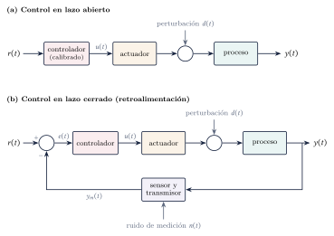
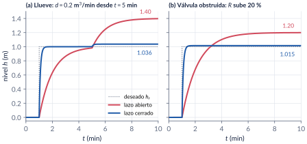
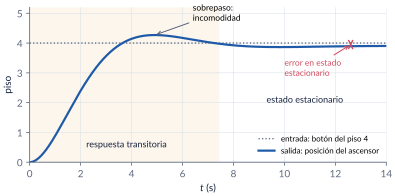
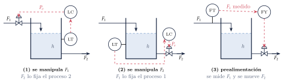
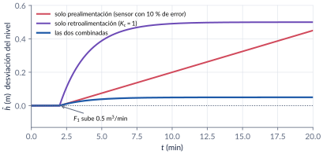
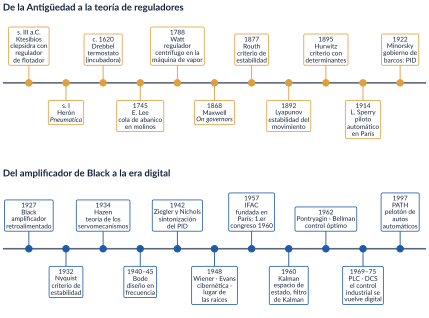
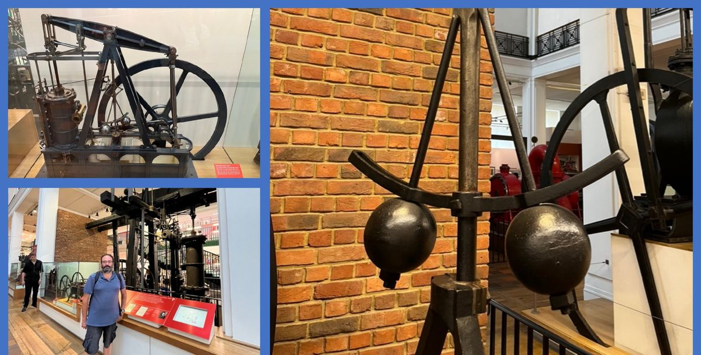
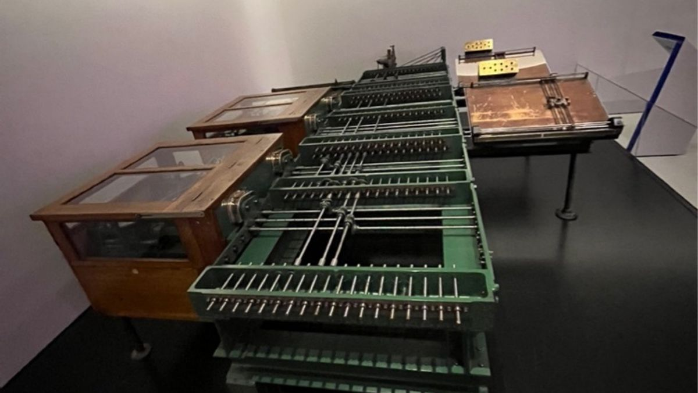

```{=html}
<div class="franja"><div class="rotulo">Parte 1 · Semana 1</div><div class="titulo">Introducción: el análisis de sistemas de control</div><div class="cita">Es que con los ojos del presente ningún pasado es tolerable… — Juan Esteban Constaín</div><svg class="bode" viewBox="0 0 600 160" preserveAspectRatio="none"><path d="M0,30 L170,30 L330,105 L420,105 L600,160" stroke="#ffffff" stroke-opacity=".12" stroke-width="10" fill="none" stroke-linejoin="round"/><path d="M0,30 C120,30 150,32 175,42 C230,65 300,98 330,104 C370,110 400,108 425,112 C480,128 540,148 600,160" stroke="#E09F3E" stroke-width="2.5" fill="none"/></svg></div>
```

¿Qué quiere decir **analizar** un **sistema de control**? En esta parte fijamos el vocabulario del curso, vemos con un tanque qué gana y qué cuesta la **retroalimentación**, aprendemos a plantear un problema de control y recorremos dos mil años de historia: de la clepsidra de Ktesibios al regulador de Watt, de Maxwell a Kalman. Terminamos con el mapa del curso.

```{=html}
<div class="botones">
  <a class="boton" href="../pdf/cap01_introduccion.pdf">⬇ Handout en PDF</a>
  <a class="boton sec" href="https://github.com/quijanon-bot/NQuijano.github.io/tree/main/fuentes/curso-control/codigo/cap01_introduccion">Códigos en GitHub</a>
  <a class="boton sec" href="#explorador">Explorador: lazo abierto vs cerrado</a>
</div>
```

::: {.receta}
[Al terminar esta parte usted podrá]{.caja-titulo}

1. Explicar qué se entiende por análisis, sistema y control, y qué hace la retroalimentación.
2. Distinguir el control en lazo abierto del control en lazo cerrado y medir, con un ejemplo, qué gana y qué cuesta retroalimentar.
3. Plantear un problema de control: objetivos, variables manipuladas y perturbaciones, mediciones, restricciones y estructura del controlador.
4. Ubicar en el tiempo las ideas del curso y saber dónde leer más.
5. Saber cómo están organizados el curso, las notas, los códigos y esta página.
:::

## Ruta de la clase

| Bloque | Qué se ve | Handout | Scripts |
|:--|:--|:--|:--|
| 1 | Análisis, sistema, control; retroalimentación; DUFF | §1.1 | — |
| 2 | Lazo abierto y lazo cerrado: el tanque con lluvia; malla abierta y lazo abierto | §1.2 | `C1_Ej1`, `crearModelo_TanqueLazos` |
| 3 | Desempeño y diseño: el ascensor | §1.3 | `C1_Ej2` |
| 4 | Plantear un problema de control: la ducha y el tanque de almacenamiento | §1.4 | `C1_Ej3` |
| 5 | Historia del control (lectura) y mapa del curso | §1.5–1.6 | — |

: Lea la sección del handout **antes** de la clase. La historia (§1.5) es de lectura. {.striped}

## Lo esencial, en una página

::: {.definicion}
[Sistema de control y retroalimentación]{.caja-titulo}

Un **sistema de control** administra el comportamiento de otro sistema para que una salida siga una referencia o rechace perturbaciones. **Retroalimentar** es medir la variable controlada, compararla con lo deseado y actuar sobre el error. Richard Murray lo resumió así: *control = dynamics, uncertainty, feedforward, feedback* (DUFF).
:::

{width=95%}

::: {.ideaclave}
[Lo que compra la retroalimentación]{.caja-titulo}

En el tanque $0.5\,\dot h=u+d-h/R$, calibrado para llegar a $1$ m, la lluvia sube el nivel a $1.40$ m en lazo abierto y a $1.036$ m en lazo cerrado con $K_c=5$: **once veces menos**, porque $1+KK_c=11$. El lazo cerrado además responde once veces más rápido. El precio: un caudal inicial de $5.5$ m³/min en lugar de $0.5$.
:::

{width=95%}

::: {.cuidado}
[Tres nombres parecidos]{.caja-titulo}

**Control en lazo abierto** es una estrategia sin retroalimentación. **Malla abierta** $G'(s)=G(s)H(s)$ es lo que recorre una señal al dar la vuelta a un lazo cerrado (estabilidad, Bode). **Lazo abierto** $G_{OL}(s)$ es la función del lazo reescrito con retroalimentación unitaria (tipo y error). En inglés, las tres se llaman *open loop*.
:::

::: {.definicion}
[Desempeño, análisis y diseño]{.caja-titulo}

El desempeño se mide con la **estabilidad**, la **respuesta transitoria** y el **error en estado estacionario**. El **análisis** determina el desempeño de un sistema dado; el **diseño** lo logra o lo modifica.
:::

{width=80%}

::: {.receta}
[Cómo plantear un problema de control]{.caja-titulo}

Objetivos · entradas (manipuladas y perturbaciones) · salidas (medidas y no medidas) · restricciones (duras y blandas) · operación (continua o por lotes) · seguridad, ambiente y economía · estructura del controlador (retroalimentación, prealimentación o ambas).
:::

{width=100%}

{width=80%}

## Explorador: lazo abierto vs lazo cerrado {#explorador}

El tanque del ejemplo 1.1. Mueva la ganancia del controlador, la lluvia, la resistencia real de la válvula de salida y el caudal máximo que puede dar la válvula de entrada.

```{=html}
<div class="explorador" id="explorador-tanque"></div>
<script src="../recursos/explorador-tiempo.js"></script>
```

::: {.pausa}
[Retos con el explorador]{.caja-titulo}

1. Con los valores iniciales, compruebe los números del handout: $1.40$ y $1.036$ m.
2. ¿Qué $K_c$ hace que la lluvia mueva el nivel menos de 1 cm? ¿Cuánto vale el pico de $u$?
3. Ponga $K_c=20$ y limite el caudal a $2$ m³/min: ¿qué pasa con la rapidez? ¿Y con el valor final?
4. Ponga $K_c=0$: ¿qué estrategia tiene? Cambie $R$ y observe.
:::

## Historia del control

```{=html}

```

El control como tecnología tiene más de dos mil años: el regulador de flotador de la **clepsidra de Ktesibios** (siglo III a.C.) ya juntaba sensor, comparador y actuador. El **regulador centrífugo** que Watt adaptó a la máquina de vapor hacia 1788 llevó a **Maxwell** (1868) a la primera teoría de estabilidad, completada por **Routh** (1877), **Vyshnegradskii** (1876) y **Hurwitz** (1895). En el siglo XX llegaron los pilotos automáticos de **Sperry**, el PID de **Minorsky** (1922), los controladores neumáticos industriales, el amplificador retroalimentado de **Black** (1927), el criterio de **Nyquist** (1932) y los diagramas de **Bode** (1940–45). Después de la guerra, **Wiener**, **Evans**, la transformada $z$, la fundación de **IFAC** (1957) y, con la carrera espacial, el espacio de estado de **Kalman** y el control óptimo de **Pontryagin** y **Bellman**. El handout (§1.5) cuenta la historia completa, con la referencia original de cada idea.

::: {layout-ncol=2}



:::

## Códigos de esta parte

Los bloques salen directamente de los archivos del [repositorio](https://github.com/quijanon-bot/NQuijano.github.io/tree/main/fuentes/curso-control/codigo/cap01_introduccion). Ejecute antes `iniciarCurso`.

::: {.panel-tabset}

### Lazo abierto y cerrado

**Lazo abierto calibrado (§1.2).**

```{.matlab include="../../codigo/cap01_introduccion/C1_Ej1_TanqueLazos.m" marca="abierto"}
```

**Lazo cerrado y el factor $1+KK_c$.**

```{.matlab include="../../codigo/cap01_introduccion/C1_Ej1_TanqueLazos.m" marca="cerrado"}
```

### Ascensor

**Transitorio y error en estado estacionario (§1.3).**

```{.matlab include="../../codigo/cap01_introduccion/C1_Ej2_Ascensor.m" marca="ascensor"}
```

### Prealimentación

**Prealimentación, retroalimentación y las dos juntas (§1.4).**

```{.matlab include="../../codigo/cap01_introduccion/C1_Ej3_Prealimentacion.m" marca="combinada"}
```

### Pruebas

`verificarCap01` comprueba los números clave del capítulo.

```{.matlab include="../../codigo/cap01_introduccion/verificarCap01.m"}
```

:::

## Modelo de Simulink

::: {.modelo}
[El modelo se construye por código]{.caja-titulo}

| Script | Modelo | Para qué |
|:--|:--|:--|
| `crearModelo_TanqueLazos.m` | el mismo tanque en lazo abierto (ganancia `Calibracion`) y en lazo cerrado (`Kc`), con lluvia activable (`Lluvia`) | ajustar a mano la calibración, encender la lluvia, intentar compensarla a mano y comparar con la retroalimentación |

Corra el script y se crea el `.slx`.
:::

## Pausas activas

::: {.pausa}
[1. Manejar un carro]{.caja-titulo}

Cuando usted conduce por una carretera con curvas, ¿quién hace de sensor, de controlador y de actuador?

<details class="respuesta"><summary>Respuesta</summary>
Los ojos son el sensor; el cerebro compara la posición con el centro del carril (la referencia) y decide; los brazos y el timón son el actuador. El viento y los baches son perturbaciones. Si cierra los ojos, el lazo se abre.
</details>
:::

::: {.pausa}
[2. Precisión a la fuerza]{.caja-titulo}

¿Qué $K_c$ hace falta para que la lluvia mueva el nivel del tanque menos de 1 cm?

<details class="respuesta"><summary>Respuesta</summary>
$0.4/(1+2K_c)<0.01$, es decir $K_c>19.5$. Con $K_c=20$, el caudal inicial es $20.5$ m³/min: cuarenta veces el de lazo abierto.
</details>
:::

::: {.pausa}
[3. Ktesibios, Watt y Black]{.caja-titulo}

¿Qué tienen en común la clepsidra, el regulador de Watt y el amplificador de Black?

<details class="respuesta"><summary>Respuesta</summary>
Los tres son lazos cerrados con retroalimentación negativa: el flotador, las bolas y la red $\beta$ miden la salida; y la válvula de entrada, la válvula de vapor y los tubos de vacío actúan.
</details>
:::

## Problemas

El handout trae 8 problemas (clasificar lazos, el tanque en detalle con saturación, plantear un problema de control, ganancia del proceso, prealimentación, moderadores y reguladores de Maxwell, el ascensor y un ensayo histórico), con soluciones seleccionadas.

```{=html}
<div class="botones"><a class="boton" href="../pdf/cap01_introduccion.pdf">Ir a los problemas (PDF, §1.8)</a></div>
```

## Para leer más

- K. J. Åström y P. R. Kumar, "Control: a perspective", *Automatica* 50(1), 2014.
- O. Mayr, *The Origins of Feedback Control*, MIT Press, 1971.
- S. Bennett, *A History of Control Engineering* (1800–1930 y 1930–1955), IET.
- C. C. Bissell, "A history of automatic control", *Springer Handbook of Automation*, 2009.
- D. S. Bernstein, "A student's guide to classical control", *IEEE Control Systems Magazine* 17(4), 1997.
- N. Quijano y C. Cotrino, "Control and automation evolution in Colombia", CCAC 2023.

::: {.profundiza}
[Correcciones respecto a la versión anterior]{.caja-titulo}

Watt no patentó el regulador centrífugo (Mead lo patentó para molinos en 1787). Sperry voló en París en 1914, no en 1912. Minorsky propuso el PID y analizó su estabilidad, sin ubicación de polos. Bode publicó en 1940–45 (1934 es la teoría de servomecanismos de Hazen). IFAC se fundó en 1957 con 18 países; RIAS en 1955. Stabilog, Dantzig y Vannevar, bien escritos. $G(s)H(s)$ es la **malla abierta**. El ejemplo del tanque ahora compara lazo abierto y cerrado con números verificados.
:::
