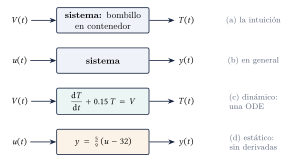
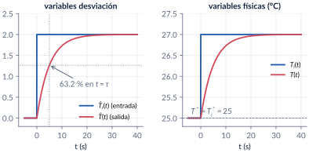
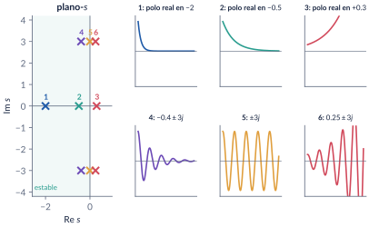
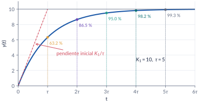

```{=html}
<div class="franja"><div class="rotulo">Parte 2 · Semanas 1–2</div><div class="titulo">Modelado I: Laplace, función de transferencia y primer orden</div><div class="cita">La ilusión es el mejor alimento espiritual, el motor del alma. No engaña, entusiasma. — Jorge Barraza</div><svg class="bode" viewBox="0 0 600 160" preserveAspectRatio="none"><path d="M0,30 L170,30 L330,105 L420,105 L600,160" stroke="#ffffff" stroke-opacity=".12" stroke-width="10" fill="none" stroke-linejoin="round"/><path d="M0,30 C120,30 150,32 175,42 C230,65 300,98 330,104 C370,110 400,108 425,112 C480,128 540,148 600,160" stroke="#E09F3E" stroke-width="2.5" fill="none"/></svg></div>
```

Todo lo que haremos en el curso (estabilidad, error, PID, Bode) se apoya en **modelos**. En esta parte construimos el primero a partir de un balance de energía, aprendemos la herramienta que convierte ecuaciones diferenciales en álgebra, la **transformada de Laplace**, y llegamos al concepto central del curso: la **función de transferencia**. Terminamos con el sistema más sencillo y más común, el de **primer orden**, y aprendemos a leer su ganancia y su constante de tiempo en una curva medida.

```{=html}
<div class="botones">
  <a class="boton" href="../pdf/cap02_modelado_primer_orden.pdf">⬇ Handout en PDF</a>
  <a class="boton sec" href="https://github.com/quijanon-bot/NQuijano.github.io/tree/main/fuentes/curso-control/codigo/cap02_modelado_primer_orden">Códigos en GitHub</a>
  <a class="boton sec" href="#explorador">Explorador del primer orden</a>
</div>
```

::: {.receta}
[Al terminar esta parte usted podrá]{.caja-titulo}

1. Distinguir señal, sistema estático y sistema dinámico, y describir un sistema con un diagrama de bloques.
2. Escribir el modelo de un proceso a partir de un balance, con sus suposiciones, en variables desviación.
3. Calcular transformadas y antitransformadas de Laplace (tabla, propiedades, fracciones parciales) y resolver ODE lineales.
4. Definir función de transferencia, polos, ceros, grado relativo y ecuación característica, y usar bien el teorema del valor final.
5. Reconocer un primer orden, leer $K_1$ y $\tau$ de su respuesta al escalón y predecir su error ante una rampa.
:::

## Ruta de las clases

| Clase | Qué se ve | Handout | Scripts |
|:--|:--|:--|:--|
| 1 | Señales y sistemas; el modelo dentro del diseño; modelos orientados al control; LTI; el tanque agitado | §2.1–2.2 | `C2_Ej1` |
| 2 | Historia y definición de Laplace; tabla y propiedades | §2.3 | `C2_Ej2` |
| 3 | Resolver ODE: polos simples, múltiples y complejos; de los polos a los modos | §2.4 | `C2_Ej3`–`C2_Ej5` |
| 4 | Función de transferencia, valor final, el tanque otra vez, primer orden | §2.5–2.8 | `C2_Ej6`–`C2_Ej8`, `crearModelo_Termico` |

: Lea la sección del handout **antes** de cada clase. {.striped}

## Lo esencial, en una página

::: {.definicion}
[Sistema dinámico]{.caja-titulo}

Un **sistema** transforma una señal de entrada $u(t)$ en una de salida $y(t)$. Es **dinámico** si la relación es una ecuación diferencial (la salida *recuerda* su historia) y **estático** si no hay derivadas.
:::

{width=85%}

::: {.ideaclave}
[Variables desviación]{.caja-titulo}

En el equilibrio se definen $\dev{x}(t)=x(t)-\eq{x}$. Ponen el origen en el punto de operación: el sistema arranca con condiciones iniciales nulas, que es lo que pide la función de transferencia. Para volver a la variable física se suma el equilibrio. El tanque agitado queda
$$
\tau\,\frac{\dif \dev{T}}{\dif t}+\dev{T}=\dev{T}_i,\qquad \tau=\frac{VC_v}{fC_p}.
$$
:::

{width=95%}

::: {.definicion}
[Transformada de Laplace]{.caja-titulo}

$$
\Lap{x(t)}=X(s)=\int_0^\infty x(t)\,e^{-st}\,\dif t,\qquad
\frac{\dif x}{\dif t}\;\leftrightarrow\; sX(s)-x(0).
$$
Las derivadas se vuelven productos por $s$ **y las condiciones iniciales aparecen solas**.
:::

| $x(t)$ | $X(s)$ | $x(t)$ | $X(s)$ |
|:--:|:--:|:--:|:--:|
| $\delta(t)$ | $1$ | $t\,e^{-at}$ | $1/(s+a)^2$ |
| $\escalon(t)$ | $1/s$ | $\sin\omega t$ | $\omega/(s^2+\omega^2)$ |
| $t$ | $1/s^2$ | $\cos\omega t$ | $s/(s^2+\omega^2)$ |
| $e^{-at}$ | $1/(s+a)$ | $e^{-at}\sin\omega t$ | $\omega/[(s+a)^2+\omega^2]$ |

: Los pares que más se usan (la tabla completa está en el handout).

{width=95%}

::: {.definicion}
[Función de transferencia]{.caja-titulo}

$T(s)=Y(s)/U(s)$ con **condiciones iniciales nulas**. Propia si $n\geq m$; grado relativo $n-m$; el denominador igualado a cero es la **ecuación característica** y sus raíces son los polos.
:::

::: {.cuidado}
[El teorema del valor final miente si no se revisan los polos]{.caja-titulo}

$\lim_{t\to\infty}y(t)=\lim_{s\to0}sY(s)$ **solo** si todos los polos de $sY(s)$ tienen parte real negativa. Con $Y=1/(s-2)$ la fórmula da $0$, pero $y(t)=e^{2t}$ diverge.
:::

{width=88%}

| Entrada | Respuesta | Lo que se lee |
|:--|:--|:--|
| escalón unitario | $y=K_1(1-e^{-t/\tau})$ | valor final $K_1$, 63.2 % en $\tau$, $\ts\approx4\tau$, pendiente inicial $K_1/\tau$ |
| rampa $u=t$ | $y=K_1(t-\tau+\tau e^{-t/\tau})$ | sigue la rampa atrasada $\tau$; error final $K_1\tau$ |

: El sistema de primer orden en dos renglones.

## Explorador del primer orden {#explorador}

Mueva $K_1$ y $\tau$ y cambie la entrada. Compruebe que $K_1$ cambia **cuánto** y $\tau$ cambia **qué tan rápido**, y que ante la rampa el error final es $K_1\tau$.

```{=html}
<div class="explorador" id="explorador-primer-orden"></div>
<script src="../recursos/explorador-tiempo.js"></script>
```

::: {.pausa}
[Retos con el explorador]{.caja-titulo}

1. Ponga $K_1=2.4$ y $\tau=20$. ¿Cuánto tarda en llegar al 98 %? Compare con $4\tau$.
2. Con la rampa y $K_1=1$, ¿qué $\tau$ deja un error final de $2$? ¿Y si además $K_1=2$?
3. Duplique $\tau$: ¿qué pasa con la pendiente inicial? ¿Y con el valor final?
:::

## Códigos de esta parte

Los bloques salen directamente de los archivos del [repositorio](https://github.com/quijanon-bot/NQuijano.github.io/tree/main/fuentes/curso-control/codigo/cap02_modelado_primer_orden). Ejecute antes `iniciarCurso`. Los que usan `syms`, `laplace` o `dsolve` necesitan el *Symbolic Math Toolbox*.

::: {.panel-tabset}

### Laplace

**Tabla de transformadas (§2.3).**

```{.matlab include="../../codigo/cap02_modelado_primer_orden/C2_Ej2_Laplace.m" marca="transformadas"}
```

**Propiedades.**

```{.matlab include="../../codigo/cap02_modelado_primer_orden/C2_Ej2_Laplace.m" marca="propiedades"}
```

### Resolver ODE

**El calibrador óptico con Laplace simbólico (§2.4).**

```{.matlab include="../../codigo/cap02_modelado_primer_orden/C2_Ej3_Motor.m" marca="simbolico"}
```

**Residuos, polos y ceros.**

```{.matlab include="../../codigo/cap02_modelado_primer_orden/C2_Ej3_Motor.m" marca="residue"}
```

**Polos complejos.**

```{.matlab include="../../codigo/cap02_modelado_primer_orden/C2_Ej4_FraccionesParciales.m" marca="complejos"}
```

**Sin transformar: `dsolve` y `ode45`.**

```{.matlab include="../../codigo/cap02_modelado_primer_orden/C2_Ej5_dsolve.m" marca="dsolve"}
```

### Transferencia y primer orden

**Valor final: primero los polos (§2.6).**

```{.matlab include="../../codigo/cap02_modelado_primer_orden/C2_Ej6_ValorFinal.m" marca="tvf"}
```

**El tanque agitado (§2.7).**

```{.matlab include="../../codigo/cap02_modelado_primer_orden/C2_Ej7_Termico.m" marca="termico"}
```

**Primer orden ante la rampa (§2.8).**

```{.matlab include="../../codigo/cap02_modelado_primer_orden/C2_Ej8_PrimerOrden.m" marca="rampa"}
```

### Pruebas

`verificarCap02` comprueba los números clave del capítulo (no necesita el *Symbolic Math Toolbox*).

```{.matlab include="../../codigo/cap02_modelado_primer_orden/verificarCap02.m"}
```

:::

## Modelos de Simulink

::: {.modelo}
[Los modelos se construyen por código]{.caja-titulo}

| Script | Modelo | Para qué |
|:--|:--|:--|
| `crearModelo_Termico.m` | escalón o rampa → $K_1/(\tau s+1)$ → $+\eq{T}$ | ver las variables desviación y las físicas lado a lado; verificar el problema de identificación |

Corra el script y se crea el `.slx`.
:::

## Pausas activas

::: {.pausa}
[1. El bombillo]{.caja-titulo}

La señal $T(t)=20-3e^{-0.15t}$ cumple $\dot T+0.15T=V$ con $V$ constante. ¿Cuánto vale $V$? ¿Y $T(0)$?

<details class="respuesta"><summary>Respuesta</summary>
En estado estacionario $0.15\cdot20=V$, luego $V=3$; y $T(0)=17$ °C.
</details>
:::

::: {.pausa}
[2. Apagar un modo]{.caja-titulo}

En $\ddot x+5\dot x+6x=0$ con $x(0)=1$, ¿qué $\dot x(0)$ hace desaparecer el modo $e^{-3t}$?

<details class="respuesta"><summary>Respuesta</summary>
$\dot x(0)=-2$: el residuo en $-3$ es $-(2+\dot x(0))$. Entonces $x(t)=e^{-2t}$.
</details>
:::

::: {.pausa}
[3. Más caudal]{.caja-titulo}

Si se duplica el caudal del tanque agitado, ¿la respuesta es más rápida o más lenta? ¿Cambia el valor final?

<details class="respuesta"><summary>Respuesta</summary>
Más rápida ($\tau$ se reduce a la mitad); el valor final no cambia (la ganancia sigue siendo 1).
</details>
:::

## Problemas

El handout trae 8 problemas (transformadas, fracciones parciales, ODE con condiciones iniciales, funciones de transferencia e identificación de un proceso térmico) con soluciones seleccionadas. Los marcados **[M]** se resuelven en MATLAB/Simulink.

```{=html}
<div class="botones"><a class="boton" href="../pdf/cap02_modelado_primer_orden.pdf">Ir a los problemas (PDF, §2.10)</a></div>
```

::: {.profundiza}
[Correcciones respecto a la versión anterior]{.caja-titulo}

Equilibrio $\eq{T}$ (antes $\bar T$) y escalón $\escalon(t)$ (antes $u(t)$, que chocaba con la entrada). Polos complejos $-\tfrac13\pm j\tfrac{\sqrt2}{3}$ (faltaba la $j$). Se eliminó la "inversión del tiempo", que no vale para la transformada unilateral. Error ante rampa: $K_1\tau(1-e^{-t/\tau})$ (había un signo errado). Todos los números se verificaron de forma independiente.
:::
