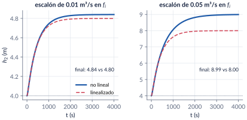
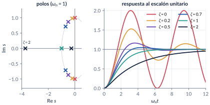
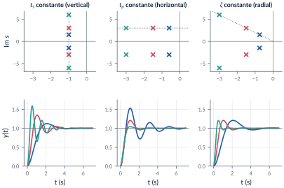
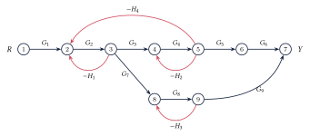
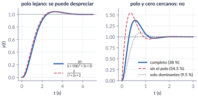

```{=html}
<div class="franja"><div class="rotulo">Parte 3 · Semanas 3–4</div><div class="titulo">Modelado II: linealización, segundo orden y diagramas de bloques</div><div class="cita">Mi misión es matar el tiempo, la suya, matarme a mí. Se está perfectamente a gusto entre asesinos. — Emil Michel Cioran</div><svg class="bode" viewBox="0 0 600 160" preserveAspectRatio="none"><path d="M0,30 L170,30 L330,105 L420,105 L600,160" stroke="#ffffff" stroke-opacity=".12" stroke-width="10" fill="none" stroke-linejoin="round"/><path d="M0,30 C120,30 150,32 175,42 C230,65 300,98 330,104 C370,110 400,108 425,112 C480,128 540,148 600,160" stroke="#E09F3E" stroke-width="2.5" fill="none"/></svg></div>
```

Los procesos reales casi nunca son lineales, y casi nunca son un solo bloque. En esta parte aprendemos a **linealizar** alrededor de un punto de operación, llegamos al otro gran protagonista de los modelos orientados al control, el sistema de **segundo orden**, y traducimos sus polos en números que se miden en una respuesta: tiempo de subida, de pico, sobrepico y tiempo de establecimiento. Luego juntamos bloques: **álgebra de bloques** y **ley de Mason**. Cerramos con los sistemas de orden superior: cuándo se pueden aproximar por sus **polos dominantes** y cómo simplificarlos.

```{=html}
<div class="botones">
  <a class="boton" href="../pdf/cap03_modelado_segundo_orden.pdf">⬇ Handout en PDF</a>
  <a class="boton sec" href="https://github.com/quijanon-bot/NQuijano.github.io/tree/main/fuentes/curso-control/codigo/cap03_modelado_segundo_orden">Códigos en GitHub</a>
  <a class="boton sec" href="#explorador">Explorador del segundo orden</a>
</div>
```

::: {.receta}
[Al terminar esta parte usted podrá]{.caja-titulo}

1. Linealizar un modelo no lineal alrededor de un punto de operación y obtener su función de transferencia en variables desviación.
2. Reconocer un segundo orden en forma estándar, clasificarlo por su $\zeta$ y ubicar sus polos.
3. Calcular $t_r$, $\tp$, $\OS$ y $\ts$ de un subamortiguado y traducir especificaciones en una región del plano-$s$.
4. Reducir diagramas de bloques con álgebra de bloques y con la ley de Mason, y escribir la ecuación característica.
5. Decidir cuándo un sistema de orden superior se puede aproximar por sus polos dominantes y simplificarlo.
:::

## Ruta de las clases

| Clase | Qué se ve | Handout | Scripts |
|:--|:--|:--|:--|
| 1 | ¿Y si no es lineal? Linealización con Taylor; el reactor; los dos tanques | §3.1–3.3 | `C3_Ej1`, `C3_Ej2`, `crearModelo_Tanques` |
| 2 | Forma estándar, casos por $\zeta$, masa-resorte; $t_r$, $\tp$, $\OS$, $\ts$; el plano-$s$ | §3.4–3.5 | `C3_Ej3` |
| 3 | Diagramas de bloques; diseño de $K$ y $K_h$; ley de Mason | §3.6–3.8 | `C3_Ej4`–`C3_Ej6`, `crearModelo_Servo` |
| 4 | Polos dominantes, efecto de los ceros, reducción de orden | §3.9–3.10 | `C3_Ej7`, `C3_Ej8` |

: Lea la sección del handout **antes** de cada clase. {.striped}

## Lo esencial, en una página

::: {.definicion}
[Linealización]{.caja-titulo}

Alrededor de un equilibrio $(\eq{x},\eq{u})$ cada no linealidad se reemplaza por su recta tangente:
$$
\dot{\dev{x}}\approx\left.\frac{\partial f}{\partial x}\right|_\ast\dev{x}+\left.\frac{\partial f}{\partial u}\right|_\ast\dev{u}.
$$
Solo vale **cerca** del punto: con escalones grandes el modelo lineal se equivoca.
:::

{width=95%}

::: {.cuidado}
[Dos tanques por gravedad nunca oscilan]{.caja-titulo}

En la planta de dos tanques $C_2=-C_1$ siempre, y entonces $\zeta\geq1$ para cualesquiera áreas y válvulas. El ejemplo subamortiguado de la versión anterior usaba valores que no corresponden a ningún par de tanques reales. Para ver oscilaciones usamos una masa con resorte y amortiguador.
:::

::: {.definicion}
[Segundo orden]{.caja-titulo}

$$
T(s)=K\,\frac{\wn^2}{s^2+2\zeta\wn s+\wn^2},\qquad p_{1,2}=-\zeta\wn\pm j\,\wn\sqrt{1-\zeta^2}.
$$
$\zeta=0$: oscila para siempre; $0<\zeta<1$: subamortiguado; $\zeta=1$: crítico; $\zeta>1$: sobreamortiguado.
:::

{width=95%}

| característica | fórmula | la fija |
|:--|:--:|:--|
| tiempo de subida (0–100 %) | $t_r=(\pi-\cos^{-1}\zeta)/\omega_d$ | $\zeta$ y $\wn$ |
| tiempo de pico | $\tp=\pi/\omega_d$ | la parte imaginaria del polo |
| sobrepico | $\OS=100\,e^{-\zeta\pi/\sqrt{1-\zeta^2}}$ | solo $\zeta$ (el ángulo) |
| establecimiento (2 %) | $\ts\approx4/(\zeta\wn)$ | la parte real del polo |

: Subamortiguado, con $\omega_d=\wn\sqrt{1-\zeta^2}$. `stepinfo` usa $t_r$ de 10–90 %.

{width=95%}

::: {.definicion}
[Bloques y Mason]{.caja-titulo}

Serie: $G_1G_2$. Paralelo: $G_1+G_2$. Retroalimentación negativa: $\dfrac{G}{1+G\Hs}$. Ley de Mason:
$$
T=\frac{1}{\Delta}\sum_k P_k\Delta_k,\qquad \Delta=1-\sum L_a+\sum L_bL_c-\cdots
$$
El **discriminante** $\Delta$ es el denominador: $\Delta=0$ es la **ecuación característica**.
:::

{width=85%}

::: {.ideaclave}
[Polos dominantes]{.caja-titulo}

Un polo extra se puede despreciar si está unas diez veces más a la izquierda que los dominantes (criterio de Clement), **conservando la ganancia DC**. Un cero cerca de los dominantes, en cambio, cambia mucho el sobrepico.
:::

{width=95%}

## Explorador del segundo orden {#explorador}

Mueva $\zeta$, $\wn$ y la ganancia. Observe los polos en el plano-$s$, la respuesta al escalón con sus envolventes y la banda del 2 %, y compare las fórmulas con lo que se mide sobre la curva.

```{=html}
<div class="explorador" id="explorador-segundo-orden"></div>
<script src="../recursos/explorador-tiempo.js"></script>
```

::: {.pausa}
[Retos con el explorador]{.caja-titulo}

1. Busque el $\zeta$ que da 20 % de sobrepico y el $\wn$ que da $\tp=1$ s. Compárelos con el diseño del servo ($\zeta=0.456$, $\wn=3.53$).
2. Con $\zeta=0.4$, duplique $\wn$: ¿qué cambia y qué no?
3. Encuentre el $\zeta$ para el cual el $\ts$ medido es mínimo con $\wn=1$. ¿Coincide con $4/(\zeta\wn)$?
:::

## Códigos de esta parte

Los bloques salen directamente de los archivos del [repositorio](https://github.com/quijanon-bot/NQuijano.github.io/tree/main/fuentes/curso-control/codigo/cap03_modelado_segundo_orden). Ejecute antes `iniciarCurso`.

::: {.panel-tabset}

### Linealización

**Derivada simbólica (§3.2).**

```{.matlab include="../../codigo/cap03_modelado_segundo_orden/C3_Ej1_Linealizacion.m" marca="simbolica"}
```

**El reactor con `jacobian`.**

```{.matlab include="../../codigo/cap03_modelado_segundo_orden/C3_Ej1_Linealizacion.m" marca="reactor"}
```

**Los dos tanques: equilibrio, coeficientes y función de transferencia (§3.3).**

```{.matlab include="../../codigo/cap03_modelado_segundo_orden/C3_Ej2_Tanques.m" marca="tanques"}
```

**Lineal contra no lineal.**

```{.matlab include="../../codigo/cap03_modelado_segundo_orden/C3_Ej2_Tanques.m" marca="comparar"}
```

### Segundo orden

**Fórmulas contra `stepinfo` (§3.5).**

```{.matlab include="../../codigo/cap03_modelado_segundo_orden/C3_Ej3_SegundoOrden.m" marca="formulas"}
```

**La función del curso `segundoOrden`.**

```{.matlab include="../../codigo/comun/segundoOrden.m"}
```

**Diseño de $K$ y $K_h$ (§3.7).**

```{.matlab include="../../codigo/cap03_modelado_segundo_orden/C3_Ej4_DisenoKKh.m" marca="diseno"}
```

### Bloques y Mason

**Álgebra de bloques (§3.6).**

```{.matlab include="../../codigo/cap03_modelado_segundo_orden/C3_Ej5_Bloques.m" marca="algebra"}
```

**Mason contra resolver las ecuaciones de los nodos (§3.8).**

```{.matlab include="../../codigo/cap03_modelado_segundo_orden/C3_Ej6_Mason.m" marca="mason"}
```

### Orden superior

**Un cero y un polo que no se pueden ignorar (§3.9).**

```{.matlab include="../../codigo/cap03_modelado_segundo_orden/C3_Ej7_Dominantes.m" marca="cero"}
```

**Igualación de momentos (§3.10).**

```{.matlab include="../../codigo/cap03_modelado_segundo_orden/C3_Ej8_Reduccion.m" marca="momentos"}
```

### Pruebas

`verificarCap03` comprueba los números clave del capítulo.

```{.matlab include="../../codigo/cap03_modelado_segundo_orden/verificarCap03.m"}
```

:::

## Modelos de Simulink

::: {.modelo}
[Los modelos se construyen por código]{.caja-titulo}

| Script | Modelo | Para qué |
|:--|:--|:--|
| `crearModelo_Tanques.m` | los dos tanques no lineales al lado del modelo linealizado | ver cuándo deja de valer la linealización |
| `crearModelo_Servo.m` | servo $K\to1/(s+1)\to1/s$ con retroalimentación de posición y tacómetro | comprobar el diseño de $K$ y $K_h$ y ver qué hace cada uno |

Corra el script y se crea el `.slx`.
:::

## Pausas activas

::: {.pausa}
[1. Un tanque con descarga libre]{.caja-titulo}

Linealice $A\dot h=q-c\sqrt h$ ($A=2$, $c=0.5$) alrededor de $\eq{q}=1$. ¿Cuánto valen $K_1$ y $\tau$?

<details class="respuesta"><summary>Respuesta</summary>
$\eq{h}=4$; la derivada de $c\sqrt h$ es $c/(2\sqrt{\eq{h}})=0.125$; entonces $\dfrac{\hat H}{\hat Q}=\dfrac{8}{16s+1}$: $K_1=8$ y $\tau=16$ s.
</details>
:::

::: {.pausa}
[2. Polos en $-2\pm j4$]{.caja-titulo}

Sin simular: ¿cuánto valen $\wn$, $\zeta$, $\tp$, $\OS$ y $\ts$?

<details class="respuesta"><summary>Respuesta</summary>
$\wn=4.47$, $\zeta=0.447$, $\tp=0.785$ s, $\OS=20.8\,\%$ y $\ts\approx2$ s.
</details>
:::

::: {.pausa}
[3. Mucha ganancia de malla]{.caja-titulo}

Si $G\Hs\gg1$, ¿a qué se parece $Y/R=G/(1+G\Hs)$? ¿Qué consecuencia práctica tiene?

<details class="respuesta"><summary>Respuesta</summary>
$Y/R\approx1/\Hs$: el lazo cerrado depende casi solo del sensor. Por eso Black pudo construir amplificadores precisos con tubos imprecisos.
</details>
:::

## Problemas

El handout trae 11 problemas (linealización, los tanques con otros datos, la demostración de que nunca oscilan, cuatro segundos órdenes, diseño con tacómetro, región de diseño, un sistema multilazo con Mason, aproximaciones de orden reducido y un resorte no lineal), con soluciones seleccionadas.

```{=html}
<div class="botones"><a class="boton" href="../pdf/cap03_modelado_segundo_orden.pdf">Ir a los problemas (PDF, §3.12)</a></div>
```

::: {.profundiza}
[Correcciones respecto a la versión anterior]{.caja-titulo}

El ejemplo numérico de los dos tanques no era físico ($C_2=-C_1$ siempre y $\zeta\geq1$): se reemplazó por datos reales. $\beta=\cos^{-1}\zeta$ (decía $\cos\zeta$). Sobrepico $\OS$ (antes $MP$), tiempo de *establecimiento* (no de asentamiento), $\Delta$ es el *discriminante*. Ejemplo con cero y polo adicionales: 54.5 % y 38.0 %, $\ts=1.47$ y $1.59$ s. El ejercicio de reducción con un cero se reformuló porque su respuesta no satisfacía las ecuaciones de momentos.
:::
