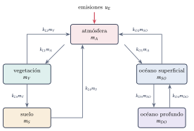
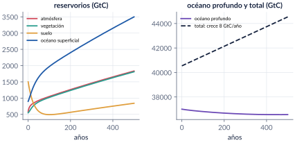
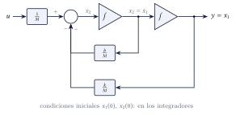
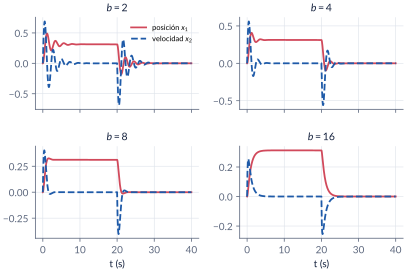
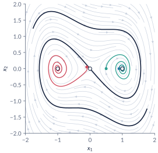
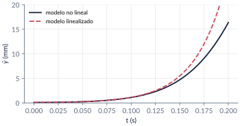
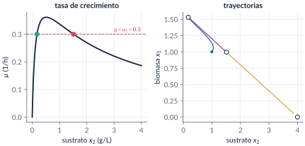

```{=html}
<div class="franja"><div class="rotulo">Parte 4 · Semanas 4–5</div><div class="titulo">Representación en espacio de estado</div><div class="cita">Otra consecuencia es que se está impulsando que la educación sea vista como una capacitación que solo conduce al trabajo, y no como un medio que conduce al pensamiento crítico y a la transformación. — Junot Díaz</div><svg class="bode" viewBox="0 0 600 160" preserveAspectRatio="none"><path d="M0,30 L170,30 L330,105 L420,105 L600,160" stroke="#ffffff" stroke-opacity=".12" stroke-width="10" fill="none" stroke-linejoin="round"/><path d="M0,30 C120,30 150,32 175,42 C230,65 300,98 330,104 C370,110 400,108 425,112 C480,128 540,148 600,160" stroke="#E09F3E" stroke-width="2.5" fill="none"/></svg></div>
```

Hasta ahora describimos los sistemas con funciones de transferencia: una relación entre una entrada y una salida. La **representación en espacio de estado** los describe con ecuaciones diferenciales de **primer orden**, una por cada variable que hace falta para conocer su futuro: el **estado**. Es más general (sistemas no lineales, de varias entradas y salidas) y muestra lo que pasa por dentro. En esta parte escribimos modelos de estado —en particular en **variables de fase**—, pasamos de función de transferencia a estado y de vuelta, resolvemos la ecuación de estado con la **matriz de transición** $e^{\mathbb A t}$ y linealizamos modelos de varias variables: un levitador magnético, un bioreactor y la ecuación de Duffing.

```{=html}
<div class="botones">
  <a class="boton" href="../pdf/cap04_espacio_estado.pdf">⬇ Handout en PDF</a>
  <a class="boton sec" href="https://github.com/quijanon-bot/NQuijano.github.io/tree/main/fuentes/curso-control/codigo/cap04_espacio_estado">Códigos en GitHub</a>
</div>
```

::: {.receta}
[Al terminar esta parte usted podrá]{.caja-titulo}

1. Definir el estado de un sistema y escribir su representación en espacio de estado, en particular en variables de fase.
2. Pasar de una función de transferencia a una representación de estado, y de vuelta, y relacionar los valores propios de $\mathbb A$ con los polos.
3. Resolver la ecuación de estado con la matriz de transición $\Phi(t)=e^{\mathbb A t}$.
4. Linealizar un modelo no lineal de varias variables alrededor de un equilibrio y escribirlo en espacio de estado.
:::

## Ruta de las clases

| Clase | Qué se ve | Handout | Scripts |
|:--|:--|:--|:--|
| 1 | Historia; el ciclo del carbono; el estado; variables de fase; masa-resorte y computador analógico; de la función de transferencia al estado | §4.1–4.4 | `C4_Ej1`, `C4_Ej2`, `C4_Ej5`, `crearModelo_MasaResorte` |
| 2 | Matriz de transición; del estado a la función de transferencia; valores propios y polos; linealización: Duffing, levitador, bioreactor | §4.5–4.7 | `C4_Ej3`, `C4_Ej4`, `C4_Ej6`, `C4_Ej7`, `crearModelo_Bioreactor` |

: Lea la sección del handout **antes** de cada clase. {.striped}

## Lo esencial, en una página

::: {.definicion}
[Estado y modelo lineal]{.caja-titulo}

El **estado** es el conjunto más pequeño de variables cuyo valor en $t_0$, junto con las entradas para $t\ge t_0$, determina todo el comportamiento futuro. Su número (el orden) es único; las variables no. Para un sistema lineal e invariante,

$$
\dot x=\mathbb A x+\mathbb B u,\qquad y=\mathbb C x+\mathbb D u .
$$
:::

{width=80%}

{width=100%}

::: {.definicion}
[Variables de fase]{.caja-titulo}

Para $y^{(n)}+a_{n-1}y^{(n-1)}+\dots+a_0y=b_0u$, con $x_1=y$, $x_2=\dot y$, …, $x_n=y^{(n-1)}$:

$$
\mathbb A=\begin{bmatrix}0&1&\cdots&0\\\vdots&&\ddots&\vdots\\0&0&\cdots&1\\-a_0&-a_1&\cdots&-a_{n-1}\end{bmatrix},\qquad
\mathbb B=\begin{bmatrix}0\\\vdots\\0\\b_0\end{bmatrix},\qquad
\mathbb C=\begin{bmatrix}1&0&\cdots&0\end{bmatrix}.
$$

Si hay ceros, se usa una variable intermedia $Z(s)=U(s)/\text{den}(s)$ y los coeficientes del numerador van en $\mathbb C$. `tf2ss` de MATLAB numera los estados al revés.
:::

{width=85%}

{width=95%}

::: {.definicion}
[Solución y función de transferencia]{.caja-titulo}

$$
x(t)=e^{\mathbb A t}x(0)+\int_0^t e^{\mathbb A(t-\tau)}\mathbb B\,u(\tau)\,\mathrm d\tau,\qquad
\Phi(t)=e^{\mathbb A t}=\mathcal L^{-1}\{(s\mathbb I-\mathbb A)^{-1}\},
$$

$$
G(s)=\mathbb C(s\mathbb I-\mathbb A)^{-1}\mathbb B+\mathbb D .
$$

Los polos de $G$ son valores propios de $\mathbb A$, pero una cancelación puede esconder valores propios. Un cambio de variables $x=\mathbb T\bar x$ cambia las matrices y no cambia $G$ ni los valores propios.
:::

::: {.cuidado}
[Una función de transferencia que esconde modos]{.caja-titulo}

Con $\mathbb A$ de valores propios $-1$, $-2$, $-3$ y $\mathbb C=[2\;\,3\;\,1]$, $G(s)=\dfrac{(s+1)(s+2)}{(s+1)(s+2)(s+3)}=\dfrac{1}{s+3}$. Los modos $e^{-t}$ y $e^{-2t}$ siguen en el estado, pero no llegan a la salida.
:::

::: {.definicion}
[Linealización]{.caja-titulo}

Alrededor de un equilibrio $f(x^*,u^*)=0$: $\dot{\hat x}=\mathbb A\hat x+\mathbb B\hat u$ con $a_{ij}=\partial f_i/\partial x_j$ y $b_{ij}=\partial f_i/\partial u_j$ evaluadas en $(x^*,u^*)$. Cada equilibrio tiene su propio modelo.
:::

{width=55%}

{width=75%}

{width=100%}

## Códigos de esta parte

Los bloques salen directamente de los archivos del [repositorio](https://github.com/quijanon-bot/NQuijano.github.io/tree/main/fuentes/curso-control/codigo/cap04_espacio_estado). Ejecute antes `iniciarCurso`.

::: {.panel-tabset}

### Masa-resorte

**Modelo en variables de fase (§4.3).**

```{.matlab include="../../codigo/cap04_espacio_estado/C4_Ej1_MasaResorte.m" marca="fase"}
```

**Cuatro amortiguamientos.**

```{.matlab include="../../codigo/cap04_espacio_estado/C4_Ej1_MasaResorte.m" marca="simulacion"}
```

### FT → estado

**Variables de fase (§4.4).**

```{.matlab include="../../codigo/cap04_espacio_estado/C4_Ej2_FTaEstado.m" marca="fase"}
```

**Con ceros: la función `variablesFase`.**

```{.matlab include="../../codigo/cap04_espacio_estado/C4_Ej2_FTaEstado.m" marca="numerador"}
```

**`tf2ss` y el orden de los estados.**

```{.matlab include="../../codigo/cap04_espacio_estado/C4_Ej2_FTaEstado.m" marca="matlab"}
```

### Transición

**Resolvente y antitransformada (§4.5).**

```{.matlab include="../../codigo/cap04_espacio_estado/C4_Ej3_Transicion.m" marca="simbolico"}
```

**`expm` y sus propiedades.**

```{.matlab include="../../codigo/cap04_espacio_estado/C4_Ej3_Transicion.m" marca="numerico"}
```

**Respuesta forzada.**

```{.matlab include="../../codigo/cap04_espacio_estado/C4_Ej3_Transicion.m" marca="forzada"}
```

### Estado → FT

**`ss2tf`, `eig`, `dcgain` (§4.6).**

```{.matlab include="../../codigo/cap04_espacio_estado/C4_Ej4_EstadoaFT.m" marca="ss2tf"}
```

**Cancelaciones.**

```{.matlab include="../../codigo/cap04_espacio_estado/C4_Ej4_EstadoaFT.m" marca="cancelacion"}
```

**Forma diagonal.**

```{.matlab include="../../codigo/cap04_espacio_estado/C4_Ej4_EstadoaFT.m" marca="similitud"}
```

### Carbono

**Matrices y valores propios (§4.2).**

```{.matlab include="../../codigo/cap04_espacio_estado/C4_Ej5_Carbono.m" marca="matrices"}
```

**500 años de emisiones.**

```{.matlab include="../../codigo/cap04_espacio_estado/C4_Ej5_Carbono.m" marca="simulacion"}
```

### Linealización

**Duffing (§4.7).**

```{.matlab include="../../codigo/cap04_espacio_estado/C4_Ej6_Linealizacion.m" marca="duffing"}
```

**Levitador magnético.**

```{.matlab include="../../codigo/cap04_espacio_estado/C4_Ej6_Linealizacion.m" marca="levitador"}
```

**Bioreactor: equilibrios.**

```{.matlab include="../../codigo/cap04_espacio_estado/C4_Ej7_Bioreactor.m" marca="equilibrios"}
```

**Bioreactor: jacobianos y funciones de transferencia.**

```{.matlab include="../../codigo/cap04_espacio_estado/C4_Ej7_Bioreactor.m" marca="jacobiano"}
```

### Pruebas

`verificarCap04` comprueba los números clave del capítulo.

```{.matlab include="../../codigo/cap04_espacio_estado/verificarCap04.m"}
```

:::

## Modelos de Simulink

::: {.modelo}
[Los modelos se construyen por código]{.caja-titulo}

| Script | Modelo | Para qué |
|:--|:--|:--|
| `crearModelo_MasaResorte.m` | la masa-resorte con dos *Integrator*, una *Sum* y dos *Gain*, y un pulso de 5 N | ver el computador analógico en Simulink y cambiar $b$ |
| `crearModelo_Bioreactor.m` | el bioreactor no lineal con dos entradas y los dos estados como salidas | simular, y linealizar con `trim` y `linmod` |

Corra el script y se crea el `.slx`.
:::

## Pausas activas

::: {.pausa}
[1. ¿Cuántos estados?]{.caja-titulo}

Un circuito RLC en serie, ¿cuántas variables de estado tiene? Proponga dos elecciones.

<details class="respuesta"><summary>Respuesta</summary>
Dos: el voltaje del condensador y la corriente de la bobina; o la carga del condensador y su derivada (variables de fase).
</details>
:::

::: {.pausa}
[2. Grado igual]{.caja-titulo}

¿Qué pasa con $\mathbb D$ en $\dfrac{2s+3}{s+1}$?

<details class="respuesta"><summary>Respuesta</summary>
$\dfrac{2s+3}{s+1}=2+\dfrac{1}{s+1}$: $\mathbb D=2$, $\mathbb A=-1$, $\mathbb B=1$, $\mathbb C=1$.
</details>
:::

::: {.pausa}
[3. Un solo modo]{.caja-titulo}

Con $\mathbb A=\begin{bmatrix}0&1\\-2&-3\end{bmatrix}$ y $x(0)=[1\;\,{-2}]^\top$, sin entrada, ¿qué modo aparece?

<details class="respuesta"><summary>Respuesta</summary>
Solo $e^{-2t}$: $[1\;\,{-2}]^\top$ es vector propio con valor propio $-2$, y $x(t)=e^{-2t}[1\;\,{-2}]^\top$.
</details>
:::

## Problemas

El handout trae 8 problemas (variables de fase, resolvente y polos, matriz de transición, levitador, ciclo del carbono, bioreactor, valores propios contra polos, Duffing), con soluciones seleccionadas.

```{=html}
<div class="botones"><a class="boton" href="../pdf/cap04_espacio_estado.pdf">Ir a los problemas (PDF, §4.9)</a></div>
```

::: {.profundiza}
[Correcciones respecto a la versión anterior]{.caja-titulo}

En el levitador faltaba la constante $C$ en la ecuación de estado (y un cuadrado en $a_{21}$); ahora $x_3^*=\sqrt{Mgy^*/C}$ y $a_{21}=g/y^*$. En el ejemplo del determinante, el segundo cofactor es $C_{22}$. En el bioreactor, la cuarta función de transferencia repetía la tercera, y los números se recalcularon con el jacobiano analítico. El truco con `canon(…,'companion')` se reemplazó por invertir el orden de los estados. En la historia, Lefschetz dirigió el centro de matemáticas del RIAS (no lo creó) y Pontryagin aportó el principio del máximo.
:::
