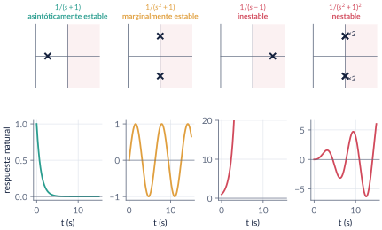
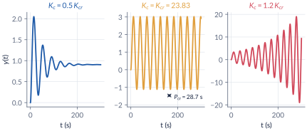
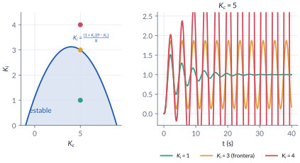
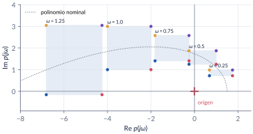
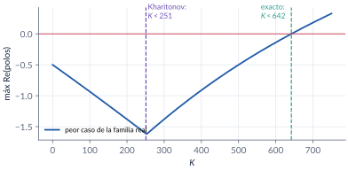

```{=html}
<div class="franja"><div class="rotulo">Parte 5 · Semana 6</div><div class="titulo">Estabilidad</div><div class="cita">En la cocina, la educación y el amor la rapidez va en contra del placer y la calidad. — Julián de Zubiría Samper</div><svg class="bode" viewBox="0 0 600 160" preserveAspectRatio="none"><path d="M0,30 L170,30 L330,105 L420,105 L600,160" stroke="#ffffff" stroke-opacity=".12" stroke-width="10" fill="none" stroke-linejoin="round"/><path d="M0,30 C120,30 150,32 175,42 C230,65 300,98 330,104 C370,110 400,108 425,112 C480,128 540,148 600,160" stroke="#E09F3E" stroke-width="2.5" fill="none"/></svg></div>
```

Antes de preguntar *cómo* llega la salida a la referencia hay que preguntar *si* llega. En esta parte definimos con cuidado qué es un **equilibrio estable**, vemos por qué todo lo decide la ubicación de los **polos**, y aprendemos el **criterio de Routh-Hurwitz**, que cuenta las raíces inestables sin calcularlas. Como trabaja con los coeficientes, Routh-Hurwitz sirve para **diseñar**: rangos de ganancia, ganancia y frecuencia críticas, regiones de un PI. Terminamos con la estabilidad en el **espacio de estado** y con la **robustez**: el teorema de **Kharitonov** reduce infinitas verificaciones a cuatro.

```{=html}
<div class="botones">
  <a class="boton" href="../pdf/cap05_estabilidad.pdf">⬇ Handout en PDF</a>
  <a class="boton sec" href="https://github.com/quijanon-bot/NQuijano.github.io/tree/main/fuentes/curso-control/codigo/cap05_estabilidad">Códigos en GitHub</a>
  <a class="boton sec" href="#explorador">Explorador de Routh-Hurwitz</a>
</div>
```

::: {.receta}
[Al terminar esta parte usted podrá]{.caja-titulo}

1. Distinguir estabilidad asintótica, marginal y BIBO, y decidirla a partir de los polos o de los valores propios.
2. Aplicar el criterio de Routh-Hurwitz, incluidos sus dos casos especiales.
3. Usar la tabla para diseñar: rango de ganancia, $\Kcr$ y $\wcr$, regiones de estabilidad de un PI y estabilidad relativa.
4. Decidir la estabilidad de un equilibrio en el espacio de estado, también linealizando, y reconocer los modos que la función de transferencia esconde.
5. Verificar la estabilidad robusta con el teorema de Kharitonov y reconocer cuándo el resultado es conservador.
:::

## Ruta de las clases

| Clase | Qué se ve | Handout | Scripts |
|:--|:--|:--|:--|
| 1 | Qué es estabilidad; modos y polos; historia; condición necesaria; tabla de Routh; casos especiales | §5.1–5.4 | `C5_Ej1`–`C5_Ej3` |
| 2 | Rango de ganancia, $\Kcr$ y $\wcr$; planta inestable; región de un PI; estabilidad relativa; espacio de estado y linealización; Kharitonov | §5.5–5.7 | `C5_Ej4`–`C5_Ej7`, `crearModelo_LazoPI` |

: Lea la sección del handout **antes** de cada clase. {.striped}

## Lo esencial, en una página

::: {.definicion}
[Estabilidad y polos]{.caja-titulo}

La estabilidad es una propiedad del **equilibrio**. Con $\Tlc(s)=N(s)/D(s)$ sin cancelaciones:

- **asintóticamente estable** (y BIBO) si y solo si todos los polos tienen parte real negativa;
- **marginalmente estable** si no hay polos en el semiplano derecho y los del eje imaginario son simples;
- **inestable** si hay polos con parte real positiva o polos repetidos sobre el eje imaginario.

Los ceros no intervienen.
:::

{width=100%}

::: {.cuidado}
[Marginal no es BIBO]{.caja-titulo}

$1/(s^2+1)$ ante $\sin t$ da $\tfrac12(\sin t-t\cos t)$, que crece sin límite. En diseño, "estable" quiere decir siempre **asintóticamente** estable.
:::

::: {.definicion}
[Criterio de Routh-Hurwitz]{.caja-titulo}

Para $a_0s^n+a_1s^{n-1}+\cdots+a_n=0$ se arma la tabla

$$
\begin{array}{c|cccc}
  s^n     & a_0 & a_2 & a_4 & \cdots\\
  s^{n-1} & a_1 & a_3 & a_5 & \cdots\\
  s^{n-2} & b_1 & b_2 & \cdots\\
  \vdots
\end{array}
\qquad b_1=\frac{a_1a_2-a_0a_3}{a_1},\quad b_2=\frac{a_1a_4-a_0a_5}{a_1},\ \dots
$$

El número de raíces con **parte real positiva** es el número de **cambios de signo** en la primera columna. Condición necesaria: todos los coeficientes presentes y del mismo signo (suficiente solo para $n\le2$). Para $n=3$: $a_1a_2>a_0a_3$.
:::

::: {.ideaclave}
[Los dos casos especiales]{.caja-titulo}

- **Cero solo en la primera columna:** se reemplaza por $\epsilon>0$ pequeño y se sigue.
- **Fila completa de ceros:** la fila de arriba es el **polinomio auxiliar** $P(s)$ (raíces simétricas respecto al origen, que se pueden calcular); se reemplaza la fila de ceros por $\mathrm{d}P/\mathrm{d}s$.
:::

::: {.ideaclave}
[Routh-Hurwitz para diseñar]{.caja-titulo}

Con un parámetro en la ecuación característica, las condiciones de la tabla dan un **rango**. La fila que se anula da la **ganancia crítica** $\Kcr$ y el polinomio auxiliar, la **frecuencia** $\wcr$ de la oscilación sostenida: los mismos números de Ziegler-Nichols (parte 8) y del margen de ganancia (parte 10). Con el cambio $s=z-\sigma$ se exige que todos los polos estén a la izquierda de $-\sigma$.
:::

{width=100%}

{width=100%}

::: {.cuidado}
[Routh sobre $\det(s\Id-\Am)$]{.caja-titulo}

La función de transferencia solo muestra los modos controlables y observables. $\Am=\begin{bmatrix}0&1&0\\0&0&1\\2&1&-2\end{bmatrix}$ tiene un valor propio en $+1$, y sin embargo con $\Cm=[-1\;\;0\;\;1]$ la función de transferencia es $1/(s+2)$. La estabilidad del equilibrio se decide con el polinomio característico de $\Am$. Linealizando un sistema no lineal, si $\Am$ es Hurwitz el equilibrio es **localmente** estable (método indirecto de Lyapunov).
:::

::: {.definicion}
[Teorema de Kharitonov]{.caja-titulo}

Una familia de polinomios cuyos coeficientes varían **independientemente** en intervalos $[a_k^-,a_k^+]$ es robustamente estable si y solo si son Hurwitz cuatro polinomios, construidos desde el término independiente con los patrones de extremos $(-,-,+,+)$, $(+,+,-,-)$, $(-,+,+,-)$ y $(+,-,-,+)$. Si los coeficientes dependen de los mismos parámetros, el resultado es **conservador**.
:::

{width=85%}

{width=85%}

## Explorador de Routh-Hurwitz {#explorador}

Lazo con retroalimentación unitaria y malla abierta $\Gma(s)=K\,N(s)/D(s)$. Escoja un lazo del handout (o escriba el suyo), mueva $K$ y observe la tabla de Routh, los cambios de signo y los polos del lazo cerrado. El rango estable se calcula con un barrido numérico de $K$.

```{=html}
<div class="explorador" id="explorador-routh"></div>
<script src="../recursos/explorador-routh.js"></script>
```

::: {.pausa}
[Retos con el explorador]{.caja-titulo}

1. Con el ejemplo 5.6, lleve $K$ a $23.83$: ¿qué fila de la tabla se anula? ¿Dónde quedan los polos?
2. Con el ejemplo 5.7, busque el $K$ que deja el polo más lento lo más a la izquierda posible. ¿Coincide con $K\approx3.07$?
3. Con el problema 5.3, ponga $K=-20$: ¿cuántos cambios de signo hay y dónde está el polo inestable?
4. En "Propio", escriba $N=1$ y $D=1\;\,7\;\,6\;\,42\;\,8\;\,56$ con $K=0$: aparece la fila de ceros del ejemplo 5.4.
:::

## Códigos de esta parte

Los bloques salen directamente de los archivos del [repositorio](https://github.com/quijanon-bot/NQuijano.github.io/tree/main/fuentes/curso-control/codigo/cap05_estabilidad). Ejecute antes `iniciarCurso`.

::: {.panel-tabset}

### Modos

**La respuesta natural según los polos (§5.1).**

```{.matlab include="../../codigo/cap05_estabilidad/C5_Ej1_Modos.m" marca="modos"}
```

**Marginal no es BIBO.**

```{.matlab include="../../codigo/cap05_estabilidad/C5_Ej1_Modos.m" marca="bibo"}
```

### Routh-Hurwitz

**La tabla y el conteo de cambios de signo (§5.3).**

```{.matlab include="../../codigo/cap05_estabilidad/C5_Ej2_Routh.m" marca="routh"}
```

**Casos especiales (§5.4).**

```{.matlab include="../../codigo/cap05_estabilidad/C5_Ej3_CasosEspeciales.m" marca="caso1"}
```

```{.matlab include="../../codigo/cap05_estabilidad/C5_Ej3_CasosEspeciales.m" marca="caso2"}
```

**La función del curso `tablaRouth`.**

```{.matlab include="../../codigo/comun/tablaRouth.m"}
```

### Diseño

**Rango de $\Kc$, $\Kcr$ y $\wcr$ (§5.5).**

```{.matlab include="../../codigo/cap05_estabilidad/C5_Ej4_RangoK.m" marca="rangokc"}
```

**Estabilizar una planta inestable.**

```{.matlab include="../../codigo/cap05_estabilidad/C5_Ej4_RangoK.m" marca="inestable"}
```

**Región de estabilidad de un PI.**

```{.matlab include="../../codigo/cap05_estabilidad/C5_Ej5_RegionPI.m" marca="region"}
```

### Espacio de estado

**Valores propios y polinomio característico (§5.6).**

```{.matlab include="../../codigo/cap05_estabilidad/C5_Ej6_EspacioEstado.m" marca="eig"}
```

**El modo inestable escondido.**

```{.matlab include="../../codigo/cap05_estabilidad/C5_Ej6_EspacioEstado.m" marca="escondido"}
```

**Los dos equilibrios del péndulo.**

```{.matlab include="../../codigo/cap05_estabilidad/C5_Ej6_EspacioEstado.m" marca="pendulo"}
```

### Kharitonov

**Los cuatro polinomios y un muestreo aleatorio (§5.7).**

```{.matlab include="../../codigo/cap05_estabilidad/C5_Ej7_Kharitonov.m" marca="kharitonov"}
```

**Rango robusto de ganancia y conservadurismo.**

```{.matlab include="../../codigo/cap05_estabilidad/C5_Ej7_Kharitonov.m" marca="diseno"}
```

**La función del curso `kharitonov`.**

```{.matlab include="../../codigo/comun/kharitonov.m"}
```

### Pruebas

`verificarCap05` comprueba los números clave del capítulo.

```{.matlab include="../../codigo/cap05_estabilidad/verificarCap05.m"}
```

:::

## Modelo de Simulink

::: {.modelo}
[El modelo se construye por código]{.caja-titulo}

| Script | Modelo | Para qué |
|:--|:--|:--|
| `crearModelo_LazoPI.m` | PI en forma paralela, $\Gc=\Kc+K_i/s$, con la planta $2/(s^3+4s^2+5s+2)$ | recorrer la región de estabilidad: un punto adentro, uno en la frontera y uno afuera; medir el periodo de la oscilación sostenida |

Corra el script y se crea el `.slx`.
:::

## Pausas activas

::: {.pausa}
[1. Clasifique]{.caja-titulo}

(a) $\dfrac{s-3}{(s+1)(s+4)}$; (b) $\dfrac{1}{s(s+2)}$; (c) $\dfrac{s+1}{(s^2+4)^2}$.

<details class="respuesta"><summary>Respuesta</summary>
(a) Asintóticamente estable: el cero en $+3$ no importa. (b) Marginal: polo simple en el origen (un escalón da una rampa). (c) Inestable: polos dobles en $\pm2j$.
</details>
:::

::: {.pausa}
[2. Sin tabla]{.caja-titulo}

¿Son estables $s^3+2s^2+3s+4$ y $2s^3+s^2+3s+4$?

<details class="respuesta"><summary>Respuesta</summary>
El primero sí: $2\cdot3=6>1\cdot4$. El segundo no: $1\cdot3=3<2\cdot4=8$.
</details>
:::

::: {.pausa}
[3. Ganancia crítica]{.caja-titulo}

Para $\Gma(s)=\dfrac{K}{s(s+1)(s+2)}$ con retroalimentación unitaria, halle el rango de $K$, $\Kcr$ y $\wcr$.

<details class="respuesta"><summary>Respuesta</summary>
$s^3+3s^2+2s+K=0$: $0<K<6$. En $\Kcr=6$ el auxiliar $3s^2+6=0$ da $\wcr=\sqrt2=1.414$ rad/s.
</details>
:::

::: {.pausa}
[4. Kharitonov en tercer orden]{.caja-titulo}

$a_3\in[1,2]$, $a_2\in[4,5]$, $a_1\in[3,4]$, $a_0\in[1,2]$ en $a_3s^3+a_2s^2+a_1s+a_0$. ¿Es robustamente estable?

<details class="respuesta"><summary>Respuesta</summary>
Sí. En tercer orden basta el peor caso de $a_2a_1>a_3a_0$: $4\cdot3=12>2\cdot2=4$.
</details>
:::

## Problemas

El handout trae 8 problemas (tablas y casos especiales, ganancia crítica, ganancias negativas y Bode, región de un PI con estabilidad relativa, estabilidad local de un sistema no lineal, matrices Hurwitz y modos escondidos, una familia de cuarto orden y una planta incierta), con soluciones seleccionadas.

```{=html}
<div class="botones"><a class="boton" href="../pdf/cap05_estabilidad.pdf">Ir a los problemas (PDF, §5.9)</a></div>
```

::: {.profundiza}
[Correcciones respecto a la versión anterior]{.caja-titulo}

Se retiró el tiempo muerto (aproximación de Padé), que el curso no cubre. La estabilidad depende solo de los polos, no de los ceros. $s^3+2s^2+s+2$ es un caso de fila de ceros, no de $\epsilon$. Se resolvieron los ejemplos que no tenían solución; en el primer ejemplo de Kharitonov faltaba un intervalo y la familia **no** es robustamente estable; el diseño robusto da $-100<K<251$ con Kharitonov y $K<642$ con la dependencia entre coeficientes. Hurwitz publicó su criterio en 1895; la anécdota del sirviente es de lord Kelvin, no de Maxwell.
:::
