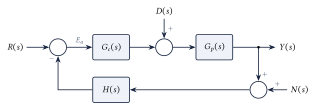
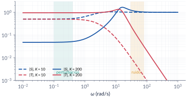
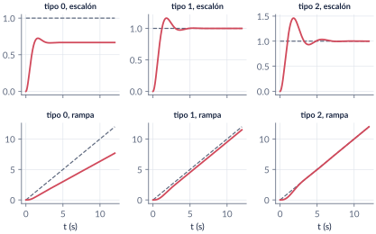
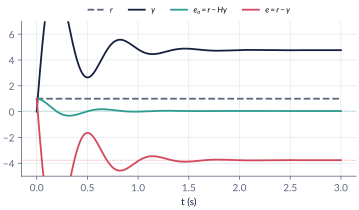
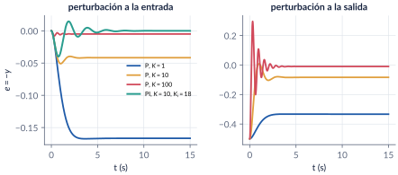
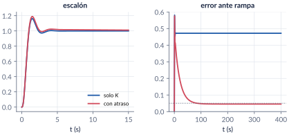

```{=html}
<div class="franja"><div class="rotulo">Parte 6 · Semana 7</div><div class="titulo">Error en estado estacionario</div><div class="cita">Los lectores del tercer mundo quieren que alguien les arme una buena ficción con la pésima realidad que les ha tocado en mala suerte. — Rodrigo Fresán</div><svg class="bode" viewBox="0 0 600 160" preserveAspectRatio="none"><path d="M0,30 L170,30 L330,105 L420,105 L600,160" stroke="#ffffff" stroke-opacity=".12" stroke-width="10" fill="none" stroke-linejoin="round"/><path d="M0,30 C120,30 150,32 175,42 C230,65 300,98 330,104 C370,110 400,108 425,112 C480,128 540,148 600,160" stroke="#E09F3E" stroke-width="2.5" fill="none"/></svg></div>
```

De las tres cosas que se evalúan en un sistema de control —estabilidad, transitorio y error—, falta la tercera: **cuánto se equivoca el lazo cuando todo se asienta**. Empezamos con las funciones de **sensitividad**, que muestran cómo la referencia, las perturbaciones y el ruido llegan al error. Luego, con las señales de prueba (escalón, rampa, parábola), el **tipo del sistema** y las **constantes de error** $\kappa_p$, $\kappa_v$, $\kappa_a$, calculamos el error sin simular. Vemos qué cambia con un sensor que no es unitario, cómo se rechaza una **perturbación**, cómo se calcula el error en **espacio de estado** y qué hacer cuando la especificación de error choca con la de transitorio.

```{=html}
<div class="botones">
  <a class="boton" href="../pdf/cap06_error.pdf">⬇ Handout en PDF</a>
  <a class="boton sec" href="https://github.com/quijanon-bot/NQuijano.github.io/tree/main/fuentes/curso-control/codigo/cap06_error">Códigos en GitHub</a>
</div>
```

::: {.receta}
[Al terminar esta parte usted podrá]{.caja-titulo}

1. Relacionar el error de seguimiento con la referencia, las perturbaciones y el ruido a través de las funciones de sensitividad.
2. Calcular el error en estado estacionario ante escalón, rampa y parábola con el tipo y las constantes $\kappa_p$, $\kappa_v$, $\kappa_a$, después de verificar la estabilidad.
3. Tratar la retroalimentación no unitaria con el lazo abierto $G_{OL}$ y distinguir el error de seguimiento del de actuación.
4. Calcular el error por perturbaciones y en espacio de estado, y reconocer cuándo el error choca con el transitorio.
:::

## Ruta de la clase

| Clase | Qué se ve | Handout | Scripts |
|:--|:--|:--|:--|
| 1 | Sensitividad; señales de prueba; tipo y constantes de error; retroalimentación no unitaria; perturbaciones; error en espacio de estado; error contra transitorio | §6.1–6.7 | `C6_Ej1`–`C6_Ej6`, `crearModelo_Perturbacion` |

: Lea la sección del handout **antes** de la clase. {.striped}

## Lo esencial, en una página

{width=80%}

::: {.definicion}
[Sensitividad]{.caja-titulo}

Con retroalimentación unitaria,

$$
E=R-Y=S\,R-S\,G_p\,D+T\,N,\qquad S=\frac{1}{1+G_cG_p},\quad T=\frac{G_cG_p}{1+G_cG_p},\quad S+T=1 .
$$

No se pueden hacer pequeñas las dos a la misma frecuencia: lazo abierto grande donde viven la referencia y las perturbaciones, pequeño donde vive el ruido.
:::

{width=85%}

::: {.cuidado}
[Primero la estabilidad]{.caja-titulo}

El teorema del valor final solo vale si el lazo cerrado es estable. Un "error en estado estacionario" de un lazo inestable no significa nada.
:::

::: {.definicion}
[Tipo y constantes de error]{.caja-titulo}

$$
e_{ss}=\lim_{s\to0}s\,\frac{R(s)}{1+G(s)},\qquad
\kappa_p=\lim_{s\to0}G,\quad \kappa_v=\lim_{s\to0}sG,\quad \kappa_a=\lim_{s\to0}s^2G .
$$

El **tipo** es el número de integradores del lazo abierto $G$.

| | escalón | rampa | parábola |
|:--|:-:|:-:|:-:|
| Tipo 0 | $1/(1+\kappa_p)$ | $\infty$ | $\infty$ |
| Tipo 1 | $0$ | $1/\kappa_v$ | $\infty$ |
| Tipo 2 | $0$ | $0$ | $1/\kappa_a$ |
:::

{width=100%}

::: {.ideaclave}
[Malla abierta no es lazo abierto]{.caja-titulo}

Con un sensor $H\neq1$, la malla abierta $GH$ da el error de **actuación** $r-Hy$; el error de **seguimiento** $r-y$ sale del lazo abierto $G_{OL}=\dfrac{G}{1+GH-G}$. Con $G=100/(s+1)$ y $H=1/(s+5)$: error de actuación $1/21$, pero la salida termina en $4.76$ (error de seguimiento $-3.76$), porque $H(0)=1/5$.
:::

{width=85%}

::: {.definicion}
[Perturbaciones]{.caja-titulo}

Con $R=0$ y la perturbación a la entrada del proceso, $E=-\dfrac{G_p}{1+G_cG_p}D$. Un escalón de perturbación se rechaza por completo si hay un integrador **antes** del punto donde entra (en el controlador).
:::

{width=100%}

::: {.definicion}
[En espacio de estado]{.caja-titulo}

Con el lazo cerrado y una referencia constante, el estado estacionario sale de $\dot x=0$: $x_{ss}=-(\mathbb A-\mathbb B\mathbb C)^{-1}\mathbb B\,r$. Un estado integrador $\dot x_3=r-y$ vuelve el lazo de tipo 1.
:::

{width=100%}

## Códigos de esta parte

Los bloques salen directamente de los archivos del [repositorio](https://github.com/quijanon-bot/NQuijano.github.io/tree/main/fuentes/curso-control/codigo/cap06_error). Ejecute antes `iniciarCurso`.

::: {.panel-tabset}

### Tipo y constantes

**Estabilidad, tipo y constantes de cuatro lazos (§6.3).**

```{.matlab include="../../codigo/cap06_error/C6_Ej1_TipoError.m" marca="tipo"}
```

**Error de rampa simulado.**

```{.matlab include="../../codigo/cap06_error/C6_Ej1_TipoError.m" marca="simulacion"}
```

**La función del curso `constantesError`.**

```{.matlab include="../../codigo/comun/constantesError.m"}
```

### No unitaria

**Malla abierta, lazo abierto y los dos errores (§6.4).**

```{.matlab include="../../codigo/cap06_error/C6_Ej2_NoUnitaria.m" marca="lazoabierto"}
```

**Simulación y sensor recalibrado.**

```{.matlab include="../../codigo/cap06_error/C6_Ej2_NoUnitaria.m" marca="simulacion"}
```

### Perturbaciones

**Proporcional (§6.5).**

```{.matlab include="../../codigo/cap06_error/C6_Ej3_Perturbacion.m" marca="proporcional"}
```

**PI.**

```{.matlab include="../../codigo/cap06_error/C6_Ej3_Perturbacion.m" marca="pi"}
```

### Espacio de estado

**Estado estacionario con $\dot x=0$ (§6.6).**

```{.matlab include="../../codigo/cap06_error/C6_Ej4_Estado.m" marca="estacionario"}
```

**Estado integrador.**

```{.matlab include="../../codigo/cap06_error/C6_Ej4_Estado.m" marca="integral"}
```

### Error contra transitorio

**El conflicto (§6.7).**

```{.matlab include="../../codigo/cap06_error/C6_Ej5_Atraso.m" marca="conflicto"}
```

**El atraso.**

```{.matlab include="../../codigo/cap06_error/C6_Ej5_Atraso.m" marca="atraso"}
```

### Sensitividad

**Tabla de $|S|$ y $|T|$ (§6.1).**

```{.matlab include="../../codigo/cap06_error/C6_Ej6_Sensibilidad.m" marca="tabla"}
```

**Aportes de la perturbación y del ruido.**

```{.matlab include="../../codigo/cap06_error/C6_Ej6_Sensibilidad.m" marca="aportes"}
```

### Pruebas

`verificarCap06` comprueba los números clave del capítulo.

```{.matlab include="../../codigo/cap06_error/verificarCap06.m"}
```

:::

## Modelos de Simulink

::: {.modelo}
[Los modelos se construyen por código]{.caja-titulo}

| Script | Modelo | Para qué |
|:--|:--|:--|
| `crearModelo_Perturbacion.m` | lazo con PI sobre $1/((s+1)(s+2))$ y una perturbación escalón de 0.5 en $t=5$ s, a la entrada o a la salida del proceso | ver cuándo se anula el error y cuándo no |

Corra el script y se crea el `.slx`.
:::

## Pausas activas

::: {.pausa}
[1. ¿Constantes infinitas?]{.caja-titulo}

Un lazo abierto $\dfrac{5(s+1)}{s^3(s+2)}$ tiene $\kappa_p=\kappa_v=\kappa_a=\infty$. ¿Sigue sin error una parábola?

<details class="respuesta"><summary>Respuesta</summary>
No se puede saber con la tabla: el polinomio característico, $s^4+2s^3+5s+5$, no tiene término en $s^2$; el lazo es inestable.
</details>
:::

::: {.pausa}
[2. ¿Dónde está el integrador?]{.caja-titulo}

Si el integrador está en la planta y la perturbación entra a la entrada de la planta, ¿se anula el error ante una perturbación escalón?

<details class="respuesta"><summary>Respuesta</summary>
No, en general: el integrador debe estar antes del punto de entrada de la perturbación. Con $G_p=1/(s(s+1))$, $G_c=K$ y $D$ a la entrada, $e_{ss}=-1/K$ por cada unidad de perturbación.
</details>
:::

## Problemas

El handout trae 8 problemas (tipo y constantes de cuatro lazos, error contra estabilidad, perturbaciones, sensor dinámico, lazo abierto equivalente, espacio de estado con estado integrador, compensador de atraso y sensitividad), con soluciones seleccionadas.

```{=html}
<div class="botones"><a class="boton" href="../pdf/cap06_error.pdf">Ir a los problemas (PDF, §6.9)</a></div>
```

::: {.profundiza}
[Correcciones respecto a la versión anterior]{.caja-titulo}

En las secciones de $\kappa_v$ y $\kappa_a$ se escribía $\lim G$ antes del desarrollo; son $\lim sG$ y $\lim s^2G$. La sensitividad complementaria se llama ahora $T(s)$. La retroalimentación no unitaria se trata con el lazo abierto $G_{OL}$ y la distinción entre error de actuación y de seguimiento. La tabla resumen se completó con las constantes y con la condición de estabilidad. Se resolvieron los ejemplos que estaban solo enunciados y se agregaron perturbaciones, espacio de estado y el conflicto entre especificaciones.
:::
