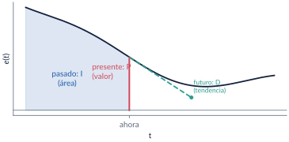
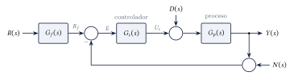
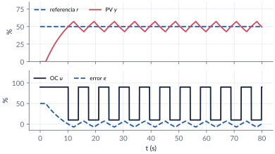
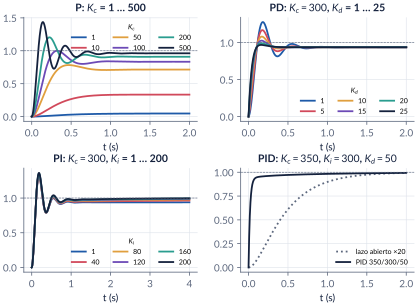
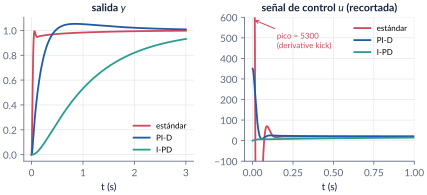
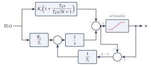
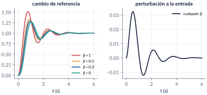

```{=html}
<div class="franja"><div class="rotulo">Parte 7 · Semana 7</div><div class="titulo">Controladores PID: nociones básicas</div><div class="cita">Nunca, ni en las situaciones más desesperadas, he perdido mi sentido del humor, y soy de los que piensan que esta vida es de risa. — Enrique Vila-Matas</div><svg class="bode" viewBox="0 0 600 160" preserveAspectRatio="none"><path d="M0,30 L170,30 L330,105 L420,105 L600,160" stroke="#ffffff" stroke-opacity=".12" stroke-width="10" fill="none" stroke-linejoin="round"/><path d="M0,30 C120,30 150,32 175,42 C230,65 300,98 330,104 C370,110 400,108 425,112 C480,128 540,148 600,160" stroke="#E09F3E" stroke-width="2.5" fill="none"/></svg></div>
```

El PID es, de lejos, el controlador más usado en la industria. En esta parte vemos qué hace cada una de sus tres acciones: la **proporcional** mira el error presente, la **integral** el pasado (su área) y la **derivativa** el futuro (su tendencia). Empezamos con el **on/off**, vemos por qué el proporcional deja error y cómo la integral lo elimina, y comparamos las tres **formas** comerciales del PID (ideal, paralelo y serie). Luego pasamos a los problemas prácticos: el ruido y el filtro derivativo, los ***kicks*** ante cambios de referencia, el ***wind-up*** con actuadores saturados y la **ponderación de la referencia**. Cerramos con el **algoritmo digital**. Cómo escoger los números es tema de la [parte 8](08-pid-sintonizacion.qmd).

```{=html}
<div class="botones">
  <a class="boton" href="../pdf/cap07_pid_nociones.pdf">⬇ Handout en PDF</a>
  <a class="boton sec" href="https://github.com/quijanon-bot/NQuijano.github.io/tree/main/fuentes/curso-control/codigo/cap07_pid_nociones">Códigos en GitHub</a>
</div>
```

::: {.receta}
[Al terminar esta parte usted podrá]{.caja-titulo}

1. Explicar qué hace cada acción (P, I, D) y cómo afecta la respuesta transitoria, el error y la estabilidad.
2. Pasar los parámetros de un PID entre las formas ideal, paralelo y serie, y saber cuándo la conversión es posible.
3. Reconocer los problemas prácticos —*kicks*, ruido, *wind-up*— y sus remedios: filtro derivativo, estructuras I-P e I-PD, anti-windup y ponderación de la referencia.
4. Escribir el algoritmo digital del PID en forma posicional e incremental.
:::

## Ruta de la clase

| Clase | Qué se ve | Handout | Scripts |
|:--|:--|:--|:--|
| 1 | Historia; on/off; acciones P, I, D; formas ideal, paralelo y serie; el ejemplo masa-resorte; filtro derivativo, *kicks*, *wind-up*, ponderación; algoritmo digital | §7.1–7.7 | `C7_Ej1`–`C7_Ej8`, `crearModelo_AntiWindup` |

: Lea la sección del handout **antes** de la clase. {.striped}

## Lo esencial, en una página

::: {.definicion}
[El PID ideal]{.caja-titulo}

$$
u_c(t)=\Kc\left(e(t)+\frac{1}{\Ti}\int_0^t e(\tau)\,\mathrm{d}\tau+\Td\deriv{e}{t}\right),
\qquad
\Gc(s)=\Kc\left(1+\frac{1}{\Ti s}+\Td s\right).
$$

$\Kc$ es la ganancia, $\Ti$ el tiempo integral (el tiempo en que la integral repite la acción proporcional ante un error constante) y $\Td$ el tiempo derivativo (un PD actúa como un proporcional que mira $\Td$ segundos adelante).
:::

{width=85%}

{width=90%}

::: {.ideaclave}
[On/off, proporcional e integral]{.caja-titulo}

- El **on/off** es simple y robusto, pero **oscila**: con un tiempo muerto, la PV nunca se asienta.
- El **proporcional** $u_c=\Kc e+u_0$ deja **error en estado estacionario** en procesos sin integrador: necesita un error para sostener la salida. Con señales normalizadas, la **banda proporcional** es $PB=100/\Kc$ (%).
- La **integral** ajusta el *bias* $u_0$ sola: elimina el error ante escalones, a cambio de estabilidad.
:::

{width=85%}

::: {.definicion}
[Tres formas de escribir un PID]{.caja-titulo}

$$
\text{ideal: }\Kc\Bigl(1+\tfrac{1}{\Ti s}+\Td s\Bigr),\qquad
\text{paralelo: }\Kc+\tfrac{K_i}{s}+K_d s,\qquad
\text{serie: }\Kc^S\Bigl(1+\tfrac{1}{\Ti^S s}\Bigr)\bigl(1+\Td^S s\bigr).
$$

Serie → ideal siempre: $\Kc=\Kc^S(1+\Td^S/\Ti^S)$, $\Ti=\Ti^S+\Td^S$, $\Td=\Ti^S\Td^S/(\Ti^S+\Td^S)$. Ideal → serie solo si $\Ti\ge4\Td$ (ceros reales). La forma paralelo es la única que admite $\Kc=0$.
:::

{width=100%}

| Aumentar | $\tr$ | $\OS$ | $\ts$ | $\ess$ | Estabilidad |
|:--|:-:|:-:|:-:|:-:|:-:|
| $\Kc$ | baja | sube | sube un poco | baja | empeora |
| $K_i=\Kc/\Ti$ | baja un poco | sube | sube | se anula | empeora |
| $K_d=\Kc\Td$ | baja un poco | baja | baja | casi no cambia | mejora (si no hay ruido) |

: Tendencias típicas, no leyes: el problema 7.2 pide comprobarlas. {.striped}

::: {.cuidado}
[Ruido y *kicks*]{.caja-titulo}

La derivada pura amplifica el ruido sin límite. Se filtra: $\dfrac{\Td s}{(\Td/N)s+1}$ con $N\approx8$–$16$, y la ganancia del controlador queda acotada en $\Kc(1+N)$. Ante un escalón de referencia, la D (y la P) producen saltos enormes en la salida del controlador; se evitan sacándolas del camino de la referencia: estructuras **PI-D** e **I-PD**.
:::

{width=100%}

::: {.ideaclave}
[*Wind-up* y anti-windup]{.caja-titulo}

Con el actuador saturado, la integral sigue acumulando error y luego tarda en "desenrollarse": sobrepicos y tiempos de establecimiento grandes. Remedios: **integración condicional** (congelar la integral mientras el actuador satura y el error la empuja hacia afuera) o **recálculo** (*back-calculation*), que realimenta $u-v$ a la integral con una constante $T_t\approx\sqrt{\Ti\Td}$.
:::

![PID sobre $e^{-4s}/(10s+1)$ con el actuador en $[0,\,1.5]$. Sin corrección, $\%\mathrm{OS}=38\,\%$ y $t_s=45$ s; con recálculo, $3\,\%$ y $30$ s.](../figuras/cap07/f_windup.svg){width=100%}

{width=80%}

::: {.definicion}
[Ponderación de la referencia]{.caja-titulo}

$u_c=\Kc\Bigl[(\beta r-y)+\dfrac{1}{\Ti}\displaystyle\int e\,\mathrm{d}t+\Td\deriv{}{t}(\gamma r-y)\Bigr]$. $\beta$ y $\gamma$ cambian la respuesta a la referencia **sin tocar** la respuesta a las perturbaciones: un controlador de dos grados de libertad. PI-D es $\beta=1$, $\gamma=0$; I-PD es $\beta=\gamma=0$.
:::

{width=100%}

::: {.definicion}
[PID digital]{.caja-titulo}

Con periodo de muestreo $T_s$, el algoritmo **posicional** es $u_c[k]=\Kc\Bigl(e[k]+\frac{T_s}{\Ti}\sum_{i=1}^k e[i]+\frac{\Td}{T_s}\bigl(e[k]-e[k-1]\bigr)\Bigr)$ y el **incremental**

$$
u_c[k]=u_c[k-1]+\Kc\Bigl[\Bigl(1+\tfrac{T_s}{\Ti}+\tfrac{\Td}{T_s}\Bigr)e[k]-\Bigl(1+\tfrac{2\Td}{T_s}\Bigr)e[k-1]+\tfrac{\Td}{T_s}e[k-2]\Bigr].
$$

El incremental no acumula la suma: resiste mejor el *wind-up* y permite pasar de manual a automático sin saltos.
:::

## Códigos de esta parte

Los bloques salen directamente de los archivos del [repositorio](https://github.com/quijanon-bot/NQuijano.github.io/tree/main/fuentes/curso-control/codigo/cap07_pid_nociones). Ejecute antes `iniciarCurso`.

::: {.panel-tabset}

### On/off

**Un horno on/off con tiempo muerto (§7.2).**

```{.matlab include="../../codigo/cap07_pid_nociones/C7_Ej1_OnOff.m" marca="onoff"}
```

### Acciones

**La planta masa-resorte-amortiguador (§7.5).**

```{.matlab include="../../codigo/cap07_pid_nociones/C7_Ej2_Acciones.m" marca="planta"}
```

**Proporcional.**

```{.matlab include="../../codigo/cap07_pid_nociones/C7_Ej2_Acciones.m" marca="p"}
```

**Proporcional-derivativo.**

```{.matlab include="../../codigo/cap07_pid_nociones/C7_Ej2_Acciones.m" marca="pd"}
```

**Proporcional-integral.**

```{.matlab include="../../codigo/cap07_pid_nociones/C7_Ej2_Acciones.m" marca="pi"}
```

**PID.**

```{.matlab include="../../codigo/cap07_pid_nociones/C7_Ej2_Acciones.m" marca="pid"}
```

### Formas

**De serie a ideal y de vuelta (§7.4).**

```{.matlab include="../../codigo/cap07_pid_nociones/C7_Ej3_Estructuras.m" marca="conversion"}
```

**Ceros complejos: no hay forma serie.**

```{.matlab include="../../codigo/cap07_pid_nociones/C7_Ej3_Estructuras.m" marca="complejos"}
```

**Paralelo e ideal.**

```{.matlab include="../../codigo/cap07_pid_nociones/C7_Ej3_Estructuras.m" marca="paralelo"}
```

**La función del curso `convertirPID`.**

```{.matlab include="../../codigo/comun/convertirPID.m"}
```

### Ruido y *kicks*

**Filtro derivativo (§7.6).**

```{.matlab include="../../codigo/cap07_pid_nociones/C7_Ej4_FiltroDerivativo.m" marca="filtro"}
```

**Estándar, PI-D e I-PD.**

```{.matlab include="../../codigo/cap07_pid_nociones/C7_Ej5_Kicks.m" marca="kicks"}
```

### *Wind-up*

**Sin corrección, con recálculo y con integración condicional.**

```{.matlab include="../../codigo/cap07_pid_nociones/C7_Ej6_Windup.m" marca="windup"}
```

**La función del curso `simularPID`.**

```{.matlab include="../../codigo/comun/simularPID.m"}
```

### Ponderación y digital

**Ponderación de la referencia.**

```{.matlab include="../../codigo/cap07_pid_nociones/C7_Ej7_Ponderacion.m" marca="beta"}
```

**Algoritmos posicional e incremental (§7.7).**

```{.matlab include="../../codigo/cap07_pid_nociones/C7_Ej8_Digital.m" marca="digital"}
```

### Pruebas

`verificarCap07` comprueba los números clave del capítulo.

```{.matlab include="../../codigo/cap07_pid_nociones/verificarCap07.m"}
```

:::

## Modelos de Simulink

::: {.modelo}
[Los modelos se construyen por código]{.caja-titulo}

| Script | Modelo | Para qué |
|:--|:--|:--|
| `crearModelo_AntiWindup.m` | dos lazos con el bloque *PID Controller* (forma ideal, $\Kc=3$, $\Ti=8$, $\Td=2$, $N=10$) sobre $e^{-4s}/(10s+1)$ con la salida limitada a $[0,\,1.5]$: uno sin anti-windup y otro con *back-calculation* | comparar el *wind-up* con y sin corrección, y barrer $T_t$ |

Corra el script y se crea el `.slx`.
:::

## Pausas activas

::: {.pausa}
[1. Banda proporcional]{.caja-titulo}

Un controlador tiene $PB=25\,\%$ con señales normalizadas. ¿Cuánto vale $\Kc$? ¿Y si el error se mide sobre un rango de $200\grados$C y la salida sobre $100\,\%$?

<details class="respuesta"><summary>Respuesta</summary>
$\Kc=100/25=4$ (adimensional). Con los rangos: $\Kc=\frac{1}{0.25}\cdot\frac{100}{200}=2$ %/°C.
</details>
:::

::: {.pausa}
[2. ¿Tiene forma serie?]{.caja-titulo}

¿Tiene forma serie el PID ideal con $\Kc=5$, $\Ti=4$ s y $\Td=2$ s?

<details class="respuesta"><summary>Respuesta</summary>
No: $4\Td=8>\Ti=4$. Los ceros, raíces de $8s^2+4s+1$, son $-0.25\pm j0.25$.
</details>
:::

::: {.pausa}
[3. Cota del filtro derivativo]{.caja-titulo}

Con $\Kc=3$, $\Td=2$ s y $N=10$, ¿cuánto vale como máximo la ganancia del controlador a alta frecuencia? ¿A partir de qué frecuencia actúa el filtro?

<details class="respuesta"><summary>Respuesta</summary>
$\Kc(1+N)=33$. El filtro actúa desde $N/\Td=5$ rad/s.
</details>
:::

## Problemas

El handout trae 8 problemas (formas del PID, las tendencias de la tabla con números, banda proporcional y *bias*, ruido y filtro derivativo, algoritmo digital, *kicks*, *wind-up* y dos grados de libertad), con soluciones seleccionadas.

```{=html}
<div class="botones"><a class="boton" href="../pdf/cap07_pid_nociones.pdf">Ir a los problemas (PDF, §7.9)</a></div>
```

::: {.profundiza}
[Correcciones respecto a la versión anterior]{.caja-titulo}

La conversión ideal → serie da $\Td^S=\frac{\Ti^I}{2}(1-\rho)$, no $\frac{\Td^I}{2}(1-\rho)$, y la expansión de la forma serie tenía los términos mal agrupados. La forma paralelo no es "la única que permite desactivar la integral": es la única que admite $\Kc=0$. En la historia, la Taylor introdujo una derivada fija hacia 1936 y en 1939 salieron el Fulscope y el Stabilog con las tres acciones ajustables; se retiraron dos datos que no se encontraron en las fuentes. Se completaron las figuras y simulaciones pendientes y se calcularon todos los números.
:::
