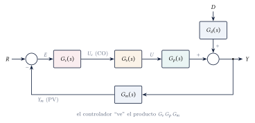
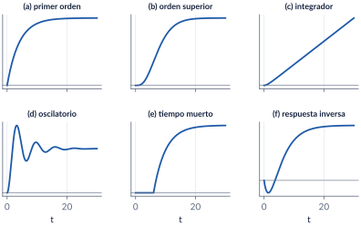
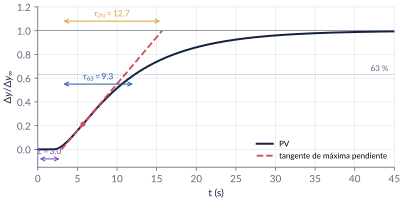
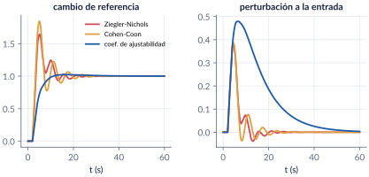
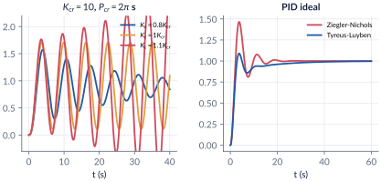
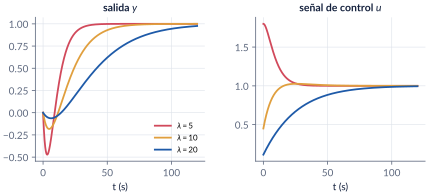
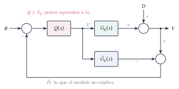
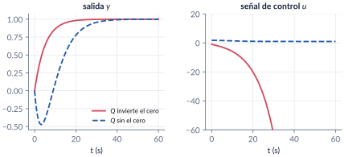
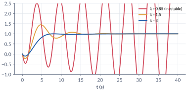
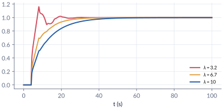

```{=html}
<div class="franja"><div class="rotulo">Parte 8 · Semana 9</div><div class="titulo">Controladores PID: sintonización</div><div class="cita">La autoridad y el dinero se rodean de calma, y se puede medir el alcance de la influencia de una persona por la intensidad del silencio que la rodea. — Hernán Díaz</div><svg class="bode" viewBox="0 0 600 160" preserveAspectRatio="none"><path d="M0,30 L170,30 L330,105 L420,105 L600,160" stroke="#ffffff" stroke-opacity=".12" stroke-width="10" fill="none" stroke-linejoin="round"/><path d="M0,30 C120,30 150,32 175,42 C230,65 300,98 330,104 C370,110 400,108 425,112 C480,128 540,148 600,160" stroke="#E09F3E" stroke-width="2.5" fill="none"/></svg></div>
```

La [parte 7](07-pid-nociones.qmd) explicó qué hace cada acción del PID; aquí decidimos **cuánto vale cada una**. Empezamos con el vocabulario de los procesos industriales y con la **prueba escalón**, que resume el proceso en tres números: ganancia, tiempo muerto y constante de tiempo. Con ellos aplicamos las **reglas de malla abierta** (Ziegler-Nichols, Cohen-Coon, coeficiente de ajustabilidad) y, con la ganancia y el periodo críticos, las de **malla cerrada** (Ziegler-Nichols, Tyreus-Luyben). Luego cambiamos de enfoque: en la **síntesis directa** y en el **control por modelo interno (IMC)** se escoge la respuesta deseada y el PID sale solo, con un único parámetro de ajuste, $\lambda$. Terminamos midiendo lo que cuesta ser agresivo: **robustez**.

```{=html}
<div class="botones">
  <a class="boton" href="../pdf/cap08_pid_sintonizacion.pdf">⬇ Handout en PDF</a>
  <a class="boton sec" href="https://github.com/quijanon-bot/NQuijano.github.io/tree/main/fuentes/curso-control/codigo/cap08_pid_sintonizacion">Códigos en GitHub</a>
</div>
```

::: {.receta}
[Al terminar esta parte usted podrá]{.caja-titulo}

1. Usar la terminología del control de procesos y reconocer los elementos de un lazo industrial.
2. Clasificar un proceso por su respuesta al escalón e identificar un modelo de primer orden con tiempo muerto, con la ganancia normalizada.
3. Sintonizar un PID con reglas de malla abierta y de malla cerrada, y juzgar el resultado por desempeño **y** por robustez.
4. Diseñar por síntesis directa y por modelo interno (IMC), y obtener de ellos un PID con un solo parámetro de ajuste.
:::

## Ruta de las clases

| Clase | Qué se ve | Handout | Scripts |
|:--|:--|:--|:--|
| 1 | Terminología y componentes; tipos de procesos; ganancia normalizada; identificación FOPDT; reglas de malla abierta y de malla cerrada | §8.1–8.4 | `C8_Ej1`–`C8_Ej3` |
| 2 | Síntesis directa; fase no mínima; control por modelo interno; estabilidad interna; IMC-PID; desempeño contra robustez | §8.5–8.7 | `C8_Ej4`–`C8_Ej6`, `crearModelo_IMC` |

: Lea la sección del handout **antes** de cada clase. {.striped}

## Lo esencial, en una página

{width=90%}

::: {.definicion}
[Ganancia normalizada y modelo FOPDT]{.caja-titulo}

Con la PV y la CO en porcentaje de su rango,
$$
\Kproc=\frac{\Delta y/\text{rango de la PV}}{\Delta u_c/\text{rango de la CO}},
\qquad
\Gp(s)\approx\frac{\Kproc\,e^{-Ls}}{\tau s+1}.
$$
Con la **tangente de máxima pendiente**: $L$ donde corta el valor inicial; $\tau$ desde $L$ hasta el $63.2\,\%$ del cambio (o hasta el corte con el valor final, en la variante de Ziegler y Nichols, que sobrestima $\tau$). En un integrador se usa $K_v=v/\Delta u_c$, con $v$ la pendiente de la rampa.
:::

{width=100%}

{width=85%}

::: {.cuidado}
[La pendiente máxima de un primer orden]{.caja-titulo}

En $y=\Kproc\bigl(1-e^{-(t-L)/\tau}\bigr)$ la pendiente es máxima **al comienzo**, en $t=L$, no en el $63\,\%$ (allí vale el $37\,\%$ del máximo).
:::

::: {.definicion}
[Reglas de sintonización (PID ideal)]{.caja-titulo}

| Regla | $\Kc$ | $\Ti$ | $\Td$ |
|:--|:-:|:-:|:-:|
| Ziegler-Nichols, malla abierta | $1.2\,\tau/(\Kproc L)$ | $2L$ | $0.5L$ |
| Cohen-Coon ($r=L/\tau$) | $\frac{\tau}{\Kproc L}\bigl(\frac43+\frac r4\bigr)$ | $L\frac{32+6r}{13+8r}$ | $\frac{4L}{11+2r}$ |
| Ajustabilidad ($0.2\le r_c\le0.5$) | $\frac{0.5(1+0.5r_c)}{\Kproc r_c}$ | $\tau(1+0.5r_c)$ | $\tau\frac{0.5r_c}{0.5r_c+1}$ |
| Ziegler-Nichols, malla cerrada | $0.6\Kcr$ | $0.5\Pcr$ | $0.125\Pcr$ |
| Tyreus-Luyben | $\Kcr/2.2$ | $2.2\Pcr$ | $\Pcr/6.3$ |

El PI de Ziegler-Nichols de malla cerrada es $0.45\Kcr$, $\Pcr/1.2$; el de Tyreus-Luyben, $\Kcr/3.2$, $2.2\Pcr$. Las tablas completas (P, PI, PD, forma serie, integradores) están en el handout.
:::

{width=100%}

{width=100%}

::: {.cuidado}
[Tyreus-Luyben no es "de un cuarto"]{.caja-titulo}

Ziegler y Nichols buscaban que cada pico fuera la cuarta parte del anterior. Tyreus y Luyben buscan lo contrario: menos ganancia y tiempos integrales mucho más largos, para respuestas amortiguadas y robustas.
:::

::: {.definicion}
[Síntesis directa]{.caja-titulo}

$$
\Gc(s)=\frac{1}{\Gp(s)}\,\frac{T(s)}{1-T(s)},\qquad T(s)=\frac{1}{\lambda s+1}\ \Rightarrow\ \Gc=\frac{1}{\Gp}\,\frac{1}{\lambda s}.
$$
Con $\Kproc/(\tau s+1)$ sale un PI ($\Kc=\tau/(\Kproc\lambda)$, $\Ti=\tau$); con dos polos, un PID. **$\lambda$ es la constante de tiempo del lazo**: menor $\lambda$, respuesta más rápida ($t_s\approx4\lambda$) y más acción de control. Los ceros inestables y el retardo no se invierten: se dejan en $T(s)$.
:::

{width=100%}

::: {.definicion}
[Control por modelo interno]{.caja-titulo}

Se factoriza el modelo, $\tilde G_p=\tilde G_p^+\tilde G_p^-$ (ceros inestables y retardo en $\tilde G_p^+$), y se invierte solo la parte invertible: $Q=(\tilde G_p^-)^{-1}F$, con $F=1/(\lambda s+1)^n$. La estructura retroalimenta solo lo que el modelo no explica, y equivale a un lazo clásico con
$$
\Gc(s)=\frac{Q(s)}{1-\tilde G_p(s)Q(s)} .
$$
Para $\Kproc e^{-Ls}/(\tau s+1)$ con Padé: $\Kc=\dfrac{\tau+L/2}{\Kproc(\lambda+L/2)}$, $\Ti=\tau+L/2$, $\Td=\dfrac{\tau L}{2\tau+L}$, con $\lambda>0.8L$.
:::

{width=85%}

{width=100%}

{width=85%}

{width=85%}

::: {.ideaclave}
[La agresividad se paga en robustez]{.caja-titulo}

Sobre $1.2e^{-4s}/(20s+1)$, variando $K_p$ y $\tau$ en $\pm30\,\%$ y $L$ en $\pm50\,\%$ (125 procesos):

| Sintonía | $\%\mathrm{OS}$ | GM | PM | Estables |
|:--|:-:|:-:|:-:|:-:|
| Ziegler-Nichols | $87\,\%$ | $1.33$ | $39^\circ$ | $98/125$ |
| Cohen-Coon | $95\,\%$ | $1.31$ | $27^\circ$ | $90/125$ |
| Ajustabilidad | $0\,\%$ | $2.91$ | $75^\circ$ | $125/125$ |
| IMC, $\lambda=6.7$ | $0\,\%$ | $3.16$ | $76^\circ$ | $125/125$ |

Ante perturbaciones, en cambio, las reglas agresivas son las mejores. Escoger una sintonía es escoger un punto en ese compromiso.
:::

## Códigos de esta parte

Los bloques salen directamente de los archivos del [repositorio](https://github.com/quijanon-bot/NQuijano.github.io/tree/main/fuentes/curso-control/codigo/cap08_pid_sintonizacion). Ejecute antes `iniciarCurso`.

::: {.panel-tabset}

### Identificación

**Ganancia normalizada (§8.2).**

```{.matlab include="../../codigo/cap08_pid_sintonizacion/C8_Ej1_Identificacion.m" marca="ganancia"}
```

**Tangente, 63 % y Ziegler-Nichols sobre datos.**

```{.matlab include="../../codigo/cap08_pid_sintonizacion/C8_Ej1_Identificacion.m" marca="tangente"}
```

**La función del curso `identificarFOPDT`.**

```{.matlab include="../../codigo/comun/identificarFOPDT.m"}
```

### Malla abierta

**Ziegler-Nichols, Cohen-Coon y ajustabilidad (§8.3).**

```{.matlab include="../../codigo/cap08_pid_sintonizacion/C8_Ej2_MallaAbierta.m" marca="reglas"}
```

**Referencia y perturbación.**

```{.matlab include="../../codigo/cap08_pid_sintonizacion/C8_Ej2_MallaAbierta.m" marca="simulacion"}
```

**La función del curso `reglasPID`.**

```{.matlab include="../../codigo/comun/reglasPID.m"}
```

### Malla cerrada

**Ganancia y periodo críticos (§8.4).**

```{.matlab include="../../codigo/cap08_pid_sintonizacion/C8_Ej3_MallaCerrada.m" marca="critico"}
```

**Ziegler-Nichols contra Tyreus-Luyben.**

```{.matlab include="../../codigo/cap08_pid_sintonizacion/C8_Ej3_MallaCerrada.m" marca="zntl"}
```

### Síntesis directa

**Un PI (§8.5).**

```{.matlab include="../../codigo/cap08_pid_sintonizacion/C8_Ej4_SintesisDirecta.m" marca="pi"}
```

**Un PID y el papel de $\lambda$.**

```{.matlab include="../../codigo/cap08_pid_sintonizacion/C8_Ej4_SintesisDirecta.m" marca="pid"}
```

**Fase no mínima.**

```{.matlab include="../../codigo/cap08_pid_sintonizacion/C8_Ej4_SintesisDirecta.m" marca="nomin"}
```

### IMC

**Estabilidad interna (§8.6).**

```{.matlab include="../../codigo/cap08_pid_sintonizacion/C8_Ej5_IMC.m" marca="interna"}
```

**El modelo no coincide con el proceso.**

```{.matlab include="../../codigo/cap08_pid_sintonizacion/C8_Ej5_IMC.m" marca="robusto"}
```

**IMC-PID con el retardo exacto.**

```{.matlab include="../../codigo/cap08_pid_sintonizacion/C8_Ej5_IMC.m" marca="fopdt"}
```

### Robustez

**Márgenes y malla de procesos perturbados (§8.7).**

```{.matlab include="../../codigo/cap08_pid_sintonizacion/C8_Ej6_Robustez.m" marca="malla"}
```

### Pruebas

`verificarCap08` comprueba los números clave del capítulo.

```{.matlab include="../../codigo/cap08_pid_sintonizacion/verificarCap08.m"}
```

:::

## Modelos de Simulink

::: {.modelo}
[Los modelos se construyen por código]{.caja-titulo}

| Script | Modelo | Para qué |
|:--|:--|:--|
| `crearModelo_IMC.m` | la estructura IMC con $Q=(5s+1)/(2(\lambda s+1))$, el proceso $1.5(1-s)/((s+1)(4s+1))$ y el modelo $2/(5s+1)$, con escalón de referencia y perturbación a la salida | ver que solo vuelve a la entrada lo que el modelo no explica, y encontrar el $\lambda$ a partir del cual el lazo se inestabiliza |

Corra el script y se crea el `.slx`.
:::

## Pausas activas

::: {.pausa}
[1. Tangente sobre un primer orden]{.caja-titulo}

Con $1/(5s+1)$, ¿qué $L$ y qué $\tau$ dan la tangente de Ziegler y Nichols y el método del 63 %?

<details class="respuesta"><summary>Respuesta</summary>
$L=0$ en los dos, y $\tau=5$ s en los dos: la tangente en $t=0$ llega a $1$ en $t=5$, y el $63.2\,\%$ se alcanza en $t=5$.
</details>
:::

::: {.pausa}
[2. Tiempo muerto pequeño]{.caja-titulo}

En $2e^{-Ls}/(10s+1)$, ¿qué pasa con el $\Kc$ de Ziegler-Nichols si $L$ baja de $2$ a $0.5$ s?

<details class="respuesta"><summary>Respuesta</summary>
Se multiplica por cuatro: $\Kc=1.2\cdot10/(2\cdot0.5)=12$, y $\Ti=1$ s. Un $L/\tau$ pequeño lleva a ganancias muy altas.
</details>
:::

::: {.pausa}
[3. PI de malla cerrada]{.caja-titulo}

Con $\Kcr=10$ y $\Pcr=2\pi$ s, ¿qué PI da Ziegler-Nichols de malla cerrada?

<details class="respuesta"><summary>Respuesta</summary>
$\Kc=0.45\cdot10=4.5$ y $\Ti=2\pi/1.2=5.24$ s.
</details>
:::

::: {.pausa}
[4. Grado relativo]{.caja-titulo}

En síntesis directa con $\Gp=(1-9s)/((15s+1)(3s+1))$, ¿por qué la respuesta deseada es $(1-9s)/(\lambda s+1)^2$ y no $(1-9s)/(\lambda s+1)$?

<details class="respuesta"><summary>Respuesta</summary>
Para conservar el grado relativo (uno). Con la segunda, $\Gc=(15s+1)(3s+1)/((\lambda+9)s)$ es impropio: un PID ideal sin filtro que pediría a la salida saltar instantáneamente.
</details>
:::

## Problemas

El handout trae 8 problemas (identificación con datos experimentales, las tres reglas de malla abierta ante referencia y perturbación, Ziegler-Nichols contra Tyreus-Luyben, síntesis directa, diseño IMC con factorización simple y pasa-todo, robustez de las reglas clásicas, IMC-PID con tiempo muerto y estabilidad interna), con soluciones seleccionadas.

```{=html}
<div class="botones"><a class="boton" href="../pdf/cap08_pid_sintonizacion.pdf">Ir a los problemas (PDF, §8.9)</a></div>
```

::: {.profundiza}
[Correcciones respecto a la versión anterior]{.caja-titulo}

En un primer orden la pendiente máxima está en $t=L$, no en el 63 %. El PI de Ziegler-Nichols de malla cerrada es $0.45\Kcr$, $\Pcr/1.2$ (no $0.4\Kcr$, $0.8\Pcr$). Tyreus-Luyben no es de "un cuarto". En síntesis directa, un $\lambda$ pequeño da una respuesta **rápida**, no lenta. En el IMC para procesos inestables, la condición es $F(1/\tau_u)=1$. En la tabla IMC, la fila del primer orden con retardo mezclaba la ganancia del PID con el tiempo integral del PI: se separó en dos filas, y se retiró una fila que no se pudo verificar. Se corrigieron erratas ($G_c$ por $G_p$, $\tau_2$ por $T_d$, una $s$ faltante en $U(s)$) y se completaron las simulaciones pendientes.
:::
