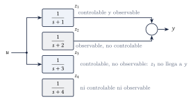
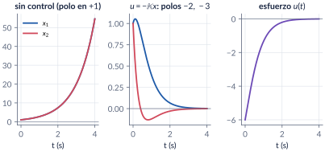
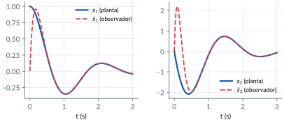
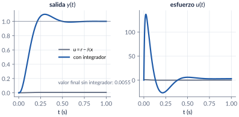

```{=html}
<div class="franja"><div class="rotulo">Parte 9 · Semanas 10–11</div><div class="titulo">Retroalimentación de estado y observadores</div><div class="cita">La virginidad o, mejor, la inocencia se pierde de otro modo. — Alberto Fuguet</div><svg class="bode" viewBox="0 0 600 160" preserveAspectRatio="none"><path d="M0,30 L170,30 L330,105 L420,105 L600,160" stroke="#ffffff" stroke-opacity=".12" stroke-width="10" fill="none" stroke-linejoin="round"/><path d="M0,30 C120,30 150,32 175,42 C230,65 300,98 330,104 C370,110 400,108 425,112 C480,128 540,148 600,160" stroke="#E09F3E" stroke-width="2.5" fill="none"/></svg></div>
```

Hasta ahora diseñamos controladores sobre la función de transferencia. En esta parte volvemos al **espacio de estado** y lo usamos para diseñar: si medimos todos los estados, $u=r-\Km x$ pone **todos** los polos donde queramos, siempre que el sistema sea **controlable**. Si no los medimos, un **observador** los estima a partir de la entrada y la salida, siempre que sea **observable**. El **principio de separación** permite diseñar las dos cosas por aparte, y un **integrador** agregado al estado anula el error en estado estacionario.

```{=html}
<div class="botones">
  <a class="boton" href="../pdf/cap09_retroalimentacion_estado.pdf">⬇ Handout en PDF</a>
  <a class="boton sec" href="https://github.com/quijanon-bot/NQuijano.github.io/tree/main/fuentes/curso-control/codigo/cap09_retroalimentacion_estado">Códigos en GitHub</a>
  <a class="boton sec" href="#explorador">Explorador de ubicación de polos</a>
</div>
```

::: {.receta}
[Al terminar esta parte usted podrá]{.caja-titulo}

1. Explicar con controlabilidad y observabilidad por qué una función de transferencia puede esconder modos, y decidir si un sistema es estabilizable y detectable.
2. Diseñar $u=r-\Km x$ para ubicar los polos que piden las especificaciones, por comparación de coeficientes y con la fórmula de Ackermann.
3. Diseñar un observador de Luenberger y unirlo con la retroalimentación de estado (principio de separación).
4. Agregar acción integral para anular el error en estado estacionario, y medir el precio en esfuerzo de control.
:::

## Ruta de las clases

| Clase | Qué se ve | Handout | Scripts |
|:--|:--|:--|:--|
| 1 | Lo que la función de transferencia esconde; $u=r-\Km x$; controlabilidad, PBH | §9.1–9.3 | `C9_Ej1`–`C9_Ej3` |
| 2 | Ackermann; de las especificaciones a los polos; el servo | §9.4–9.5 | `C9_Ej4`–`C9_Ej6`, `crearModelo_RetroEstado` |
| 3 | Observabilidad y observador de Luenberger; dualidad | §9.6 | `C9_Ej7` |
| 4 | Principio de separación y compensador; acción integral | §9.7–9.8 | `C9_Ej8`, `C9_Ej9`, `crearModelo_Observador` |

: Lea la sección del handout **antes** de cada clase. {.striped}

## Lo esencial, en una página

::: {.ideaclave}
[Lo que la función de transferencia esconde]{.caja-titulo}

Un sistema de cuarto orden puede tener función de transferencia $1/(s+1)$: solo se ve la parte **controlable y observable**. Es **estabilizable** si sus modos no controlables son estables y **detectable** si lo son los no observables. Por eso nunca se cancela un polo inestable con un cero.
:::

{width=80%}

::: {.definicion}
[Retroalimentación de estado y controlabilidad]{.caja-titulo}

$$
u=r-\Km x\quad\Longrightarrow\quad \dot x=(\Am-\Bm\Km)\,x+\Bm r .
$$
Los $n$ polos se pueden poner donde se quiera si y solo si $\operatorname{rango}\Ctrb=n$, con $\Ctrb=[\Bm\;\;\Am\Bm\;\;\cdots\;\;\Am^{n-1}\Bm]$. Con una entrada, la **fórmula de Ackermann** da $\Km=[0\;\cdots\;0\;1]\,\Ctrb^{-1}q(\Am)$.
:::

{width=95%}

::: {.cuidado}
[Controlable no quiere decir barato]{.caja-titulo}

Cuando el sistema está "casi" sin controlabilidad (número de condición de $\Ctrb$ grande), las ganancias y el esfuerzo de control crecen sin límite. Y las ganancias dependen de la representación de estado: `tf2ss` y las variables de fase dan $\Km$ distintos para los mismos polos.
:::

::: {.definicion}
[Observador de Luenberger]{.caja-titulo}

$$
\dot{\est{x}}=(\Am-\Lm\Cm)\,\est{x}+\Bm u+\Lm y,\qquad \dot\errest=(\Am-\Lm\Cm)\,\errest,\quad \errest=x-\est{x}.
$$
Se puede diseñar si y solo si $\operatorname{rango}\Obsv=n$. $\Lm$ se calcula como $\Km$ en el sistema dual: `L = acker(A',C',p)'`. En el curso el estimado se escribe $\est{x}$, porque $\hat{x}$ es la variable desviación.
:::

{width=95%}

::: {.ideaclave}
[Principio de separación]{.caja-titulo}

Con $u=-\Km\est{x}$, los polos del conjunto son los de $\Am-\Bm\Km$ **más** los de $\Am-\Lm\Cm$: se diseñan por separado. El compensador completo es una función de transferencia $U/Y=-\Km\bigl(s\Id-(\Am-\Bm\Km-\Lm\Cm)\bigr)^{-1}\Lm$. Ojo: la separación supone un modelo exacto; la robustez hay que verificarla.
:::

::: {.definicion}
[Acción integral]{.caja-titulo}

Se agrega el estado $\dot z=r-y$ y la ley $u=-\Km x+K_e z$. Un polo más que ubicar y, si el lazo es estable, $y\to r$ ante cualquier escalón.
:::

{width=95%}

## Explorador de ubicación de polos {#explorador}

Planta $1/(s^2+a_1s+a_0)$ en variables de fase. Escoja las especificaciones, active o no la acción integral y mire la salida, el esfuerzo de control y las ganancias que resultan. Intente reproducir los ejemplos del handout.

```{=html}
<div class="explorador" id="explorador-estado"></div>
<script src="../recursos/explorador-tiempo.js"></script>
```

::: {.pausa}
[Retos con el explorador]{.caja-titulo}

1. Con los valores iniciales y sin acción integral, compruebe $\Km=[180.1\;\;11]$ y el valor final $0.0055$ del handout.
2. Active la acción integral con el tercer polo a $12.5$ veces $\zeta\wn$ (el polo en $-100$ del ejemplo): ¿obtiene $K_e\approx18\,314$? ¿Cuánto vale el pico de $u$?
3. Ponga $a_0=-2$ (planta inestable): ¿sigue funcionando el diseño? ¿Qué le pasa a $K_1$?
4. Baje $\ts$ a $0.2$ s: ¿qué le pasa al esfuerzo de control?
:::

## Códigos de esta parte

Los bloques salen directamente de los archivos del [repositorio](https://github.com/quijanon-bot/NQuijano.github.io/tree/main/fuentes/curso-control/codigo/cap09_retroalimentacion_estado). Ejecute antes `iniciarCurso`.

::: {.panel-tabset}

### Controlabilidad

**Lo que la función de transferencia esconde (§9.1).**

```{.matlab include="../../codigo/cap09_retroalimentacion_estado/C9_Ej1_Kalman.m" marca="kalman"}
```

**Rango, PBH y número de condición (§9.3).**

```{.matlab include="../../codigo/cap09_retroalimentacion_estado/C9_Ej3_Controlabilidad.m" marca="pbh"}
```

```{.matlab include="../../codigo/cap09_retroalimentacion_estado/C9_Ej3_Controlabilidad.m" marca="condicion"}
```

### Ubicación de polos

**La fórmula de Ackermann paso a paso (§9.4).**

```{.matlab include="../../codigo/cap09_retroalimentacion_estado/C9_Ej4_Ackermann.m" marca="ackermann"}
```

**De las especificaciones a los polos (§9.5).**

```{.matlab include="../../codigo/cap09_retroalimentacion_estado/C9_Ej5_Especificaciones.m" marca="tercerorden"}
```

**Las funciones del curso `polosDeseados` y `variablesFase`.**

```{.matlab include="../../codigo/comun/polosDeseados.m"}
```

### Observador

**Observador de Luenberger (§9.6).**

```{.matlab include="../../codigo/cap09_retroalimentacion_estado/C9_Ej7_Observador.m" marca="observador"}
```

**Principio de separación y compensador (§9.7).**

```{.matlab include="../../codigo/cap09_retroalimentacion_estado/C9_Ej8_Compensador.m" marca="separacion"}
```

### Acción integral

**Sin integrador (§9.8).**

```{.matlab include="../../codigo/cap09_retroalimentacion_estado/C9_Ej9_Integral.m" marca="sinintegrador"}
```

**Con integrador.**

```{.matlab include="../../codigo/cap09_retroalimentacion_estado/C9_Ej9_Integral.m" marca="integrador"}
```

### Pruebas

`verificarCap09` comprueba los números clave del capítulo.

```{.matlab include="../../codigo/cap09_retroalimentacion_estado/verificarCap09.m"}
```

:::

## Modelos de Simulink

::: {.modelo}
[Los modelos se construyen por código]{.caja-titulo}

| Script | Modelo | Para qué |
|:--|:--|:--|
| `crearModelo_RetroEstado.m` | dos copias de la planta: $u=r-\Km x$ y $u=-\Km x+K_e z$ | comparar salidas y esfuerzos; perturbar la planta y ver que el integrador sigue llegando a 1 |
| `crearModelo_Observador.m` | planta + observador + $u=-\Km\est{x}+Nr$, con interruptor para usar el estado real | ver cuánto tarda $\est{x}$ en alcanzar a $x$ y cómo afecta la respuesta |

Corra el script y se crea el `.slx`.
:::

## Pausas activas

::: {.pausa}
[1. ¿Y si $a=0$?]{.caja-titulo}

En la planta $\Am=\begin{bmatrix}-1&a\\3&-2\end{bmatrix}$, $\Bm=[0\;\;1]^\top$, ¿qué polo no se puede mover si $a=0$?

<details class="respuesta"><summary>Respuesta</summary>
El de $-1$: el polinomio queda $(\lambda+1)(\lambda+2+K_2)$, porque con $a=0$, $\dot x_1=-x_1$ y la entrada no llega a $x_1$.
</details>
:::

::: {.pausa}
[2. Ackermann a mano]{.caja-titulo}

$1/(s(s+3))$ en variables de fase, polos en $-4\pm j4$. ¿Cuánto vale $\Km$?

<details class="respuesta"><summary>Respuesta</summary>
$\Km=[32\;\;5]$: $\lambda^2+(3+K_2)\lambda+K_1=\lambda^2+8\lambda+32$.
</details>
:::

::: {.pausa}
[3. Cancelar el cero]{.caja-titulo}

Para $100(s+1)/(s(s+2)(s+3))$ con $\OS=10\,\%$ y $\tp=1$ s, el tercer polo va sobre el cero. ¿Qué queda en lazo cerrado con $u=r-\Km x$?

<details class="respuesta"><summary>Respuesta</summary>
$100/(s^2+4.605s+15.17)$: la forma pedida, pero con valor final $6.59$. Hace falta la acción integral.
</details>
:::

## Problemas

El handout trae 9 problemas (estructura de Kalman, controlabilidad cuantitativa, Ackermann con especificaciones, dos representaciones, observador y ruido, compensador completo, robustez, integrador con un cero y la conexión con el I-PD), con soluciones seleccionadas.

```{=html}
<div class="botones"><a class="boton" href="../pdf/cap09_retroalimentacion_estado.pdf">Ir a los problemas (PDF, §9.10)</a></div>
```

::: {.profundiza}
[Correcciones respecto a la versión anterior]{.caja-titulo}

El estimado del observador se escribe $\est{x}$ y el error de estimación $\errest$ (antes $\hat{x}$ y $e$, que chocaban con la variable desviación y el error de seguimiento). "Ackerman" → Ackermann. Signo del polinomio del servo de tercer orden corregido. El ejemplo $\operatorname{diag}(-1,-3)$ tiene ahora solución ($\Km=[0.5\;\;-0.5]$). $K_e=18\,314$ con $\wn^2$ sin redondear.
:::
