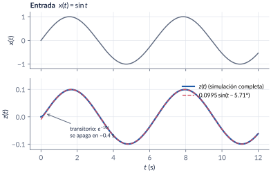
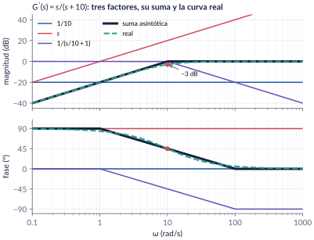
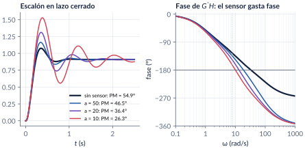
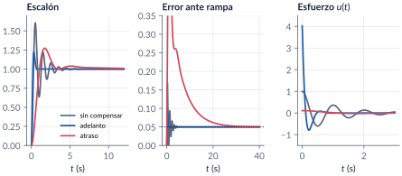

```{=html}
<div class="franja"><div class="rotulo">Parte 10 · Semanas 13–16</div><div class="titulo">Respuesta frecuencial y diagramas de Bode</div><div class="cita">Compramos libros porque creemos que compramos el tiempo para leerlos. — Warren Zevon</div><svg class="bode" viewBox="0 0 600 160" preserveAspectRatio="none"><path d="M0,30 L170,30 L330,105 L420,105 L600,160" stroke="#ffffff" stroke-opacity=".12" stroke-width="10" fill="none" stroke-linejoin="round"/><path d="M0,30 C120,30 150,32 175,42 C230,65 300,98 330,104 C370,110 400,108 425,112 C480,128 540,148 600,160" stroke="#E09F3E" stroke-width="2.5" fill="none"/></svg></div>
```

Hasta ahora analizamos los sistemas mirando dónde están los polos. En esta parte cambiamos la pregunta: **¿qué le hace el sistema a una senoide?** La respuesta son dos números por frecuencia, que se pueden medir en el laboratorio aunque no se tenga el modelo, y con ellos dibujados en una sola gráfica, el diagrama de Bode, vamos a responder las tres preguntas del curso (estabilidad, transitorio y error) y a diseñar compensadores.

```{=html}
<div class="botones">
  <a class="boton" href="../pdf/cap10_respuesta_frecuencial.pdf">⬇ Handout en PDF</a>
  <a class="boton sec" href="https://github.com/quijanon-bot/NQuijano.github.io/tree/main/fuentes/curso-control/codigo/cap10_respuesta_frecuencial">Códigos en GitHub</a>
  <a class="boton sec" href="../videos.html#parte-10-respuesta-frecuencial">Videos</a>
  <a class="boton sec" href="#explorador">Explorador de Bode</a>
</div>
```

::: {.receta}
[Al terminar esta parte usted podrá]{.caja-titulo}

1. Explicar por qué un sistema lineal y estable responde a una senoide con otra senoide, y calcular su amplitud y su fase.
2. Dibujar a mano el Bode asintótico de una malla abierta con ganancia, integradores y polos y ceros reales, y estimar cuánto se equivoca.
3. Leer los márgenes de ganancia y de fase, decidir si el lazo cerrado es estable y cuánta ganancia admite.
4. Predecir sobrepico, velocidad y error del lazo cerrado mirando solo la malla abierta.
5. Diseñar un controlador proporcional, un adelanto, un atraso o un atraso-adelanto, y verificarlo en MATLAB/Simulink.
:::

## Ruta de las cuatro clases

| Clase | Qué se ve | Handout | Scripts | Videos |
|:--|:--|:--|:--|:--|
| 1 | Historia, malla abierta y lazo abierto, la senoide, el decibel, los cuatro factores, el ejemplo $s/(s+10)$ | §10.1–10.5 | `C1_*` | V1, V2, V10, V11 |
| 2 | Leer un Bode al revés, márgenes, el sensor lento, rango de $\Kc$, Ziegler-Nichols | §10.6–10.7 | `C2_*` | V3, V4, V12 |
| 3 | $\Mr$ y $\wbw$, $\PM\leftrightarrow\zeta$, tipo y error, ajuste de ganancia | §10.8–10.10 | `C3_*` | V5, V6 |
| 4 | Adelanto, atraso, atraso-adelanto, redes RC, el PID visto en frecuencia | §10.11–10.12 | `C4_*` | V7, V8 |

: Lea la sección del handout **antes** de cada clase. {.striped}

## Lo esencial, en una página

::: {.definicion}
[Respuesta en frecuencia]{.caja-titulo}

Un sistema lineal, invariante y **estable** excitado con $x_0\sin\omega t$ responde en estado estacionario con
$$
z_{ss}(t)=x_0\,|\Gma(\jw)|\,\sin\big(\omega t+\angle \Gma(\jw)\big).
$$
El diagrama de Bode guarda esos dos números, $20\log|\Gma(\jw)|$ y $\angle\Gma(\jw)$, para cada $\omega$.
:::

{width=90%}

::: {.cuidado}
[La trampa clásica: la ganancia escondida]{.caja-titulo}

Las reglas asintóticas solo valen con cada factor escrito como $s/\omega_1+1$. Como $s+10=10\,(s/10+1)$, el factor $1/(s+10)$ trae $1/10=-20\dB$ escondidos. Es el error más frecuente en las evaluaciones.
:::

::: {.receta}
[Diagrama de Bode asintótico, paso a paso]{.caja-titulo}

1. Llevar $\Gma(s)$ a la **forma de Bode**: cada factor como $(s/\omega_i+1)$ y la ganancia $\Kb$ sola.
2. Ordenar las esquinas de menor a mayor.
3. Magnitud: arrancar con $20\log\Kb-20N\log\omega$ y sumar $+20\dBdec$ por cada cero y $-20$ por cada polo.
4. Fase: $\pm45^\circ$/década entre $\omega_i/10$ y $10\,\omega_i$ por cada factor real, $-90N^\circ$ por los integradores.
5. Verificar con `bode`. Con polos complejos y $\zeta$ pequeño, la curva real puede estar muy por encima de la asíntota.
:::

{width=95%}

::: {.definicion}
[Márgenes de ganancia y de fase]{.caja-titulo}

La frontera de estabilidad es $\Gma(\jw)=-1$: magnitud $0\dB$ y fase $-180^\circ$ a la vez.

- $\GM=-20\log|\Gma(\jw_{GM})|$, medido donde la fase vale $-180^\circ$: **cuánta ganancia de más aguanta** el lazo.
- $\PM=180^\circ+\angle\Gma(\jw_{PM})$, medido donde $|\Gma|=0\dB$: **cuánto atraso de fase no modelado aguanta**.

Regla práctica (fase mínima): $30^\circ<\PM<60^\circ$ y $\GM>6\dB$.
:::

![Lectura de los márgenes de $10\,000/[(s+1)(s+10)(s+100)]$: $\GM=21.7\dB$ y $\PM=54.9^\circ$.](../figuras/cap10/f_margenes_def.svg){width=90%}

::: {.ideaclave}
[El PM es un presupuesto de fase]{.caja-titulo}

Un sensor de primer orden $a/(s+a)$ que nadie modeló resta cerca de $\tan^{-1}(\wpm/a)$ de fase en el cruce. Con el lazo anterior: $a=50$ deja $\PM=46.5^\circ$ (sobrepico 28 %); $a=10$, $26.3^\circ$ (68 %). La planta es la misma; lo que cambió fue cuánto presupuesto quedó.
:::

{width=95%}

::: {.definicion}
[Del margen de fase al transitorio]{.caja-titulo}

Para la malla abierta $\wn^2/[s(s+2\zeta\wn)]$ el margen de fase depende solo de $\zeta$:
$$
\PM=\tan^{-1}\frac{2\zeta}{\sqrt{-2\zeta^2+\sqrt{1+4\zeta^4}}}\qquad(\PM\approx100\,\zeta\ \text{si}\ \zeta<0.6).
$$

| $\zeta$ | 0.25 | 0.40 | 0.50 | 0.60 | 0.707 |
|:--:|:--:|:--:|:--:|:--:|:--:|
| $\PM$ | $28.0^\circ$ | $43.1^\circ$ | $51.8^\circ$ | $59.2^\circ$ | $65.5^\circ$ |
| $\OS$ | 44.4 % | 25.4 % | 16.3 % | 9.5 % | 4.3 % |
:::

::: {.ideaclave}
[Diseño: primero el error, después la forma]{.caja-titulo}

1. $\Kc$: la ganancia DC más pequeña que cumple el error ($\kp$, $\kv$ o $\ka$ se leen en las **bajas frecuencias**).
2. Términos con $G_c'(0)=1$ para cambiar la forma **en el cruce**: un **adelanto** agrega fase (más rápido, más ruido); un **atraso** atenúa (más lento, menos esfuerzo); un **atraso-adelanto**, ambas cosas.
3. Verificar con `margin` y en el tiempo.
:::

| | cruce (rad/s) | $\PM$ | $\OS$ | $\ts$ (s) | $\wbw$ (rad/s) | $u(0^+)$ |
|:--|:--:|:--:|:--:|:--:|:--:|:--:|
| sin compensar | 6.17 | $18.0^\circ$ | 60 % | 3.7 | 9.8 | 1 |
| adelanto | 8.85 | $49.8^\circ$ | 22 % | 0.6 | 14.5 | 4.03 |
| atraso | 1.68 | $44.8^\circ$ | 27 % | 7.1 | 2.8 | 0.11 |

: $40/[s(s+2)]$ con $\kv=20$ y $\PM_{des}=45^\circ$: mismo error, dos personalidades.

{width=100%}

## Explorador de Bode {#explorador}

Mueva la ganancia, los integradores, los polos y el cero. La curva negra es el **asintótico** que usted dibujaría a mano y la verde, la **real**; abajo aparecen los márgenes y lo que ellos predicen para el lazo cerrado con retroalimentación unitaria. Intente reproducir los ejemplos del handout.

```{=html}
<div class="explorador" id="explorador-bode"></div>
<script src="../recursos/explorador-bode.js"></script>
```

::: {.pausa}
[Retos con el explorador]{.caja-titulo}

1. Con los valores iniciales ($K=10\,000$, polos en 1, 10 y 100) lea los márgenes y compárelos con el ejemplo 10.5 del handout.
2. Suba $K$ hasta que el GM llegue a 0 dB. ¿Qué valor de $K$ obtuvo? Compárelo con $\Kcr=122\,210$ (Routh-Hurwitz).
3. Ponga un integrador, quite el polo en 1 y busque el $K$ que da $\PM\approx52^\circ$ con el polo en 10 (el ejemplo $100/[s(s+10)]$).
:::

## Códigos de esta parte

Los bloques salen directamente de los archivos del [repositorio](https://github.com/quijanon-bot/NQuijano.github.io/tree/main/fuentes/curso-control/codigo/cap10_respuesta_frecuencial). Ejecute antes `iniciarCurso`. Cada script tiene un encabezado con **qué hace**, **qué observar**, los **resultados esperados** y una sugerencia para **explorar**.

::: {.panel-tabset}

### Clase 1

**La senoide (handout §10.2).** Simulación completa contra la predicción de estado estacionario.

```{.matlab include="../../codigo/cap10_respuesta_frecuencial/Clase1_RespuestaFrecuencial/C1_Ej1_RespuestaSenoidal.m" marca="senoide"}
```

**El ejemplo $s/(s+10)$ (§10.5).** Los tres factores con la función del curso `bodeAsintotico`.

```{.matlab include="../../codigo/cap10_respuesta_frecuencial/Clase1_RespuestaFrecuencial/C1_Ej2_Asintotico_s_s10.m" marca="factores"}
```

**La asíntota que engaña (§10.4).**

```{.matlab include="../../codigo/cap10_respuesta_frecuencial/Clase1_RespuestaFrecuencial/C1_Ej3_SegundoOrden.m" marca="sorpresa"}
```

### Clase 2

**Márgenes (§10.7).** Ojo con los nombres de `margin`.

```{.matlab include="../../codigo/cap10_respuesta_frecuencial/Clase2_Margenes/C2_Ej2_Margenes.m" marca="margenes"}
```

**Rango de $\Kc$ con Routh-Hurwitz, sin Symbolic Toolbox.**

```{.matlab include="../../codigo/cap10_respuesta_frecuencial/Clase2_Margenes/C2_Ej3_RangoKc.m" marca="routh"}
```

**El sensor lento.**

```{.matlab include="../../codigo/cap10_respuesta_frecuencial/Clase2_Margenes/C2_Video_SensorMargenFase.m" marca="sensor"}
```

### Clase 3

**Del PM al transitorio (§10.8).**

```{.matlab include="../../codigo/cap10_respuesta_frecuencial/Clase3_LazoCerrado/C3_Ej1_PM_zeta.m" marca="receta"}
```

**Ajuste de ganancia (§10.10).**

```{.matlab include="../../codigo/cap10_respuesta_frecuencial/Clase3_LazoCerrado/C3_Ej3_AjusteGanancia.m" marca="ajuste"}
```

### Clase 4

**Los siete pasos del adelanto como función (§10.11).**

```{.matlab include="../../codigo/cap10_respuesta_frecuencial/Clase4_Compensadores/disenoAdelanto.m"}
```

**Atraso-adelanto.**

```{.matlab include="../../codigo/cap10_respuesta_frecuencial/Clase4_Compensadores/C4_Ej4_AtrasoAdelanto.m" marca="atrasoadelanto"}
```

**PID por moldeo del lazo (§10.12).**

```{.matlab include="../../codigo/cap10_respuesta_frecuencial/Clase4_Compensadores/C4_Ej5_PID_Frecuencia.m" marca="moldeo"}
```

### Pruebas

`verificarCap10` comprueba los números clave del capítulo. Córralo cada vez que modifique un código.

```{.matlab include="../../codigo/cap10_respuesta_frecuencial/verificarCap10.m"}
```

:::

## Modelos de Simulink

::: {.modelo}
[Los modelos se construyen por código]{.caja-titulo}

| Script | Modelo | Para qué |
|:--|:--|:--|
| `crearModelo_RespuestaSenoidal.m` | Sine Wave → $G(s)$ → Scope | medir el Bode un punto a la vez; mide amplitud y desfase automáticamente |
| `crearModelo_LazoKc.m` | lazo con $\Kc$ y planta de tercer orden | ver la oscilación sostenida en $\Kc=\Kcr$ |
| `crearModelo_Compensadores.m` | tres lazos en paralelo con selector escalón/rampa | comparar sin compensar, adelanto y atraso: salidas y esfuerzos |

Corra el script y se crea el `.slx`. Así cualquiera puede ver, versionar y mejorar exactamente qué bloques tiene cada modelo.
:::

## Pausas activas

::: {.pausa}
[1. ¿Más grande o más pequeña?]{.caja-titulo}

Si la entrada de $1/(s+10)$ fuera $\sin(100t)$ en lugar de $\sin t$, ¿la salida sería más grande o más pequeña? ¿Más o menos atrasada?

<details class="respuesta"><summary>Respuesta</summary>
Más pequeña y más atrasada: $|G(j100)|=0.00995$ y $\phi=-84.3^\circ$.
</details>
:::

::: {.pausa}
[2. Tres lazos]{.caja-titulo}

(A) $\PM=40^\circ$, $\GM=12\dB$; (B) $\PM=-15^\circ$, $\GM=-4\dB$; (C) $\PM=70^\circ$, $\GM=2\dB$. ¿Cuáles son estables? ¿Cuál le preocupa más?

<details class="respuesta"><summary>Respuesta</summary>
A es estable con márgenes cómodos; B es inestable; C es estable pero frágil: un 26 % más de ganancia lo inestabiliza. Hay que mirar los dos márgenes.
</details>
:::

::: {.pausa}
[3. El tipo 2]{.caja-titulo}

¿Por qué en un sistema tipo 2 la asíntota de baja frecuencia cruza $0\dB$ en $\sqrt{\ka}$ y no en $\ka$?

<details class="respuesta"><summary>Respuesta</summary>
En bajas frecuencias $|\Gma(\jw)|\approx\ka/\omega^2$; igualando a 1, $\omega=\sqrt{\ka}$.
</details>
:::

## Problemas

El handout trae 17 problemas, desde el diagrama asintótico hasta el diseño de un atraso-adelanto, con soluciones de los seis primeros. Los marcados **[M]** se resuelven en MATLAB/Simulink.

```{=html}
<div class="botones"><a class="boton" href="../pdf/cap10_respuesta_frecuencial.pdf#section.10.14">Ir a los problemas (PDF)</a></div>
```

::: {.profundiza}
[Correcciones respecto a la versión anterior]{.caja-titulo}

Adelanto: $\omega_M=8.85$ (no 14). Atraso: con la holgura de $5^\circ$, $\omega=1.68$ y $\PM=44.8^\circ$. Rango de $\Kc$: $\GM=+40\dB$ (no $-40$). $\omega_{GM}$ asintótico del ejemplo $10\,000/[\cdots]$: 31.6 (no 50). Ajuste de ganancia: $\Kc=33\,056$. El pico de resonancia se llama ahora $\Mr$ (antes $M_P$). Todos los números se verificaron de forma independiente.
:::
