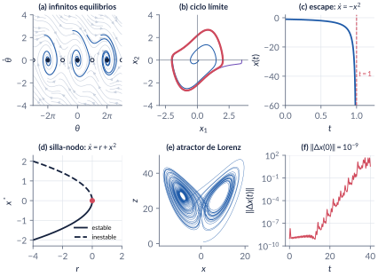
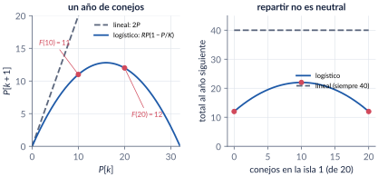
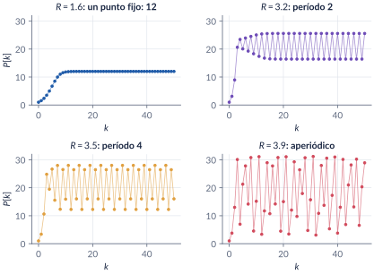
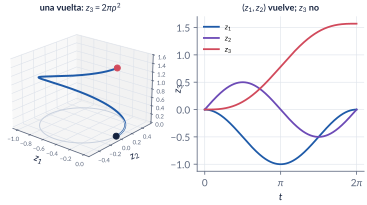
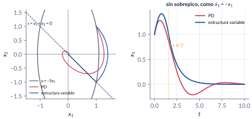

```{=html}
<div class="franja"><div class="rotulo">Parte 1 · Semana 1</div><div class="titulo">Introducción y motivación</div><div class="cita">No solo en la investigación, sino también en el mundo cotidiano de la política y la economía, todos estaríamos mejor si más gente se diera cuenta de que los sistemas no lineales simples no poseen necesariamente propiedades dinámicas simples. — Robert May</div><svg class="fase" viewBox="0 0 600 160" preserveAspectRatio="xMaxYMid slice"><ellipse cx="430" cy="80" rx="30" ry="15" stroke="#ffffff" stroke-opacity=".10" fill="none"/><ellipse cx="430" cy="80" rx="60" ry="30" stroke="#ffffff" stroke-opacity=".10" fill="none"/><ellipse cx="430" cy="80" rx="90" ry="45" stroke="#ffffff" stroke-opacity=".10" fill="none"/><ellipse cx="430" cy="80" rx="120" ry="60" stroke="#ffffff" stroke-opacity=".10" fill="none"/><ellipse cx="430" cy="80" rx="150" ry="75" stroke="#ffffff" stroke-opacity=".10" fill="none"/><ellipse cx="430" cy="80" rx="180" ry="90" stroke="#ffffff" stroke-opacity=".10" fill="none"/><ellipse cx="430" cy="80" rx="210" ry="105" stroke="#ffffff" stroke-opacity=".10" fill="none"/><ellipse cx="430" cy="80" rx="240" ry="120" stroke="#ffffff" stroke-opacity=".10" fill="none"/><polyline points="580.0,80.0 578.7,84.5 577.0,88.9 574.7,93.2 571.9,97.4 568.6,101.4 564.9,105.4 560.8,109.2 556.2,112.9 551.2,116.3 545.9,119.6 540.2,122.8 534.2,125.7 527.9,128.4 521.3,130.9 514.5,133.2 507.4,135.3 500.2,137.1 492.8,138.7 485.3,140.1 477.6,141.3 469.9,142.2 462.2,142.8 454.4,143.3 446.7,143.5 439.0,143.4 431.4,143.2 423.8,142.7 416.4,142.0 409.1,141.1 402.0,139.9 395.1,138.6 388.4,137.1 382.0,135.3 375.8,133.4 369.9,131.4 364.3,129.2 359.0,126.8 354.0,124.3 349.3,121.7 345.1,118.9 341.1,116.0 337.6,113.1 334.4,110.1 331.6,107.0 329.2,103.8 327.2,100.6 325.6,97.4 324.4,94.1 323.6,90.9 323.2,87.6 323.2,84.4 323.6,81.1 324.4,78.0 325.5,74.8 327.0,71.8 328.8,68.8 331.0,65.9 333.5,63.0 336.3,60.3 339.5,57.7 342.9,55.2 346.6,52.8 350.5,50.5 354.7,48.4 359.1,46.4 363.7,44.6 368.5,42.9 373.4,41.4 378.5,40.0 383.7,38.8 389.0,37.8 394.3,36.9 399.8,36.2 405.2,35.7 410.7,35.3 416.2,35.1 421.7,35.1 427.1,35.2 432.5,35.5 437.7,35.9 442.9,36.5 448.0,37.3 452.9,38.2 457.7,39.2 462.4,40.4 466.8,41.7 471.1,43.1 475.1,44.6 479.0,46.3 482.6,48.0 485.9,49.8 489.1,51.8 491.9,53.7 494.5,55.8 496.9,57.9 499.0,60.1 500.7,62.3 502.3,64.6 503.5,66.9 504.4,69.2 505.1,71.5 505.5,73.8 505.6,76.1 505.4,78.4 505.0,80.6 504.3,82.9 503.3,85.0 502.1,87.2 500.7,89.3 499.0,91.3 497.0,93.3 494.9,95.2 492.6,97.0 490.0,98.7 487.3,100.3 484.4,101.8 481.3,103.3 478.1,104.6 474.8,105.8 471.3,107.0 467.8,108.0 464.1,108.9 460.4,109.6 456.6,110.3 452.8,110.8 448.9,111.3 445.0,111.6 441.2,111.7 437.3,111.8 433.4,111.8 429.6,111.6 425.9,111.3 422.2,110.9 418.5,110.4 415.0,109.8 411.6,109.1 408.3,108.4 405.1,107.5 402.0,106.5 399.1,105.4 396.3,104.3 393.7,103.1 391.2,101.8 389.0,100.5 386.9,99.1 385.0,97.7 383.2,96.2 381.7,94.6 380.4,93.1 379.2,91.5 378.3,89.9 377.5,88.3 377.0,86.6 376.6,85.0 376.5,83.4 376.5,81.7 376.8,80.1 377.2,78.5 377.8,77.0 378.6,75.5 379.6,74.0 380.7,72.5 382.0,71.1 383.5,69.8 385.1,68.5 386.9,67.2 388.7,66.0 390.8,64.9 392.9,63.9 395.1,62.9 397.4,62.0 399.9,61.2 402.3,60.5 404.9,59.8 407.5,59.2 410.2,58.7 412.9,58.3 415.6,58.0 418.4,57.7 421.1,57.6 423.9,57.5 426.6,57.5 429.3,57.6 432.0,57.8 434.6,58.0 437.2,58.3 439.7,58.7 442.2,59.2 444.5,59.7 446.8,60.3 449.0,61.0 451.2,61.7 453.2,62.5 455.0,63.3 456.8,64.2 458.5,65.2 460.0,66.1 461.4,67.1 462.7,68.2 463.8,69.2 464.8,70.3 465.7,71.5 466.4,72.6 467.0,73.7 467.4,74.9 467.7,76.1 467.9,77.2 467.9,78.4 467.7,79.5 467.5,80.6 467.1,81.7 466.6,82.8 465.9,83.9 465.2,84.9 464.3,85.9 463.3,86.9 462.2,87.8 461.0,88.7 459.7,89.6 458.3,90.4 456.8,91.2 455.3,91.9 453.6,92.5 452.0,93.1 450.2,93.7 448.4,94.1 446.6,94.6 444.7,94.9 442.8,95.3 440.9,95.5 438.9,95.7 437.0,95.8 435.0,95.9 433.1,95.9 431.2,95.9 429.3,95.8 427.4,95.6 425.6,95.4 423.8,95.2 422.0,94.9 420.3,94.5 418.7,94.1 417.1,93.6 415.6,93.1 414.1,92.6 412.7,92.0 411.5,91.4 410.3,90.8 409.1,90.1 408.1,89.4 407.2,88.6 406.3,87.9 405.6,87.1 405.0,86.3 404.4,85.5 404.0,84.7 403.6,83.9 403.4,83.1 403.2,82.3 403.2,81.5 403.2,80.6 403.4,79.8 403.6,79.0 404.0,78.3 404.4,77.5 404.9,76.8 405.5,76.0 406.2,75.4 406.9,74.7 407.7,74.0 408.6,73.4 409.6,72.8 410.6,72.3 411.7,71.8 412.8,71.3 414.0,70.9 415.2,70.5 416.5,70.1 417.8,69.8 419.1,69.5 420.5,69.3 421.8,69.1 423.2,68.9 424.6,68.8 425.9,68.7 427.3,68.7 428.7,68.7 430.0,68.8 431.4,68.9 432.7,69.0 434.0,69.2 435.2,69.4 436.4,69.6 437.6,69.9 438.8,70.2 439.8,70.6 440.9,70.9 441.9,71.3 442.8,71.8 443.7,72.2 444.5,72.7 445.2,73.2 445.9,73.7 446.5,74.2 447.1,74.8 447.6,75.3 448.0,75.9 448.3,76.5 448.6,77.0 448.8,77.6 448.9,78.2 449.0,78.8 449.0,79.3 448.9,79.9 448.7,80.5 448.5,81.0 448.2,81.6 447.9,82.1 447.5,82.6 447.0,83.1 446.5,83.6 446.0,84.1 445.3,84.5 444.7,84.9 444.0,85.3 443.2,85.7 442.4,86.0 441.6,86.4 440.8,86.6 439.9,86.9 439.0,87.1 438.0,87.4 437.1,87.5 436.1,87.7 435.2,87.8 434.2,87.9 433.2,87.9 432.3,88.0 431.3,88.0 430.3,88.0 429.4,87.9 428.4,87.8 427.5,87.7 426.6,87.6 425.8,87.4 424.9,87.2 424.1,87.0 423.3,86.8 422.6,86.5 421.8,86.2 421.2,85.9 420.5,85.6 419.9,85.3 419.4,84.9 418.9,84.6 418.4,84.2 418.0,83.8 417.7,83.5 417.4,83.1 417.1,82.7 416.9,82.3 416.7,81.8 416.6,81.4 416.6,81.0 416.6,80.6 416.6,80.2 416.7,79.8 416.8,79.4 417.0,79.0 417.2,78.6 417.5,78.3 417.8,77.9 418.2,77.6 418.6,77.2 419.0,76.9 419.4,76.6 419.9,76.3 420.4,76.1 421.0,75.8 421.6,75.6 422.2,75.4 422.8,75.2 423.4,75.0 424.1,74.8 424.7,74.7 425.4,74.6 426.1,74.5 426.8,74.4 427.5,74.4 428.2,74.4 428.8,74.3 429.5,74.4 430.2,74.4 430.9,74.4 431.5,74.5 432.2,74.6 432.8,74.7 433.4,74.8 434.0,75.0" stroke="#E09F3E" stroke-width="2.5" fill="none"/><circle cx="430" cy="80" r="4" fill="#E09F3E"/></svg></div>
```

Casi todo lo que usted conoce de sistemas dinámicos descansa en la **superposición**: la respuesta a una suma de causas es la suma de las respuestas. Esta parte muestra qué se pierde sin ella. Un sistema no lineal puede tener varios equilibrios aislados, oscilar con una amplitud que no depende de la condición inicial, dejar de existir en tiempo finito, cambiar de período con la amplitud y ser caótico. Y en control, una ley lineal puede no estabilizar nada, una no lineal puede hacerlo mejor, y hay sistemas controlables que ninguna ley continua estabiliza.

```{=html}
<div class="botones">
  <a class="boton" href="../pdf/cap01_introduccion.pdf">⬇ Capítulo en PDF</a>
  <a class="boton sec" href="https://github.com/quijanon-bot/NQuijano.github.io/tree/main/fuentes/curso-sisnl/codigo/cap01_introduccion">Códigos en GitHub</a>
  <a class="boton sec" href="#explorador">Explorador interactivo</a>
</div>
```

::: {.receta}
[Al terminar esta parte usted podrá]{.caja-titulo}

1. Escribir un modelo en variables de estado $\dot x=f(t,x,u)$, $y=h(t,x,u)$, encontrar sus equilibrios y trasladarlos al origen.
2. Reconocer cinco comportamientos que ningún sistema lineal puede tener: equilibrios aislados múltiples, ciclos límite, escape en tiempo finito, dependencia de la amplitud y caos.
3. Explicar con un ejemplo por qué el todo no es la suma de las partes, y por qué la versión discreta y la continua de la ecuación logística no se comportan igual.
4. Usar la energía para concluir algo sobre un sistema sin resolverlo, y decir qué *no* se puede concluir todavía.
5. Dar ejemplos en los que el control lineal no basta, incluido uno en el que ningún control continuo funciona (Brockett).
6. Distinguir una conclusión plausible de una correcta, que es el hilo de todo el curso.
:::

## Ruta de la clase

| Clase | Qué se ve | Capítulo | Scripts |
|:--|:--|:--|:--|
| 1 | Por qué no lineal: superposición y los conejos de dos islas. Modelos de estado, equilibrios, reescalamiento. Cinco cosas que un sistema lineal no puede hacer. La logística discreta y la continua | §1.1–1.4 | `C1_Ej1`, `C1_Ej2`, `C1_Ej3`, `C1_Ej5` |
| (lectura) | Energía y LaSalle en miniatura; el integrador de Brockett; qué aporta lo no lineal al control; historia; cómo trabajar en el curso | §1.5–1.8 | `C1_Ej4`, `C1_Ej6`–`C1_Ej9` |

: Lea la sección del capítulo **antes** de cada clase. {.striped}

## Lo esencial, en una página

{width=100%}

::: {.definicion}
[Modelo de estado y equilibrio (Khalil, §1.1)]{.caja-titulo}

Un sistema no lineal es $\dot x=f(t,x,u)$, $y=h(t,x,u)$, con $x\in\R^n$. Es **invariante en el tiempo** si $f$ no depende de $t$ (no decimos "autónomo"). Un punto $\eq$ es un **equilibrio** de $\dot x=f(x)$ si $f(\eq)=0$; con $z=x-\eq$ se traslada al origen sin cambiar nada más. Un sistema lineal no puede tener dos equilibrios aislados.
:::

{width=95%}

{width=90%}

::: {.trampa}
[Trampa: la logística discreta y la continua describen lo mismo]{.caja-titulo}

Una es dócil (dos equilibrios, monotonía, solución explícita) y la otra es caótica. En el mapa, $R$ es un factor por generación; en la ecuación diferencial, una tasa. Discretizar no es una operación inocente.
:::

::: {.ideaclave}
[Concluir sin resolver]{.caja-titulo}

Para el masa-resorte con fricción, $E=\tfrac12kx_1^2+\tfrac12mx_2^2$ cumple $\dot E=-cx_2^2\le0$: la energía nunca crece, y eso se sabe sin resolver la ecuación. Es el método de Lyapunov en miniatura. Pero $\dot E=0$ en toda la recta $x_2=0$: para concluir que el bloque se detiene en el origen hace falta el principio de invarianza de LaSalle.
:::

::: {.trampa}
[Trampa: controlable implica estabilizable]{.caja-titulo}

El integrador de Brockett $\dot z_1=v_1$, $\dot z_2=v_2$, $\dot z_3=z_1v_2-z_2v_1$ es controlable (una vuelta en $(z_1,z_2)$ sube $z_3$ en $2\pi\rho^2$), pero el punto $(0,0,\delta)$ nunca es una velocidad posible: falla la condición de Brockett y **ninguna** realimentación suave $u=k(z)$ estabiliza el origen.
:::

{width=90%}

::: {.trampa}
[Trampa: converge a algo, luego es estable]{.caja-titulo}

Con $\dot x=x+u^3$ y $u=-kx$, el lazo es $\dot x=x-k^3x^3$: el origen **sigue siendo inestable** ($f'(0)=1$ para todo $k$) y la solución converge a otro equilibrio, $k^{-3/2}$. La ley $u=-(kx)^{1/3}$ da $\dot x=(1-k)x$: exponencialmente estable.
:::

{width=95%}

## Explorador interactivo {#explorador}

Cuatro pestañas con los ejemplos del capítulo. Todo se calcula en su navegador (los mismos modelos de `C1_Ej2`, `C1_Ej3`, `C1_Ej6` y `C1_Ej7`).

```{=html}
<div class="explorador" id="explorador-introduccion"></div>
<script src="../recursos/explorador-introduccion.js"></script>
```

::: {.pausa}
[Retos con el explorador]{.caja-titulo}

1. **Mapa logístico:** suba $R$ lentamente desde $2.9$. ¿En qué valor deja de converger la población? Compare con $F'(P^*)=2-R$.
2. **Mapa logístico:** con $R=3.83$ aparece un ciclo de período 3 en medio del caos. Búsquelo.
3. **$\dot x=x+u^3$:** con la ley lineal, ponga $x(0)=10^{-3}$. ¿Se queda cerca del origen? ¿Por qué no?
4. **Doble integrador:** busque ganancias del PD que lleguen al 2 % antes que la ley de estructura variable. ¿Qué precio pagan?
5. **Lorenz:** con $\delta=10^{-12}$, ¿cuánto tiempo más se demoran en separarse que con $\delta=10^{-9}$? ¿Es lo que predice $\ln(1/\delta)/0.9$?
:::

## Códigos de esta parte

Los bloques salen directamente de los archivos del [repositorio](https://github.com/quijanon-bot/NQuijano.github.io/tree/main/fuentes/curso-sisnl/codigo/cap01_introduccion). Ejecute antes `iniciarCurso`. `verificarCap01` comprueba los números del capítulo (34/34).

::: {.panel-tabset}

### Superposición y logística

**Una isla o dos (§1.1).**

```{.matlab include="../../codigo/cap01_introduccion/C1_Ej1_Superposicion.m" marca="islas"}
```

**Iterar el mapa logístico (§1.4).**

```{.matlab include="../../codigo/cap01_introduccion/C1_Ej2_Logistica.m" marca="discreta"}
```

**Puntos fijos, ciclos y caos (§1.4).**

```{.matlab include="../../codigo/cap01_introduccion/C1_Ej2_Logistica.m" marca="regimenes"}
```

### Fenómenos

**Reescalar: tres sistemas, una curva (§1.2).**

```{.matlab include="../../codigo/cap01_introduccion/C1_Ej5_Reescalamiento.m" marca="reescalar"}
```

**El período del péndulo depende de la amplitud (§1.3).**

```{.matlab include="../../codigo/cap01_introduccion/C1_Ej3_Panorama.m" marca="periodo"}
```

**Sensibilidad a las condiciones iniciales (§1.3).**

```{.matlab include="../../codigo/cap01_introduccion/C1_Ej3_Panorama.m" marca="lorenz"}
```

### Energía y Brockett

**La energía a lo largo de una solución (§1.5).**

```{.matlab include="../../codigo/cap01_introduccion/C1_Ej4_Energia.m" marca="energia"}
```

**Una vuelta sube $z_3$ (§1.5).**

```{.matlab include="../../codigo/cap01_introduccion/C1_Ej8_Brockett.m" marca="vuelta"}
```

### Control

**Tres leyes para $\dot x=x+u^3$ (§1.6).**

```{.matlab include="../../codigo/cap01_introduccion/C1_Ej6_ControlCubico.m" marca="leyes"}
```

**Estructura variable (§1.6).** El modelo de Simulink se construye con `crearModelo_EstructuraVariable.m`.

```{.matlab include="../../codigo/cap01_introduccion/C1_Ej7_DobleIntegrador.m" marca="vsc"}
```

**PD, PID, perturbación y ruido (§1.6).**

```{.matlab include="../../codigo/cap01_introduccion/C1_Ej9_PID.m" marca="pid"}
```

:::

## Videos

| Video | Qué muestra | Script |
|:--|:--|:--|
| [V1.1 · Lorenz](../videos/V1_1_lorenz.mp4) | Dos trayectorias a $10^{-9}$: indistinguibles durante 25 segundos, luego cada una por su lado. | `C1_Video_Lorenz.m` |
| [V1.2 · Mapa logístico](../videos/V1_2_logistica.mp4) | La telaraña mientras $R$ crece y el diagrama de bifurcación que se va dibujando. | `C1_Video_Logistica.m` |

```{=html}
<video controls preload="metadata" style="width:100%;max-width:820px;border-radius:8px" src="../videos/V1_1_lorenz.mp4"></video>
```

## Problemas

Los problemas del capítulo (§1.10) tienen cada uno una trampa; las soluciones seleccionadas están en §1.11 y las respuestas a las pausas al final del capítulo.
