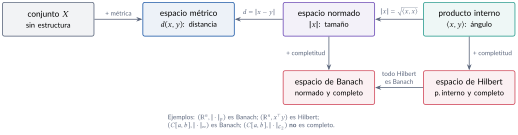
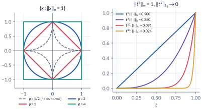
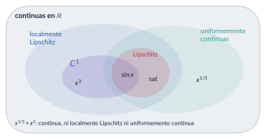
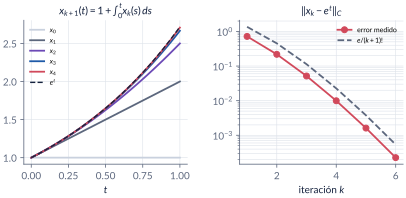
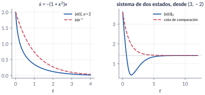

```{=html}
<div class="franja"><div class="rotulo">Parte 3 · Semanas 3–4</div><div class="titulo">Fundamentos matemáticos</div><div class="cita">Los amores pasados siempre ofenden a los amantes nuevos, por muy muertos que estén aquellos. — Javier Marías</div><svg class="fase" viewBox="0 0 600 160" preserveAspectRatio="xMaxYMid slice"><ellipse cx="430" cy="80" rx="30" ry="15" stroke="#ffffff" stroke-opacity=".10" fill="none"/><ellipse cx="430" cy="80" rx="60" ry="30" stroke="#ffffff" stroke-opacity=".10" fill="none"/><ellipse cx="430" cy="80" rx="90" ry="45" stroke="#ffffff" stroke-opacity=".10" fill="none"/><ellipse cx="430" cy="80" rx="120" ry="60" stroke="#ffffff" stroke-opacity=".10" fill="none"/><ellipse cx="430" cy="80" rx="150" ry="75" stroke="#ffffff" stroke-opacity=".10" fill="none"/><ellipse cx="430" cy="80" rx="180" ry="90" stroke="#ffffff" stroke-opacity=".10" fill="none"/><ellipse cx="430" cy="80" rx="210" ry="105" stroke="#ffffff" stroke-opacity=".10" fill="none"/><ellipse cx="430" cy="80" rx="240" ry="120" stroke="#ffffff" stroke-opacity=".10" fill="none"/><polyline points="580.0,80.0 578.7,84.5 577.0,88.9 574.7,93.2 571.9,97.4 568.6,101.4 564.9,105.4 560.8,109.2 556.2,112.9 551.2,116.3 545.9,119.6 540.2,122.8 534.2,125.7 527.9,128.4 521.3,130.9 514.5,133.2 507.4,135.3 500.2,137.1 492.8,138.7 485.3,140.1 477.6,141.3 469.9,142.2 462.2,142.8 454.4,143.3 446.7,143.5 439.0,143.4 431.4,143.2 423.8,142.7 416.4,142.0 409.1,141.1 402.0,139.9 395.1,138.6 388.4,137.1 382.0,135.3 375.8,133.4 369.9,131.4 364.3,129.2 359.0,126.8 354.0,124.3 349.3,121.7 345.1,118.9 341.1,116.0 337.6,113.1 334.4,110.1 331.6,107.0 329.2,103.8 327.2,100.6 325.6,97.4 324.4,94.1 323.6,90.9 323.2,87.6 323.2,84.4 323.6,81.1 324.4,78.0 325.5,74.8 327.0,71.8 328.8,68.8 331.0,65.9 333.5,63.0 336.3,60.3 339.5,57.7 342.9,55.2 346.6,52.8 350.5,50.5 354.7,48.4 359.1,46.4 363.7,44.6 368.5,42.9 373.4,41.4 378.5,40.0 383.7,38.8 389.0,37.8 394.3,36.9 399.8,36.2 405.2,35.7 410.7,35.3 416.2,35.1 421.7,35.1 427.1,35.2 432.5,35.5 437.7,35.9 442.9,36.5 448.0,37.3 452.9,38.2 457.7,39.2 462.4,40.4 466.8,41.7 471.1,43.1 475.1,44.6 479.0,46.3 482.6,48.0 485.9,49.8 489.1,51.8 491.9,53.7 494.5,55.8 496.9,57.9 499.0,60.1 500.7,62.3 502.3,64.6 503.5,66.9 504.4,69.2 505.1,71.5 505.5,73.8 505.6,76.1 505.4,78.4 505.0,80.6 504.3,82.9 503.3,85.0 502.1,87.2 500.7,89.3 499.0,91.3 497.0,93.3 494.9,95.2 492.6,97.0 490.0,98.7 487.3,100.3 484.4,101.8 481.3,103.3 478.1,104.6 474.8,105.8 471.3,107.0 467.8,108.0 464.1,108.9 460.4,109.6 456.6,110.3 452.8,110.8 448.9,111.3 445.0,111.6 441.2,111.7 437.3,111.8 433.4,111.8 429.6,111.6 425.9,111.3 422.2,110.9 418.5,110.4 415.0,109.8 411.6,109.1 408.3,108.4 405.1,107.5 402.0,106.5 399.1,105.4 396.3,104.3 393.7,103.1 391.2,101.8 389.0,100.5 386.9,99.1 385.0,97.7 383.2,96.2 381.7,94.6 380.4,93.1 379.2,91.5 378.3,89.9 377.5,88.3 377.0,86.6 376.6,85.0 376.5,83.4 376.5,81.7 376.8,80.1 377.2,78.5 377.8,77.0 378.6,75.5 379.6,74.0 380.7,72.5 382.0,71.1 383.5,69.8 385.1,68.5 386.9,67.2 388.7,66.0 390.8,64.9 392.9,63.9 395.1,62.9 397.4,62.0 399.9,61.2 402.3,60.5 404.9,59.8 407.5,59.2 410.2,58.7 412.9,58.3 415.6,58.0 418.4,57.7 421.1,57.6 423.9,57.5 426.6,57.5 429.3,57.6 432.0,57.8 434.6,58.0 437.2,58.3 439.7,58.7 442.2,59.2 444.5,59.7 446.8,60.3 449.0,61.0 451.2,61.7 453.2,62.5 455.0,63.3 456.8,64.2 458.5,65.2 460.0,66.1 461.4,67.1 462.7,68.2 463.8,69.2 464.8,70.3 465.7,71.5 466.4,72.6 467.0,73.7 467.4,74.9 467.7,76.1 467.9,77.2 467.9,78.4 467.7,79.5 467.5,80.6 467.1,81.7 466.6,82.8 465.9,83.9 465.2,84.9 464.3,85.9 463.3,86.9 462.2,87.8 461.0,88.7 459.7,89.6 458.3,90.4 456.8,91.2 455.3,91.9 453.6,92.5 452.0,93.1 450.2,93.7 448.4,94.1 446.6,94.6 444.7,94.9 442.8,95.3 440.9,95.5 438.9,95.7 437.0,95.8 435.0,95.9 433.1,95.9 431.2,95.9 429.3,95.8 427.4,95.6 425.6,95.4 423.8,95.2 422.0,94.9 420.3,94.5 418.7,94.1 417.1,93.6 415.6,93.1 414.1,92.6 412.7,92.0 411.5,91.4 410.3,90.8 409.1,90.1 408.1,89.4 407.2,88.6 406.3,87.9 405.6,87.1 405.0,86.3 404.4,85.5 404.0,84.7 403.6,83.9 403.4,83.1 403.2,82.3 403.2,81.5 403.2,80.6 403.4,79.8 403.6,79.0 404.0,78.3 404.4,77.5 404.9,76.8 405.5,76.0 406.2,75.4 406.9,74.7 407.7,74.0 408.6,73.4 409.6,72.8 410.6,72.3 411.7,71.8 412.8,71.3 414.0,70.9 415.2,70.5 416.5,70.1 417.8,69.8 419.1,69.5 420.5,69.3 421.8,69.1 423.2,68.9 424.6,68.8 425.9,68.7 427.3,68.7 428.7,68.7 430.0,68.8 431.4,68.9 432.7,69.0 434.0,69.2 435.2,69.4 436.4,69.6 437.6,69.9 438.8,70.2 439.8,70.6 440.9,70.9 441.9,71.3 442.8,71.8 443.7,72.2 444.5,72.7 445.2,73.2 445.9,73.7 446.5,74.2 447.1,74.8 447.6,75.3 448.0,75.9 448.3,76.5 448.6,77.0 448.8,77.6 448.9,78.2 449.0,78.8 449.0,79.3 448.9,79.9 448.7,80.5 448.5,81.0 448.2,81.6 447.9,82.1 447.5,82.6 447.0,83.1 446.5,83.6 446.0,84.1 445.3,84.5 444.7,84.9 444.0,85.3 443.2,85.7 442.4,86.0 441.6,86.4 440.8,86.6 439.9,86.9 439.0,87.1 438.0,87.4 437.1,87.5 436.1,87.7 435.2,87.8 434.2,87.9 433.2,87.9 432.3,88.0 431.3,88.0 430.3,88.0 429.4,87.9 428.4,87.8 427.5,87.7 426.6,87.6 425.8,87.4 424.9,87.2 424.1,87.0 423.3,86.8 422.6,86.5 421.8,86.2 421.2,85.9 420.5,85.6 419.9,85.3 419.4,84.9 418.9,84.6 418.4,84.2 418.0,83.8 417.7,83.5 417.4,83.1 417.1,82.7 416.9,82.3 416.7,81.8 416.6,81.4 416.6,81.0 416.6,80.6 416.6,80.2 416.7,79.8 416.8,79.4 417.0,79.0 417.2,78.6 417.5,78.3 417.8,77.9 418.2,77.6 418.6,77.2 419.0,76.9 419.4,76.6 419.9,76.3 420.4,76.1 421.0,75.8 421.6,75.6 422.2,75.4 422.8,75.2 423.4,75.0 424.1,74.8 424.7,74.7 425.4,74.6 426.1,74.5 426.8,74.4 427.5,74.4 428.2,74.4 428.8,74.3 429.5,74.4 430.2,74.4 430.9,74.4 431.5,74.5 432.2,74.6 432.8,74.7 433.4,74.8 434.0,75.0" stroke="#E09F3E" stroke-width="2.5" fill="none"/><circle cx="430" cy="80" r="4" fill="#E09F3E"/></svg></div>
```

Antes de hablar de estabilidad hay que saber **medir**: la distancia entre dos estados, el tamaño de una señal, la pendiente máxima de un campo vectorial. Esta parte arma esas herramientas (métricas, normas, producto interno, completitud, condición de Lipschitz) y las usa para responder la pregunta que todo lo demás da por sentada: ¿la ecuación $\dot x=f(t,x)$ tiene una solución, una sola, y para todo tiempo? La respuesta es "no siempre", y los contraejemplos (no unicidad, escape en tiempo finito) son tan importantes como el teorema.

```{=html}
<div class="botones">
  <a class="boton" href="../pdf/cap03_preliminares.pdf">⬇ Capítulo en PDF</a>
  <a class="boton sec" href="https://github.com/quijanon-bot/NQuijano.github.io/tree/main/fuentes/curso-sisnl/codigo/cap03_preliminares">Códigos en GitHub</a>
  <a class="boton sec" href="#explorador">Explorador interactivo</a>
</div>
```

::: {.receta}
[Al terminar esta parte usted podrá]{.caja-titulo}

1. Decir qué estructura tiene un espacio (métrica, norma, producto interno, completitud) y qué preguntas permite responder cada una.
2. Calcular normas de vectores, de señales y de matrices, y usar la equivalencia de normas en $\R^n$ sin extenderla a espacios de funciones.
3. Clasificar un campo vectorial como continuo, $\Cont1$, localmente Lipschitz, Lipschitz o globalmente Lipschitz, y calcular una constante de Lipschitz con el jacobiano.
4. Enunciar y demostrar el teorema de existencia y unicidad local, y decir qué hipótesis falla en cada contraejemplo (no unicidad, escape en tiempo finito).
5. Acotar soluciones que no se pueden calcular con la desigualdad de Gronwall–Bellman y el lema de comparación.
:::

## Ruta de las clases

| Clase | Qué se ve | Capítulo | Scripts |
|:--|:--|:--|:--|
| 1 | Espacio = conjunto + estructura. Métricas, normas de vectores y de señales, equivalencia de normas | §3.1–3.3 | `C3_Ej1`, `C3_Ej2` |
| 2 | Normas inducidas de matrices, producto interno, Cauchy–Schwarz, espacios completos, conjuntos en $\R^n$ | §3.3–3.6 | `C3_Ej3`, `C3_Ej4` |
| 3 | Jerarquía de regularidad, condición de Lipschitz, existencia y unicidad local (prueba con contracción) | §3.7–3.9 | `C3_Ej5`, `C3_Ej6`, `C3_Ej7` |
| 4 | Existencia global, escape en tiempo finito, Gronwall–Bellman, dependencia de condiciones iniciales, lema de comparación | §3.9–3.10 | `C3_Ej8`, `C3_Ej9`, `C3_Ej10` |

: Lea la sección del capítulo **antes** de cada clase. {.striped}

## Lo esencial, en una página

{width=80%}

::: {.definicion}
[Normas (Khalil, §A.1)]{.caja-titulo}

Una **norma** en un espacio vectorial $X$ es una función $\norm{\cdot}:X\to\Rp$ con $\norm x=0\iff x=0$, $\norm{\alpha x}=\abs\alpha\norm x$ y $\norm{x+y}\le\norm x+\norm y$. En $\R^n$, $\norm x_p=\bigl(\sum_i\abs{x_i}^p\bigr)^{1/p}$ para $1\le p<\infty$ y $\norm x_\infty=\max_i\abs{x_i}$. Todas las normas de $\R^n$ son **equivalentes**: $c_1\norm x_a\le\norm x_b\le c_2\norm x_a$. La norma inducida de una matriz es $\norm A=\max_{\norm x=1}\norm{Ax}$; en particular $\norm A_2=\sqrt{\lmax(A\T A)}$.
:::

{width=95%}

::: {.trampa}
[Trampa: la equivalencia de normas es un privilegio de $\R^n$]{.caja-titulo}

"Todas las normas son equivalentes; si una señal es pequeña en $\mathcal{L}_1$, es pequeña en la norma del máximo." Falso con funciones: $f_k(t)=t^k$ en $C[0,1]$ tiene $\norm{f_k}_\infty=1$ y $\norm{f_k}_{\mathcal{L}_1}=1/(k+1)\to0$. Con señales hay que decir **en qué norma** es pequeña una señal.
:::

::: {.trampa}
[Trampa: la norma 2 no es el mayor valor propio]{.caja-titulo}

Para $A=\begin{bmatrix}1&2\\-3&4\end{bmatrix}$, el radio espectral es $\sqrt{10}\approx3.16$, pero $\norm A_2=\sqrt{15+5\sqrt5}\approx5.12$. Lo correcto: $\norm A_2=\sqrt{\lmax(A\T A)}$, y solo coincide con $\max\abs{\lambda_i}$ si $A$ es simétrica (o normal).
:::

{width=80%}

::: {.definicion}
[Condición de Lipschitz (Khalil, §3.1)]{.caja-titulo}

$f$ es **Lipschitz** en $W$ si $\norm{f(t,x)-f(t,y)}\le L\norm{x-y}$ para todo $x,y\in W$; **localmente Lipschitz** si cada punto tiene una vecindad donde lo es, y **globalmente Lipschitz** si $W=\R^n$. Si $f\in\Cont1$ y $W$ es convexo y compacto, $L=\max_{x\in W}\norm{\jac fx}$ sirve. Ejemplos: $x^3$ es localmente pero no globalmente Lipschitz; $\sat(x)$ es globalmente Lipschitz sin ser $\Cont1$; $x^{1/3}$ no es Lipschitz en ninguna vecindad de $0$.
:::

::: {.teorema}
[Existencia y unicidad local (Khalil, Teorema 3.1)]{.caja-titulo}

Si $f(t,x)$ es continua a trozos en $t$ y Lipschitz en $x$ en la bola $\{\norm{x-x_0}\le r\}$ para $t\in[t_0,t_1]$, entonces $\dot x=f(t,x)$, $x(t_0)=x_0$ tiene una **única** solución en $[t_0,t_0+\delta]$ para algún $\delta>0$. La prueba: el operador de Picard $(Px)(t)=x_0+\int_{t_0}^tf(s,x(s))\dif s$ es una contracción en un espacio de Banach, y la contracción tiene un único punto fijo.
:::

{width=95%}

{width=95%}

::: {.trampa}
[Trampa: el simulador no detecta la no unicidad]{.caja-titulo}

"Simulé $\dot x=x^{1/3}$ desde $x(0)=0$ con `ode45` y obtuve $x(t)\equiv0$; la solución es única." El integrador se queda en una rama; desde $x(0)=10^{-12}$ sigue la otra y llega a $2\sqrt2\approx2.83$ en $t=3$. La unicidad es una propiedad de $f$ y se verifica con Lipschitz, no con una simulación.
:::

::: {.ideaclave}
[Gronwall–Bellman y comparación]{.caja-titulo}

Si $y(t)\le\lambda_0+\int_a^t\mu_0\,y(s)\dif s$ con $\mu_0\ge0$, entonces $y(t)\le\lambda_0e^{\mu_0(t-a)}$. De ahí sale la **dependencia continua** de las condiciones iniciales: $\norm{x(t)-y(t)}\le\norm{x_0-y_0}e^{L(t-t_0)}$. El **lema de comparación** hace lo mismo con una ecuación escalar: si $\dot v\le f(t,v)$ y $\dot u=f(t,u)$ con $v(t_0)\le u(t_0)$, entonces $v(t)\le u(t)$. Sirve para acotar soluciones que no se pueden calcular.
:::

{width=95%}

## Explorador interactivo {#explorador}

Tres pestañas con los ejemplos del capítulo. Todo se calcula en su navegador (los mismos modelos de `C3_Ej2`, `C3_Ej5` y `C3_Ej7`).

```{=html}
<div class="explorador" id="explorador-fundamentos"></div>
<script src="../recursos/explorador-fundamentos.js"></script>
```

::: {.pausa}
[Retos con el explorador]{.caja-titulo}

1. **Normas-p:** baje $p$ por debajo de $1$. ¿Qué propiedad de norma deja de cumplirse? Mírelo en la forma de la "bola".
2. **Lipschitz:** con $x^3$, agrande el intervalo. ¿Qué le pasa a $L$? Con $x^{1/3}$, ponga el vértice en $0$ y achique el intervalo: ¿existe un cono que contenga la gráfica?
3. **Picard:** con $\dot x=x^2$, $x(0)=1$, aumente $T$ hasta $1$. ¿Qué pasa con las iteraciones cerca de $t=1$? Compare con el $\delta=0.207$ que garantiza el teorema.
4. **Picard:** con $\dot x=-x^3$ y $x(0)=2$ la solución existe para todo $t\ge0$. ¿Por qué divergen las iteraciones en $[0,3]$?
:::

## Códigos de esta parte

Los bloques salen directamente de los archivos del [repositorio](https://github.com/quijanon-bot/NQuijano.github.io/tree/main/fuentes/curso-sisnl/codigo/cap03_preliminares). Ejecute antes `iniciarCurso`. `verificarCap03` comprueba los números del capítulo (33/33).

::: {.panel-tabset}

### Clase 1: métricas y normas

**Tres métricas para los mismos dos puntos (§3.2).**

```{.matlab include="../../codigo/cap03_preliminares/C3_Ej1_Metricas.m" marca="vectores"}
```

**Distancia entre señales (§3.2).**

```{.matlab include="../../codigo/cap03_preliminares/C3_Ej1_Metricas.m" marca="funciones"}
```

**Equivalencia de normas en $\R^n$ (§3.3).**

```{.matlab include="../../codigo/cap03_preliminares/C3_Ej2_Normas.m" marca="equivalencia"}
```

**La equivalencia falla con funciones (§3.3).**

```{.matlab include="../../codigo/cap03_preliminares/C3_Ej2_Normas.m" marca="funciones"}
```

### Clase 2: matrices y completitud

**Normas inducidas (§3.3).**

```{.matlab include="../../codigo/cap03_preliminares/C3_Ej3_NormasMatrices.m" marca="inducidas"}
```

**Norma 2 contra radio espectral (§3.3).**

```{.matlab include="../../codigo/cap03_preliminares/C3_Ej3_NormasMatrices.m" marca="espectral"}
```

**Una sucesión de Cauchy sin límite continuo (§3.5).**

```{.matlab include="../../codigo/cap03_preliminares/C3_Ej4_Completitud.m" marca="rampas"}
```

### Clase 3: Lipschitz y existencia

**Constantes de Lipschitz con secantes (§3.8).**

```{.matlab include="../../codigo/cap03_preliminares/C3_Ej5_Lipschitz.m" marca="secantes"}
```

**No unicidad: la familia de soluciones de $\dot x=x^{1/3}$ (§3.9).**

```{.matlab include="../../codigo/cap03_preliminares/C3_Ej6_NoUnicidad.m" marca="familia"}
```

**Iteraciones de Picard (§3.9).**

```{.matlab include="../../codigo/cap03_preliminares/C3_Ej7_Picard.m" marca="picard"}
```

### Clase 4: escape, Gronwall y comparación

**Escape en tiempo finito (§3.9).**

```{.matlab include="../../codigo/cap03_preliminares/C3_Ej8_Escape.m" marca="escape"}
```

**Dependencia de las condiciones iniciales (§3.9).**

```{.matlab include="../../codigo/cap03_preliminares/C3_Ej10_Dependencia.m" marca="dependencia"}
```

**Lema de comparación, caso vectorial (§3.10).**

```{.matlab include="../../codigo/cap03_preliminares/C3_Ej9_Comparacion.m" marca="vectorial"}
```

:::

## Videos

Los videos se generan con los scripts de la tabla (MATLAB, `VideoWriter`).

| Video | Qué muestra | Script |
|:--|:--|:--|
| V3.1 · Picard | Las iteraciones se acercan a la solución en el intervalo del teorema y se separan fuera de él. | `C3_Video_Picard.m` |
| V3.2 · No unicidad | Desde $x(0)=0$, la familia de soluciones de $\dot x=x^{1/3}$ despega en distintos instantes. | `C3_Video_NoUnicidad.m` |

## Problemas

Los problemas del capítulo (§3.12) tienen cada uno una trampa; las soluciones seleccionadas están en §3.13 y las respuestas a las pausas al final del capítulo.
