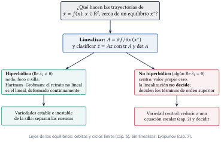
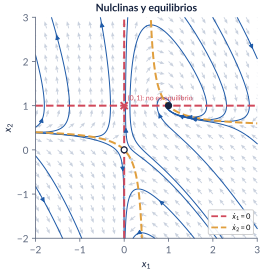
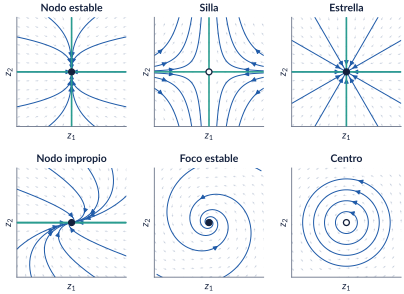
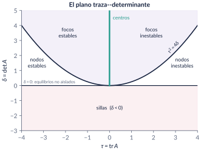
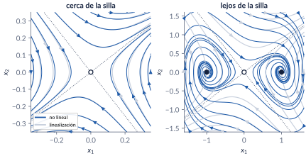
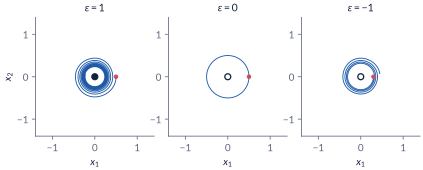
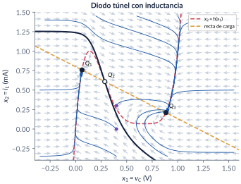
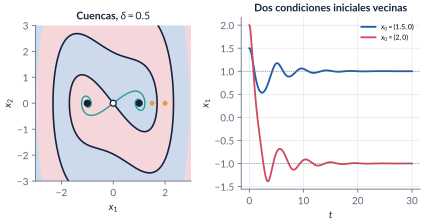
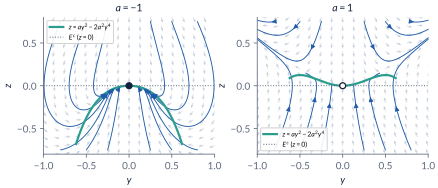

```{=html}
<div class="franja"><div class="rotulo">Parte 4 · Semanas 2 y 5</div><div class="titulo">Sistemas bidimensionales: el plano de fase</div><div class="cita">Porque se sabe: siempre es más sencillo precisar dónde se está, pero la cosa se complica cuando se trata de detallar lo que se es. — Rodrigo Fresán</div><svg class="fase" viewBox="0 0 600 160" preserveAspectRatio="xMaxYMid slice"><ellipse cx="430" cy="80" rx="30" ry="15" stroke="#ffffff" stroke-opacity=".10" fill="none"/><ellipse cx="430" cy="80" rx="60" ry="30" stroke="#ffffff" stroke-opacity=".10" fill="none"/><ellipse cx="430" cy="80" rx="90" ry="45" stroke="#ffffff" stroke-opacity=".10" fill="none"/><ellipse cx="430" cy="80" rx="120" ry="60" stroke="#ffffff" stroke-opacity=".10" fill="none"/><ellipse cx="430" cy="80" rx="150" ry="75" stroke="#ffffff" stroke-opacity=".10" fill="none"/><ellipse cx="430" cy="80" rx="180" ry="90" stroke="#ffffff" stroke-opacity=".10" fill="none"/><ellipse cx="430" cy="80" rx="210" ry="105" stroke="#ffffff" stroke-opacity=".10" fill="none"/><ellipse cx="430" cy="80" rx="240" ry="120" stroke="#ffffff" stroke-opacity=".10" fill="none"/><polyline points="580.0,80.0 578.7,84.5 577.0,88.9 574.7,93.2 571.9,97.4 568.6,101.4 564.9,105.4 560.8,109.2 556.2,112.9 551.2,116.3 545.9,119.6 540.2,122.8 534.2,125.7 527.9,128.4 521.3,130.9 514.5,133.2 507.4,135.3 500.2,137.1 492.8,138.7 485.3,140.1 477.6,141.3 469.9,142.2 462.2,142.8 454.4,143.3 446.7,143.5 439.0,143.4 431.4,143.2 423.8,142.7 416.4,142.0 409.1,141.1 402.0,139.9 395.1,138.6 388.4,137.1 382.0,135.3 375.8,133.4 369.9,131.4 364.3,129.2 359.0,126.8 354.0,124.3 349.3,121.7 345.1,118.9 341.1,116.0 337.6,113.1 334.4,110.1 331.6,107.0 329.2,103.8 327.2,100.6 325.6,97.4 324.4,94.1 323.6,90.9 323.2,87.6 323.2,84.4 323.6,81.1 324.4,78.0 325.5,74.8 327.0,71.8 328.8,68.8 331.0,65.9 333.5,63.0 336.3,60.3 339.5,57.7 342.9,55.2 346.6,52.8 350.5,50.5 354.7,48.4 359.1,46.4 363.7,44.6 368.5,42.9 373.4,41.4 378.5,40.0 383.7,38.8 389.0,37.8 394.3,36.9 399.8,36.2 405.2,35.7 410.7,35.3 416.2,35.1 421.7,35.1 427.1,35.2 432.5,35.5 437.7,35.9 442.9,36.5 448.0,37.3 452.9,38.2 457.7,39.2 462.4,40.4 466.8,41.7 471.1,43.1 475.1,44.6 479.0,46.3 482.6,48.0 485.9,49.8 489.1,51.8 491.9,53.7 494.5,55.8 496.9,57.9 499.0,60.1 500.7,62.3 502.3,64.6 503.5,66.9 504.4,69.2 505.1,71.5 505.5,73.8 505.6,76.1 505.4,78.4 505.0,80.6 504.3,82.9 503.3,85.0 502.1,87.2 500.7,89.3 499.0,91.3 497.0,93.3 494.9,95.2 492.6,97.0 490.0,98.7 487.3,100.3 484.4,101.8 481.3,103.3 478.1,104.6 474.8,105.8 471.3,107.0 467.8,108.0 464.1,108.9 460.4,109.6 456.6,110.3 452.8,110.8 448.9,111.3 445.0,111.6 441.2,111.7 437.3,111.8 433.4,111.8 429.6,111.6 425.9,111.3 422.2,110.9 418.5,110.4 415.0,109.8 411.6,109.1 408.3,108.4 405.1,107.5 402.0,106.5 399.1,105.4 396.3,104.3 393.7,103.1 391.2,101.8 389.0,100.5 386.9,99.1 385.0,97.7 383.2,96.2 381.7,94.6 380.4,93.1 379.2,91.5 378.3,89.9 377.5,88.3 377.0,86.6 376.6,85.0 376.5,83.4 376.5,81.7 376.8,80.1 377.2,78.5 377.8,77.0 378.6,75.5 379.6,74.0 380.7,72.5 382.0,71.1 383.5,69.8 385.1,68.5 386.9,67.2 388.7,66.0 390.8,64.9 392.9,63.9 395.1,62.9 397.4,62.0 399.9,61.2 402.3,60.5 404.9,59.8 407.5,59.2 410.2,58.7 412.9,58.3 415.6,58.0 418.4,57.7 421.1,57.6 423.9,57.5 426.6,57.5 429.3,57.6 432.0,57.8 434.6,58.0 437.2,58.3 439.7,58.7 442.2,59.2 444.5,59.7 446.8,60.3 449.0,61.0 451.2,61.7 453.2,62.5 455.0,63.3 456.8,64.2 458.5,65.2 460.0,66.1 461.4,67.1 462.7,68.2 463.8,69.2 464.8,70.3 465.7,71.5 466.4,72.6 467.0,73.7 467.4,74.9 467.7,76.1 467.9,77.2 467.9,78.4 467.7,79.5 467.5,80.6 467.1,81.7 466.6,82.8 465.9,83.9 465.2,84.9 464.3,85.9 463.3,86.9 462.2,87.8 461.0,88.7 459.7,89.6 458.3,90.4 456.8,91.2 455.3,91.9 453.6,92.5 452.0,93.1 450.2,93.7 448.4,94.1 446.6,94.6 444.7,94.9 442.8,95.3 440.9,95.5 438.9,95.7 437.0,95.8 435.0,95.9 433.1,95.9 431.2,95.9 429.3,95.8 427.4,95.6 425.6,95.4 423.8,95.2 422.0,94.9 420.3,94.5 418.7,94.1 417.1,93.6 415.6,93.1 414.1,92.6 412.7,92.0 411.5,91.4 410.3,90.8 409.1,90.1 408.1,89.4 407.2,88.6 406.3,87.9 405.6,87.1 405.0,86.3 404.4,85.5 404.0,84.7 403.6,83.9 403.4,83.1 403.2,82.3 403.2,81.5 403.2,80.6 403.4,79.8 403.6,79.0 404.0,78.3 404.4,77.5 404.9,76.8 405.5,76.0 406.2,75.4 406.9,74.7 407.7,74.0 408.6,73.4 409.6,72.8 410.6,72.3 411.7,71.8 412.8,71.3 414.0,70.9 415.2,70.5 416.5,70.1 417.8,69.8 419.1,69.5 420.5,69.3 421.8,69.1 423.2,68.9 424.6,68.8 425.9,68.7 427.3,68.7 428.7,68.7 430.0,68.8 431.4,68.9 432.7,69.0 434.0,69.2 435.2,69.4 436.4,69.6 437.6,69.9 438.8,70.2 439.8,70.6 440.9,70.9 441.9,71.3 442.8,71.8 443.7,72.2 444.5,72.7 445.2,73.2 445.9,73.7 446.5,74.2 447.1,74.8 447.6,75.3 448.0,75.9 448.3,76.5 448.6,77.0 448.8,77.6 448.9,78.2 449.0,78.8 449.0,79.3 448.9,79.9 448.7,80.5 448.5,81.0 448.2,81.6 447.9,82.1 447.5,82.6 447.0,83.1 446.5,83.6 446.0,84.1 445.3,84.5 444.7,84.9 444.0,85.3 443.2,85.7 442.4,86.0 441.6,86.4 440.8,86.6 439.9,86.9 439.0,87.1 438.0,87.4 437.1,87.5 436.1,87.7 435.2,87.8 434.2,87.9 433.2,87.9 432.3,88.0 431.3,88.0 430.3,88.0 429.4,87.9 428.4,87.8 427.5,87.7 426.6,87.6 425.8,87.4 424.9,87.2 424.1,87.0 423.3,86.8 422.6,86.5 421.8,86.2 421.2,85.9 420.5,85.6 419.9,85.3 419.4,84.9 418.9,84.6 418.4,84.2 418.0,83.8 417.7,83.5 417.4,83.1 417.1,82.7 416.9,82.3 416.7,81.8 416.6,81.4 416.6,81.0 416.6,80.6 416.6,80.2 416.7,79.8 416.8,79.4 417.0,79.0 417.2,78.6 417.5,78.3 417.8,77.9 418.2,77.6 418.6,77.2 419.0,76.9 419.4,76.6 419.9,76.3 420.4,76.1 421.0,75.8 421.6,75.6 422.2,75.4 422.8,75.2 423.4,75.0 424.1,74.8 424.7,74.7 425.4,74.6 426.1,74.5 426.8,74.4 427.5,74.4 428.2,74.4 428.8,74.3 429.5,74.4 430.2,74.4 430.9,74.4 431.5,74.5 432.2,74.6 432.8,74.7 433.4,74.8 434.0,75.0" stroke="#E09F3E" stroke-width="2.5" fill="none"/><circle cx="430" cy="80" r="4" fill="#E09F3E"/></svg></div>
```

¿Qué hacen las trayectorias de un sistema plano **cerca de un equilibrio**? Esta parte arma el retrato de fase sin resolver la ecuación (campo vectorial, nulclinas), resuelve por completo los sistemas lineales $\dot x=Ax$ y los clasifica con la traza y el determinante, y responde la pregunta que casi nunca se hace en control lineal: **¿cuándo dice la verdad la linealización?** La respuesta es el teorema de Hartman–Grobman, con sus excepciones (los equilibrios no hiperbólicos), que se atacan con la variedad central. Las variedades estable e inestable de las sillas dibujan las fronteras entre cuencas de atracción.

```{=html}
<div class="botones">
  <a class="boton" href="../pdf/cap04_bidimensionales.pdf">⬇ Capítulo en PDF</a>
  <a class="boton sec" href="https://github.com/quijanon-bot/NQuijano.github.io/tree/main/fuentes/curso-sisnl/codigo/cap04_bidimensionales">Códigos en GitHub</a>
  <a class="boton sec" href="#explorador">Explorador interactivo</a>
</div>
```

::: {.receta}
[Al terminar esta parte usted podrá]{.caja-titulo}

1. Dibujar e interpretar el plano de fase de un sistema de segundo orden: campo vectorial, trayectorias, nulclinas y equilibrios, sin resolver la ecuación.
2. Resolver $\dot x=Ax$ con la exponencial de matriz y con un cambio de coordenadas, y probar que la solución es única.
3. Clasificar el origen de $\dot x=Ax$ en $\mathbb R^2$ (nodo, silla, foco, centro y los casos degenerados) con la traza y el determinante, y saber cuáles de esos retratos sobreviven a una perturbación.
4. Linealizar en un equilibrio y usar el teorema de Hartman–Grobman con sus hipótesis: qué garantiza, qué no garantiza y cuándo no dice nada.
5. Reconocer las variedades estable e inestable de una silla y usarlas como fronteras entre cuencas de atracción.
6. Reducir un sistema a su variedad central para decidir la estabilidad cuando la linealización tiene valores propios en el eje imaginario.
:::

## Ruta de las clases

| Semana | Qué se ve | Capítulo | Scripts |
|:--|:--|:--|:--|
| 2 (12 de agosto) | Campo vectorial y plano de fase; nulclinas; la exponencial de matriz y la diagonalización; los retratos lineales y el teorema de traza y determinante; robustez | §4.1–4.4 | `C4_Ej1`–`C4_Ej6` |
| 5 (31 de agosto) | Linealización y Hartman–Grobman; Duffing y el diodo túnel; variedades estable e inestable; variedad central | §4.5–4.8 | `C4_Ej7`–`C4_Ej12`, `crearModelo_DiodoTunel2D` |

: Lea la sección del capítulo **antes** de cada clase. Lo que pasa lejos de los equilibrios (órbitas y ciclos límite) es la [parte 5](05-orbitas-ciclos.qmd); la estabilidad sin linealizar, la [parte 7](07-lyapunov.qmd). {.striped}

## Lo esencial, en una página

{width=90%}

::: {.definicion}
[Nulclinas]{.caja-titulo}

La nulclina de $x_1$ es $\{f_1=0\}$ (el campo es vertical); la de $x_2$, $\{f_2=0\}$ (horizontal). Los equilibrios son los cruces de una nulclina de $x_1$ con una de $x_2$; entre ellas, el flujo va siempre hacia el mismo cuadrante.
:::

{width=60%}

::: {.trampa}
[Trampa: "la trayectoria llega al equilibrio"]{.caja-titulo}

Si $f$ es localmente Lipschitz, ninguna solución alcanza un equilibrio en tiempo finito (contradiría la unicidad hacia atrás). Las trayectorias **tienden** al equilibrio. Sin Lipschitz sí: $\dot x=-\sqrt{|x|}$ llega a $0$ desde $1$ en $t=2$.
:::

::: {.teorema}
[Teorema fundamental y diagonalización]{.caja-titulo}

$x(t)=e^{At}x_0$ es la única solución de $\dot x=Ax$, $x(0)=x_0$. Si $A$ tiene valores propios reales distintos y $P=[v_1\ \cdots\ v_n]$, entonces $P^{-1}AP=\mathrm{diag}(\lambda_i)$ y $e^{At}=P\,\mathrm{diag}(e^{\lambda_it})\,P^{-1}$.
:::

::: {.trampa}
[Trampa: "$\dot x_1=-x_1-3x_2$: como $a_{11}<0$, $x_1$ decae"]{.caja-titulo}

Con $\dot x_2=2x_2$, $x_1(t)=x_1(0)e^{-t}+x_2(0)(e^{-t}-e^{2t})$: desde $(1,1)$ se anula en $t=\tfrac13\ln2$ y se va a $-\infty$. Cada estado mezcla todos los modos.
:::

::: {.teorema}
[Traza y determinante (Perko, §1.5)]{.caja-titulo}

Con $\tau=\mathrm{tr}\,A$, $\delta=\det A\neq0$: **silla** si $\delta<0$; **nodo** si $\delta>0$ y $\tau^2\ge4\delta$; **foco** si $\tau^2<4\delta$ y $\tau\neq0$; **centro** si $\delta>0$ y $\tau=0$. Estable si $\tau<0$. El giro es antihorario si $a_{21}>0$.
:::

{width=95%}

{width=70%}

::: {.trampa}
[Trampa: "en un nodo, las trayectorias llegan por la dirección rápida"]{.caja-titulo}

Llegan tangentes a la dirección **lenta**: con $\lambda=-6,-2$, la componente rápida desaparece primero y lo que queda cerca del origen es la lenta.
:::

::: {.teorema}
[Hartman–Grobman (Grobman 1959, Hartman 1960)]{.caja-titulo}

Si $x^*$ es un equilibrio **hiperbólico** (ningún valor propio de la jacobiana con parte real nula), hay un homeomorfismo local que lleva las trayectorias no lineales a las de $\dot e=Ae$. Es local, $h$ no es única ni diferenciable, y si $x^*$ no es hiperbólico el teorema **no dice nada**.
:::

{width=95%}

::: {.trampa}
[Trampa: "la linealización es un centro: el sistema oscila"]{.caja-titulo}

$\dot x_1=x_2$, $\dot x_2=-x_1-\varepsilon x_1^2x_2$ tiene $\lambda=\pm j$ para todo $\varepsilon$, y $\frac{d}{dt}(x_1^2+x_2^2)=-2\varepsilon x_1^2x_2^2$: espiral hacia adentro si $\varepsilon>0$, hacia afuera si $\varepsilon<0$.
:::

{width=95%}

::: {.ideaclave}
[Biestabilidad: Duffing y el diodo túnel]{.caja-titulo}

Duffing amortiguado ($\delta=0.5$) tiene una silla en el origen y dos focos estables en $(\pm1,0)$; el diodo túnel con inductancia, dos nodos estables separados por una silla. En los dos, la **variedad estable de la silla** es la frontera entre las cuencas: desde $v_C=0.4$ V el diodo termina en $Q_1$ si $i_L(0)=0$ y en $Q_3$ si $i_L(0)\gtrsim0.189$ mA.
:::

{width=75%}

::: {.trampa}
[Trampa: "las condiciones iniciales sobre $E^s$ llegan a la silla"]{.caja-titulo}

En $\dot x_1=-x_1$, $\dot x_2=x_2+x_1^2$, $W^s=\{x_2=-x_1^2/3\}$ es solo **tangente** a $E^s$ (el eje $x_1$); desde $(1,0)$, $x_2(t)=\tfrac13(e^t-e^{-2t})\to\infty$.
:::

{width=95%}

::: {.teorema}
[Variedad central (Khalil, §8.1; Carr, 1981)]{.caja-titulo}

Si la jacobiana tiene $k$ valores propios con parte real nula y los demás con parte real negativa, hay una variedad invariante $z=h(y)$ tangente a $E^c$, y la estabilidad del origen es la del **sistema reducido** $\dot y=A_1y+g_1(y,h(y))$. $h$ se aproxima con la ecuación de invariancia.
:::

::: {.trampa}
[Trampa: "$z$ es rápida: se reemplaza por $z=0$"]{.caja-titulo}

En $\dot y=yz$, $\dot z=-z+ay^2$, con $z=0$ quedaría $\dot y=0$ para todo $a$. Pero $z\to h(y)=ay^2-2a^2y^4+\cdots$ y el reducido es $\dot y=ay^3+\cdots$: estable si $a<0$, inestable si $a>0$.
:::

{width=95%}

## Explorador interactivo {#explorador}

Tres pestañas. Todo se calcula en su navegador (Runge–Kutta de paso fijo, Newton y jacobianas numéricas), con los mismos modelos de `C4_Ej2`, `C4_Ej4`, `C4_Ej5`, `C4_Ej7`–`C4_Ej10` y `C4_Ej12`.

```{=html}
<div class="explorador" id="explorador-bidimensional"></div>
<script src="../recursos/explorador-bidimensional.js"></script>
```

::: {.pausa}
[Retos con el explorador]{.caja-titulo}

1. **Retratos lineales:** escoja el nodo $\mathrm{diag}(-6,-2)$. ¿Por qué eje llegan las trayectorias? Cambie $a_{22}$ a $-8$. ¿Y ahora?
2. **Retratos lineales:** parta del nodo impropio y mueva $a_{21}$ a $-0.05$ y a $+0.05$. ¿Qué tipo aparece en cada caso? ¿Cambia la estabilidad?
3. **Retratos lineales:** construya un centro que gire en sentido horario y otro antihorario. ¿Qué elemento de $A$ decide?
4. **Linealizar:** en el sistema de la clase, haga clic cerca del punto $(0,1)$. ¿Por qué no se queda quieta la trayectoria?
5. **Linealizar:** en Duffing, suba $\delta$ por encima de $2.83$. ¿Qué cambia en los equilibrios $(\pm1,0)$? ¿Y en el retrato?
6. **Linealizar:** en el diodo túnel, lance trayectorias desde $v_C=0.4$ con distintas $i_L(0)$. Encuentre el umbral. Cambie $L$: ¿cambian los equilibrios? ¿Y el umbral?
7. **Linealizar:** en "un centro que no lo es", ponga $\varepsilon=0$ y luego $\pm0.2$. ¿Qué dice la clasificación en los tres casos?
8. **Variedad central:** con $a=-1$, arranque en $z(0)=0.6$. ¿Cuánto tarda en caer a la variedad? Ponga $a=0$: ¿converge $y$ a cero?
:::

## Códigos de esta parte

Los bloques salen directamente de los archivos del [repositorio](https://github.com/quijanon-bot/NQuijano.github.io/tree/main/fuentes/curso-sisnl/codigo/cap04_bidimensionales). Ejecute antes `iniciarCurso`. `verificarCap04` comprueba los números del capítulo (38/38). Ningún script necesita toolboxes. Dos funciones nuevas en `comun/`: `retratoFase` (campo con flechas normalizadas, trayectorias y equilibrios) y `clasificarEquilibrio` (el teorema de traza y determinante, con el sentido de giro).

::: {.panel-tabset}

### Semana 2: plano de fase y lineales

**El campo vectorial y la masa–resorte (§4.2).**

```{.matlab include="../../codigo/cap04_bidimensionales/C4_Ej1_CampoVectorial.m" marca="campo"}
```

```{.matlab include="../../codigo/cap04_bidimensionales/C4_Ej1_CampoVectorial.m" marca="resorte"}
```

**Nulclinas y equilibrios (§4.2).**

```{.matlab include="../../codigo/cap04_bidimensionales/C4_Ej2_Nulclinas.m" marca="nulclinas"}
```

**Diagonalización y exponencial de matriz (§4.3).**

```{.matlab include="../../codigo/cap04_bidimensionales/C4_Ej3_Exponencial.m" marca="diagonal"}
```

**Los seis retratos (§4.4).**

```{.matlab include="../../codigo/cap04_bidimensionales/C4_Ej4_Galeria.m" marca="galeria"}
```

**Traza, determinante y un barrido (§4.4).**

```{.matlab include="../../codigo/cap04_bidimensionales/C4_Ej5_TrazaDeterminante.m" marca="clasificar"}
```

```{.matlab include="../../codigo/cap04_bidimensionales/C4_Ej5_TrazaDeterminante.m" marca="barrido"}
```

**Perturbar un centro y un nodo impropio (§4.4).**

```{.matlab include="../../codigo/cap04_bidimensionales/C4_Ej6_Estructural.m" marca="perturbar"}
```

### Semana 5: linealización y variedades

**Tres equilibrios (§4.5).**

```{.matlab include="../../codigo/cap04_bidimensionales/C4_Ej7_Linealizacion.m" marca="tres"}
```

**Un centro que no lo es (§4.5).**

```{.matlab include="../../codigo/cap04_bidimensionales/C4_Ej8_Centro.m" marca="epsilon"}
```

**Duffing (§4.6).**

```{.matlab include="../../codigo/cap04_bidimensionales/C4_Ej9_Duffing.m" marca="duffing"}
```

**El diodo túnel con su inductancia (§4.6).**

```{.matlab include="../../codigo/cap04_bidimensionales/C4_Ej10_DiodoTunel.m" marca="diodo"}
```

**Variedades estable e inestable (§4.7).**

```{.matlab include="../../codigo/cap04_bidimensionales/C4_Ej11_Variedades.m" marca="exacta"}
```

```{.matlab include="../../codigo/cap04_bidimensionales/C4_Ej11_Variedades.m" marca="variedad"}
```

**La variedad central (§4.8).**

```{.matlab include="../../codigo/cap04_bidimensionales/C4_Ej12_VariedadCentral.m" marca="central"}
```

### Funciones

**`retratoFase` (en `comun/`).**

```{.matlab include="../../codigo/comun/retratoFase.m"}
```

**`clasificarEquilibrio` (en `comun/`).**

```{.matlab include="../../codigo/comun/clasificarEquilibrio.m"}
```

**`variedadSilla` (en `cap04_bidimensionales/`).**

```{.matlab include="../../codigo/cap04_bidimensionales/variedadSilla.m"}
```

### Simulink

El modelo se **construye por código**: ejecute el script y se crea, se simula y se compara con `ode45`.

**`DiodoTunel2D.slx`: el diodo túnel con inductancia, con un gráfico XY del plano de fase.**

```{.matlab include="../../codigo/cap04_bidimensionales/crearModelo_DiodoTunel2D.m"}
```

:::

## Videos

Los videos están publicados (generados con `herramientas/cap04_videos.py`, los mismos modelos y parámetros); los scripts `C4_Video_*` de MATLAB producen la misma animación para grabarla en su computador.

| Video | Qué muestra | Script |
|:--|:--|:--|
| [V4.1 · Traza y determinante](../videos/V4_1_traza_determinante.mp4) | Un punto recorre el plano $(\tau,\delta)$ y el retrato cambia de silla a nodo, foco, centro y de vuelta. | `C4_Video_TrazaDeterminante.m` |
| [V4.2 · Cuencas de Duffing](../videos/V4_2_cuencas_duffing.mp4) | $W^s$ y $W^u$ de la silla crecen y dibujan la frontera entre las cuencas. | `C4_Video_CuencasDuffing.m` |
| [V4.3 · Variedad central](../videos/V4_3_variedad_central.mp4) | Las soluciones caen rápido sobre $z\approx ay^2$ y después se mueven despacio. | `C4_Video_VariedadCentral.m` |

```{=html}
<video controls preload="metadata" style="width:100%;max-width:820px;border-radius:8px" src="../videos/V4_1_traza_determinante.mp4"></video>
```

## Problemas

Los problemas del capítulo (§4.10) tienen cada uno una trampa; las soluciones seleccionadas están en §4.11 y las respuestas a las pausas al final del capítulo.
