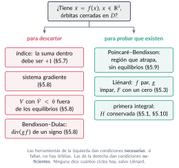
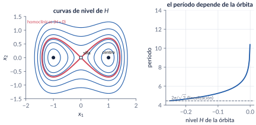
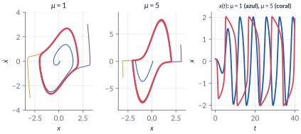
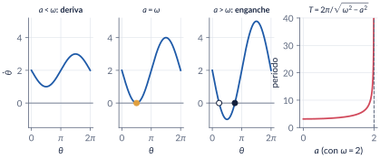
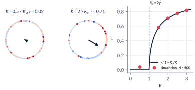
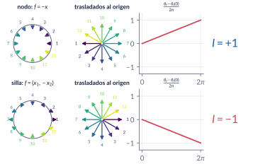
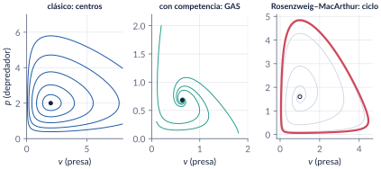
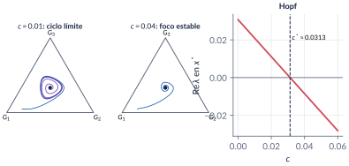

```{=html}
<div class="franja"><div class="rotulo">Parte 5 · Semanas 5–7</div><div class="titulo">Órbitas, osciladores y ciclos límite</div><div class="cita">Se escribe para atar al lector, para adueñarse de él, para seducirlo, para subyugarlo […] — Enrique Vila-Matas</div><svg class="fase" viewBox="0 0 600 160" preserveAspectRatio="xMaxYMid slice"><ellipse cx="430" cy="80" rx="30" ry="15" stroke="#ffffff" stroke-opacity=".10" fill="none"/><ellipse cx="430" cy="80" rx="60" ry="30" stroke="#ffffff" stroke-opacity=".10" fill="none"/><ellipse cx="430" cy="80" rx="90" ry="45" stroke="#ffffff" stroke-opacity=".10" fill="none"/><ellipse cx="430" cy="80" rx="120" ry="60" stroke="#ffffff" stroke-opacity=".10" fill="none"/><ellipse cx="430" cy="80" rx="150" ry="75" stroke="#ffffff" stroke-opacity=".10" fill="none"/><ellipse cx="430" cy="80" rx="180" ry="90" stroke="#ffffff" stroke-opacity=".10" fill="none"/><ellipse cx="430" cy="80" rx="210" ry="105" stroke="#ffffff" stroke-opacity=".10" fill="none"/><ellipse cx="430" cy="80" rx="240" ry="120" stroke="#ffffff" stroke-opacity=".10" fill="none"/><polyline points="580.0,80.0 578.7,84.5 577.0,88.9 574.7,93.2 571.9,97.4 568.6,101.4 564.9,105.4 560.8,109.2 556.2,112.9 551.2,116.3 545.9,119.6 540.2,122.8 534.2,125.7 527.9,128.4 521.3,130.9 514.5,133.2 507.4,135.3 500.2,137.1 492.8,138.7 485.3,140.1 477.6,141.3 469.9,142.2 462.2,142.8 454.4,143.3 446.7,143.5 439.0,143.4 431.4,143.2 423.8,142.7 416.4,142.0 409.1,141.1 402.0,139.9 395.1,138.6 388.4,137.1 382.0,135.3 375.8,133.4 369.9,131.4 364.3,129.2 359.0,126.8 354.0,124.3 349.3,121.7 345.1,118.9 341.1,116.0 337.6,113.1 334.4,110.1 331.6,107.0 329.2,103.8 327.2,100.6 325.6,97.4 324.4,94.1 323.6,90.9 323.2,87.6 323.2,84.4 323.6,81.1 324.4,78.0 325.5,74.8 327.0,71.8 328.8,68.8 331.0,65.9 333.5,63.0 336.3,60.3 339.5,57.7 342.9,55.2 346.6,52.8 350.5,50.5 354.7,48.4 359.1,46.4 363.7,44.6 368.5,42.9 373.4,41.4 378.5,40.0 383.7,38.8 389.0,37.8 394.3,36.9 399.8,36.2 405.2,35.7 410.7,35.3 416.2,35.1 421.7,35.1 427.1,35.2 432.5,35.5 437.7,35.9 442.9,36.5 448.0,37.3 452.9,38.2 457.7,39.2 462.4,40.4 466.8,41.7 471.1,43.1 475.1,44.6 479.0,46.3 482.6,48.0 485.9,49.8 489.1,51.8 491.9,53.7 494.5,55.8 496.9,57.9 499.0,60.1 500.7,62.3 502.3,64.6 503.5,66.9 504.4,69.2 505.1,71.5 505.5,73.8 505.6,76.1 505.4,78.4 505.0,80.6 504.3,82.9 503.3,85.0 502.1,87.2 500.7,89.3 499.0,91.3 497.0,93.3 494.9,95.2 492.6,97.0 490.0,98.7 487.3,100.3 484.4,101.8 481.3,103.3 478.1,104.6 474.8,105.8 471.3,107.0 467.8,108.0 464.1,108.9 460.4,109.6 456.6,110.3 452.8,110.8 448.9,111.3 445.0,111.6 441.2,111.7 437.3,111.8 433.4,111.8 429.6,111.6 425.9,111.3 422.2,110.9 418.5,110.4 415.0,109.8 411.6,109.1 408.3,108.4 405.1,107.5 402.0,106.5 399.1,105.4 396.3,104.3 393.7,103.1 391.2,101.8 389.0,100.5 386.9,99.1 385.0,97.7 383.2,96.2 381.7,94.6 380.4,93.1 379.2,91.5 378.3,89.9 377.5,88.3 377.0,86.6 376.6,85.0 376.5,83.4 376.5,81.7 376.8,80.1 377.2,78.5 377.8,77.0 378.6,75.5 379.6,74.0 380.7,72.5 382.0,71.1 383.5,69.8 385.1,68.5 386.9,67.2 388.7,66.0 390.8,64.9 392.9,63.9 395.1,62.9 397.4,62.0 399.9,61.2 402.3,60.5 404.9,59.8 407.5,59.2 410.2,58.7 412.9,58.3 415.6,58.0 418.4,57.7 421.1,57.6 423.9,57.5 426.6,57.5 429.3,57.6 432.0,57.8 434.6,58.0 437.2,58.3 439.7,58.7 442.2,59.2 444.5,59.7 446.8,60.3 449.0,61.0 451.2,61.7 453.2,62.5 455.0,63.3 456.8,64.2 458.5,65.2 460.0,66.1 461.4,67.1 462.7,68.2 463.8,69.2 464.8,70.3 465.7,71.5 466.4,72.6 467.0,73.7 467.4,74.9 467.7,76.1 467.9,77.2 467.9,78.4 467.7,79.5 467.5,80.6 467.1,81.7 466.6,82.8 465.9,83.9 465.2,84.9 464.3,85.9 463.3,86.9 462.2,87.8 461.0,88.7 459.7,89.6 458.3,90.4 456.8,91.2 455.3,91.9 453.6,92.5 452.0,93.1 450.2,93.7 448.4,94.1 446.6,94.6 444.7,94.9 442.8,95.3 440.9,95.5 438.9,95.7 437.0,95.8 435.0,95.9 433.1,95.9 431.2,95.9 429.3,95.8 427.4,95.6 425.6,95.4 423.8,95.2 422.0,94.9 420.3,94.5 418.7,94.1 417.1,93.6 415.6,93.1 414.1,92.6 412.7,92.0 411.5,91.4 410.3,90.8 409.1,90.1 408.1,89.4 407.2,88.6 406.3,87.9 405.6,87.1 405.0,86.3 404.4,85.5 404.0,84.7 403.6,83.9 403.4,83.1 403.2,82.3 403.2,81.5 403.2,80.6 403.4,79.8 403.6,79.0 404.0,78.3 404.4,77.5 404.9,76.8 405.5,76.0 406.2,75.4 406.9,74.7 407.7,74.0 408.6,73.4 409.6,72.8 410.6,72.3 411.7,71.8 412.8,71.3 414.0,70.9 415.2,70.5 416.5,70.1 417.8,69.8 419.1,69.5 420.5,69.3 421.8,69.1 423.2,68.9 424.6,68.8 425.9,68.7 427.3,68.7 428.7,68.7 430.0,68.8 431.4,68.9 432.7,69.0 434.0,69.2 435.2,69.4 436.4,69.6 437.6,69.9 438.8,70.2 439.8,70.6 440.9,70.9 441.9,71.3 442.8,71.8 443.7,72.2 444.5,72.7 445.2,73.2 445.9,73.7 446.5,74.2 447.1,74.8 447.6,75.3 448.0,75.9 448.3,76.5 448.6,77.0 448.8,77.6 448.9,78.2 449.0,78.8 449.0,79.3 448.9,79.9 448.7,80.5 448.5,81.0 448.2,81.6 447.9,82.1 447.5,82.6 447.0,83.1 446.5,83.6 446.0,84.1 445.3,84.5 444.7,84.9 444.0,85.3 443.2,85.7 442.4,86.0 441.6,86.4 440.8,86.6 439.9,86.9 439.0,87.1 438.0,87.4 437.1,87.5 436.1,87.7 435.2,87.8 434.2,87.9 433.2,87.9 432.3,88.0 431.3,88.0 430.3,88.0 429.4,87.9 428.4,87.8 427.5,87.7 426.6,87.6 425.8,87.4 424.9,87.2 424.1,87.0 423.3,86.8 422.6,86.5 421.8,86.2 421.2,85.9 420.5,85.6 419.9,85.3 419.4,84.9 418.9,84.6 418.4,84.2 418.0,83.8 417.7,83.5 417.4,83.1 417.1,82.7 416.9,82.3 416.7,81.8 416.6,81.4 416.6,81.0 416.6,80.6 416.6,80.2 416.7,79.8 416.8,79.4 417.0,79.0 417.2,78.6 417.5,78.3 417.8,77.9 418.2,77.6 418.6,77.2 419.0,76.9 419.4,76.6 419.9,76.3 420.4,76.1 421.0,75.8 421.6,75.6 422.2,75.4 422.8,75.2 423.4,75.0 424.1,74.8 424.7,74.7 425.4,74.6 426.1,74.5 426.8,74.4 427.5,74.4 428.2,74.4 428.8,74.3 429.5,74.4 430.2,74.4 430.9,74.4 431.5,74.5 432.2,74.6 432.8,74.7 433.4,74.8 434.0,75.0" stroke="#E09F3E" stroke-width="2.5" fill="none"/><circle cx="430" cy="80" r="4" fill="#E09F3E"/></svg></div>
```

Un sistema no lineal puede hacer algo que ningún sistema lineal hace: **oscilar de manera robusta**, con una amplitud y un período que no dependen de dónde empezó. Esta parte estudia esas oscilaciones —ciclos límite, osciladores de fase, sincronización— y las dos preguntas que hay que saber responder sobre ellas: cómo **descartar** que existan (índice, sistemas gradiente, Lyapunov, Bendixson–Dulac) y cómo **probar** que existen (Poincaré–Bendixson, Liénard). Terminamos con poblaciones de presas y depredadores y con un modelo de cambio de lenguaje.

```{=html}
<div class="botones">
  <a class="boton" href="../pdf/cap05_orbitas_ciclos.pdf">⬇ Capítulo en PDF</a>
  <a class="boton sec" href="https://github.com/quijanon-bot/NQuijano.github.io/tree/main/fuentes/curso-sisnl/codigo/cap05_orbitas_ciclos">Códigos en GitHub</a>
  <a class="boton sec" href="#explorador">Explorador interactivo</a>
</div>
```

::: {.receta}
[Al terminar esta parte usted podrá]{.caja-titulo}

1. Distinguir una órbita cerrada de un ciclo límite y explicar por qué un sistema lineal no puede tener ciclos límite.
2. Analizar flujos en el círculo y osciladores de fase: período, arrastre y deriva, y el umbral de sincronización del modelo de Kuramoto.
3. Calcular el índice de una curva cerrada y usarlo, junto con los sistemas gradiente, las funciones de Lyapunov y el criterio de Bendixson–Dulac, para **descartar** órbitas cerradas.
4. Construir una región que atrape trayectorias y usar el teorema de Poincaré–Bendixson para **probar** que existe una órbita periódica.
5. Aplicar el mismo arsenal a modelos de poblaciones (Lotka–Volterra y sus variantes) y a un modelo de cambio de lenguaje.
:::

## Ruta de las clases

| Clase | Qué se ve | Capítulo | Scripts |
|:--|:--|:--|:--|
| 1 | Más allá de los equilibrios. Órbitas cerradas (Duffing), ciclos límite, van der Pol y Liénard | §5.1–5.3 | `C5_Ej1`, `C5_Ej2`, `C5_Ej3`, `crearModelo_VanDerPol` |
| 2 | Flujos en el círculo, oscilador no uniforme, osciladores acoplados, luciérnagas, Kuramoto | §5.4–5.6 | `C5_Ej4`, `C5_Ej5`, `C5_Ej6` |
| 3 | Teoría del índice; descartar órbitas: gradiente, Lyapunov, Bendixson–Dulac | §5.7–5.8 | `C5_Ej7`, `C5_Ej8` |
| 4 | Conjuntos $\omega$-límite y Poincaré–Bendixson | §5.9 | `C5_Ej9` |
| 5 | Presas y depredadores (Lotka–Volterra, competencia, Rosenzweig–MacArthur) y cambio de lenguaje (Nowak) | §5.10–5.11 | `C5_Ej10`, `C5_Ej11` |

: Lea la sección del capítulo **antes** de cada clase. {.striped}

## Lo esencial, en una página

{width=85%}

::: {.definicion}
[Órbita cerrada y ciclo límite]{.caja-titulo}

Una solución no constante con $x(t+T)=x(t)$ es **periódica**; su imagen en el plano de fase es una **órbita cerrada**. Un **ciclo límite** es una órbita cerrada **aislada**: alguna vecindad suya no contiene otras órbitas cerradas. En un sistema lineal las órbitas cerradas vienen en familias (si $x(t)$ lo es, también $c\,x(t)$), así que un sistema lineal no tiene ciclos límite.
:::

{width=95%}

::: {.trampa}
[Trampa: $\pm j\omega$ en la linealización no es un centro]{.caja-titulo}

$\dot x_1=-x_2+x_1(x_1^2+x_2^2)$, $\dot x_2=x_1+x_2(x_1^2+x_2^2)$ tiene la linealización de un centro ($\pm j$), pero en polares $\dot r=r^3$: el origen es un foco **inestable** y las soluciones escapan en $t=1/(2r_0^2)$. Con valores propios imaginarios puros la linealización no concluye nada.
:::

{width=95%}

::: {.ideaclave}
[Osciladores de fase]{.caja-titulo}

En el círculo, $\dot\theta=\omega-a\sin\theta$. Si $a>\abs\omega$ hay dos equilibrios y la fase se **engancha**; si $a<\abs\omega$ la fase **deriva** con período $T=2\pi/\sqrt{\omega^2-a^2}$, que crece sin límite cuando $a\to\abs\omega$. La misma ecuación describe la diferencia de fase de dos osciladores acoplados y la de una luciérnaga frente a una linterna.
:::

{width=95%}

::: {.ideaclave}
[Kuramoto]{.caja-titulo}

$\dot\theta_i=\omega_i+\frac KN\sum_j\sin(\theta_j-\theta_i)=\omega_i+Kr\sin(\Psi-\theta_i)$, con $re^{j\Psi}=\frac1N\sum_je^{j\theta_j}$. Con frecuencias de Lorentz de ancho $\gamma$, la sincronización parcial aparece en $K_c=2\gamma$, y $r=\sqrt{1-K_c/K}$ para $K>K_c$. Acoplar no es igualar: los osciladores de los extremos siguen derivando.
:::

{width=95%}

::: {.teorema}
[Lo que encierra una órbita cerrada]{.caja-titulo}

El **índice** de una curva cerrada es el número de vueltas que da el campo vectorial al recorrerla. Nodos, focos y centros tienen índice $+1$; las sillas, $-1$. Toda órbita cerrada tiene índice $+1$, así que encierra equilibrios cuyos índices suman $+1$. **Se usa para descartar**: una curva que no encierra equilibrios, o que solo encierra sillas, no puede ser una órbita.
:::

{width=95%}

::: {.teorema}
[Bendixson–Dulac]{.caja-titulo}

Si en una región simplemente conexa $D\subset\R^2$ existe $g\in\Cont1$ tal que $\nabla\cdot(gf)$ no es idénticamente cero y no cambia de signo, entonces $D$ no contiene órbitas cerradas (con $g\equiv1$ es el criterio de Bendixson). **Solo descarta**: que la divergencia cambie de signo no prueba nada.
:::

::: {.teorema}
[Poincaré–Bendixson (Khalil, Lema 2.1)]{.caja-titulo}

Sea $M\subset\R^2$ compacto y positivamente invariante. Si $M$ no contiene equilibrios, o contiene solo uno con valores propios de parte real positiva (foco o nodo inestable), entonces $M$ contiene una **órbita periódica**. No dice que sea aislada ni que sea única, y no vale en $\R^3$.
:::

![Ejemplo de Khalil: con $V=x_1^2+x_2^2$, el disco $\{V\le c\}$ atrapa las trayectorias para $c\ge3/2$; el ciclo vive en $r\in[0.85,1.13]$.](../figuras/cap05/f_pb_khalil.svg){width=95%}

::: {.trampa}
[Trampa: Poincaré–Bendixson no da un ciclo límite]{.caja-titulo}

El anillo $\{c_1\le x_1^2+x_2^2\le c_2\}$ es compacto, invariante y sin equilibrios para el oscilador armónico, que no tiene ningún ciclo límite: el anillo está lleno de órbitas cerradas. El teorema da **una órbita periódica**; para concluir que es aislada y única hace falta más (Liénard, o encoger la región).
:::

{width=95%}

::: {.trampa}
[Trampa: más recursos no estabilizan]{.caja-titulo}

En Rosenzweig–MacArthur, si la capacidad de carga $K$ supera $K_H=3$, el equilibrio pierde la estabilidad y aparece un ciclo cuya amplitud crece con $K$; con $K=5$ las presas bajan hasta $0.047$. Es la **paradoja del enriquecimiento**.
:::

::: {.ejemplo}
[Aplicación: ciclos límite y lenguaje (Mitchener y Nowak, 2004)]{.caja-titulo}

Tres gramáticas compiten en el símplex $\simplex$ con dinámica de replicador–mutador; $c$ es la probabilidad de aprender la gramática anterior en el ciclo $G_1\to G_2\to G_3\to G_1$. Para $c<c^*=23/735\approx0.0313$ el equilibrio $(\tfrac13,\tfrac13,\tfrac13)$ es un foco inestable, la frontera repele y Poincaré–Bendixson **demuestra** que hay una órbita periódica: la población oscila entre gramáticas (con $c=0.01$, período $\approx63$). Sin mutación no hay ciclos: la aptitud media crece (Fisher) y hace de función de Lyapunov.
:::

{width=95%}

## Explorador interactivo {#explorador}

Cuatro pestañas con los modelos del capítulo. Los cálculos se hacen en su navegador con Runge–Kutta de paso fijo (los mismos modelos de `C5_Ej3`, `C5_Ej4`, `C5_Ej6`, `C5_Ej7`, `C5_Ej9` y `C5_Ej10`).

```{=html}
<div class="explorador" id="explorador-ciclos"></div>
<script src="../recursos/explorador-ciclos.js"></script>
```

::: {.pausa}
[Retos con el explorador]{.caja-titulo}

1. **Oscilador de fase:** con $\omega=2$, baje $a$ desde $3$. ¿En qué valor exacto empieza la deriva? ¿Qué le pasa al período cuando $a=1.99$?
2. **Plano de fase:** en van der Pol, pase $\mu$ de positivo a negativo. ¿Desaparece el ciclo o cambia otra cosa?
3. **Plano de fase:** en el ejemplo de Khalil, mueva $c$ de $0.5$ a $3$. ¿Desde qué valor el disco $\{V\le c\}$ atrapa las trayectorias?
4. **Plano de fase:** en Rosenzweig–MacArthur, suba $K$ de $2$ a $6$ y mire qué tan cerca de cero llegan las presas.
5. **Kuramoto:** con $\gamma=0.5$, ponga $K$ justo por debajo y justo por encima de $1$. Luego baje $N$ a 20: ¿qué tan fiable es la teoría con pocos osciladores?
6. **Índice:** con el campo "silla + foco", ¿qué curvas tienen índice $+1$? ¿Alguna de ellas puede ser una órbita cerrada?
:::

## Códigos de esta parte

Los bloques salen directamente de los archivos del [repositorio](https://github.com/quijanon-bot/NQuijano.github.io/tree/main/fuentes/curso-sisnl/codigo/cap05_orbitas_ciclos). Ejecute antes `iniciarCurso`. `verificarCap05` comprueba los números del capítulo (34/34).

::: {.panel-tabset}

### Clase 1: órbitas y ciclos

**Duffing: la energía se conserva (§5.2).**

```{.matlab include="../../codigo/cap05_orbitas_ciclos/C5_Ej1_Duffing.m" marca="energia"}
```

**El falso centro (§5.2).**

```{.matlab include="../../codigo/cap05_orbitas_ciclos/C5_Ej1_Duffing.m" marca="contraejemplo"}
```

**van der Pol: período y amplitud del ciclo (§5.3).**

```{.matlab include="../../codigo/cap05_orbitas_ciclos/C5_Ej3_VanDerPol.m" marca="ciclo"}
```

### Clase 2: fase y sincronización

**El oscilador no uniforme (§5.4).**

```{.matlab include="../../codigo/cap05_orbitas_ciclos/C5_Ej4_Circulo.m" marca="nouniforme"}
```

**Luciérnagas: arrastre y deriva (§5.5).**

```{.matlab include="../../codigo/cap05_orbitas_ciclos/C5_Ej5_Luciernagas.m" marca="arrastre"}
```

**El modelo de Kuramoto (§5.6).**

```{.matlab include="../../codigo/cap05_orbitas_ciclos/modeloKuramoto.m"}
```

```{.matlab include="../../codigo/cap05_orbitas_ciclos/C5_Ej6_Kuramoto.m" marca="kuramoto"}
```

### Clase 3: índice y descartar

**El índice como número de vueltas (§5.7).**

```{.matlab include="../../codigo/cap05_orbitas_ciclos/indiceCurva.m"}
```

```{.matlab include="../../codigo/cap05_orbitas_ciclos/C5_Ej7_Indice.m" marca="ejemplo"}
```

**Bendixson–Dulac (§5.8).**

```{.matlab include="../../codigo/cap05_orbitas_ciclos/C5_Ej8_Descartar.m" marca="bendixson"}
```

### Clase 4: Poincaré–Bendixson

**La región que atrapa (§5.9).**

```{.matlab include="../../codigo/cap05_orbitas_ciclos/C5_Ej9_PoincareBendixson.m" marca="criterio"}
```

**El ciclo dentro del anillo (§5.9).**

```{.matlab include="../../codigo/cap05_orbitas_ciclos/C5_Ej9_PoincareBendixson.m" marca="simulacion"}
```

### Clase 5: poblaciones y lenguaje

**Rosenzweig–MacArthur y la paradoja del enriquecimiento (§5.10).**

```{.matlab include="../../codigo/cap05_orbitas_ciclos/C5_Ej10_LotkaVolterra.m" marca="rosenzweig"}
```

**El modelo de Nowak (§5.11).**

```{.matlab include="../../codigo/cap05_orbitas_ciclos/modeloNowak.m"}
```

```{.matlab include="../../codigo/cap05_orbitas_ciclos/C5_Ej11_Nowak.m" marca="hopf"}
```

### Simulink

El modelo se **construye por código**: ejecute el script y se crea, se simula y se compara con `ode45`.

**`VanDerPol.slx`: el oscilador con integradores y ganancia $\mu$ ajustable.**

```{.matlab include="../../codigo/cap05_orbitas_ciclos/crearModelo_VanDerPol.m"}
```

:::

## Videos

Los videos se generan con los scripts de la tabla (MATLAB, `VideoWriter`).

| Video | Qué muestra | Script |
|:--|:--|:--|
| V5.1 · Kuramoto | Los osciladores en el círculo y $r(t)$ mientras $K$ cruza $K_c$. | `C5_Video_Kuramoto.m` |
| V5.2 · Índice | La curva barre el plano y el contador de vueltas cambia al cruzar equilibrios. | `C5_Video_Indice.m` |
| V5.3 · van der Pol | Trayectorias de adentro y de afuera llegan al mismo ciclo. | `C5_Video_VanDerPol.m` |

## Problemas

Los problemas del capítulo (§5.13) tienen cada uno una trampa; las soluciones seleccionadas están en §5.14 y las respuestas a las pausas al final del capítulo.
