```{=html}
<div class="franja"><div class="rotulo">Parte 6 · Semanas 2 y 7</div><div class="titulo">Bifurcaciones</div><div class="cita">Otra consecuencia es que se está impulsando que la educación sea vista como una capacitación que solo conduce al trabajo, y no como un medio que conduce al pensamiento crítico y a la transformación. — Junot Díaz</div><svg class="fase" viewBox="0 0 600 160" preserveAspectRatio="xMaxYMid slice"><ellipse cx="430" cy="80" rx="30" ry="15" stroke="#ffffff" stroke-opacity=".10" fill="none"/><ellipse cx="430" cy="80" rx="60" ry="30" stroke="#ffffff" stroke-opacity=".10" fill="none"/><ellipse cx="430" cy="80" rx="90" ry="45" stroke="#ffffff" stroke-opacity=".10" fill="none"/><ellipse cx="430" cy="80" rx="120" ry="60" stroke="#ffffff" stroke-opacity=".10" fill="none"/><ellipse cx="430" cy="80" rx="150" ry="75" stroke="#ffffff" stroke-opacity=".10" fill="none"/><ellipse cx="430" cy="80" rx="180" ry="90" stroke="#ffffff" stroke-opacity=".10" fill="none"/><ellipse cx="430" cy="80" rx="210" ry="105" stroke="#ffffff" stroke-opacity=".10" fill="none"/><ellipse cx="430" cy="80" rx="240" ry="120" stroke="#ffffff" stroke-opacity=".10" fill="none"/><polyline points="580.0,80.0 578.7,84.5 577.0,88.9 574.7,93.2 571.9,97.4 568.6,101.4 564.9,105.4 560.8,109.2 556.2,112.9 551.2,116.3 545.9,119.6 540.2,122.8 534.2,125.7 527.9,128.4 521.3,130.9 514.5,133.2 507.4,135.3 500.2,137.1 492.8,138.7 485.3,140.1 477.6,141.3 469.9,142.2 462.2,142.8 454.4,143.3 446.7,143.5 439.0,143.4 431.4,143.2 423.8,142.7 416.4,142.0 409.1,141.1 402.0,139.9 395.1,138.6 388.4,137.1 382.0,135.3 375.8,133.4 369.9,131.4 364.3,129.2 359.0,126.8 354.0,124.3 349.3,121.7 345.1,118.9 341.1,116.0 337.6,113.1 334.4,110.1 331.6,107.0 329.2,103.8 327.2,100.6 325.6,97.4 324.4,94.1 323.6,90.9 323.2,87.6 323.2,84.4 323.6,81.1 324.4,78.0 325.5,74.8 327.0,71.8 328.8,68.8 331.0,65.9 333.5,63.0 336.3,60.3 339.5,57.7 342.9,55.2 346.6,52.8 350.5,50.5 354.7,48.4 359.1,46.4 363.7,44.6 368.5,42.9 373.4,41.4 378.5,40.0 383.7,38.8 389.0,37.8 394.3,36.9 399.8,36.2 405.2,35.7 410.7,35.3 416.2,35.1 421.7,35.1 427.1,35.2 432.5,35.5 437.7,35.9 442.9,36.5 448.0,37.3 452.9,38.2 457.7,39.2 462.4,40.4 466.8,41.7 471.1,43.1 475.1,44.6 479.0,46.3 482.6,48.0 485.9,49.8 489.1,51.8 491.9,53.7 494.5,55.8 496.9,57.9 499.0,60.1 500.7,62.3 502.3,64.6 503.5,66.9 504.4,69.2 505.1,71.5 505.5,73.8 505.6,76.1 505.4,78.4 505.0,80.6 504.3,82.9 503.3,85.0 502.1,87.2 500.7,89.3 499.0,91.3 497.0,93.3 494.9,95.2 492.6,97.0 490.0,98.7 487.3,100.3 484.4,101.8 481.3,103.3 478.1,104.6 474.8,105.8 471.3,107.0 467.8,108.0 464.1,108.9 460.4,109.6 456.6,110.3 452.8,110.8 448.9,111.3 445.0,111.6 441.2,111.7 437.3,111.8 433.4,111.8 429.6,111.6 425.9,111.3 422.2,110.9 418.5,110.4 415.0,109.8 411.6,109.1 408.3,108.4 405.1,107.5 402.0,106.5 399.1,105.4 396.3,104.3 393.7,103.1 391.2,101.8 389.0,100.5 386.9,99.1 385.0,97.7 383.2,96.2 381.7,94.6 380.4,93.1 379.2,91.5 378.3,89.9 377.5,88.3 377.0,86.6 376.6,85.0 376.5,83.4 376.5,81.7 376.8,80.1 377.2,78.5 377.8,77.0 378.6,75.5 379.6,74.0 380.7,72.5 382.0,71.1 383.5,69.8 385.1,68.5 386.9,67.2 388.7,66.0 390.8,64.9 392.9,63.9 395.1,62.9 397.4,62.0 399.9,61.2 402.3,60.5 404.9,59.8 407.5,59.2 410.2,58.7 412.9,58.3 415.6,58.0 418.4,57.7 421.1,57.6 423.9,57.5 426.6,57.5 429.3,57.6 432.0,57.8 434.6,58.0 437.2,58.3 439.7,58.7 442.2,59.2 444.5,59.7 446.8,60.3 449.0,61.0 451.2,61.7 453.2,62.5 455.0,63.3 456.8,64.2 458.5,65.2 460.0,66.1 461.4,67.1 462.7,68.2 463.8,69.2 464.8,70.3 465.7,71.5 466.4,72.6 467.0,73.7 467.4,74.9 467.7,76.1 467.9,77.2 467.9,78.4 467.7,79.5 467.5,80.6 467.1,81.7 466.6,82.8 465.9,83.9 465.2,84.9 464.3,85.9 463.3,86.9 462.2,87.8 461.0,88.7 459.7,89.6 458.3,90.4 456.8,91.2 455.3,91.9 453.6,92.5 452.0,93.1 450.2,93.7 448.4,94.1 446.6,94.6 444.7,94.9 442.8,95.3 440.9,95.5 438.9,95.7 437.0,95.8 435.0,95.9 433.1,95.9 431.2,95.9 429.3,95.8 427.4,95.6 425.6,95.4 423.8,95.2 422.0,94.9 420.3,94.5 418.7,94.1 417.1,93.6 415.6,93.1 414.1,92.6 412.7,92.0 411.5,91.4 410.3,90.8 409.1,90.1 408.1,89.4 407.2,88.6 406.3,87.9 405.6,87.1 405.0,86.3 404.4,85.5 404.0,84.7 403.6,83.9 403.4,83.1 403.2,82.3 403.2,81.5 403.2,80.6 403.4,79.8 403.6,79.0 404.0,78.3 404.4,77.5 404.9,76.8 405.5,76.0 406.2,75.4 406.9,74.7 407.7,74.0 408.6,73.4 409.6,72.8 410.6,72.3 411.7,71.8 412.8,71.3 414.0,70.9 415.2,70.5 416.5,70.1 417.8,69.8 419.1,69.5 420.5,69.3 421.8,69.1 423.2,68.9 424.6,68.8 425.9,68.7 427.3,68.7 428.7,68.7 430.0,68.8 431.4,68.9 432.7,69.0 434.0,69.2 435.2,69.4 436.4,69.6 437.6,69.9 438.8,70.2 439.8,70.6 440.9,70.9 441.9,71.3 442.8,71.8 443.7,72.2 444.5,72.7 445.2,73.2 445.9,73.7 446.5,74.2 447.1,74.8 447.6,75.3 448.0,75.9 448.3,76.5 448.6,77.0 448.8,77.6 448.9,78.2 449.0,78.8 449.0,79.3 448.9,79.9 448.7,80.5 448.5,81.0 448.2,81.6 447.9,82.1 447.5,82.6 447.0,83.1 446.5,83.6 446.0,84.1 445.3,84.5 444.7,84.9 444.0,85.3 443.2,85.7 442.4,86.0 441.6,86.4 440.8,86.6 439.9,86.9 439.0,87.1 438.0,87.4 437.1,87.5 436.1,87.7 435.2,87.8 434.2,87.9 433.2,87.9 432.3,88.0 431.3,88.0 430.3,88.0 429.4,87.9 428.4,87.8 427.5,87.7 426.6,87.6 425.8,87.4 424.9,87.2 424.1,87.0 423.3,86.8 422.6,86.5 421.8,86.2 421.2,85.9 420.5,85.6 419.9,85.3 419.4,84.9 418.9,84.6 418.4,84.2 418.0,83.8 417.7,83.5 417.4,83.1 417.1,82.7 416.9,82.3 416.7,81.8 416.6,81.4 416.6,81.0 416.6,80.6 416.6,80.2 416.7,79.8 416.8,79.4 417.0,79.0 417.2,78.6 417.5,78.3 417.8,77.9 418.2,77.6 418.6,77.2 419.0,76.9 419.4,76.6 419.9,76.3 420.4,76.1 421.0,75.8 421.6,75.6 422.2,75.4 422.8,75.2 423.4,75.0 424.1,74.8 424.7,74.7 425.4,74.6 426.1,74.5 426.8,74.4 427.5,74.4 428.2,74.4 428.8,74.3 429.5,74.4 430.2,74.4 430.9,74.4 431.5,74.5 432.2,74.6 432.8,74.7 433.4,74.8 434.0,75.0" stroke="#E09F3E" stroke-width="2.5" fill="none"/><circle cx="430" cy="80" r="4" fill="#E09F3E"/></svg></div>
```

¿Qué cambia en el retrato de fase cuando **cambia un parámetro**? Casi siempre, nada importante: los equilibrios se corren un poco y conservan su tipo. Esta parte trata de las excepciones. Una bifurcación local es una **pérdida de hiperbolicidad**, y en el plano solo hay dos maneras de perderla: un valor propio real pasa por cero (silla-nodo, transcrítica, horquilla) o un par complejo cruza el eje imaginario (Hopf). La parte termina con las bifurcaciones de los propios ciclos y con la herramienta para estudiarlas: el **mapa de Poincaré**.

```{=html}
<div class="botones">
  <a class="boton" href="../pdf/cap06_bifurcaciones.pdf">⬇ Capítulo en PDF</a>
  <a class="boton sec" href="https://github.com/quijanon-bot/NQuijano.github.io/tree/main/fuentes/curso-sisnl/codigo/cap06_bifurcaciones">Códigos en GitHub</a>
  <a class="boton sec" href="#explorador">Explorador interactivo</a>
</div>
```

::: {.receta}
[Al terminar esta parte usted podrá]{.caja-titulo}

1. Explicar qué es una bifurcación local como pérdida de hiperbolicidad, y reconocer en el plano traza–determinante las dos maneras en que puede ocurrir en $\mathbb R^2$.
2. Analizar las bifurcaciones silla-nodo, transcrítica y de horquilla (supercrítica y subcrítica) con líneas de fase y diagramas de bifurcación, y decidir cuáles sobreviven a una perturbación del modelo.
3. Seguir una receta de cinco pasos (equilibrios, jacobiano, cruce, transversalidad y no degeneración) para encontrar y clasificar bifurcaciones en sistemas planos, reduciendo a la variedad central cuando haga falta.
4. Enunciar el teorema de Hopf con todas sus hipótesis, distinguir la supercrítica de la subcrítica con el primer coeficiente de Lyapunov o con una simulación, y explicar la histéresis que produce una subcrítica.
5. Construir el mapa de Poincaré de una órbita periódica, calcular su multiplicador (analíticamente o con la divergencia) y decidir con él la estabilidad del ciclo.
:::

## Ruta de las clases

| Semana | Qué se ve | Capítulo | Scripts |
|:--|:--|:--|:--|
| 2 (10 de agosto) | Pérdida de hiperbolicidad; silla-nodo y su fantasma; transcrítica y el láser; horquillas, histéresis y bifurcaciones imperfectas | §6.1–6.4 | `C6_Ej1`–`C6_Ej5` |
| 6 (9 de septiembre) | Introducción a los mapas de Poincaré | §6.8 | `C6_Ej11` |
| 7 (14 de septiembre) | Bifurcaciones en el plano (variedad central, interruptor genético); Hopf super y subcrítica; histéresis y bifurcaciones de ciclos | §6.5–6.7 | `C6_Ej6`–`C6_Ej10`, `crearModelo_InterruptorGenetico` |
| 7 (16 de septiembre) | Mapas de Poincaré: multiplicador, divergencia y van der Pol | §6.8 | `C6_Ej11`, `C6_Ej12` |

: Lea la sección del capítulo **antes** de cada clase. La parte de la recta usa la [parte 2](02-unidimensionales.qmd); la del plano, la variedad central de la [parte 4](04-bidimensionales.qmd) y los ciclos de la [parte 5](05-orbitas-ciclos.qmd). {.striped}

## Lo esencial, en una página

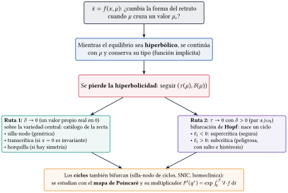{width=92%}

::: {.definicion}
[Las dos rutas]{.caja-titulo}

Si la jacobiana es invertible, el equilibrio se continúa suavemente con $\mu$ y conserva su tipo (teorema de la función implícita). En el plano, con $\tau=\mathrm{tr}\,J$ y $\delta=\det J$, la hiperbolicidad se pierde por la **Ruta 1** ($\delta\to0$: silla-nodo, transcrítica, horquilla) o por la **Ruta 2** ($\tau\to0$ con $\delta>0$: Hopf).
:::

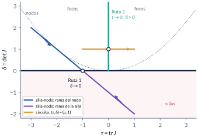{width=62%}

::: {.receta}
[Cinco pasos]{.caja-titulo}

1. Equilibrios en función de $\mu$. 2. Jacobiano en cada rama, $\tau(\mu)$ y $\delta(\mu)$. 3. Cruce: $\delta=0$, o $\tau=0$ con $\delta>0$. 4. **Transversalidad**: el valor propio cruza con velocidad no nula. 5. **No degeneración**: el primer término no lineal decide el tipo. Sin los pasos 4 y 5 no se sabe qué bifurcación hay.
:::

::: {.trampa}
[Trampa: "$\det J=0$ en $\mu_c$: hay una bifurcación"]{.caja-titulo}

Es necesario, no suficiente: en $\dot x=\mu-x^3$, $f_x(0,0)=0$, pero para todo $\mu$ hay un único equilibrio $\mu^{1/3}$, siempre estable. No pasa nada.
:::

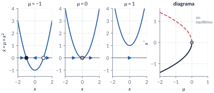{width=95%}

::: {.trampa}
[Trampa: "ya no hay equilibrio: el estado pasa de largo"]{.caja-titulo}

Del lado sin equilibrios queda un **fantasma**: el tiempo de tránsito crece como $\pi/\sqrt{|\mu|}$ ($29.42$ de $x=1$ a $x=-1$ con $|\mu|=0.01$). Del otro lado, la recuperación se vuelve lenta (constante de tiempo $1/(2\sqrt\mu)$): una señal de alerta temprana.
:::

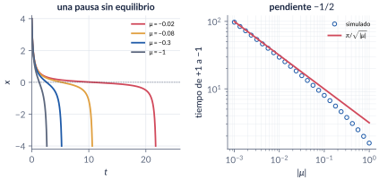{width=95%}

::: {.ideaclave}
[Transcrítica y horquilla: frágiles]{.caja-titulo}

Solo la silla-nodo y la Hopf son **genéricas**. La transcrítica necesita un equilibrio que exista para todo $\mu$ (el umbral del láser, $N_0=k/G$); la horquilla, una simetría $x\mapsto-x$. Con una imperfección $\varepsilon$, ambas se deshacen.
:::

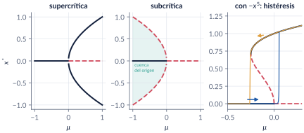{width=95%}

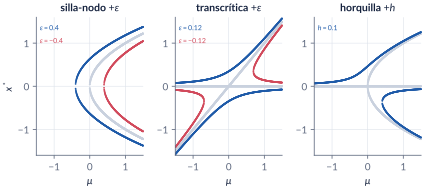{width=95%}

::: {.trampa}
[Trampa: "para reducir, se pone $x_2=0$"]{.caja-titulo}

En $\dot x_1=\mu x_1-x_1x_2$, $\dot x_2=-x_2+x_1^2$, con $x_2=0$ queda $\dot x_1=\mu x_1$, que no decide nada. Sobre la variedad central $x_2\approx x_1^2$ queda $\dot x_1\approx\mu x_1-x_1^3$: una horquilla supercrítica, con equilibrios exactos $(\pm\sqrt\mu,\mu)$.
:::

::: {.ideaclave}
[El interruptor genético de Griffith]{.caja-titulo}

$\dot x=-ax+y$, $\dot y=x^2/(1+x^2)-by$: tres equilibrios si $a<a_c=1/(2b)$ ($1.4286$ con $b=0.35$); en $a_c$ la silla y el nodo alto chocan en $x=1$. Biestable para $a<a_c$, con **histéresis**: si $a$ sube por encima de $a_c$ el gen se apaga, y al bajar $a$ no se vuelve a encender.
:::

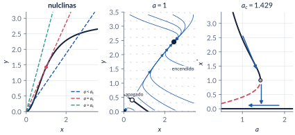{width=95%}

::: {.teorema}
[Poincaré–Andronov–Hopf]{.caja-titulo}

Si los valores propios $\alpha(\mu)\pm j\omega(\mu)$ cruzan el eje imaginario en $\mu_c$ con $\omega_0>0$, $\alpha'(\mu_c)\neq0$ y el primer coeficiente de Lyapunov $\ell_1\neq0$, nace una familia de órbitas periódicas de amplitud $\propto\sqrt{|\mu-\mu_c|}$ y período $\to2\pi/\omega_0$. $\ell_1<0$: supercrítica (ciclo estable); $\ell_1>0$: subcrítica (ciclo inestable).
:::

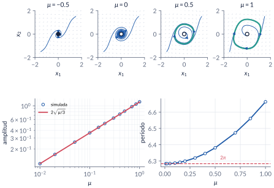{width=95%}

::: {.trampa}
[Trampa: "en $\mu_c$ la linealización es un centro: hay órbitas cerradas"]{.caja-titulo}

En la forma normal con $\mu=0$, $\dot r=-r^3$: $r(t)=r_0/\sqrt{1+2r_0^2t}$. El origen es asintóticamente estable, pero converge como $1/\sqrt t$. Deciden los términos cúbicos.
:::

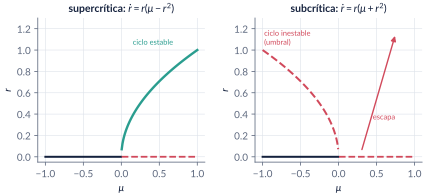{width=90%}

::: {.trampa}
[Trampa: "con una rampa lenta, el salto ocurre exactamente en $\mu_c$"]{.caja-titulo}

En $\dot r=r(\mu+r^2-r^4)$ (Hopf subcrítica en $0$, silla-nodo de ciclos en $-1/4$), una rampa lenta salta en $\mu\approx0.048$, no en $0$: el estado se acercó tanto al origen que tarda en salir. Al bajar, el ciclo se apaga cerca de $-1/4$.
:::

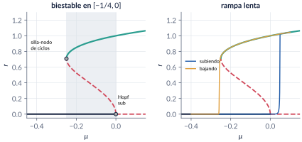{width=95%}

::: {.trampa}
[Trampa: "esta es la catástrofe de cielo azul"]{.caja-titulo}

El ejemplo con $\dot r=r((1-r^2)^2\cos\mu-\sin\mu)$ es una **silla-nodo de ciclos**: dos ciclos de radio finito nacen juntos. La catástrofe de cielo azul (Turaev y Shilnikov, 1995) es otra cosa y no ocurre en el plano.
:::

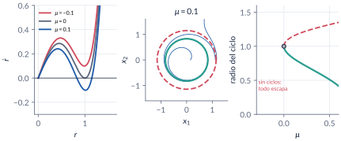{width=95%}

::: {.teorema}
[Mapa de Poincaré y multiplicador]{.caja-titulo}

Las órbitas periódicas son puntos fijos del mapa de primer retorno $P$ a una sección transversal $\Sigma$; el ciclo es estable si $|P'(q^*)|<1$. En el plano, $P'(q^*)=\exp\int_0^T\nabla\cdot f(\gamma(t))\,dt$, sin importar la sección (Perko, §3.4).
:::

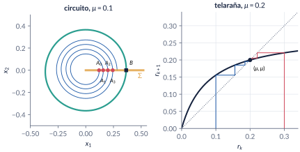{width=90%}

::: {.trampa}
[Trampa: "el tiempo entre retornos es constante"]{.caja-titulo}

Solo cuando $\dot\theta$ no depende de $r$. En van der Pol, $\tau(q)$ cambia con $q$ (6.81 desde $q=0.5$, 6.55 desde $q=2.5$) y vale el período, $6.663$, solo en el punto fijo $q^*=1.1081$, donde $P'(q^*)=8.60\times10^{-4}$.
:::

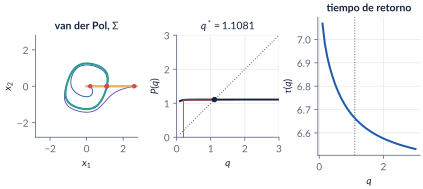{width=95%}

## Explorador interactivo {#explorador}

Tres pestañas. Todo se calcula en su navegador (Runge–Kutta de paso fijo, Newton y jacobianas numéricas), con los mismos modelos de `C6_Ej1`–`C6_Ej12`.

```{=html}
<div class="explorador" id="explorador-bifurcaciones"></div>
<script src="../recursos/explorador-bifurcaciones.js"></script>
```

::: {.pausa}
[Retos con el explorador]{.caja-titulo}

1. **Recta:** en la silla-nodo, ponga $\varepsilon=0.2$. ¿Dónde está ahora la bifurcación? Haga lo mismo con la transcrítica y con la horquilla. ¿Cuál cambia de forma?
2. **Recta:** en la subcrítica con $-x^5$, recorra $\mu$ de $-0.5$ a $0.3$ y de vuelta. Señale en el diagrama el ciclo de histéresis.
3. **Plano:** en la silla-nodo, baje $\mu$ hasta $0$. ¿Qué pasa con los puntos $(\tau,\delta)$? Con $\mu=-0.05$, lance una trayectoria desde $(2,0.5)$: ¿dónde se demora?
4. **Plano:** en la horquilla escondida, ¿sobre qué curva quedan los equilibrios nuevos? ¿Por qué no sobre el eje $x_1$?
5. **Plano:** en el interruptor genético, con $a=1$, lance trayectorias desde $(0.5,0.5)$ y desde $(1,1)$. Suba $a$ a $1.5$ y repita.
6. **Plano:** en el circuito, siga el punto $(\tau,\delta)$ al mover $\mu$ de $-1$ a $1$. ¿Qué semirrecta cruza? En la Hopf subcrítica con $\mu=-0.2$, lance trayectorias desde $r=0.4$ y $r=0.5$.
7. **Poincaré:** en el ejemplo con fórmula, compare el multiplicador con $e^{-2\pi\mu}$ para $\mu=0.05$ y $\mu=0.5$. ¿Cuándo es el ciclo "apenas" atractor?
8. **Poincaré:** en el circuito con $\mu=1$, ¿es constante el tiempo de retorno? Baje $\mu$ a $0.1$ y compare el multiplicador con $e^{-2\pi\mu}$.
:::

## Códigos de esta parte

Los bloques salen directamente de los archivos del [repositorio](https://github.com/quijanon-bot/NQuijano.github.io/tree/main/fuentes/curso-sisnl/codigo/cap06_bifurcaciones). Ejecute antes `iniciarCurso`. `verificarCap06` comprueba los números del capítulo (42/42). Ningún script necesita toolboxes. Dos funciones nuevas en `comun/`: `primerLyapunov` (el coeficiente $\ell_1$ de una Hopf, con derivadas numéricas) y `mapaPoincare` (primer retorno a una sección, con un evento de `ode45`).

::: {.panel-tabset}

### Semana 2: en la recta

**La silla-nodo (§6.3).**

```{.matlab include="../../codigo/cap06_bifurcaciones/C6_Ej1_SillaNodo.m" marca="sillanodo"}
```

```{.matlab include="../../codigo/cap06_bifurcaciones/C6_Ej1_SillaNodo.m" marca="cosecha"}
```

**El fantasma (§6.3).**

```{.matlab include="../../codigo/cap06_bifurcaciones/C6_Ej2_Fantasma.m" marca="fantasma"}
```

**Transcrítica y el láser (§6.4).**

```{.matlab include="../../codigo/cap06_bifurcaciones/C6_Ej3_Transcritica.m" marca="laser"}
```

**Horquillas e histéresis (§6.4).**

```{.matlab include="../../codigo/cap06_bifurcaciones/C6_Ej4_Horquillas.m" marca="horquillas"}
```

```{.matlab include="../../codigo/cap06_bifurcaciones/C6_Ej4_Horquillas.m" marca="quintica"}
```

**Bifurcaciones imperfectas (§6.4).**

```{.matlab include="../../codigo/cap06_bifurcaciones/C6_Ej5_Imperfectas.m" marca="imperfecta"}
```

### Semana 7: el plano y Hopf

**Silla-nodo en el plano y la horquilla escondida (§6.5).**

```{.matlab include="../../codigo/cap06_bifurcaciones/C6_Ej6_SillaNodo2D.m" marca="sillanodo2d"}
```

```{.matlab include="../../codigo/cap06_bifurcaciones/C6_Ej6_SillaNodo2D.m" marca="escondida"}
```

**El interruptor genético (§6.5).**

```{.matlab include="../../codigo/cap06_bifurcaciones/C6_Ej7_Genetico.m" marca="genetico"}
```

```{.matlab include="../../codigo/cap06_bifurcaciones/C6_Ej7_Genetico.m" marca="histeresis"}
```

**Hopf en el circuito (§6.6).**

```{.matlab include="../../codigo/cap06_bifurcaciones/C6_Ej8_HopfCircuito.m" marca="circuito"}
```

**¿Supercrítica o subcrítica? (§6.6).**

```{.matlab include="../../codigo/cap06_bifurcaciones/C6_Ej9_HopfSuperSub.m" marca="lyapunov"}
```

```{.matlab include="../../codigo/cap06_bifurcaciones/C6_Ej9_HopfSuperSub.m" marca="supersub"}
```

**Histéresis de ciclos con rampa lenta (§6.6).**

```{.matlab include="../../codigo/cap06_bifurcaciones/C6_Ej10_Histeresis.m" marca="rampa"}
```

### Mapas de Poincaré

**El mapa con fórmula (§6.8).**

```{.matlab include="../../codigo/cap06_bifurcaciones/C6_Ej11_MapaPoincare.m" marca="mapa"}
```

**Van der Pol: el mapa numérico y el multiplicador por dos caminos (§6.8).**

```{.matlab include="../../codigo/cap06_bifurcaciones/C6_Ej12_PoincareVanDerPol.m" marca="vdp"}
```

### Funciones

**`primerLyapunov` (en `comun/`).**

```{.matlab include="../../codigo/comun/primerLyapunov.m"}
```

**`mapaPoincare` (en `comun/`).**

```{.matlab include="../../codigo/comun/mapaPoincare.m"}
```

### Simulink

El modelo se **construye por código**: ejecute el script y se crea, se simula y se compara con `ode45`.

**`InterruptorGenetico.slx`: el interruptor genético con una rampa lenta de $a$ que sube y baja.**

```{.matlab include="../../codigo/cap06_bifurcaciones/crearModelo_InterruptorGenetico.m"}
```

:::

## Videos

Los videos están publicados (generados con `herramientas/cap06_videos.py`, los mismos modelos y parámetros); los scripts `C6_Video_*` de MATLAB producen la misma animación para grabarla en su computador.

| Video | Qué muestra | Script |
|:--|:--|:--|
| [V6.1 · Cuello de botella](../videos/V6_1_cuello_botella.mp4) | El fantasma de la silla-nodo: la pausa crece al acercarse $\mu$ a $0$. | `C6_Video_CuelloBotella.m` |
| [V6.2 · Nace un ciclo](../videos/V6_2_hopf.mp4) | Los valores propios cruzan el eje imaginario y aparece el ciclo del circuito. | `C6_Video_Hopf.m` |
| [V6.3 · Histéresis de ciclos](../videos/V6_3_histeresis_ciclos.mp4) | Rampa lenta de $\mu$: el salto llega tarde y el regreso ocurre en $-1/4$. | `C6_Video_Histeresis.m` |
| [V6.4 · Sucesión de Poincaré](../videos/V6_4_poincare.mp4) | Los cruces de van der Pol con $\Sigma$ y la telaraña del mapa. | `C6_Video_Poincare.m` |

```{=html}
<video controls preload="metadata" style="width:100%;max-width:820px;border-radius:8px" src="../videos/V6_2_hopf.mp4"></video>
```

## Problemas

Los problemas del capítulo (§6.10) tienen cada uno una trampa; las soluciones seleccionadas están en §6.11 y las respuestas a las pausas al final del capítulo.
