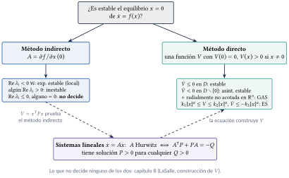
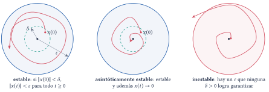
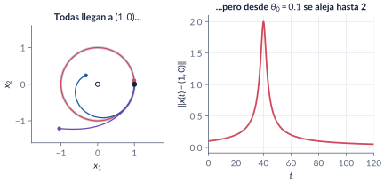
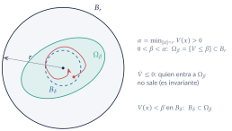
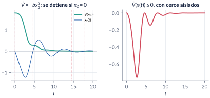
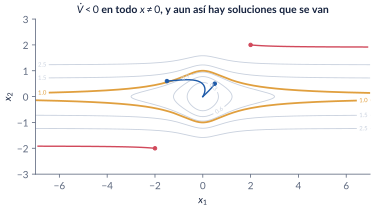
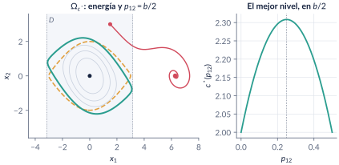
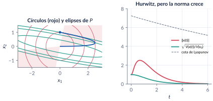
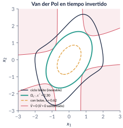

```{=html}
<div class="franja"><div class="rotulo">Parte 7 · Semanas 8–9</div><div class="titulo">Estabilidad de Lyapunov</div><div class="cita">Esperamos dichosos el bus de la victoria, que aquí siempre conduce al abismo y la derrota. — Juan Esteban Constaín</div><svg class="fase" viewBox="0 0 600 160" preserveAspectRatio="xMaxYMid slice"><ellipse cx="430" cy="80" rx="30" ry="15" stroke="#ffffff" stroke-opacity=".10" fill="none"/><ellipse cx="430" cy="80" rx="60" ry="30" stroke="#ffffff" stroke-opacity=".10" fill="none"/><ellipse cx="430" cy="80" rx="90" ry="45" stroke="#ffffff" stroke-opacity=".10" fill="none"/><ellipse cx="430" cy="80" rx="120" ry="60" stroke="#ffffff" stroke-opacity=".10" fill="none"/><ellipse cx="430" cy="80" rx="150" ry="75" stroke="#ffffff" stroke-opacity=".10" fill="none"/><ellipse cx="430" cy="80" rx="180" ry="90" stroke="#ffffff" stroke-opacity=".10" fill="none"/><ellipse cx="430" cy="80" rx="210" ry="105" stroke="#ffffff" stroke-opacity=".10" fill="none"/><ellipse cx="430" cy="80" rx="240" ry="120" stroke="#ffffff" stroke-opacity=".10" fill="none"/><polyline points="580.0,80.0 578.7,84.5 577.0,88.9 574.7,93.2 571.9,97.4 568.6,101.4 564.9,105.4 560.8,109.2 556.2,112.9 551.2,116.3 545.9,119.6 540.2,122.8 534.2,125.7 527.9,128.4 521.3,130.9 514.5,133.2 507.4,135.3 500.2,137.1 492.8,138.7 485.3,140.1 477.6,141.3 469.9,142.2 462.2,142.8 454.4,143.3 446.7,143.5 439.0,143.4 431.4,143.2 423.8,142.7 416.4,142.0 409.1,141.1 402.0,139.9 395.1,138.6 388.4,137.1 382.0,135.3 375.8,133.4 369.9,131.4 364.3,129.2 359.0,126.8 354.0,124.3 349.3,121.7 345.1,118.9 341.1,116.0 337.6,113.1 334.4,110.1 331.6,107.0 329.2,103.8 327.2,100.6 325.6,97.4 324.4,94.1 323.6,90.9 323.2,87.6 323.2,84.4 323.6,81.1 324.4,78.0 325.5,74.8 327.0,71.8 328.8,68.8 331.0,65.9 333.5,63.0 336.3,60.3 339.5,57.7 342.9,55.2 346.6,52.8 350.5,50.5 354.7,48.4 359.1,46.4 363.7,44.6 368.5,42.9 373.4,41.4 378.5,40.0 383.7,38.8 389.0,37.8 394.3,36.9 399.8,36.2 405.2,35.7 410.7,35.3 416.2,35.1 421.7,35.1 427.1,35.2 432.5,35.5 437.7,35.9 442.9,36.5 448.0,37.3 452.9,38.2 457.7,39.2 462.4,40.4 466.8,41.7 471.1,43.1 475.1,44.6 479.0,46.3 482.6,48.0 485.9,49.8 489.1,51.8 491.9,53.7 494.5,55.8 496.9,57.9 499.0,60.1 500.7,62.3 502.3,64.6 503.5,66.9 504.4,69.2 505.1,71.5 505.5,73.8 505.6,76.1 505.4,78.4 505.0,80.6 504.3,82.9 503.3,85.0 502.1,87.2 500.7,89.3 499.0,91.3 497.0,93.3 494.9,95.2 492.6,97.0 490.0,98.7 487.3,100.3 484.4,101.8 481.3,103.3 478.1,104.6 474.8,105.8 471.3,107.0 467.8,108.0 464.1,108.9 460.4,109.6 456.6,110.3 452.8,110.8 448.9,111.3 445.0,111.6 441.2,111.7 437.3,111.8 433.4,111.8 429.6,111.6 425.9,111.3 422.2,110.9 418.5,110.4 415.0,109.8 411.6,109.1 408.3,108.4 405.1,107.5 402.0,106.5 399.1,105.4 396.3,104.3 393.7,103.1 391.2,101.8 389.0,100.5 386.9,99.1 385.0,97.7 383.2,96.2 381.7,94.6 380.4,93.1 379.2,91.5 378.3,89.9 377.5,88.3 377.0,86.6 376.6,85.0 376.5,83.4 376.5,81.7 376.8,80.1 377.2,78.5 377.8,77.0 378.6,75.5 379.6,74.0 380.7,72.5 382.0,71.1 383.5,69.8 385.1,68.5 386.9,67.2 388.7,66.0 390.8,64.9 392.9,63.9 395.1,62.9 397.4,62.0 399.9,61.2 402.3,60.5 404.9,59.8 407.5,59.2 410.2,58.7 412.9,58.3 415.6,58.0 418.4,57.7 421.1,57.6 423.9,57.5 426.6,57.5 429.3,57.6 432.0,57.8 434.6,58.0 437.2,58.3 439.7,58.7 442.2,59.2 444.5,59.7 446.8,60.3 449.0,61.0 451.2,61.7 453.2,62.5 455.0,63.3 456.8,64.2 458.5,65.2 460.0,66.1 461.4,67.1 462.7,68.2 463.8,69.2 464.8,70.3 465.7,71.5 466.4,72.6 467.0,73.7 467.4,74.9 467.7,76.1 467.9,77.2 467.9,78.4 467.7,79.5 467.5,80.6 467.1,81.7 466.6,82.8 465.9,83.9 465.2,84.9 464.3,85.9 463.3,86.9 462.2,87.8 461.0,88.7 459.7,89.6 458.3,90.4 456.8,91.2 455.3,91.9 453.6,92.5 452.0,93.1 450.2,93.7 448.4,94.1 446.6,94.6 444.7,94.9 442.8,95.3 440.9,95.5 438.9,95.7 437.0,95.8 435.0,95.9 433.1,95.9 431.2,95.9 429.3,95.8 427.4,95.6 425.6,95.4 423.8,95.2 422.0,94.9 420.3,94.5 418.7,94.1 417.1,93.6 415.6,93.1 414.1,92.6 412.7,92.0 411.5,91.4 410.3,90.8 409.1,90.1 408.1,89.4 407.2,88.6 406.3,87.9 405.6,87.1 405.0,86.3 404.4,85.5 404.0,84.7 403.6,83.9 403.4,83.1 403.2,82.3 403.2,81.5 403.2,80.6 403.4,79.8 403.6,79.0 404.0,78.3 404.4,77.5 404.9,76.8 405.5,76.0 406.2,75.4 406.9,74.7 407.7,74.0 408.6,73.4 409.6,72.8 410.6,72.3 411.7,71.8 412.8,71.3 414.0,70.9 415.2,70.5 416.5,70.1 417.8,69.8 419.1,69.5 420.5,69.3 421.8,69.1 423.2,68.9 424.6,68.8 425.9,68.7 427.3,68.7 428.7,68.7 430.0,68.8 431.4,68.9 432.7,69.0 434.0,69.2 435.2,69.4 436.4,69.6 437.6,69.9 438.8,70.2 439.8,70.6 440.9,70.9 441.9,71.3 442.8,71.8 443.7,72.2 444.5,72.7 445.2,73.2 445.9,73.7 446.5,74.2 447.1,74.8 447.6,75.3 448.0,75.9 448.3,76.5 448.6,77.0 448.8,77.6 448.9,78.2 449.0,78.8 449.0,79.3 448.9,79.9 448.7,80.5 448.5,81.0 448.2,81.6 447.9,82.1 447.5,82.6 447.0,83.1 446.5,83.6 446.0,84.1 445.3,84.5 444.7,84.9 444.0,85.3 443.2,85.7 442.4,86.0 441.6,86.4 440.8,86.6 439.9,86.9 439.0,87.1 438.0,87.4 437.1,87.5 436.1,87.7 435.2,87.8 434.2,87.9 433.2,87.9 432.3,88.0 431.3,88.0 430.3,88.0 429.4,87.9 428.4,87.8 427.5,87.7 426.6,87.6 425.8,87.4 424.9,87.2 424.1,87.0 423.3,86.8 422.6,86.5 421.8,86.2 421.2,85.9 420.5,85.6 419.9,85.3 419.4,84.9 418.9,84.6 418.4,84.2 418.0,83.8 417.7,83.5 417.4,83.1 417.1,82.7 416.9,82.3 416.7,81.8 416.6,81.4 416.6,81.0 416.6,80.6 416.6,80.2 416.7,79.8 416.8,79.4 417.0,79.0 417.2,78.6 417.5,78.3 417.8,77.9 418.2,77.6 418.6,77.2 419.0,76.9 419.4,76.6 419.9,76.3 420.4,76.1 421.0,75.8 421.6,75.6 422.2,75.4 422.8,75.2 423.4,75.0 424.1,74.8 424.7,74.7 425.4,74.6 426.1,74.5 426.8,74.4 427.5,74.4 428.2,74.4 428.8,74.3 429.5,74.4 430.2,74.4 430.9,74.4 431.5,74.5 432.2,74.6 432.8,74.7 433.4,74.8 434.0,75.0" stroke="#E09F3E" stroke-width="2.5" fill="none"/><circle cx="430" cy="80" r="4" fill="#E09F3E"/></svg></div>
```

¿Qué les pasa a las soluciones que empiezan **cerca** de un equilibrio? Esta parte da las definiciones precisas (estable, asintóticamente estable, exponencialmente estable, local y global) y los dos métodos de Lyapunov para responder sin resolver la ecuación: el **indirecto**, que mira la jacobiana, y el **directo**, que busca una función $V$ que haga de energía y decrezca a lo largo de las soluciones. Los dos se encuentran en los sistemas lineales, donde la **ecuación de Lyapunov** $A^\top P+PA=-Q$ construye la función, y vuelven a lo no lineal para **estimar la región de atracción**.

```{=html}
<div class="botones">
  <a class="boton" href="../pdf/cap07_lyapunov.pdf">⬇ Capítulo en PDF</a>
  <a class="boton sec" href="https://github.com/quijanon-bot/NQuijano.github.io/tree/main/fuentes/curso-sisnl/codigo/cap07_lyapunov">Códigos en GitHub</a>
  <a class="boton sec" href="#explorador">Explorador interactivo</a>
</div>
```

::: {.receta}
[Al terminar esta parte usted podrá]{.caja-titulo}

1. Escribir las definiciones de estabilidad, estabilidad asintótica y exponencial (locales y globales), y reconocer con ejemplos por qué ninguna sobra.
2. Usar el método indirecto: decidir la estabilidad local con la jacobiana, y reconocer cuándo no decide nada.
3. Usar el método directo: proponer una función candidata, calcular $\dot V$ sin resolver la ecuación y sacar la conclusión correcta (y no más).
4. Distinguir lo local de lo global: funciones radialmente no acotadas, el teorema de Barbashin–Krasovskii y las cotas exponenciales.
5. Clasificar formas cuadráticas y usar la ecuación de Lyapunov $A^\top P+PA=-Q$ para sistemas lineales: qué dice, qué no dice y cómo se resuelve.
6. Estimar la región de atracción con conjuntos de nivel, y no con regiones donde $\dot V<0$.
:::

## Ruta de las clases

| Semana | Qué se ve | Capítulo | Scripts |
|:--|:--|:--|:--|
| 8 | Definiciones y el reto $\varepsilon$–$\delta$; convergencia sin estabilidad; método indirecto y cuándo se calla; método directo: el teorema, su prueba y los primeros ejemplos | §7.1–7.4 | `C7_Ej1`–`C7_Ej3` |
| 9 | Global (Barbashin–Krasovskii) y exponencial; formas cuadráticas y Sylvester; el término cruzado del péndulo; sistemas lineales y la ecuación de Lyapunov; región de atracción | §7.5–7.8 | `C7_Ej4`–`C7_Ej10`, `crearModelo_PenduloLyapunov` |

: Lea la sección del capítulo **antes** de cada clase. LaSalle y la construcción de funciones de Lyapunov son la [parte 8](08-invarianza.qmd). {.striped}

## Lo esencial, en una página

{width=85%}

::: {.definicion}
[Estable, asintótica, exponencial (Khalil, Def. 4.1)]{.caja-titulo}

El equilibrio $x=0$ de $\dot x=f(x)$ es **estable** si para cada $\varepsilon>0$ hay $\delta>0$ con $\|x(0)\|<\delta\Rightarrow\|x(t)\|<\varepsilon$ para todo $t\ge0$; **asintóticamente estable** si además las soluciones cercanas convergen a $0$; **exponencialmente estable** si $\|x(t)\|\le k\|x(0)\|e^{-\lambda t}$ cerca del origen. Es **global** si vale para toda condición inicial.
:::

{width=95%}

::: {.trampa}
[Trampa: "si todas las soluciones convergen, el equilibrio es asintóticamente estable"]{.caja-titulo}

Con $\dot r=r(1-r)$, $\dot\theta=\sin^2(\theta/2)$, todas las soluciones llegan a $(1,0)$, pero la que arranca en $\theta_0=0.1$ da la vuelta completa y se aleja hasta distancia 2. El equilibrio es atractivo e **inestable**: por eso la definición exige estabilidad **y** convergencia.
:::

{width=95%}

::: {.teorema}
[Método indirecto (Khalil, Teo. 4.7)]{.caja-titulo}

Si la jacobiana $A=\partial f/\partial x(0)$ es Hurwitz, el origen es (exponencialmente) asintóticamente estable; si algún valor propio tiene parte real positiva, es inestable. Si hay valores propios en el eje imaginario y ninguno a la derecha, **no decide**: $\dot x=-x^3$ y $\dot x=+x^3$ tienen la misma linealización.
:::

::: {.teorema}
[Método directo (Lyapunov, 1892; Khalil, Teo. 4.1)]{.caja-titulo}

Si $V$ es $\mathcal C^1$, definida positiva en $D$ y $\dot V=\nabla V\cdot f\le0$ en $D$, el origen es estable; si $\dot V<0$ en $D\setminus\{0\}$, es asintóticamente estable. Si además $D=\mathbb R^n$ y $V$ es **radialmente no acotada**, es globalmente asintóticamente estable (Barbashin–Krasovskii).
:::

{width=70%}

::: {.trampa}
[Trampa: "$\dot V\le0$ y casi siempre $<0$: asintóticamente estable"]{.caja-titulo}

La energía del péndulo con fricción da $\dot V=-bx_2^2$, que se anula en todo el eje $x_2=0$: el teorema da **solo estabilidad**. La energía decrece con escalones. Para pasar a la estabilidad asintótica hace falta LaSalle (parte 8) o cambiar de $V$.
:::

{width=95%}

::: {.trampa}
[Trampa: "$\dot V<0$ en todo el espacio basta para la estabilidad global"]{.caja-titulo}

Con $V=x_1^2/(1+x_1^2)+x_2^2$ (que no es radialmente no acotada) hay un sistema con $\dot V<0$ en todo $x\neq0$ y soluciones que se van a infinito: bajan de nivel en nivel, pero los niveles con $c\ge1$ no son curvas cerradas.
:::

{width=88%}

::: {.trampa}
[Trampa: "menores líderes $\ge0$, luego $P\ge0$"]{.caja-titulo}

$P=\mathrm{diag}(0,-1)$ tiene $\Delta_1=\Delta_2=0$ y $x^\top Px=-x_2^2$. Sylvester con menores líderes vale para $P>0$; para $P\ge0$ hay que mirar **todos** los menores principales, o los valores propios.
:::

::: {.ideaclave}
[Inclinar la energía]{.caja-titulo}

Para el péndulo, $V=\tfrac12x^\top\begin{bmatrix}bp_{12}&p_{12}\\p_{12}&1\end{bmatrix}x+a(1-\cos x_1)$ con $0<p_{12}<b$ da $\dot V=-ap_{12}x_1\sin x_1-(b-p_{12})x_2^2<0$ en $|x_1|<\pi$: un término cruzado vuelve estricta una función que no lo era, y con $p_{12}=b/2$ certifica un nivel mayor que la energía ($c^*=2.31$ contra $2$).
:::

{width=95%}

::: {.teorema}
[Ecuación de Lyapunov (Khalil, Teo. 4.6)]{.caja-titulo}

$A$ es Hurwitz si y solo si para cada $Q>0$ la ecuación $A^\top P+PA=-Q$ tiene una solución $P>0$. Es única y $P=\int_0^\infty e^{A^\top t}Qe^{At}dt$: $x_0^\top Px_0=\int_0^\infty x^\top Qx\,dt$ es el **costo** desde $x_0$. En MATLAB, la $P$ del curso es `lyap(A',Q)`, no `lyap(A,Q)`.
:::

::: {.trampa}
[Trampa: "si $A$ es Hurwitz, la norma decrece"]{.caja-titulo}

$A=[-1\ 10;\ 0\ -2]$ tiene valores propios $-1$ y $-2$, y desde $(0,1)$ la norma sube a $2.51$ antes de decaer: $A+A^\top$ es indefinida. La $P$ de la ecuación de Lyapunov da la métrica en la que el sistema sí se contrae.
:::

{width=95%}

::: {.trampa}
[Trampa: "si la ecuación de Lyapunov tiene solución, $A$ es Hurwitz"]{.caja-titulo}

Tiene solución única siempre que $\lambda_i+\lambda_j\neq0$. Lo que caracteriza a Hurwitz es que sea **definida positiva**; si $A$ es inestable, $P$ tiene tantos valores propios negativos como valores propios inestables de $A$.
:::

::: {.trampa}
[Trampa: "$\dot V<0$ en $D$, luego $D$ está en la región de atracción"]{.caja-titulo}

En el péndulo, la solución que arranca en $(1.5,3)\in D=\{|x_1|<\pi\}$ sale de $D$ en $t=0.72$ y termina en $(2\pi,0)$. Solo un **conjunto de nivel** acotado dentro de $D$ es una estimación válida; el mejor toca $\{\dot V=0\}$ o la frontera de $D$.
:::

{width=60%}

## Explorador interactivo {#explorador}

Cuatro pestañas con los modelos del capítulo. Todo se calcula en su navegador (Runge–Kutta de paso fijo y la ecuación de Lyapunov $2\times2$ resuelta en forma cerrada), con los mismos modelos de `C7_Ej3`, `C7_Ej5`, `C7_Ej6`, `C7_Ej8`, `C7_Ej9` y `C7_Ej10`.

```{=html}
<div class="explorador" id="explorador-lyapunov"></div>
<script src="../recursos/explorador-lyapunov.js"></script>
```

::: {.pausa}
[Retos con el explorador]{.caja-titulo}

1. **Péndulo:** ponga $p_{12}/b=0$ (la energía). ¿Dónde se detiene $V$? Suba $p_{12}$: ¿desaparecen los escalones? ¿Para qué valor es mayor $c^*$?
2. **Péndulo:** busque una condición inicial dentro de $D$ que termine en $(2\pi,0)$. ¿Cuánto vale $V(x_0)$ comparado con $c^*$?
3. **Formas:** con $\theta=0$, $\lambda_1=0$ y $\lambda_2<0$, lea los menores líderes. ¿Qué dice Sylvester? ¿Qué es $P$?
4. **Ecuación de Lyapunov:** escoja el caso "no normal". ¿Cuánto crece la norma? Cambie $a_{12}$: ¿desde qué valor deja de crecer? (Compare con el problema 7.7.)
5. **Ecuación de Lyapunov:** escoja el caso "inestable". ¿Tiene solución la ecuación? ¿Qué signo tienen los valores propios de $P$? Lleve $a_{22}$ a $1$.
6. **Región de atracción:** suba $c/c^*$ por encima de $1$. ¿Dejan de converger las soluciones de inmediato? ¿Por qué ya no es una estimación certificada? Cambie $q$: ¿cuánto mejora el área?
:::

## Códigos de esta parte

Los bloques salen directamente de los archivos del [repositorio](https://github.com/quijanon-bot/NQuijano.github.io/tree/main/fuentes/curso-sisnl/codigo/cap07_lyapunov). Ejecute antes `iniciarCurso`. `verificarCap07` comprueba los números del capítulo (34/34). Ningún script necesita toolboxes: la ecuación de Lyapunov se resuelve con `ecuacionLyapunov` (en `comun/`), que sigue la convención $A^\top P+PA=-Q$.

::: {.panel-tabset}

### Semana 8: definiciones y métodos

**Péndulo con y sin fricción (§7.2).**

```{.matlab include="../../codigo/cap07_lyapunov/C7_Ej1_Definiciones.m" marca="pendulo"}
```

**Converger no es ser estable (§7.2).**

```{.matlab include="../../codigo/cap07_lyapunov/C7_Ej1_Definiciones.m" marca="polar"}
```

**La jacobiana del péndulo (§7.3).**

```{.matlab include="../../codigo/cap07_lyapunov/C7_Ej2_Indirecto.m" marca="jacobiano"}
```

**Cuando la linealización se calla (§7.3).**

```{.matlab include="../../codigo/cap07_lyapunov/C7_Ej2_Indirecto.m" marca="cubico"}
```

**La energía a lo largo de las soluciones (§7.4).**

```{.matlab include="../../codigo/cap07_lyapunov/C7_Ej3_Energia.m" marca="energia"}
```

### Semana 9: global y cuadráticas

**$\dot V<0$ en todas partes, sin estabilidad global (§7.5).**

```{.matlab include="../../codigo/cap07_lyapunov/C7_Ej4_Global.m" marca="noacotada"}
```

**Cota exponencial (§7.5).**

```{.matlab include="../../codigo/cap07_lyapunov/C7_Ej4_Global.m" marca="exponencial"}
```

**Sylvester y su trampa (§7.6).**

```{.matlab include="../../codigo/cap07_lyapunov/C7_Ej5_Cuadraticas.m" marca="sylvester"}
```

```{.matlab include="../../codigo/cap07_lyapunov/C7_Ej5_Cuadraticas.m" marca="trampa"}
```

**El término cruzado del péndulo (§7.6, §7.8).**

```{.matlab include="../../codigo/cap07_lyapunov/C7_Ej6_TerminoCruzado.m" marca="cruzado"}
```

### Semana 9: lineales y región

**Serie contra paralelo (§7.7).**

```{.matlab include="../../codigo/cap07_lyapunov/C7_Ej7_Jordan.m" marca="jordan"}
```

**Ecuación de Lyapunov, integral y costo (§7.7).**

```{.matlab include="../../codigo/cap07_lyapunov/C7_Ej8_EcuacionLyapunov.m" marca="lyap"}
```

**Hurwitz con norma que crece (§7.7).**

```{.matlab include="../../codigo/cap07_lyapunov/C7_Ej8_EcuacionLyapunov.m" marca="nonormal"}
```

**Inercia y observabilidad (§7.7).**

```{.matlab include="../../codigo/cap07_lyapunov/C7_Ej9_InerciaObservabilidad.m" marca="inercia"}
```

```{.matlab include="../../codigo/cap07_lyapunov/C7_Ej9_InerciaObservabilidad.m" marca="masas"}
```

**Región de atracción de van der Pol invertido (§7.8).**

```{.matlab include="../../codigo/cap07_lyapunov/C7_Ej10_RegionAtraccion.m" marca="region"}
```

**La función `ecuacionLyapunov`.**

```{.matlab include="../../codigo/comun/ecuacionLyapunov.m"}
```

### Simulink

El modelo se **construye por código**: ejecute el script y se crea, se simula y se compara con `ode45`.

**`PenduloLyapunov.slx`: el péndulo con fricción y cuatro medidores ($V$ y $\dot V$ para la energía y para la función con término cruzado).**

```{.matlab include="../../codigo/cap07_lyapunov/crearModelo_PenduloLyapunov.m"}
```

:::

## Videos

Los videos están publicados (generados con `herramientas/cap07_videos.py`, los mismos modelos y parámetros); los scripts `C7_Video_*` de MATLAB producen la misma animación para grabarla en su computador.

| Video | Qué muestra | Script |
|:--|:--|:--|
| [V7.1 · Formas cuadráticas](../videos/V7_1_formas_cuadraticas.mp4) | De elipses a franjas y a hipérbolas cuando un valor propio de $P$ cruza el cero. | `C7_Video_FormasCuadraticas.m` |
| [V7.2 · Término cruzado](../videos/V7_2_termino_cruzado.mp4) | El nivel certificado crece con $p_{12}$; una solución arranca en $D$ y sale. | `C7_Video_TerminoCruzado.m` |
| [V7.3 · Círculos y elipses](../videos/V7_3_circulos_elipses.mp4) | $A$ Hurwitz con norma que crece; la elipse de $P$ solo se encoge. | `C7_Video_CirculosElipses.m` |
| [V7.4 · Región de atracción](../videos/V7_4_region_atraccion.mp4) | $\Omega_c$ crece hasta tocar $\{\dot V=0\}$. | `C7_Video_RegionAtraccion.m` |

```{=html}
<video controls preload="metadata" style="width:100%;max-width:820px;border-radius:8px" src="../videos/V7_2_termino_cruzado.mp4"></video>
```

## Problemas

Los problemas del capítulo (§7.10) tienen cada uno una trampa; las soluciones seleccionadas están en §7.11 y las respuestas a las pausas al final del capítulo.
