```{=html}
<div class="franja"><div class="rotulo">Parte 8 · Semana 9</div><div class="titulo">Principio de invarianza y construcción de funciones de Lyapunov</div><div class="cita">El tiempo es un río que me arrebata, pero yo soy el río. — Jorge Luis Borges</div><svg class="fase" viewBox="0 0 600 160" preserveAspectRatio="xMaxYMid slice"><ellipse cx="430" cy="80" rx="30" ry="15" stroke="#ffffff" stroke-opacity=".10" fill="none"/><ellipse cx="430" cy="80" rx="60" ry="30" stroke="#ffffff" stroke-opacity=".10" fill="none"/><ellipse cx="430" cy="80" rx="90" ry="45" stroke="#ffffff" stroke-opacity=".10" fill="none"/><ellipse cx="430" cy="80" rx="120" ry="60" stroke="#ffffff" stroke-opacity=".10" fill="none"/><ellipse cx="430" cy="80" rx="150" ry="75" stroke="#ffffff" stroke-opacity=".10" fill="none"/><ellipse cx="430" cy="80" rx="180" ry="90" stroke="#ffffff" stroke-opacity=".10" fill="none"/><ellipse cx="430" cy="80" rx="210" ry="105" stroke="#ffffff" stroke-opacity=".10" fill="none"/><ellipse cx="430" cy="80" rx="240" ry="120" stroke="#ffffff" stroke-opacity=".10" fill="none"/><polyline points="580.0,80.0 578.7,84.5 577.0,88.9 574.7,93.2 571.9,97.4 568.6,101.4 564.9,105.4 560.8,109.2 556.2,112.9 551.2,116.3 545.9,119.6 540.2,122.8 534.2,125.7 527.9,128.4 521.3,130.9 514.5,133.2 507.4,135.3 500.2,137.1 492.8,138.7 485.3,140.1 477.6,141.3 469.9,142.2 462.2,142.8 454.4,143.3 446.7,143.5 439.0,143.4 431.4,143.2 423.8,142.7 416.4,142.0 409.1,141.1 402.0,139.9 395.1,138.6 388.4,137.1 382.0,135.3 375.8,133.4 369.9,131.4 364.3,129.2 359.0,126.8 354.0,124.3 349.3,121.7 345.1,118.9 341.1,116.0 337.6,113.1 334.4,110.1 331.6,107.0 329.2,103.8 327.2,100.6 325.6,97.4 324.4,94.1 323.6,90.9 323.2,87.6 323.2,84.4 323.6,81.1 324.4,78.0 325.5,74.8 327.0,71.8 328.8,68.8 331.0,65.9 333.5,63.0 336.3,60.3 339.5,57.7 342.9,55.2 346.6,52.8 350.5,50.5 354.7,48.4 359.1,46.4 363.7,44.6 368.5,42.9 373.4,41.4 378.5,40.0 383.7,38.8 389.0,37.8 394.3,36.9 399.8,36.2 405.2,35.7 410.7,35.3 416.2,35.1 421.7,35.1 427.1,35.2 432.5,35.5 437.7,35.9 442.9,36.5 448.0,37.3 452.9,38.2 457.7,39.2 462.4,40.4 466.8,41.7 471.1,43.1 475.1,44.6 479.0,46.3 482.6,48.0 485.9,49.8 489.1,51.8 491.9,53.7 494.5,55.8 496.9,57.9 499.0,60.1 500.7,62.3 502.3,64.6 503.5,66.9 504.4,69.2 505.1,71.5 505.5,73.8 505.6,76.1 505.4,78.4 505.0,80.6 504.3,82.9 503.3,85.0 502.1,87.2 500.7,89.3 499.0,91.3 497.0,93.3 494.9,95.2 492.6,97.0 490.0,98.7 487.3,100.3 484.4,101.8 481.3,103.3 478.1,104.6 474.8,105.8 471.3,107.0 467.8,108.0 464.1,108.9 460.4,109.6 456.6,110.3 452.8,110.8 448.9,111.3 445.0,111.6 441.2,111.7 437.3,111.8 433.4,111.8 429.6,111.6 425.9,111.3 422.2,110.9 418.5,110.4 415.0,109.8 411.6,109.1 408.3,108.4 405.1,107.5 402.0,106.5 399.1,105.4 396.3,104.3 393.7,103.1 391.2,101.8 389.0,100.5 386.9,99.1 385.0,97.7 383.2,96.2 381.7,94.6 380.4,93.1 379.2,91.5 378.3,89.9 377.5,88.3 377.0,86.6 376.6,85.0 376.5,83.4 376.5,81.7 376.8,80.1 377.2,78.5 377.8,77.0 378.6,75.5 379.6,74.0 380.7,72.5 382.0,71.1 383.5,69.8 385.1,68.5 386.9,67.2 388.7,66.0 390.8,64.9 392.9,63.9 395.1,62.9 397.4,62.0 399.9,61.2 402.3,60.5 404.9,59.8 407.5,59.2 410.2,58.7 412.9,58.3 415.6,58.0 418.4,57.7 421.1,57.6 423.9,57.5 426.6,57.5 429.3,57.6 432.0,57.8 434.6,58.0 437.2,58.3 439.7,58.7 442.2,59.2 444.5,59.7 446.8,60.3 449.0,61.0 451.2,61.7 453.2,62.5 455.0,63.3 456.8,64.2 458.5,65.2 460.0,66.1 461.4,67.1 462.7,68.2 463.8,69.2 464.8,70.3 465.7,71.5 466.4,72.6 467.0,73.7 467.4,74.9 467.7,76.1 467.9,77.2 467.9,78.4 467.7,79.5 467.5,80.6 467.1,81.7 466.6,82.8 465.9,83.9 465.2,84.9 464.3,85.9 463.3,86.9 462.2,87.8 461.0,88.7 459.7,89.6 458.3,90.4 456.8,91.2 455.3,91.9 453.6,92.5 452.0,93.1 450.2,93.7 448.4,94.1 446.6,94.6 444.7,94.9 442.8,95.3 440.9,95.5 438.9,95.7 437.0,95.8 435.0,95.9 433.1,95.9 431.2,95.9 429.3,95.8 427.4,95.6 425.6,95.4 423.8,95.2 422.0,94.9 420.3,94.5 418.7,94.1 417.1,93.6 415.6,93.1 414.1,92.6 412.7,92.0 411.5,91.4 410.3,90.8 409.1,90.1 408.1,89.4 407.2,88.6 406.3,87.9 405.6,87.1 405.0,86.3 404.4,85.5 404.0,84.7 403.6,83.9 403.4,83.1 403.2,82.3 403.2,81.5 403.2,80.6 403.4,79.8 403.6,79.0 404.0,78.3 404.4,77.5 404.9,76.8 405.5,76.0 406.2,75.4 406.9,74.7 407.7,74.0 408.6,73.4 409.6,72.8 410.6,72.3 411.7,71.8 412.8,71.3 414.0,70.9 415.2,70.5 416.5,70.1 417.8,69.8 419.1,69.5 420.5,69.3 421.8,69.1 423.2,68.9 424.6,68.8 425.9,68.7 427.3,68.7 428.7,68.7 430.0,68.8 431.4,68.9 432.7,69.0 434.0,69.2 435.2,69.4 436.4,69.6 437.6,69.9 438.8,70.2 439.8,70.6 440.9,70.9 441.9,71.3 442.8,71.8 443.7,72.2 444.5,72.7 445.2,73.2 445.9,73.7 446.5,74.2 447.1,74.8 447.6,75.3 448.0,75.9 448.3,76.5 448.6,77.0 448.8,77.6 448.9,78.2 449.0,78.8 449.0,79.3 448.9,79.9 448.7,80.5 448.5,81.0 448.2,81.6 447.9,82.1 447.5,82.6 447.0,83.1 446.5,83.6 446.0,84.1 445.3,84.5 444.7,84.9 444.0,85.3 443.2,85.7 442.4,86.0 441.6,86.4 440.8,86.6 439.9,86.9 439.0,87.1 438.0,87.4 437.1,87.5 436.1,87.7 435.2,87.8 434.2,87.9 433.2,87.9 432.3,88.0 431.3,88.0 430.3,88.0 429.4,87.9 428.4,87.8 427.5,87.7 426.6,87.6 425.8,87.4 424.9,87.2 424.1,87.0 423.3,86.8 422.6,86.5 421.8,86.2 421.2,85.9 420.5,85.6 419.9,85.3 419.4,84.9 418.9,84.6 418.4,84.2 418.0,83.8 417.7,83.5 417.4,83.1 417.1,82.7 416.9,82.3 416.7,81.8 416.6,81.4 416.6,81.0 416.6,80.6 416.6,80.2 416.7,79.8 416.8,79.4 417.0,79.0 417.2,78.6 417.5,78.3 417.8,77.9 418.2,77.6 418.6,77.2 419.0,76.9 419.4,76.6 419.9,76.3 420.4,76.1 421.0,75.8 421.6,75.6 422.2,75.4 422.8,75.2 423.4,75.0 424.1,74.8 424.7,74.7 425.4,74.6 426.1,74.5 426.8,74.4 427.5,74.4 428.2,74.4 428.8,74.3 429.5,74.4 430.2,74.4 430.9,74.4 431.5,74.5 432.2,74.6 432.8,74.7 433.4,74.8 434.0,75.0" stroke="#E09F3E" stroke-width="2.5" fill="none"/><circle cx="430" cy="80" r="4" fill="#E09F3E"/></svg></div>
```

La [parte 7](07-lyapunov.qmd) dejó dos preguntas abiertas. La primera: si $\dot V\le0$ y $\dot V$ se anula en algo más que el origen (la energía del péndulo con fricción), ¿qué se puede concluir? La respuesta es el **principio de invarianza de LaSalle**: las soluciones que viven en un compacto positivamente invariante tienden al mayor conjunto **invariante** contenido en $\{\dot V=0\}$. La segunda: ¿de dónde sale una $V$ cuando no hay energía evidente, o cuando la energía se queda corta? Tres respuestas: el **gradiente variable** (se adivina $\nabla V$), el método de **Krasovskii** ($V=f^\top Pf$) y la ecuación de **Zubov**, que da la región de atracción exacta.

```{=html}
<div class="botones">
  <a class="boton" href="../pdf/cap08_invarianza.pdf">⬇ Capítulo en PDF</a>
  <a class="boton sec" href="https://github.com/quijanon-bot/NQuijano.github.io/tree/main/fuentes/curso-sisnl/codigo/cap08_invarianza">Códigos en GitHub</a>
  <a class="boton sec" href="#explorador">Explorador interactivo</a>
</div>
```

::: {.receta}
[Al terminar esta parte usted podrá]{.caja-titulo}

1. Distinguir conjuntos invariantes de positivamente invariantes, construir un conjunto compacto y positivamente invariante con una componente de un conjunto de nivel, y usar las propiedades del conjunto $\omega$-límite.
2. Enunciar y probar el principio de invarianza de LaSalle, calcular $E$ y su mayor subconjunto invariante $M$ con la prueba de permanencia, y concluir exactamente lo que el teorema permite (y no más).
3. Reconocer qué puede ser $M$ (un punto, un ciclo límite, una recta de equilibrios, un subespacio no observable) y por qué la convergencia a $M$ no da por sí sola convergencia a un punto ni estabilidad.
4. Estimar la región de atracción con conjuntos de nivel cuando $\dot V$ es solo semidefinida.
5. Construir funciones de Lyapunov con el gradiente variable y con el método de Krasovskii, y caracterizar la región de atracción exacta con la ecuación de Zubov.
:::

## Ruta de las clases

| Semana | Qué se ve | Capítulo | Scripts |
|:--|:--|:--|:--|
| 9 (primera sesión) | El hueco de $\dot V\le0$; conjuntos invariantes y $\omega$-límite; el teorema de LaSalle, su prueba y los corolarios de Barbashin y Krasovskii; el péndulo, por fin | §8.1–8.3 | `C8_Ej1`, `C8_Ej2` |
| 9 (segunda sesión) | Qué puede ser $M$; estimar la región de atracción con $\dot V\le0$; gradiente variable, Krasovskii y Zubov | §8.4–8.8 | `C8_Ej3`–`C8_Ej15`, `crearModelo_AdaptativoLaSalle` |

: Lea la sección del capítulo **antes** de cada clase. Se usan el conjunto $\omega$-límite de la [parte 5](05-orbitas-ciclos.qmd) y el método directo de la [parte 7](07-lyapunov.qmd). {.striped}

## Lo esencial, en una página

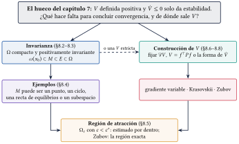{width=90%}

### El principio de invarianza

::: {.teorema}
[Teorema de LaSalle (Khalil, Teorema 4.4)]{.caja-titulo}

Sea $\Omega$ **compacto y positivamente invariante** y $V$ de clase $\mathcal C^1$ con $\dot V\le0$ en $\Omega$. Sea $E=\{x\in\Omega:\dot V(x)=0\}$ y $M$ el mayor conjunto invariante contenido en $E$. Entonces toda solución que comienza en $\Omega$ tiende a $M$. La prueba es la cadena $\omega(x_0)\subset M\subset E\subset\Omega$. **$V$ no tiene que ser definida positiva.**
:::

::: {.ideaclave}
[La prueba de permanencia]{.caja-titulo}

Si $E=\{h(x)=0\}$ y una solución se queda en $E$, entonces $h$, $L_fh$, $L_f^2h,\dots$ se anulan a lo largo de ella. En el péndulo: $x_2\equiv0\Rightarrow\sin x_1\equiv0\Rightarrow x_1\equiv0$, y $M=\{0\}$. En sistemas lineales es literalmente la prueba de observabilidad: $M=\ker\mathcal O$.
:::

::: {.trampa}
[Trampa: "$\dot V=0$ en el eje, luego la solución termina en el eje"]{.caja-titulo}

Termina en $M$, no en $E$: la solución del péndulo desde $(2,0.8)$ cruza el eje $x_2=0$ doce veces en $[0,40]$, y en cada cruce $V$ sigue bajando. Pasar por $E$ no es quedarse en $E$.
:::

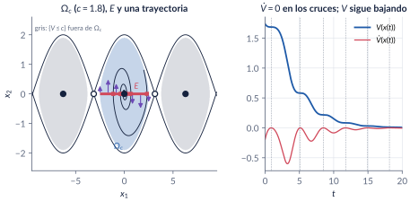{width=95%}

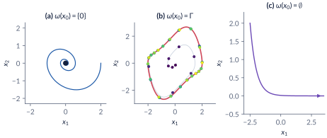{width=95%}

### Qué puede ser $M$

::: {.trampa}
[Trampa: "$V(x_0)<c$, luego $x_0$ está en $\Omega_c$"]{.caja-titulo}

En el resorte blando, $(1.2,0)$ tiene $V=0.2016<c^*=0.25$ y **escapa** en $t=2.40$: está en otra componente de $\{V\le c\}$. El estimado es la componente conexa que contiene al origen.
:::

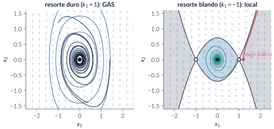{width=95%}

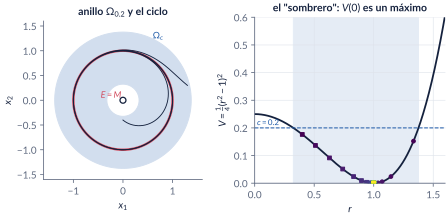{width=95%}

::: {.trampa}
[Trampa: "$x(t)\to M$, luego converge al punto que usé en $V$"]{.caja-titulo}

En el control adaptativo, $M$ es una recta de equilibrios y $k_\infty=a+\sqrt{(k_0-a)^2+\gamma y_0^2}$ depende de la condición inicial ($3.83$ desde $(2,-1)$), no de la constante $b$ del análisis.
:::

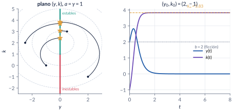{width=95%}

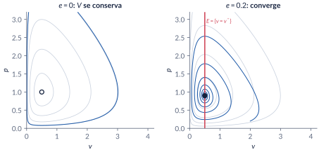{width=95%}

::: {.trampa}
[Trampa: "todas convergen, luego es asintóticamente estable"]{.caja-titulo}

Con $\dot r=r(1-r)$, $\dot\theta=1-\cos\theta$, todas las soluciones del anillo van a $(1,0)$, que es **inestable**: desde distancia $0.15$ la solución se aleja hasta $2$. LaSalle da convergencia, no estabilidad.
:::

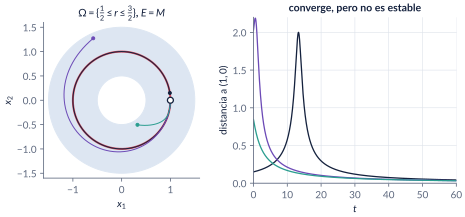{width=95%}

### Estimar la región de atracción con $\dot V\le0$

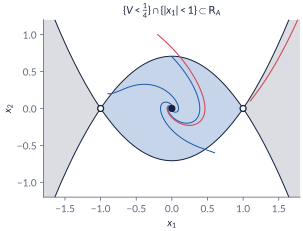{width=60%}

### Construir $V$

| Método | Qué se fija | Qué se obtiene |
|:--|:--|:--|
| Gradiente variable | la forma de $\nabla V$ | $V$ y un estimado de $\mathcal R_A$, con parámetros libres para mejorarlo |
| Krasovskii | $V=f^\top Pf$ | una condición sobre la jacobiana; estabilidad global si vale en $\mathbb R^n$ |
| Zubov | la forma de $\dot V$ (una EDP) | la región de atracción **exacta** |

: {.striped}

::: {.trampa}
[Trampa: "la elección limpia es la mejor"]{.caja-titulo}

En $\dot x_1=x_2$, $\dot x_2=-(x_1+x_2)-\sin(x_1+x_2)$, la elección $a_{11}=2$ anula el término cruzado y da un estimado de área $\pi^3=31.0$. El mayor estimado está en $a_{11}\approx1.48$, con área $37.4$.
:::

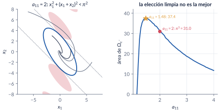{width=95%}

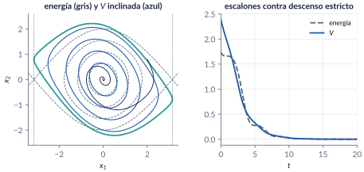{width=95%}

::: {.teorema}
[Krasovskii]{.caja-titulo}

Si $J(x)^\top P+PJ(x)\le-R$ en un dominio convexo $D$, el origen es el único equilibrio en $D$, es asintóticamente estable con $V=f^\top Pf$ y, si $D=\mathbb R^n$, globalmente asintóticamente estable.
:::

::: {.trampa}
[Trampa: "$\|f\|^2$ pequeña, luego el estado está cerca del origen"]{.caja-titulo}

$V=\|f\|^2$ se anula en **todos** los equilibrios: en $\dot x_1=-x_1+x_1^3$, $\dot x_2=-x_2$, el punto $(1.05,0)$ tiene $V=0.0116$ y escapa.
:::

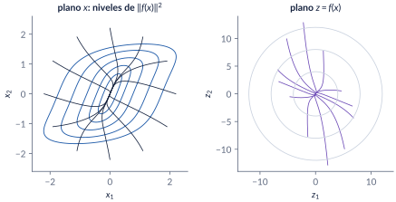{width=95%}

::: {.teorema}
[Zubov]{.caja-titulo}

Si $\dfrac{\partial V}{\partial x}f=-h(x)(1-V)$ en un abierto $D$, con $0<V<1$ en $D\setminus\{0\}$ y $V\to1$ en $\partial D$ y en el infinito, entonces $D$ **es** la región de atracción. Con $W=-\ln(1-V)$: $\dot W=-h$, y $W(x_0)=\int_0^\infty h(\phi_t(x_0))\,dt$.
:::

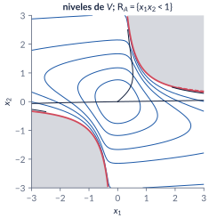{width=60%}

{width=95%}

## Explorador interactivo {#explorador}

Tres pestañas. Todo se calcula en su navegador (Runge–Kutta de paso fijo), con los mismos modelos de `C8_Ej1`–`C8_Ej15`.

```{=html}
<div class="explorador" id="explorador-invarianza"></div>
<script src="../recursos/explorador-invarianza.js"></script>
```

::: {.pausa}
[Retos con el explorador]{.caja-titulo}

1. **LaSalle:** en el péndulo, lance soluciones que crucen $E$ varias veces. ¿Se detiene $V$ en algún cruce? Suba $c$ por encima de $2$: ¿qué le pasa a $\Omega_c$?
2. **LaSalle:** en el resorte blando, haga clic en una zona gris. ¿Qué hace la solución? ¿Y en la zona azul?
3. **LaSalle:** en el ciclo límite, ¿hay algún equilibrio en $E$? ¿A dónde van las soluciones?
4. **LaSalle:** en el atractivo inestable, arranque muy cerca de $(1,0)$ por encima del eje y por debajo. ¿Cuál se aleja?
5. **Gradiente variable:** mueva $a_{11}$ y encuentre el mayor estimado. ¿Qué pasa con $a_{11}=1.1$?
6. **Gradiente variable:** lance soluciones desde fuera del estimado. ¿Convergen? ¿Qué dice eso del estimado?
7. **Zubov:** suba $c$ hasta $0.999$. ¿Hasta dónde llega el nivel? Haga clic justo a ambos lados de la hipérbola.
:::

## Códigos de esta parte

Los bloques salen directamente de los archivos del [repositorio](https://github.com/quijanon-bot/NQuijano.github.io/tree/main/fuentes/curso-sisnl/codigo/cap08_invarianza). Ejecute antes `iniciarCurso`. `verificarCap08` comprueba los números del capítulo (39/39). Ningún script necesita toolboxes. Una función nueva en `comun/`: `nivelCritico` (el mayor nivel certificable, $c^*$, en una malla), y una en la carpeta del capítulo: `zubovMalla` (la función de Zubov por el método de las características).

::: {.panel-tabset}

### Invarianza y LaSalle

**Tres conjuntos límite (§8.2).**

```{.matlab include="../../codigo/cap08_invarianza/C8_Ej1_ConjuntosLimite.m" marca="limite"}
```

**El péndulo con fricción, por fin (§8.3).**

```{.matlab include="../../codigo/cap08_invarianza/C8_Ej2_PenduloLaSalle.m" marca="pendulo"}
```

**La prueba de permanencia (§8.3).**

```{.matlab include="../../codigo/cap08_invarianza/C8_Ej2_PenduloLaSalle.m" marca="permanencia"}
```

### Qué puede ser M

**Resorte duro y blando (§8.4).**

```{.matlab include="../../codigo/cap08_invarianza/C8_Ej3_Duffing.m" marca="duffing"}
```

**Un ciclo límite con $V$ no definida positiva (§8.4).**

```{.matlab include="../../codigo/cap08_invarianza/C8_Ej4_CicloLimite.m" marca="ciclo"}
```

**Control adaptativo (§8.4).**

```{.matlab include="../../codigo/cap08_invarianza/C8_Ej5_Adaptativo.m" marca="adaptativo"}
```

**$M$ es el subespacio no observable (§8.4).**

```{.matlab include="../../codigo/cap08_invarianza/C8_Ej6_Observabilidad.m" marca="observabilidad"}
```

**Lotka–Volterra (§8.4).**

```{.matlab include="../../codigo/cap08_invarianza/C8_Ej7_LotkaVolterra.m" marca="lotka"}
```

**Atractivo pero inestable (§8.4).**

```{.matlab include="../../codigo/cap08_invarianza/C8_Ej8_AtractivoInestable.m" marca="inestable"}
```

### Región de atracción

**El estimado con $\dot V\le0$ y `nivelCritico` (§8.5).**

```{.matlab include="../../codigo/cap08_invarianza/C8_Ej9_RegionLaSalle.m" marca="region"}
```

### Gradiente variable

**El ejemplo resuelto (§8.6).**

```{.matlab include="../../codigo/cap08_invarianza/C8_Ej10_GradienteVariable.m" marca="g1"}
```

**El barrido de $a_{11}$ (§8.6).**

```{.matlab include="../../codigo/cap08_invarianza/C8_Ej10_GradienteVariable.m" marca="barrido"}
```

**La $V$ inclinada del péndulo (§8.6).**

```{.matlab include="../../codigo/cap08_invarianza/C8_Ej11_GradientePendulo.m" marca="pendulo"}
```

### Krasovskii

**La condición en una malla y el plano de velocidades (§8.7).**

```{.matlab include="../../codigo/cap08_invarianza/C8_Ej12_Krasovskii.m" marca="k1"}
```

**Escoger $P$ (§8.7).**

```{.matlab include="../../codigo/cap08_invarianza/C8_Ej12_Krasovskii.m" marca="matrizP"}
```

**$\|f\|^2$ en las sillas (§8.7).**

```{.matlab include="../../codigo/cap08_invarianza/C8_Ej13_KrasovskiiTrampa.m" marca="k2"}
```

### Zubov

**Soluciones cerradas (§8.8).**

```{.matlab include="../../codigo/cap08_invarianza/C8_Ej14_Zubov.m" marca="z2"}
```

**Zubov numérico, van der Pol invertido (§8.8).**

```{.matlab include="../../codigo/cap08_invarianza/C8_Ej15_ZubovVanDerPol.m" marca="zubov"}
```

### Funciones

**`nivelCritico` (en `comun/`).**

```{.matlab include="../../codigo/comun/nivelCritico.m"}
```

**`zubovMalla` (en `cap08_invarianza/`).**

```{.matlab include="../../codigo/cap08_invarianza/zubovMalla.m"}
```

### Simulink

El modelo se **construye por código**: ejecute el script y se crea y se simula.

**`AdaptativoLaSalle.slx`: la planta $\dot y=ay+u$ con la ley adaptativa $u=-ky$, $\dot k=\gamma y^2$, y un medidor de la $V$ del análisis con la constante ficticia $b$.**

```{.matlab include="../../codigo/cap08_invarianza/crearModelo_AdaptativoLaSalle.m"}
```

:::

## Videos

Los videos están publicados (generados con `herramientas/cap08_videos.py`, los mismos modelos y parámetros); los scripts `C8_Video_*` de MATLAB producen la misma animación para grabarla en su computador.

| Video | Qué muestra | Script |
|:--|:--|:--|
| [V8.1 · Pasar por E no es quedarse en E](../videos/V8_1_pendulo_lasalle.mp4) | El péndulo cruza el eje $x_2=0$ y $V$ sigue bajando. | `C8_Video_PenduloLaSalle.m` |
| [V8.2 · Rodar por el sombrero](../videos/V8_2_ciclo_sombrero.mp4) | Con $V=\frac14(r^2-1)^2$, las soluciones bajan al ciclo. | `C8_Video_CicloSombrero.m` |
| [V8.3 · Barrido del gradiente variable](../videos/V8_3_gradiente_barrido.mp4) | El estimado crece, colapsa y tiene su máximo en $a_{11}\approx1.48$. | `C8_Video_GradienteBarrido.m` |
| [V8.4 · Zubov llena la región](../videos/V8_4_zubov_vdp.mp4) | Los niveles $\{V\le c\}$ llegan hasta el ciclo; la elipse no. | `C8_Video_ZubovVanDerPol.m` |

```{=html}
<video controls preload="metadata" style="width:100%;max-width:820px;border-radius:8px" src="../videos/V8_1_pendulo_lasalle.mp4"></video>
```

## Problemas

Los problemas del capítulo (§8.10) tienen cada uno una trampa; las soluciones seleccionadas están en §8.11 y las respuestas a las pausas al final del capítulo.
