```{=html}
<div class="franja"><div class="rotulo">Parte 9 · Semanas 11–12</div><div class="titulo">Sistemas variantes en el tiempo</div><div class="cita">Nunca, ni en las situaciones más desesperadas, he perdido mi sentido del humor… — Enrique Vila-Matas</div><svg class="fase" viewBox="0 0 600 160" preserveAspectRatio="xMaxYMid slice"><ellipse cx="430" cy="80" rx="30" ry="15" stroke="#ffffff" stroke-opacity=".10" fill="none"/><ellipse cx="430" cy="80" rx="60" ry="30" stroke="#ffffff" stroke-opacity=".10" fill="none"/><ellipse cx="430" cy="80" rx="90" ry="45" stroke="#ffffff" stroke-opacity=".10" fill="none"/><ellipse cx="430" cy="80" rx="120" ry="60" stroke="#ffffff" stroke-opacity=".10" fill="none"/><ellipse cx="430" cy="80" rx="150" ry="75" stroke="#ffffff" stroke-opacity=".10" fill="none"/><ellipse cx="430" cy="80" rx="180" ry="90" stroke="#ffffff" stroke-opacity=".10" fill="none"/><ellipse cx="430" cy="80" rx="210" ry="105" stroke="#ffffff" stroke-opacity=".10" fill="none"/><ellipse cx="430" cy="80" rx="240" ry="120" stroke="#ffffff" stroke-opacity=".10" fill="none"/><polyline points="580.0,80.0 578.7,84.5 577.0,88.9 574.7,93.2 571.9,97.4 568.6,101.4 564.9,105.4 560.8,109.2 556.2,112.9 551.2,116.3 545.9,119.6 540.2,122.8 534.2,125.7 527.9,128.4 521.3,130.9 514.5,133.2 507.4,135.3 500.2,137.1 492.8,138.7 485.3,140.1 477.6,141.3 469.9,142.2 462.2,142.8 454.4,143.3 446.7,143.5 439.0,143.4 431.4,143.2 423.8,142.7 416.4,142.0 409.1,141.1 402.0,139.9 395.1,138.6 388.4,137.1 382.0,135.3 375.8,133.4 369.9,131.4 364.3,129.2 359.0,126.8 354.0,124.3 349.3,121.7 345.1,118.9 341.1,116.0 337.6,113.1 334.4,110.1 331.6,107.0 329.2,103.8 327.2,100.6 325.6,97.4 324.4,94.1 323.6,90.9 323.2,87.6 323.2,84.4 323.6,81.1 324.4,78.0 325.5,74.8 327.0,71.8 328.8,68.8 331.0,65.9 333.5,63.0 336.3,60.3 339.5,57.7 342.9,55.2 346.6,52.8 350.5,50.5 354.7,48.4 359.1,46.4 363.7,44.6 368.5,42.9 373.4,41.4 378.5,40.0 383.7,38.8 389.0,37.8 394.3,36.9 399.8,36.2 405.2,35.7 410.7,35.3 416.2,35.1 421.7,35.1 427.1,35.2 432.5,35.5 437.7,35.9 442.9,36.5 448.0,37.3 452.9,38.2 457.7,39.2 462.4,40.4 466.8,41.7 471.1,43.1 475.1,44.6 479.0,46.3 482.6,48.0 485.9,49.8 489.1,51.8 491.9,53.7 494.5,55.8 496.9,57.9 499.0,60.1 500.7,62.3 502.3,64.6 503.5,66.9 504.4,69.2 505.1,71.5 505.5,73.8 505.6,76.1 505.4,78.4 505.0,80.6 504.3,82.9 503.3,85.0 502.1,87.2 500.7,89.3 499.0,91.3 497.0,93.3 494.9,95.2 492.6,97.0 490.0,98.7 487.3,100.3 484.4,101.8 481.3,103.3 478.1,104.6 474.8,105.8 471.3,107.0 467.8,108.0 464.1,108.9 460.4,109.6 456.6,110.3 452.8,110.8 448.9,111.3 445.0,111.6 441.2,111.7 437.3,111.8 433.4,111.8 429.6,111.6 425.9,111.3 422.2,110.9 418.5,110.4 415.0,109.8 411.6,109.1 408.3,108.4 405.1,107.5 402.0,106.5 399.1,105.4 396.3,104.3 393.7,103.1 391.2,101.8 389.0,100.5 386.9,99.1 385.0,97.7 383.2,96.2 381.7,94.6 380.4,93.1 379.2,91.5 378.3,89.9 377.5,88.3 377.0,86.6 376.6,85.0 376.5,83.4 376.5,81.7 376.8,80.1 377.2,78.5 377.8,77.0 378.6,75.5 379.6,74.0 380.7,72.5 382.0,71.1 383.5,69.8 385.1,68.5 386.9,67.2 388.7,66.0 390.8,64.9 392.9,63.9 395.1,62.9 397.4,62.0 399.9,61.2 402.3,60.5 404.9,59.8 407.5,59.2 410.2,58.7 412.9,58.3 415.6,58.0 418.4,57.7 421.1,57.6 423.9,57.5 426.6,57.5 429.3,57.6 432.0,57.8 434.6,58.0 437.2,58.3 439.7,58.7 442.2,59.2 444.5,59.7 446.8,60.3 449.0,61.0 451.2,61.7 453.2,62.5 455.0,63.3 456.8,64.2 458.5,65.2 460.0,66.1 461.4,67.1 462.7,68.2 463.8,69.2 464.8,70.3 465.7,71.5 466.4,72.6 467.0,73.7 467.4,74.9 467.7,76.1 467.9,77.2 467.9,78.4 467.7,79.5 467.5,80.6 467.1,81.7 466.6,82.8 465.9,83.9 465.2,84.9 464.3,85.9 463.3,86.9 462.2,87.8 461.0,88.7 459.7,89.6 458.3,90.4 456.8,91.2 455.3,91.9 453.6,92.5 452.0,93.1 450.2,93.7 448.4,94.1 446.6,94.6 444.7,94.9 442.8,95.3 440.9,95.5 438.9,95.7 437.0,95.8 435.0,95.9 433.1,95.9 431.2,95.9 429.3,95.8 427.4,95.6 425.6,95.4 423.8,95.2 422.0,94.9 420.3,94.5 418.7,94.1 417.1,93.6 415.6,93.1 414.1,92.6 412.7,92.0 411.5,91.4 410.3,90.8 409.1,90.1 408.1,89.4 407.2,88.6 406.3,87.9 405.6,87.1 405.0,86.3 404.4,85.5 404.0,84.7 403.6,83.9 403.4,83.1 403.2,82.3 403.2,81.5 403.2,80.6 403.4,79.8 403.6,79.0 404.0,78.3 404.4,77.5 404.9,76.8 405.5,76.0 406.2,75.4 406.9,74.7 407.7,74.0 408.6,73.4 409.6,72.8 410.6,72.3 411.7,71.8 412.8,71.3 414.0,70.9 415.2,70.5 416.5,70.1 417.8,69.8 419.1,69.5 420.5,69.3 421.8,69.1 423.2,68.9 424.6,68.8 425.9,68.7 427.3,68.7 428.7,68.7 430.0,68.8 431.4,68.9 432.7,69.0 434.0,69.2 435.2,69.4 436.4,69.6 437.6,69.9 438.8,70.2 439.8,70.6 440.9,70.9 441.9,71.3 442.8,71.8 443.7,72.2 444.5,72.7 445.2,73.2 445.9,73.7 446.5,74.2 447.1,74.8 447.6,75.3 448.0,75.9 448.3,76.5 448.6,77.0 448.8,77.6 448.9,78.2 449.0,78.8 449.0,79.3 448.9,79.9 448.7,80.5 448.5,81.0 448.2,81.6 447.9,82.1 447.5,82.6 447.0,83.1 446.5,83.6 446.0,84.1 445.3,84.5 444.7,84.9 444.0,85.3 443.2,85.7 442.4,86.0 441.6,86.4 440.8,86.6 439.9,86.9 439.0,87.1 438.0,87.4 437.1,87.5 436.1,87.7 435.2,87.8 434.2,87.9 433.2,87.9 432.3,88.0 431.3,88.0 430.3,88.0 429.4,87.9 428.4,87.8 427.5,87.7 426.6,87.6 425.8,87.4 424.9,87.2 424.1,87.0 423.3,86.8 422.6,86.5 421.8,86.2 421.2,85.9 420.5,85.6 419.9,85.3 419.4,84.9 418.9,84.6 418.4,84.2 418.0,83.8 417.7,83.5 417.4,83.1 417.1,82.7 416.9,82.3 416.7,81.8 416.6,81.4 416.6,81.0 416.6,80.6 416.6,80.2 416.7,79.8 416.8,79.4 417.0,79.0 417.2,78.6 417.5,78.3 417.8,77.9 418.2,77.6 418.6,77.2 419.0,76.9 419.4,76.6 419.9,76.3 420.4,76.1 421.0,75.8 421.6,75.6 422.2,75.4 422.8,75.2 423.4,75.0 424.1,74.8 424.7,74.7 425.4,74.6 426.1,74.5 426.8,74.4 427.5,74.4 428.2,74.4 428.8,74.3 429.5,74.4 430.2,74.4 430.9,74.4 431.5,74.5 432.2,74.6 432.8,74.7 433.4,74.8 434.0,75.0" stroke="#E09F3E" stroke-width="2.5" fill="none"/><circle cx="430" cy="80" r="4" fill="#E09F3E"/></svg></div>
```

La [parte 7](07-lyapunov.qmd) y la [parte 8](08-invarianza.qmd) trataron sistemas $\dot x=f(x)$. En control, sin embargo, casi todo termina siendo **variante en el tiempo**: el error de seguimiento de una referencia que se mueve, un parámetro que oscila (la ecuación de Mathieu), la adaptación. Entonces la solución depende de la **hora de arranque** $t_0$, y aparecen preguntas nuevas: ¿la estabilidad es igual de buena para todo $t_0$ (**uniformidad**)? ¿Qué significa que $V(t,x)$ sea definida positiva? ¿Por qué los valores propios de $A(t)$ no deciden nada? Y, al final, ¿cómo se prueba que un equilibrio es **inestable**?

```{=html}
<div class="botones">
  <a class="boton" href="../pdf/cap09_variantes.pdf">⬇ Capítulo en PDF</a>
  <a class="boton sec" href="https://github.com/quijanon-bot/NQuijano.github.io/tree/main/fuentes/curso-sisnl/codigo/cap09_variantes">Códigos en GitHub</a>
  <a class="boton sec" href="#explorador">Explorador interactivo</a>
</div>
```

::: {.receta}
[Al terminar esta parte usted podrá]{.caja-titulo}

1. Explicar por qué la solución de $\dot x=f(t,x)$ depende del instante inicial y distinguir estabilidad, estabilidad uniforme, estabilidad asintótica y estabilidad asintótica uniforme.
2. Usar las funciones de comparación ($\mathcal K$, $\mathcal K_\infty$, $\mathcal{KL}$) para escribir cotas uniformes, y reconocer cuándo una función no es de esas clases.
3. Aplicar los teoremas de Lyapunov con $V(t,x)$: verificar que $V$ es definida positiva, decreciente y radialmente no acotada, y calcular $\dot V$ sin olvidar $\partial V/\partial t$.
4. Reconocer los errores clásicos de los sistemas variantes: valores propios "congelados", linealización no uniforme y $\dot V<0$ sin una cota independiente de $t$.
5. Cerrar la brecha de $\dot V\le0$ (LaSalle periódico, Floquet, LaSalle–Yoshizawa con Barbalat) y probar inestabilidad con los teoremas de inestabilidad y de Chetaev.
:::

## Ruta de las clases

| Semana | Qué se ve | Capítulo | Scripts |
|:--|:--|:--|:--|
| 11 | La hora de arranque; US, AS, UAS, GUAS; funciones de comparación; Lyapunov con $V(t,x)$ y la trampa de $\dot V<0$ | §9.1–9.4 | `C9_Ej1`–`C9_Ej4` |
| 12 | Mathieu, ganancia variable, Markus–Yamabe y linealización; $\dot V$ semidefinida: el lema de Barbalat y LaSalle–Yoshizawa, con sus pruebas; inestabilidad y Chetaev | §9.5–9.7 | `C9_Ej5`–`C9_Ej12`, `crearModelo_MathieuAmortiguada` |

: Lea la sección del capítulo **antes** de cada clase. Se usan el lema de comparación de la [parte 3](03-preliminares.qmd), el método directo de la [parte 7](07-lyapunov.qmd) y LaSalle de la [parte 8](08-invarianza.qmd). El lema de Barbalat y LaSalle–Yoshizawa se prueban en esta parte; la [parte 10](10-estabilidad-avanzada.qmd) los usa en el análisis tipo Lyapunov. {.striped}

## Lo esencial, en una página

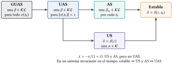{width=90%}

### Uniformidad

::: {.ideaclave}
[La hora de arranque importa]{.caja-titulo}

Para $\dot x=-x/(1+t)$, $x(t)=x_0(1+t_0)/(1+t)$: el tiempo para bajar de $0.1$ es $9(1+t_0)$, es decir $9$ si se arranca en $t_0=0$ y $909$ si se arranca en $t_0=100$. El origen es uniformemente estable y asintóticamente estable, pero **no** uniformemente asintóticamente estable.
:::

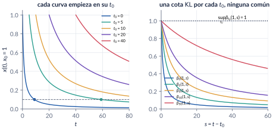{width=95%}

::: {.teorema}
[Uniformidad con funciones de comparación (Khalil, Lema 4.5)]{.caja-titulo}

El origen es UAS si y solo si existen $\beta\in\mathcal{KL}$ y $c>0$, **independientes de $t_0$**, con $\|x(t)\|\le\beta(\|x(t_0)\|,t-t_0)$ para todo $t\ge t_0\ge0$ y $\|x(t_0)\|<c$; GUAS si vale para todo $x(t_0)$.
:::

::: {.trampa}
[Trampa: "$re^{-sr}$ decae a cero, luego es de clase $\mathcal{KL}$"]{.caja-titulo}

Para $s>0$ tiene un máximo en $r=1/s$: una condición inicial más grande recibiría una cota más pequeña. Hay que revisar las dos variables: estrictamente creciente en $r$, decreciente a cero en $s$.
:::

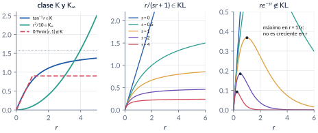{width=95%}

### Lyapunov con $V(t,x)$

::: {.teorema}
[Khalil, Teoremas 4.8–4.10]{.caja-titulo}

Si $W_1(x)\le V(t,x)\le W_2(x)$ ($V$ definida positiva y **decreciente**) y $\dot V=\partial V/\partial t+\nabla V\cdot f\le-W_3(x)$, el origen es UAS; con $W_1$ radialmente no acotada, GUAS. Con $k_1\|x\|^a\le V\le k_2\|x\|^a$ y $\dot V\le-k_3\|x\|^a$, $\|x(t)\|\le(k_2/k_1)^{1/a}\|x(t_0)\|e^{-\frac{k_3}{ak_2}(t-t_0)}$.
:::

::: {.trampa}
[Trampa: "$\dot V=\nabla V\cdot f$, como siempre"]{.caja-titulo}

Con $\dot x=-x/10$ y $V=(2+\sin t)x^2$, olvidar $\partial V/\partial t$ da $\dot V<0$ siempre; la derivada correcta, $(\cos t-0.2(2+\sin t))x^2$, vale $0.6x^2>0$ en $t=0$.
:::

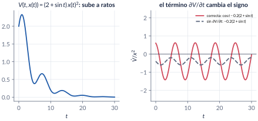{width=95%}

::: {.trampa}
[Trampa: "$V>0$ y $\dot V<0$, luego asintóticamente estable"]{.caja-titulo}

$\dot x=-x/(1+t)^2$ con $V=x^2$: $\dot V=-2x^2/(1+t)^2<0$ fuera del origen, y $x(t)\to x_0e^{-1/(1+t_0)}\neq0$ ($0.368$ con $t_0=0$, $0.913$ con $t_0=10$). Hace falta $\dot V\le-W_3(x)$ con $W_3$ **independiente de $t$**.
:::

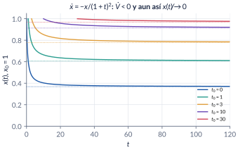{width=70%}

### Ejemplos y sistemas lineales variantes

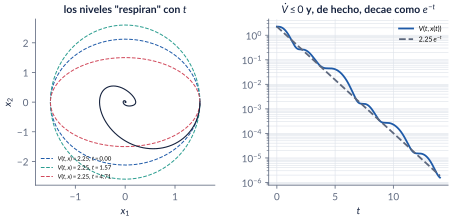{width=95%}

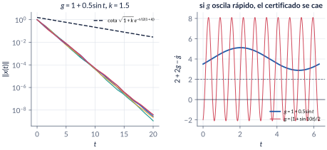{width=95%}

::: {.trampa}
[Trampa: "si $A(t)$ es Hurwitz para cada $t$, el sistema es estable"]{.caja-titulo}

Markus–Yamabe: los valores propios de $A(t)$ son $-\frac14\pm j\frac{\sqrt7}{4}$ para todo $t$, y $\Phi(t,0)$ tiene la columna $e^{t/2}(\cos t,-\sin t)$: desde $(1,0)$, $\|x(t)\|=e^{t/2}$.
:::

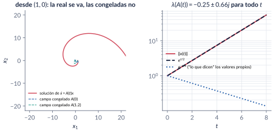{width=95%}

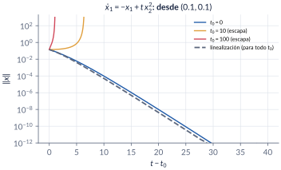{width=80%}

### Cuando $\dot V$ es solo semidefinida

::: {.receta}
[LaSalle–Yoshizawa y Barbalat]{.caja-titulo}

1. Con $V$ definida positiva y decreciente y $\dot V\le-W(x)\le0$: las soluciones están acotadas y $W(x(t))\to0$.
2. Derive la variable que ya converge; si su derivada segunda está acotada, Barbalat da que su derivada tiende a cero.
3. Lea la variable que falta de la ecuación. En Mathieu: $(2+\sin t)x_1=-\dot x_2-x_2\to0$.
:::

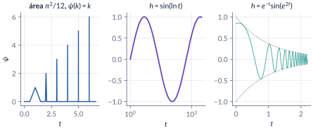{width=95%}

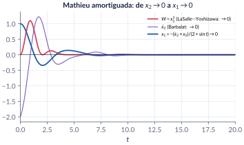{width=85%}

### Inestabilidad

::: {.teorema}
[Chetaev (Khalil, Teorema 4.3)]{.caja-titulo}

Si $V(0)=0$, $V$ toma valores positivos arbitrariamente cerca del origen y $\dot V>0$ en $U=\{x\in\bar B_r:V(x)>0\}$, el origen es inestable. Para $\dot x=f(t,x)$: con $V$ decreciente, $\dot V\ge W(x)$ definida positiva (primer teorema) o $\dot V-\lambda V\ge0$ (segundo teorema).
:::

::: {.trampa}
[Trampa: "inestable quiere decir que se va a infinito"]{.caja-titulo}

En van der Pol el origen es inestable y todas las soluciones están acotadas: terminan en el ciclo, con $1.53\le\|x\|\le2.83$. Desde $(\delta,0)$ la solución sale de $B_1$ en $t\approx2\ln(1/\delta)$, por pequeño que sea $\delta$.
:::

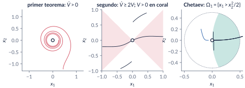{width=95%}

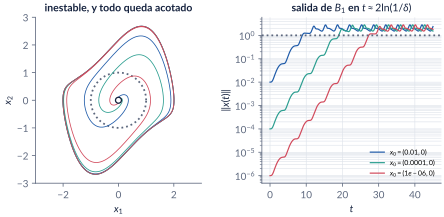{width=95%}

## Explorador interactivo {#explorador}

Tres pestañas. Todo se calcula en su navegador (Runge–Kutta de paso fijo), con los mismos modelos de `C9_Ej1`–`C9_Ej11`.

```{=html}
<div class="explorador" id="explorador-variantes"></div>
<script src="../recursos/explorador-variantes.js"></script>
```

::: {.pausa}
[Retos con el explorador]{.caja-titulo}

1. **Hora de arranque:** con $a(t)=1/(1+t)$, ¿cuánto tarda la curva azul con $t_0=300$? Cambie a $2+\sin t$: ¿depende ahora de $t_0$?
2. **Hora de arranque:** con $a(t)=1/(1+t)^2$, ¿a dónde llega cada curva? ¿Por qué $\dot V<0$ no basta?
3. **Lineales periódicos:** en Markus–Yamabe, baje $a$ desde $1.5$. ¿Para qué $a$ el multiplicador cruza $1$? ¿Cambian los valores propios congelados?
4. **Lineales periódicos:** en Mathieu, ponga $b=0$ y busque valores de $k_0$ y $k_1$ con $|\mu|>1$ (resonancia paramétrica). ¿Qué hace la solución?
5. **Lineales periódicos:** en la ganancia variable, mueva $\omega$. ¿Hay algún $\omega$ que la vuelva inestable? Compare con la condición $\dot g\le g$.
6. **Inestabilidad:** en Chetaev con $V=x_1$, ¿dónde están las celdas coral? Láncelas desde allí: ¿sale la solución de la bola de todos modos?
7. **Inestabilidad:** en el segundo teorema, lance soluciones desde la zona donde $V<0$. ¿Qué pasa con $V$?
:::

## Códigos de esta parte

Los bloques salen directamente de los archivos del [repositorio](https://github.com/quijanon-bot/NQuijano.github.io/tree/main/fuentes/curso-sisnl/codigo/cap09_variantes). Ejecute antes `iniciarCurso`. `verificarCap09` comprueba los números del capítulo (52/52). Ningún script necesita toolboxes.

::: {.panel-tabset}

### Uniformidad y comparación

**El tiempo de asentamiento $9(1+t_0)$ (§9.2).**

```{.matlab include="../../codigo/cap09_variantes/C9_Ej1_TiempoInicial.m" marca="tiempoinicial"}
```

**Las dos condiciones de la clase $\mathcal{KL}$ (§9.3).**

```{.matlab include="../../codigo/cap09_variantes/C9_Ej2_FuncionesComparacion.m" marca="comparacion"}
```

### Lyapunov con V(t,x)

**$\dot V$ con y sin $\partial V/\partial t$ (§9.4).**

```{.matlab include="../../codigo/cap09_variantes/C9_Ej3_DerivadaParcial.m" marca="derivada"}
```

**La trampa de $\dot V<0$ (§9.4).**

```{.matlab include="../../codigo/cap09_variantes/C9_Ej4_TrampaE1.m" marca="trampae1"}
```

### Ejemplos

**Mathieu: $\dot V$, la constante $c$ y Floquet (§9.5).**

```{.matlab include="../../codigo/cap09_variantes/C9_Ej5_Mathieu.m" marca="mathieu"}
```

**Ganancia variable (§9.5).**

```{.matlab include="../../codigo/cap09_variantes/C9_Ej6_GananciaVariable.m" marca="ganancia"}
```

**Markus–Yamabe (§9.5).**

```{.matlab include="../../codigo/cap09_variantes/C9_Ej7_MarkusYamabe.m" marca="markus"}
```

**La linealización no uniforme (§9.5).**

```{.matlab include="../../codigo/cap09_variantes/C9_Ej8_Linealizacion.m" marca="linealizacion"}
```

### V̇ semidefinida

**Tres trampas sobre señales (§9.6).**

```{.matlab include="../../codigo/cap09_variantes/C9_Ej12_Senales.m" marca="pulsos"}
```

**LaSalle–Yoshizawa y Barbalat en la Mathieu amortiguada (§9.6).**

```{.matlab include="../../codigo/cap09_variantes/C9_Ej9_MathieuBarbalat.m" marca="yoshizawa"}
```

### Inestabilidad

**Las tres $\dot V$ y la cota de Chetaev (§9.7).**

```{.matlab include="../../codigo/cap09_variantes/C9_Ej10_Inestabilidad.m" marca="inestabilidad"}
```

**Van der Pol: inestable y acotado (§9.7).**

```{.matlab include="../../codigo/cap09_variantes/C9_Ej11_VanDerPol.m" marca="vdp"}
```

### Simulink

El modelo se **construye por código**: ejecute el script y se crea y se simula.

**`MathieuAmortiguada.slx`: el resorte con rigidez periódica y un medidor de $V(t,x)$ y $\dot V$.**

```{.matlab include="../../codigo/cap09_variantes/crearModelo_MathieuAmortiguada.m"}
```

:::

## Videos

Los videos están publicados (generados con `herramientas/cap09_videos.py`, los mismos modelos y parámetros); los scripts `C9_Video_*` de MATLAB producen la misma animación para grabarla en su computador.

| Video | Qué muestra | Script |
|:--|:--|:--|
| [V9.1 · Misma condición inicial, distinta hora de arranque](../videos/V9_1_tiempo_inicial.mp4) | Cuatro arranques de $\dot x=-x/(1+t)$ y sus tiempos de asentamiento $9(1+t_0)$. | `C9_Video_TiempoInicial.m` |
| [V9.2 · Los niveles respiran](../videos/V9_2_mathieu.mp4) | Mathieu amortiguada: el nivel $V(t,x)$ cambia de forma y la solución entra. | `C9_Video_Mathieu.m` |
| [V9.3 · Los campos congelados atraen](../videos/V9_3_markus_yamabe.mp4) | Markus–Yamabe: el campo de cada instante atrae; la solución real se escapa como $e^{t/2}$. | `C9_Video_MarkusYamabe.m` |
| [V9.4 · La región de Chetaev](../videos/V9_4_cetaev.mp4) | Soluciones que nacen en $U=\{x_1>x_2^2/2\}$ cada vez más cerca del origen: todas salen de la bola. | `C9_Video_Chetaev.m` |

```{=html}
<video controls preload="metadata" style="width:100%;max-width:820px;border-radius:8px" src="../videos/V9_3_markus_yamabe.mp4"></video>
```

## Problemas

Los problemas del capítulo (§9.9) tienen cada uno una trampa; las soluciones seleccionadas están en §9.10 y las respuestas a las pausas al final del capítulo.

---

**Nota de transparencia.** En la redacción de este capítulo y en la escritura y corrección de los códigos que lo acompañan se contó con la asistencia de Claude, un modelo de inteligencia artificial desarrollado por Anthropic. El contenido fue revisado y validado por el autor, quien asume la responsabilidad por lo aquí expuesto.
