```{=html}
<div class="franja"><div class="rotulo">Parte 10 · Semanas 11–12</div><div class="titulo">Más allá de la estabilidad asintótica: UUB, conversos, CLF, Barbalat e ISS</div><div class="cita">Corren tiempos raros. El arte siempre está fuera de lugar. Siempre es innecesario cuando surge. Y después, al mirar atrás, resulta que era lo único importante. — Daniel Kehlmann</div><svg class="fase" viewBox="0 0 600 160" preserveAspectRatio="xMaxYMid slice"><ellipse cx="430" cy="80" rx="30" ry="15" stroke="#ffffff" stroke-opacity=".10" fill="none"/><ellipse cx="430" cy="80" rx="60" ry="30" stroke="#ffffff" stroke-opacity=".10" fill="none"/><ellipse cx="430" cy="80" rx="90" ry="45" stroke="#ffffff" stroke-opacity=".10" fill="none"/><ellipse cx="430" cy="80" rx="120" ry="60" stroke="#ffffff" stroke-opacity=".10" fill="none"/><ellipse cx="430" cy="80" rx="150" ry="75" stroke="#ffffff" stroke-opacity=".10" fill="none"/><ellipse cx="430" cy="80" rx="180" ry="90" stroke="#ffffff" stroke-opacity=".10" fill="none"/><ellipse cx="430" cy="80" rx="210" ry="105" stroke="#ffffff" stroke-opacity=".10" fill="none"/><ellipse cx="430" cy="80" rx="240" ry="120" stroke="#ffffff" stroke-opacity=".10" fill="none"/><polyline points="580.0,80.0 578.7,84.5 577.0,88.9 574.7,93.2 571.9,97.4 568.6,101.4 564.9,105.4 560.8,109.2 556.2,112.9 551.2,116.3 545.9,119.6 540.2,122.8 534.2,125.7 527.9,128.4 521.3,130.9 514.5,133.2 507.4,135.3 500.2,137.1 492.8,138.7 485.3,140.1 477.6,141.3 469.9,142.2 462.2,142.8 454.4,143.3 446.7,143.5 439.0,143.4 431.4,143.2 423.8,142.7 416.4,142.0 409.1,141.1 402.0,139.9 395.1,138.6 388.4,137.1 382.0,135.3 375.8,133.4 369.9,131.4 364.3,129.2 359.0,126.8 354.0,124.3 349.3,121.7 345.1,118.9 341.1,116.0 337.6,113.1 334.4,110.1 331.6,107.0 329.2,103.8 327.2,100.6 325.6,97.4 324.4,94.1 323.6,90.9 323.2,87.6 323.2,84.4 323.6,81.1 324.4,78.0 325.5,74.8 327.0,71.8 328.8,68.8 331.0,65.9 333.5,63.0 336.3,60.3 339.5,57.7 342.9,55.2 346.6,52.8 350.5,50.5 354.7,48.4 359.1,46.4 363.7,44.6 368.5,42.9 373.4,41.4 378.5,40.0 383.7,38.8 389.0,37.8 394.3,36.9 399.8,36.2 405.2,35.7 410.7,35.3 416.2,35.1 421.7,35.1 427.1,35.2 432.5,35.5 437.7,35.9 442.9,36.5 448.0,37.3 452.9,38.2 457.7,39.2 462.4,40.4 466.8,41.7 471.1,43.1 475.1,44.6 479.0,46.3 482.6,48.0 485.9,49.8 489.1,51.8 491.9,53.7 494.5,55.8 496.9,57.9 499.0,60.1 500.7,62.3 502.3,64.6 503.5,66.9 504.4,69.2 505.1,71.5 505.5,73.8 505.6,76.1 505.4,78.4 505.0,80.6 504.3,82.9 503.3,85.0 502.1,87.2 500.7,89.3 499.0,91.3 497.0,93.3 494.9,95.2 492.6,97.0 490.0,98.7 487.3,100.3 484.4,101.8 481.3,103.3 478.1,104.6 474.8,105.8 471.3,107.0 467.8,108.0 464.1,108.9 460.4,109.6 456.6,110.3 452.8,110.8 448.9,111.3 445.0,111.6 441.2,111.7 437.3,111.8 433.4,111.8 429.6,111.6 425.9,111.3 422.2,110.9 418.5,110.4 415.0,109.8 411.6,109.1 408.3,108.4 405.1,107.5 402.0,106.5 399.1,105.4 396.3,104.3 393.7,103.1 391.2,101.8 389.0,100.5 386.9,99.1 385.0,97.7 383.2,96.2 381.7,94.6 380.4,93.1 379.2,91.5 378.3,89.9 377.5,88.3 377.0,86.6 376.6,85.0 376.5,83.4 376.5,81.7 376.8,80.1 377.2,78.5 377.8,77.0 378.6,75.5 379.6,74.0 380.7,72.5 382.0,71.1 383.5,69.8 385.1,68.5 386.9,67.2 388.7,66.0 390.8,64.9 392.9,63.9 395.1,62.9 397.4,62.0 399.9,61.2 402.3,60.5 404.9,59.8 407.5,59.2 410.2,58.7 412.9,58.3 415.6,58.0 418.4,57.7 421.1,57.6 423.9,57.5 426.6,57.5 429.3,57.6 432.0,57.8 434.6,58.0 437.2,58.3 439.7,58.7 442.2,59.2 444.5,59.7 446.8,60.3 449.0,61.0 451.2,61.7 453.2,62.5 455.0,63.3 456.8,64.2 458.5,65.2 460.0,66.1 461.4,67.1 462.7,68.2 463.8,69.2 464.8,70.3 465.7,71.5 466.4,72.6 467.0,73.7 467.4,74.9 467.7,76.1 467.9,77.2 467.9,78.4 467.7,79.5 467.5,80.6 467.1,81.7 466.6,82.8 465.9,83.9 465.2,84.9 464.3,85.9 463.3,86.9 462.2,87.8 461.0,88.7 459.7,89.6 458.3,90.4 456.8,91.2 455.3,91.9 453.6,92.5 452.0,93.1 450.2,93.7 448.4,94.1 446.6,94.6 444.7,94.9 442.8,95.3 440.9,95.5 438.9,95.7 437.0,95.8 435.0,95.9 433.1,95.9 431.2,95.9 429.3,95.8 427.4,95.6 425.6,95.4 423.8,95.2 422.0,94.9 420.3,94.5 418.7,94.1 417.1,93.6 415.6,93.1 414.1,92.6 412.7,92.0 411.5,91.4 410.3,90.8 409.1,90.1 408.1,89.4 407.2,88.6 406.3,87.9 405.6,87.1 405.0,86.3 404.4,85.5 404.0,84.7 403.6,83.9 403.4,83.1 403.2,82.3 403.2,81.5 403.2,80.6 403.4,79.8 403.6,79.0 404.0,78.3 404.4,77.5 404.9,76.8 405.5,76.0 406.2,75.4 406.9,74.7 407.7,74.0 408.6,73.4 409.6,72.8 410.6,72.3 411.7,71.8 412.8,71.3 414.0,70.9 415.2,70.5 416.5,70.1 417.8,69.8 419.1,69.5 420.5,69.3 421.8,69.1 423.2,68.9 424.6,68.8 425.9,68.7 427.3,68.7 428.7,68.7 430.0,68.8 431.4,68.9 432.7,69.0 434.0,69.2 435.2,69.4 436.4,69.6 437.6,69.9 438.8,70.2 439.8,70.6 440.9,70.9 441.9,71.3 442.8,71.8 443.7,72.2 444.5,72.7 445.2,73.2 445.9,73.7 446.5,74.2 447.1,74.8 447.6,75.3 448.0,75.9 448.3,76.5 448.6,77.0 448.8,77.6 448.9,78.2 449.0,78.8 449.0,79.3 448.9,79.9 448.7,80.5 448.5,81.0 448.2,81.6 447.9,82.1 447.5,82.6 447.0,83.1 446.5,83.6 446.0,84.1 445.3,84.5 444.7,84.9 444.0,85.3 443.2,85.7 442.4,86.0 441.6,86.4 440.8,86.6 439.9,86.9 439.0,87.1 438.0,87.4 437.1,87.5 436.1,87.7 435.2,87.8 434.2,87.9 433.2,87.9 432.3,88.0 431.3,88.0 430.3,88.0 429.4,87.9 428.4,87.8 427.5,87.7 426.6,87.6 425.8,87.4 424.9,87.2 424.1,87.0 423.3,86.8 422.6,86.5 421.8,86.2 421.2,85.9 420.5,85.6 419.9,85.3 419.4,84.9 418.9,84.6 418.4,84.2 418.0,83.8 417.7,83.5 417.4,83.1 417.1,82.7 416.9,82.3 416.7,81.8 416.6,81.4 416.6,81.0 416.6,80.6 416.6,80.2 416.7,79.8 416.8,79.4 417.0,79.0 417.2,78.6 417.5,78.3 417.8,77.9 418.2,77.6 418.6,77.2 419.0,76.9 419.4,76.6 419.9,76.3 420.4,76.1 421.0,75.8 421.6,75.6 422.2,75.4 422.8,75.2 423.4,75.0 424.1,74.8 424.7,74.7 425.4,74.6 426.1,74.5 426.8,74.4 427.5,74.4 428.2,74.4 428.8,74.3 429.5,74.4 430.2,74.4 430.9,74.4 431.5,74.5 432.2,74.6 432.8,74.7 433.4,74.8 434.0,75.0" stroke="#E09F3E" stroke-width="2.5" fill="none"/><circle cx="430" cy="80" r="4" fill="#E09F3E"/></svg></div>
```

La teoría de Lyapunov de las partes 7 a 9 responde una sola pregunta: si hay un equilibrio, ¿las soluciones se quedan cerca y llegan a él? Esta parte responde otras cinco. ¿Qué se garantiza **sin equilibrio** (acotamiento último)? Si no encuentro una $V$, ¿es porque no existe (**teoremas conversos**)? ¿Cómo se **diseña** una entrada con una $V$ (**funciones de control de Lyapunov** y la fórmula de Sontag)? ¿Qué converge en un sistema **variante en el tiempo** con $\dot V\le0$ (**Barbalat**)? ¿Y qué pasa con **entradas** y con sistemas **interconectados** (**ISS** y pequeña ganancia)? Casi todo sale del mismo argumento: si $V$ decrece fuera de un conjunto, las trayectorias quedan atrapadas en el menor conjunto de nivel de $V$ que lo contiene.

```{=html}
<div class="botones">
  <a class="boton" href="../pdf/cap10_avanzada.pdf">⬇ Capítulo en PDF</a>
  <a class="boton sec" href="https://github.com/quijanon-bot/NQuijano.github.io/tree/main/fuentes/curso-sisnl/codigo/cap10_avanzada">Códigos en GitHub</a>
  <a class="boton sec" href="#explorador">Explorador interactivo</a>
</div>
```

::: {.receta}
[Al terminar esta parte usted podrá]{.caja-titulo}

1. Garantizar acotamiento y acotamiento último uniforme (UB, UUB) cuando no hay equilibrio, con el argumento de los dos conjuntos de nivel, y calcular la cota última que de verdad garantiza el teorema.
2. Explicar qué entrega un teorema converso de Lyapunov según la hipótesis (exponencial, asintótica, solo estable) y usar sus cotas para probar robustez frente a perturbaciones.
3. Decidir si una función es de control de Lyapunov, diseñar con la fórmula universal de Sontag y reconocer cuándo no existe una realimentación continua (Artstein, control pequeño, Brockett).
4. Usar el lema de Barbalat en sistemas variantes en el tiempo, verificando la continuidad uniforme con una derivada acotada, y saber qué concluye y qué no.
5. Probar estabilidad entrada–estado con funciones ISS-Lyapunov, robustecer un diseño con amortiguamiento $L_gV$ y analizar cascadas y retroalimentaciones con la condición de pequeña ganancia.
:::

## Ruta de las clases

| Semana | Qué se ve | Capítulo | Scripts |
|:--|:--|:--|:--|
| 11 (21 de octubre) | Acotamiento último: el ejemplo que se resuelve, el argumento de los conjuntos de nivel, el teorema y sus trampas | §10.1–10.2 | `C10_Ej1`, `C10_Ej2` |
| 12 (26 de octubre) | Conversos (energía futura, robustez, estable sin $V(x)$); funciones de control de Lyapunov | §10.3–10.4 | `C10_Ej3`–`C10_Ej8` |
| 12 (28 de octubre) | CLF e ISS: Sontag, estabilizar contra robustecer, cascadas y pequeña ganancia; Barbalat como lectura | §10.4–10.7 | `C10_Ej9`–`C10_Ej15`, `crearModelo_RedisenoISS` |

: Lea la sección del capítulo **antes** de cada clase. Se usan la estabilidad de Lyapunov de la [parte 7](07-lyapunov.qmd) y el lema de comparación de la [parte 3](03-preliminares.qmd); las funciones de comparación y la estabilidad uniforme son del capítulo 9, y aquí se recuerda lo indispensable. {.striped}

## Lo esencial, en una página

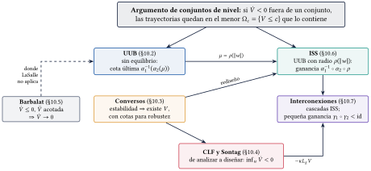{width=92%}

::: {.ideaclave}
[“Existe $u$” contra “para todo $w$”]{.caja-titulo}

En las CLF, $u$ es un control que se **diseña**: la pregunta es si *existe* un $u$ que haga bajar a $V$. En ISS, $w$ es una entrada que se **sufre**: la pregunta es si el estado queda acotado *para toda* $w$ acotada. Por eso se escriben con letras distintas.
:::

### Acotamiento último

::: {.teorema}
[Teorema de acotamiento último (Khalil, Teorema 4.18)]{.caja-titulo}

Si $\alpha_1(\|x\|)\le V(t,x)\le\alpha_2(\|x\|)$ y $\dot V\le-W_3(x)$ para $\|x\|\ge\mu$, las soluciones terminan, en un tiempo que no depende de $t_0$, dentro de la bola de radio $b=\alpha_1^{-1}(\alpha_2(\mu))$.
:::

::: {.trampa}
[Trampa: "la cota última es $\mu$"]{.caja-titulo}

$V$ decrece fuera de $B_\mu$, pero lo que no se abandona es un **conjunto de nivel**, y el menor que contiene a $B_\mu$ llega hasta $\alpha_1^{-1}(\alpha_2(\mu))\ge\mu$. En el oscilador $A=[0\ 1;\,-4\ -0.2]$ con $|w|\le0.2$: $\mu=2.50$ y $b=5.01$; una trayectoria que nace en $(2.45,0)$, dentro de $B_\mu$, sube hasta $\|x\|=4.50$ sin salir nunca de $\Omega_\eta$.
:::

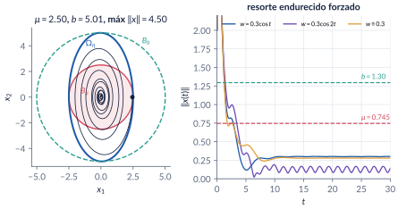{width=95%}

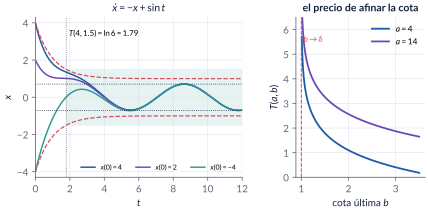{width=95%}

### Conversos

::: {.trampa}
[Trampa: "el converso me da la $V$"]{.caja-titulo}

Las pruebas construyen $V$ **integrando las soluciones** (la energía futura $\int_t^\infty\|x\|^2$), justo lo que se quería evitar. El converso sirve para razonar: su cota $\|\partial V/\partial x\|\le c_4\|x\|$ garantiza que la estabilidad exponencial sobrevive a perturbaciones con $\|g_p\|\le\nu\|x\|$, $\nu<c_3/c_4$ ($0.276$ en el ejemplo, contra un margen real de $1$ para una perturbación particular).
:::

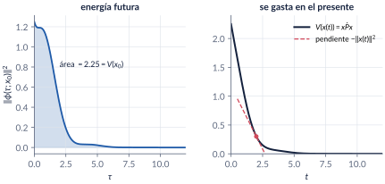{width=90%}

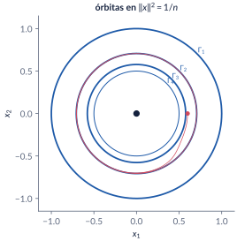{width=50%}

### CLF y la fórmula de Sontag

::: {.definicion}
[Fórmula universal de Sontag]{.caja-titulo}

Si $V$ es CLF para $\dot x=f(x)+g(x)u$ ($L_gV=0\Rightarrow L_fV<0$), la ley $u=-\big(L_fV+\sqrt{(L_fV)^2+(L_gV)^4}\big)/L_gV$ da $\dot V=-\sqrt{(L_fV)^2+(L_gV)^4}<0$. Es continua en el origen si y solo si hay **control pequeño** (Artstein). No gasta control donde la deriva ayuda.
:::

::: {.trampa}
[Trampa: "si el estado llega a cero, el control también"]{.caja-titulo}

En $\dot x=\cos x-x^3+u$, $f(0)=1\neq0$: el control en régimen es $u^*=-1$. Sontag arranca con $u(0)=0.17$ desde $x(0)=2$; la linealización exacta, con $6.42$.
:::

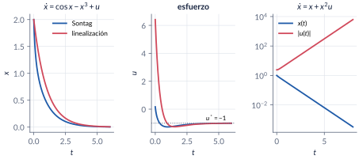{width=95%}

### Barbalat

::: {.trampa}
[Trampa: "la integral es finita, luego $W(x(t))\to0$"]{.caja-titulo}

Pulsos de altura $k$ y base $1/k^3$: área total $\pi^2/12$ y alturas sin cota. Falta la **continuidad uniforme**, que se verifica mostrando que la derivada está acotada. Con ella, Barbalat da $\dot V\to0$, una conclusión parcial: en el control adaptativo el error converge, pero el parámetro solo si hay excitación persistente.
:::

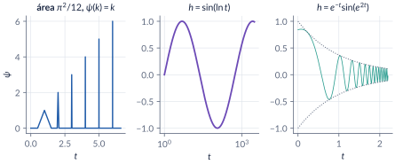{width=95%}

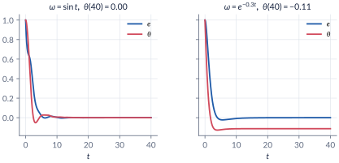{width=90%}

### ISS e interconexiones

::: {.teorema}
[ISS es UUB con un radio que depende de la entrada]{.caja-titulo}

Si $\dot V\le-W_3(x)$ siempre que $\|x\|\ge\rho(\|w\|)$, el sistema es ISS con ganancia $\gamma=\alpha_1^{-1}\circ\alpha_2\circ\rho$: $\|x(t)\|\le\beta(\|x(t_0)\|,t-t_0)+\gamma(\sup\|w\|)$.
:::

::: {.trampa}
[Trampa: "si el lazo es GES, aguanta perturbaciones pequeñas"]{.caja-titulo}

$\dot x=x+(x^2+1)u$ con $u=-2x/(x^2+1)$ da $\dot x=-x$. Con un error $w\equiv1$ en el actuador escapa en $t=4\pi/(3\sqrt3)=2.42$ **partiendo del equilibrio**; con $w\equiv0.1$, toda condición inicial por encima de $x_+=9.90$ escapa. El arreglo es el amortiguamiento $-L_gV$.
:::

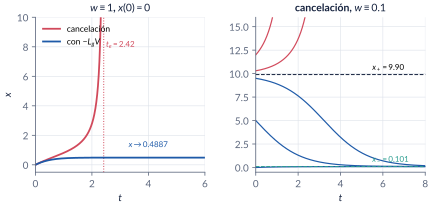{width=95%}

::: {.trampa}
[Trampa: "GAS más GAS da GAS en cascada"]{.caja-titulo}

$\dot x_1=-x_1+x_1^2x_2$, $\dot x_2=-x_2$ escapa en tiempo finito si $x_{10}x_{20}>2$ (en $0.347$ desde $(2,2)$). Hace falta que $x_1$ sea **ISS** respecto a $x_2$. Pero no toda cascada no ISS escapa: $\dot x_1=-x_1+x_1x_2^2$ sube hasta $18.2$ desde $(1,3)$ y vuelve a cero.
:::

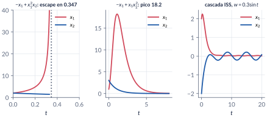{width=95%}

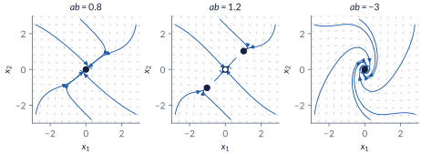{width=95%}

## Explorador interactivo {#explorador}

Cuatro pestañas. Todo se calcula en su navegador (Runge–Kutta de paso fijo), con los mismos modelos de `C10_Ej1`–`C10_Ej15`.

```{=html}
<div class="explorador" id="explorador-avanzada"></div>
<script src="../recursos/explorador-avanzada.js"></script>
```

::: {.pausa}
[Retos con el explorador]{.caja-titulo}

1. **Acotamiento:** con los valores iniciales, ¿sale la trayectoria de $B_\mu$? ¿Y de $\Omega_\eta$? Ponga $W=0$: ¿sigue saliendo de la bola? ¿Por qué?
2. **Acotamiento:** suba el amortiguamiento $c$ a $2$. ¿Qué pasa con la razón $b/\mu$? ¿Y con la excentricidad de $\Omega_\eta$?
3. **Acotamiento:** cambie $\theta$ de $0.5$ a $0.9$. ¿Qué cota mejora? ¿Cambia la trayectoria?
4. **Sontag:** en la planta lineal, ponga $f_0=-5$. ¿Cuánto control gasta Sontag? ¿Y la ley que cancela?
5. **Sontag:** en $x-x^3+u$ desde $x(0)=3$, ¿cuál ley llega antes a $|x|<0.01$? ¿Cuál gasta menos?
6. **Robustecer:** con $w=0.3$ y $x(0)=0$, ¿escapa la cancelación? Suba $x(0)$ hasta que escape. Compare con $x_+$.
7. **Robustecer:** con $w=1$ y $\kappa=0$, ¿sobrevive la ley de Sontag? ¿Y con $\kappa=1$?
8. **Interconexiones:** en la retroalimentación, fije $a=1$ y mueva $b$ de $0.8$ a $1.2$. ¿Qué le pasa al origen? Ahora ponga $b=-3$.
9. **Interconexiones:** en la cascada que escapa, haga clic a ambos lados de la hipérbola $x_1x_2=2$.
:::

## Códigos de esta parte

Los bloques salen directamente de los archivos del [repositorio](https://github.com/quijanon-bot/NQuijano.github.io/tree/main/fuentes/curso-sisnl/codigo/cap10_avanzada). Ejecute antes `iniciarCurso`. `verificarCap10` comprueba los números del capítulo (46/46). Ningún script necesita toolboxes. Una función nueva en `comun/`: `leySontag` (la fórmula universal, también con varias entradas y con el amortiguamiento $\kappa$).

::: {.panel-tabset}

### Acotamiento último

**El ejemplo que se resuelve (§10.2).**

```{.matlab include="../../codigo/cap10_avanzada/C10_Ej1_UUBescalar.m" marca="escalar"}
```

**La bola no es invariante (§10.2).**

```{.matlab include="../../codigo/cap10_avanzada/C10_Ej2_Conjuntos.m" marca="conjuntos"}
```

**El resorte endurecido (§10.2).**

```{.matlab include="../../codigo/cap10_avanzada/C10_Ej2_Conjuntos.m" marca="resorte"}
```

### Conversos

**La energía futura (§10.3).**

```{.matlab include="../../codigo/cap10_avanzada/C10_Ej3_EnergiaFutura.m" marca="energia"}
```

**Estable sin $V(x)$ (§10.3).**

```{.matlab include="../../codigo/cap10_avanzada/C10_Ej4_EstableSinV.m" marca="sinV"}
```

**Robustez frente a perturbaciones que se anulan (§10.3).**

```{.matlab include="../../codigo/cap10_avanzada/C10_Ej5_Robustez.m" marca="robustez"}
```

### CLF y Sontag

**Planta lineal escalar (§10.4).**

```{.matlab include="../../codigo/cap10_avanzada/C10_Ej6_SontagLineal.m" marca="lineal"}
```

**Sontag contra linealización exacta (§10.4).**

```{.matlab include="../../codigo/cap10_avanzada/C10_Ej7_SontagCos.m" marca="sontag"}
```

**Cuando falla el control pequeño (§10.4).**

```{.matlab include="../../codigo/cap10_avanzada/C10_Ej8_ControlPequeno.m" marca="pequeno"}
```

### Barbalat

**Tres trampas sobre señales (§10.5).**

```{.matlab include="../../codigo/cap10_avanzada/C10_Ej9_Barbalat.m" marca="pulsos"}
```

**Control adaptativo (§10.5).**

```{.matlab include="../../codigo/cap10_avanzada/C10_Ej10_Adaptativo.m" marca="adaptativo"}
```

### ISS

**GES con entrada cero no basta (§10.6).**

```{.matlab include="../../codigo/cap10_avanzada/C10_Ej11_ISScontraejemplos.m" marca="contra"}
```

**Ganancia ISS y $\limsup$ (§10.6).**

```{.matlab include="../../codigo/cap10_avanzada/C10_Ej12_ISSenvolvente.m" marca="envolvente"}
```

**Estabilizar no es robustecer (§10.6).**

```{.matlab include="../../codigo/cap10_avanzada/C10_Ej13_RedisenoISS.m" marca="rediseno"}
```

### Interconexiones

**Cascadas (§10.7).**

```{.matlab include="../../codigo/cap10_avanzada/C10_Ej14_Cascadas.m" marca="cascadas"}
```

**Pequeña ganancia (§10.7).**

```{.matlab include="../../codigo/cap10_avanzada/C10_Ej15_PequenaGanancia.m" marca="ganancia"}
```

### Funciones

**`leySontag` (en `comun/`).**

```{.matlab include="../../codigo/comun/leySontag.m"}
```

### Simulink

El modelo se **construye por código**: ejecute el script y se crea y se simula con las tres leyes.

**`RedisenoISS.slx`: la planta $\dot x=x+(x^2+1)(u+w)$ con un selector de ley (cancelación, $-L_gV$, Sontag) y un escalón de error en el actuador.**

```{.matlab include="../../codigo/cap10_avanzada/crearModelo_RedisenoISS.m"}
```

:::

## Videos

Los videos están publicados (generados con `herramientas/cap10_videos.py`, los mismos modelos y parámetros); los scripts `C10_Video_*` de MATLAB producen la misma animación para grabarla en su computador.

| Video | Qué muestra | Script |
|:--|:--|:--|
| [V10.1 · Banda UUB](../videos/V10_1_banda_uub.mp4) | La cota última baja hacia $\delta$ y el tiempo de espera crece sin cota. | `C10_Video_BandaUUB.m` |
| [V10.2 · La bola no es invariante](../videos/V10_2_bola_no_invariante.mp4) | La trayectoria sale de $B_\mu$ y nunca sale de $\Omega_\eta$. | `C10_Video_BolaNoInvariante.m` |
| [V10.3 · Energía futura](../videos/V10_3_energia_futura.mp4) | $V(x(t))=\int_t^\infty\|x\|^2$ y su pendiente $-\|x(t)\|^2$. | `C10_Video_EnergiaFutura.m` |
| [V10.4 · Estabilizar no es robustecer](../videos/V10_4_rediseno_iss.mp4) | Al crecer el error del actuador, la cancelación escapa y el amortiguamiento no. | `C10_Video_RedisenoISS.m` |

```{=html}
<video controls preload="metadata" style="width:100%;max-width:820px;border-radius:8px" src="../videos/V10_4_rediseno_iss.mp4"></video>
```

## Problemas

Los problemas del capítulo (§10.9) tienen cada uno una trampa; las soluciones seleccionadas están en §10.10 y las respuestas a las pausas al final del capítulo.
