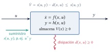
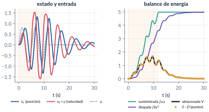
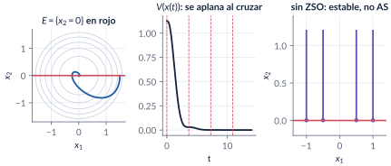
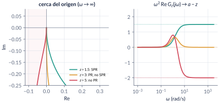
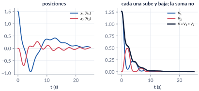
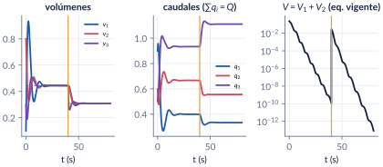

```{=html}
<div class="franja"><div class="rotulo">Parte 11 · Semana 13</div><div class="titulo">Pasividad y disipatividad</div><div class="cita">La vida es un embrollo, Benítez. […] Pero, en cambio, cuando jugás al fútbol todo es clarísimo. — Eduardo Sacheri</div><svg class="fase" viewBox="0 0 600 160" preserveAspectRatio="xMaxYMid slice"><ellipse cx="430" cy="80" rx="30" ry="15" stroke="#ffffff" stroke-opacity=".10" fill="none"/><ellipse cx="430" cy="80" rx="60" ry="30" stroke="#ffffff" stroke-opacity=".10" fill="none"/><ellipse cx="430" cy="80" rx="90" ry="45" stroke="#ffffff" stroke-opacity=".10" fill="none"/><ellipse cx="430" cy="80" rx="120" ry="60" stroke="#ffffff" stroke-opacity=".10" fill="none"/><ellipse cx="430" cy="80" rx="150" ry="75" stroke="#ffffff" stroke-opacity=".10" fill="none"/><ellipse cx="430" cy="80" rx="180" ry="90" stroke="#ffffff" stroke-opacity=".10" fill="none"/><ellipse cx="430" cy="80" rx="210" ry="105" stroke="#ffffff" stroke-opacity=".10" fill="none"/><ellipse cx="430" cy="80" rx="240" ry="120" stroke="#ffffff" stroke-opacity=".10" fill="none"/><polyline points="580.0,80.0 578.7,84.5 577.0,88.9 574.7,93.2 571.9,97.4 568.6,101.4 564.9,105.4 560.8,109.2 556.2,112.9 551.2,116.3 545.9,119.6 540.2,122.8 534.2,125.7 527.9,128.4 521.3,130.9 514.5,133.2 507.4,135.3 500.2,137.1 492.8,138.7 485.3,140.1 477.6,141.3 469.9,142.2 462.2,142.8 454.4,143.3 446.7,143.5 439.0,143.4 431.4,143.2 423.8,142.7 416.4,142.0 409.1,141.1 402.0,139.9 395.1,138.6 388.4,137.1 382.0,135.3 375.8,133.4 369.9,131.4 364.3,129.2 359.0,126.8 354.0,124.3 349.3,121.7 345.1,118.9 341.1,116.0 337.6,113.1 334.4,110.1 331.6,107.0 329.2,103.8 327.2,100.6 325.6,97.4 324.4,94.1 323.6,90.9 323.2,87.6 323.2,84.4 323.6,81.1 324.4,78.0 325.5,74.8 327.0,71.8 328.8,68.8 331.0,65.9 333.5,63.0 336.3,60.3 339.5,57.7 342.9,55.2 346.6,52.8 350.5,50.5 354.7,48.4 359.1,46.4 363.7,44.6 368.5,42.9 373.4,41.4 378.5,40.0 383.7,38.8 389.0,37.8 394.3,36.9 399.8,36.2 405.2,35.7 410.7,35.3 416.2,35.1 421.7,35.1 427.1,35.2 432.5,35.5 437.7,35.9 442.9,36.5 448.0,37.3 452.9,38.2 457.7,39.2 462.4,40.4 466.8,41.7 471.1,43.1 475.1,44.6 479.0,46.3 482.6,48.0 485.9,49.8 489.1,51.8 491.9,53.7 494.5,55.8 496.9,57.9 499.0,60.1 500.7,62.3 502.3,64.6 503.5,66.9 504.4,69.2 505.1,71.5 505.5,73.8 505.6,76.1 505.4,78.4 505.0,80.6 504.3,82.9 503.3,85.0 502.1,87.2 500.7,89.3 499.0,91.3 497.0,93.3 494.9,95.2 492.6,97.0 490.0,98.7 487.3,100.3 484.4,101.8 481.3,103.3 478.1,104.6 474.8,105.8 471.3,107.0 467.8,108.0 464.1,108.9 460.4,109.6 456.6,110.3 452.8,110.8 448.9,111.3 445.0,111.6 441.2,111.7 437.3,111.8 433.4,111.8 429.6,111.6 425.9,111.3 422.2,110.9 418.5,110.4 415.0,109.8 411.6,109.1 408.3,108.4 405.1,107.5 402.0,106.5 399.1,105.4 396.3,104.3 393.7,103.1 391.2,101.8 389.0,100.5 386.9,99.1 385.0,97.7 383.2,96.2 381.7,94.6 380.4,93.1 379.2,91.5 378.3,89.9 377.5,88.3 377.0,86.6 376.6,85.0 376.5,83.4 376.5,81.7 376.8,80.1 377.2,78.5 377.8,77.0 378.6,75.5 379.6,74.0 380.7,72.5 382.0,71.1 383.5,69.8 385.1,68.5 386.9,67.2 388.7,66.0 390.8,64.9 392.9,63.9 395.1,62.9 397.4,62.0 399.9,61.2 402.3,60.5 404.9,59.8 407.5,59.2 410.2,58.7 412.9,58.3 415.6,58.0 418.4,57.7 421.1,57.6 423.9,57.5 426.6,57.5 429.3,57.6 432.0,57.8 434.6,58.0 437.2,58.3 439.7,58.7 442.2,59.2 444.5,59.7 446.8,60.3 449.0,61.0 451.2,61.7 453.2,62.5 455.0,63.3 456.8,64.2 458.5,65.2 460.0,66.1 461.4,67.1 462.7,68.2 463.8,69.2 464.8,70.3 465.7,71.5 466.4,72.6 467.0,73.7 467.4,74.9 467.7,76.1 467.9,77.2 467.9,78.4 467.7,79.5 467.5,80.6 467.1,81.7 466.6,82.8 465.9,83.9 465.2,84.9 464.3,85.9 463.3,86.9 462.2,87.8 461.0,88.7 459.7,89.6 458.3,90.4 456.8,91.2 455.3,91.9 453.6,92.5 452.0,93.1 450.2,93.7 448.4,94.1 446.6,94.6 444.7,94.9 442.8,95.3 440.9,95.5 438.9,95.7 437.0,95.8 435.0,95.9 433.1,95.9 431.2,95.9 429.3,95.8 427.4,95.6 425.6,95.4 423.8,95.2 422.0,94.9 420.3,94.5 418.7,94.1 417.1,93.6 415.6,93.1 414.1,92.6 412.7,92.0 411.5,91.4 410.3,90.8 409.1,90.1 408.1,89.4 407.2,88.6 406.3,87.9 405.6,87.1 405.0,86.3 404.4,85.5 404.0,84.7 403.6,83.9 403.4,83.1 403.2,82.3 403.2,81.5 403.2,80.6 403.4,79.8 403.6,79.0 404.0,78.3 404.4,77.5 404.9,76.8 405.5,76.0 406.2,75.4 406.9,74.7 407.7,74.0 408.6,73.4 409.6,72.8 410.6,72.3 411.7,71.8 412.8,71.3 414.0,70.9 415.2,70.5 416.5,70.1 417.8,69.8 419.1,69.5 420.5,69.3 421.8,69.1 423.2,68.9 424.6,68.8 425.9,68.7 427.3,68.7 428.7,68.7 430.0,68.8 431.4,68.9 432.7,69.0 434.0,69.2 435.2,69.4 436.4,69.6 437.6,69.9 438.8,70.2 439.8,70.6 440.9,70.9 441.9,71.3 442.8,71.8 443.7,72.2 444.5,72.7 445.2,73.2 445.9,73.7 446.5,74.2 447.1,74.8 447.6,75.3 448.0,75.9 448.3,76.5 448.6,77.0 448.8,77.6 448.9,78.2 449.0,78.8 449.0,79.3 448.9,79.9 448.7,80.5 448.5,81.0 448.2,81.6 447.9,82.1 447.5,82.6 447.0,83.1 446.5,83.6 446.0,84.1 445.3,84.5 444.7,84.9 444.0,85.3 443.2,85.7 442.4,86.0 441.6,86.4 440.8,86.6 439.9,86.9 439.0,87.1 438.0,87.4 437.1,87.5 436.1,87.7 435.2,87.8 434.2,87.9 433.2,87.9 432.3,88.0 431.3,88.0 430.3,88.0 429.4,87.9 428.4,87.8 427.5,87.7 426.6,87.6 425.8,87.4 424.9,87.2 424.1,87.0 423.3,86.8 422.6,86.5 421.8,86.2 421.2,85.9 420.5,85.6 419.9,85.3 419.4,84.9 418.9,84.6 418.4,84.2 418.0,83.8 417.7,83.5 417.4,83.1 417.1,82.7 416.9,82.3 416.7,81.8 416.6,81.4 416.6,81.0 416.6,80.6 416.6,80.2 416.7,79.8 416.8,79.4 417.0,79.0 417.2,78.6 417.5,78.3 417.8,77.9 418.2,77.6 418.6,77.2 419.0,76.9 419.4,76.6 419.9,76.3 420.4,76.1 421.0,75.8 421.6,75.6 422.2,75.4 422.8,75.2 423.4,75.0 424.1,74.8 424.7,74.7 425.4,74.6 426.1,74.5 426.8,74.4 427.5,74.4 428.2,74.4 428.8,74.3 429.5,74.4 430.2,74.4 430.9,74.4 431.5,74.5 432.2,74.6 432.8,74.7 433.4,74.8 434.0,75.0" stroke="#E09F3E" stroke-width="2.5" fill="none"/><circle cx="430" cy="80" r="4" fill="#E09F3E"/></svg></div>
```

Un sistema **pasivo** no puede crear energía: lo que almacena nunca supera lo que tenía más lo que ha recibido por su puerto. De ese balance, sin resolver la ecuación diferencial, salen la estabilidad (con observabilidad en estado cero y LaSalle), la lectura en frecuencia (funciones reales positivas y el lema KYP), la estabilidad de interconexiones y una manera de diseñar controladores: agregar amortiguamiento. La parte termina con una prueba completa: la distribución de agua con la dinámica del replicador.

```{=html}
<div class="botones">
  <a class="boton" href="../pdf/cap11_pasividad.pdf">⬇ Handout en PDF</a>
  <a class="boton sec" href="https://github.com/quijanon-bot/NQuijano.github.io/tree/main/fuentes/curso-sisnl/codigo/cap11_pasividad">Códigos en GitHub</a>
  <a class="boton sec" href="#explorador">Explorador interactivo</a>
</div>
```

::: {.receta}
[Al terminar esta parte usted podrá]{.caja-titulo}

1. Escribir el balance de energía de un sistema con puertos y reconocer en él una desigualdad de disipación.
2. Clasificar un sistema como pasivo, sin pérdidas, ISP, OSP o estrictamente pasivo, y decir dónde se disipa la energía.
3. Concluir estabilidad a partir de la pasividad, y saber cuándo hacen falta la observabilidad en estado cero y LaSalle.
4. Decidir si una función de transferencia es PR o SPR, en frecuencia y con el lema KYP.
5. Probar la estabilidad de una interconexión sumando almacenamientos y diseñar por inyección de amortiguamiento y pasivación.
6. Seguir la prueba de estabilidad del reparto de agua con el replicador.
:::

## Ruta de las clases

| Clase | Qué se ve | Handout | Scripts |
|:--|:--|:--|:--|
| 1 | Balance de energía, señales $\Ldos$, disipatividad, almacenamiento disponible, pasividad sin memoria y de modelos de estado, OSP + ZSO + LaSalle | §11.1–11.6 | `C11_Ej1`–`C11_Ej7` |
| 2 | Funciones reales positivas y KYP, interconexión, aplicación al reparto de agua | §11.7, 11.8, 11.10 | `C11_Ej8`–`C11_Ej10`, `C11_Ej13`, `C11_Ej14`, `crearModelo_LazoPasivo`, `crearModelo_Agua` |
| lectura | Control basado en pasividad: amortiguamiento, compensación de gravedad, cascadas | §11.9 | `C11_Ej11`, `C11_Ej12`, `crearModelo_Pendulo` |

: Lea la sección del handout **antes** de cada clase. {.striped}

## Lo esencial, en una página

{width=60%}

::: {.definicion}
[Disipatividad y pasividad (Willems, 1972; Khalil, Def. 6.3)]{.caja-titulo}

El sistema $\dot x=f(x,u)$, $y=h(x,u)$ es **disipativo** respecto a la tasa de suministro $s(u,y)$ si existe $V\ge0$ con
$$
V\bigl(x(t_1)\bigr)\le V\bigl(x(t_0)\bigr)+\int_{t_0}^{t_1}s\,\dif t
\qquad\text{o, si }V\in\Cont1,\qquad \Vdot\le s(u,y)\ \ \forall (x,u).
$$
Es **pasivo** si eso vale con $s=u\T y$. Es OSP si $u\T y\ge\Vdot+y\T\rho(y)$ con $y\T\rho(y)>0$, y estrictamente pasivo si $u\T y\ge\Vdot+\psi(x)$ con $\psi$ definida positiva.
:::

{width=95%}

::: {.trampa}
[Trampa: OSP no basta sin observabilidad en estado cero]{.caja-titulo}

"$\Vdot\le0$ y $\Vdot=0$ solo donde $y=0$; luego $x\to0$." Falso: $\dot x_1=0$, $\dot x_2=-x_2+u$, $y=x_2$ es OSP con $V$ definida positiva, y $x_1$ no se mueve. Lo correcto: **OSP + ZSO ⇒ AS**, por el principio de invarianza.
:::

{width=95%}

::: {.definicion}
[Funciones reales positivas y lema KYP]{.caja-titulo}

$G(s)$ es **SPR** si es Hurwitz, $\Re G(\jw)>0$ para todo $\omega$ y, si $G(\infty)=0$, $\lim_{\omega\to\infty}\omega^2\Re G(\jw)>0$. El lema **KYP**: $G$ es SPR si y solo si existen $P>0$, $L$, $W$, $\epsilon>0$ con
$$
PA+A\T P=-L\T L-\epsilon P,\qquad PB=C\T-L\T W,\qquad W\T W=D+D\T ,
$$
y entonces el sistema es estrictamente pasivo con $V=\tfrac12x\T Px$.
:::

{width=95%}

::: {.ideaclave}
[Interconexión]{.caja-titulo}

En la conexión estándar ($e_1=u_1-y_2$, $e_2=u_2+y_1$) las potencias se cancelan: $e_1\T y_1+e_2\T y_2=u_1\T y_1+u_2\T y_2$. Pasivo con pasivo es pasivo, y $V_1+V_2$ es función de Lyapunov del lazo. Cada almacenamiento puede subir; solo la suma baja.
:::

{width=95%}

::: {.ejemplo}
[Aplicación: reparto de agua con el replicador (Ramírez-Llanos y Quijano, 2010)]{.caja-titulo}

Los tanques son **OSP** (la descarga de Torricelli disipa) y el replicador es **sin pérdidas** con la entropía relativa $V_2=\frac1Q\sum_iq_i^*\ln(q_i^*/q_i)$. La cancelación da $\Vdot\le0$; LaSalle, con los tanques como "observador" de los caudales, da estabilidad asintótica en $\{q_i>0\}$.
:::

{width=95%}

## Explorador interactivo {#explorador}

Cuatro pestañas con los modelos del handout. Los cálculos se hacen en su navegador con Runge–Kutta de paso fijo (los mismos modelos de los scripts `C11_Ej1`, `C11_Ej8`, `C11_Ej10` y `C11_Ej13`).

```{=html}
<div class="explorador" id="explorador-pasividad"></div>
<script src="../recursos/explorador-pasividad.js"></script>
```

::: {.pausa}
[Retos con el explorador]{.caja-titulo}

1. **Balance:** ponga $\delta<0$. ¿Qué término del balance cambia de signo? ¿Sigue siendo pasivo el sistema?
2. **PR/SPR:** con $a=3$, $b=2$, mueva $z$ de $1.5$ a $5$. ¿En qué valor exacto deja de ser SPR? ¿Y de ser PR? Pruebe $z=1$: ¿qué avisa el explorador y por qué?
3. **Interconexión:** cambie la retroalimentación a positiva con $x_1(0)=0.3$. ¿Qué le pasa a $V$?
4. **Agua:** ponga $q_3(0)=0$ y luego $q_3(0)=0.0001$. Compare el tiempo que tarda en llegar al equilibrio.
:::

## Códigos de esta parte

Los bloques salen directamente de los archivos del [repositorio](https://github.com/quijanon-bot/NQuijano.github.io/tree/main/fuentes/curso-sisnl/codigo/cap11_pasividad). Ejecute antes `iniciarCurso`. `verificarCap11` comprueba los números del handout (39/39).

::: {.panel-tabset}

### Clase 1: balance y estabilidad

**Balance de energía a lo largo de una simulación (§11.2).**

```{.matlab include="../../codigo/cap11_pasividad/C11_Ej1_MasaResorte.m" marca="balance"}
```

**Pasivo con pendiente negativa (§11.4).**

```{.matlab include="../../codigo/cap11_pasividad/C11_Ej3_SinMemoria.m" marca="diodo"}
```

**La prueba de que un sistema no es pasivo (§11.5).**

```{.matlab include="../../codigo/cap11_pasividad/C11_Ej6_PasividadLocal.m" marca="local"}
```

**OSP + ZSO + LaSalle (§11.6).**

```{.matlab include="../../codigo/cap11_pasividad/C11_Ej7_LaSalleRLC.m" marca="lasalle"}
```


### Clase 2: frecuencia e interconexión

**La familia $G_z$ y la prueba `esPR` (§11.7).**

```{.matlab include="../../codigo/cap11_pasividad/C11_Ej8_PR_SPR.m" marca="familia"}
```

**Las ecuaciones KYP (§11.7).**

```{.matlab include="../../codigo/cap11_pasividad/C11_Ej9_KYP.m" marca="kyp"}
```

**Dos osciladores en lazo (§11.8).**

```{.matlab include="../../codigo/cap11_pasividad/C11_Ej10_Interconexion.m" marca="lazo"}
```


### Agua

**El modelo, una sola función para scripts y Simulink.**

```{.matlab include="../../codigo/cap11_pasividad/modeloAgua.m"}
```

**Cambio de demanda (§11.10).**

```{.matlab include="../../codigo/cap11_pasividad/C11_Ej13_Agua.m" marca="simulacion"}
```

**La trampa de las caras (§11.10).**

```{.matlab include="../../codigo/cap11_pasividad/C11_Ej14_AguaCaras.m" marca="caras"}
```


### Diseño

**PD con y sin compensación de gravedad (§11.9).**

```{.matlab include="../../codigo/cap11_pasividad/C11_Ej11_ControlPasividad.m" marca="pendulo"}
```

**Escape en tiempo finito de una cascada (§11.9).**

```{.matlab include="../../codigo/cap11_pasividad/C11_Ej12_Cascada.m" marca="escape"}
```


### Simulink

Los modelos se **construyen por código**: ejecute el script y se crea, se simula y se compara con `ode45`.

**`LazoPasivo.slx`: dos osciladores en la conexión estándar, con $V_1$, $V_2$ y $V$ en línea.**

```{.matlab include="../../codigo/cap11_pasividad/crearModelo_LazoPasivo.m"}
```

:::

## Videos

| Video | Qué muestra | Script |
|:--|:--|:--|
| [V11.1 · Balance de energía](../videos/V11_1_balance.mp4) | Energía suministrada, disipada y almacenada de la masa con resorte. | `C11_Video_Balance.m` |
| [V11.2 · LaSalle en el RLC](../videos/V11_2_lasalle.mp4) | La trayectoria toca $\{\Vdot=0\}$ y no se queda. | `C11_Video_LaSalle.m` |
| [V11.3 · De SPR a no PR](../videos/V11_3_nyquist.mp4) | El cero $z$ barre la familia $G_z$. | `C11_Video_Nyquist.m` |
| [V11.4 · Interconexión](../videos/V11_4_interconexion.mp4) | La energía pasa de $H_1$ a $H_2$; la suma solo baja. | `C11_Video_Interconexion.m` |
| [V11.5 · Agua](../videos/V11_5_agua.mp4) | Tanques, caudales y $V$ con cambio de demanda. | `C11_Video_Agua.m` |

## Problemas

Los problemas del handout (§11.12) tienen cada uno una trampa; las soluciones seleccionadas están en §11.13.
