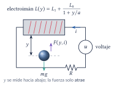
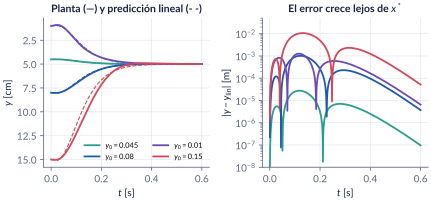
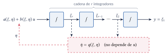
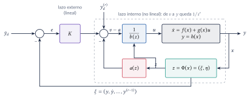
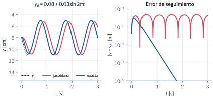
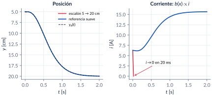
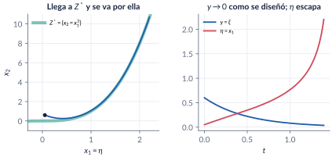
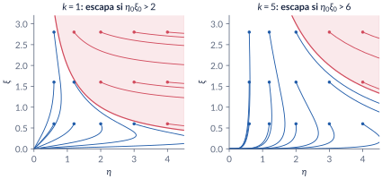

```{=html}
<div class="franja"><div class="rotulo">Parte 12 · Semanas 14–15</div><div class="titulo">Linealización por retroalimentación</div><div class="cita">Cuanto más rico y profundo es el conocimiento parece que se vuelve más contumaz la ignorancia. — Antonio Muñoz Molina</div><svg class="fase" viewBox="0 0 600 160" preserveAspectRatio="xMaxYMid slice"><ellipse cx="430" cy="80" rx="30" ry="15" stroke="#ffffff" stroke-opacity=".10" fill="none"/><ellipse cx="430" cy="80" rx="60" ry="30" stroke="#ffffff" stroke-opacity=".10" fill="none"/><ellipse cx="430" cy="80" rx="90" ry="45" stroke="#ffffff" stroke-opacity=".10" fill="none"/><ellipse cx="430" cy="80" rx="120" ry="60" stroke="#ffffff" stroke-opacity=".10" fill="none"/><ellipse cx="430" cy="80" rx="150" ry="75" stroke="#ffffff" stroke-opacity=".10" fill="none"/><ellipse cx="430" cy="80" rx="180" ry="90" stroke="#ffffff" stroke-opacity=".10" fill="none"/><ellipse cx="430" cy="80" rx="210" ry="105" stroke="#ffffff" stroke-opacity=".10" fill="none"/><ellipse cx="430" cy="80" rx="240" ry="120" stroke="#ffffff" stroke-opacity=".10" fill="none"/><polyline points="580.0,80.0 578.7,84.5 577.0,88.9 574.7,93.2 571.9,97.4 568.6,101.4 564.9,105.4 560.8,109.2 556.2,112.9 551.2,116.3 545.9,119.6 540.2,122.8 534.2,125.7 527.9,128.4 521.3,130.9 514.5,133.2 507.4,135.3 500.2,137.1 492.8,138.7 485.3,140.1 477.6,141.3 469.9,142.2 462.2,142.8 454.4,143.3 446.7,143.5 439.0,143.4 431.4,143.2 423.8,142.7 416.4,142.0 409.1,141.1 402.0,139.9 395.1,138.6 388.4,137.1 382.0,135.3 375.8,133.4 369.9,131.4 364.3,129.2 359.0,126.8 354.0,124.3 349.3,121.7 345.1,118.9 341.1,116.0 337.6,113.1 334.4,110.1 331.6,107.0 329.2,103.8 327.2,100.6 325.6,97.4 324.4,94.1 323.6,90.9 323.2,87.6 323.2,84.4 323.6,81.1 324.4,78.0 325.5,74.8 327.0,71.8 328.8,68.8 331.0,65.9 333.5,63.0 336.3,60.3 339.5,57.7 342.9,55.2 346.6,52.8 350.5,50.5 354.7,48.4 359.1,46.4 363.7,44.6 368.5,42.9 373.4,41.4 378.5,40.0 383.7,38.8 389.0,37.8 394.3,36.9 399.8,36.2 405.2,35.7 410.7,35.3 416.2,35.1 421.7,35.1 427.1,35.2 432.5,35.5 437.7,35.9 442.9,36.5 448.0,37.3 452.9,38.2 457.7,39.2 462.4,40.4 466.8,41.7 471.1,43.1 475.1,44.6 479.0,46.3 482.6,48.0 485.9,49.8 489.1,51.8 491.9,53.7 494.5,55.8 496.9,57.9 499.0,60.1 500.7,62.3 502.3,64.6 503.5,66.9 504.4,69.2 505.1,71.5 505.5,73.8 505.6,76.1 505.4,78.4 505.0,80.6 504.3,82.9 503.3,85.0 502.1,87.2 500.7,89.3 499.0,91.3 497.0,93.3 494.9,95.2 492.6,97.0 490.0,98.7 487.3,100.3 484.4,101.8 481.3,103.3 478.1,104.6 474.8,105.8 471.3,107.0 467.8,108.0 464.1,108.9 460.4,109.6 456.6,110.3 452.8,110.8 448.9,111.3 445.0,111.6 441.2,111.7 437.3,111.8 433.4,111.8 429.6,111.6 425.9,111.3 422.2,110.9 418.5,110.4 415.0,109.8 411.6,109.1 408.3,108.4 405.1,107.5 402.0,106.5 399.1,105.4 396.3,104.3 393.7,103.1 391.2,101.8 389.0,100.5 386.9,99.1 385.0,97.7 383.2,96.2 381.7,94.6 380.4,93.1 379.2,91.5 378.3,89.9 377.5,88.3 377.0,86.6 376.6,85.0 376.5,83.4 376.5,81.7 376.8,80.1 377.2,78.5 377.8,77.0 378.6,75.5 379.6,74.0 380.7,72.5 382.0,71.1 383.5,69.8 385.1,68.5 386.9,67.2 388.7,66.0 390.8,64.9 392.9,63.9 395.1,62.9 397.4,62.0 399.9,61.2 402.3,60.5 404.9,59.8 407.5,59.2 410.2,58.7 412.9,58.3 415.6,58.0 418.4,57.7 421.1,57.6 423.9,57.5 426.6,57.5 429.3,57.6 432.0,57.8 434.6,58.0 437.2,58.3 439.7,58.7 442.2,59.2 444.5,59.7 446.8,60.3 449.0,61.0 451.2,61.7 453.2,62.5 455.0,63.3 456.8,64.2 458.5,65.2 460.0,66.1 461.4,67.1 462.7,68.2 463.8,69.2 464.8,70.3 465.7,71.5 466.4,72.6 467.0,73.7 467.4,74.9 467.7,76.1 467.9,77.2 467.9,78.4 467.7,79.5 467.5,80.6 467.1,81.7 466.6,82.8 465.9,83.9 465.2,84.9 464.3,85.9 463.3,86.9 462.2,87.8 461.0,88.7 459.7,89.6 458.3,90.4 456.8,91.2 455.3,91.9 453.6,92.5 452.0,93.1 450.2,93.7 448.4,94.1 446.6,94.6 444.7,94.9 442.8,95.3 440.9,95.5 438.9,95.7 437.0,95.8 435.0,95.9 433.1,95.9 431.2,95.9 429.3,95.8 427.4,95.6 425.6,95.4 423.8,95.2 422.0,94.9 420.3,94.5 418.7,94.1 417.1,93.6 415.6,93.1 414.1,92.6 412.7,92.0 411.5,91.4 410.3,90.8 409.1,90.1 408.1,89.4 407.2,88.6 406.3,87.9 405.6,87.1 405.0,86.3 404.4,85.5 404.0,84.7 403.6,83.9 403.4,83.1 403.2,82.3 403.2,81.5 403.2,80.6 403.4,79.8 403.6,79.0 404.0,78.3 404.4,77.5 404.9,76.8 405.5,76.0 406.2,75.4 406.9,74.7 407.7,74.0 408.6,73.4 409.6,72.8 410.6,72.3 411.7,71.8 412.8,71.3 414.0,70.9 415.2,70.5 416.5,70.1 417.8,69.8 419.1,69.5 420.5,69.3 421.8,69.1 423.2,68.9 424.6,68.8 425.9,68.7 427.3,68.7 428.7,68.7 430.0,68.8 431.4,68.9 432.7,69.0 434.0,69.2 435.2,69.4 436.4,69.6 437.6,69.9 438.8,70.2 439.8,70.6 440.9,70.9 441.9,71.3 442.8,71.8 443.7,72.2 444.5,72.7 445.2,73.2 445.9,73.7 446.5,74.2 447.1,74.8 447.6,75.3 448.0,75.9 448.3,76.5 448.6,77.0 448.8,77.6 448.9,78.2 449.0,78.8 449.0,79.3 448.9,79.9 448.7,80.5 448.5,81.0 448.2,81.6 447.9,82.1 447.5,82.6 447.0,83.1 446.5,83.6 446.0,84.1 445.3,84.5 444.7,84.9 444.0,85.3 443.2,85.7 442.4,86.0 441.6,86.4 440.8,86.6 439.9,86.9 439.0,87.1 438.0,87.4 437.1,87.5 436.1,87.7 435.2,87.8 434.2,87.9 433.2,87.9 432.3,88.0 431.3,88.0 430.3,88.0 429.4,87.9 428.4,87.8 427.5,87.7 426.6,87.6 425.8,87.4 424.9,87.2 424.1,87.0 423.3,86.8 422.6,86.5 421.8,86.2 421.2,85.9 420.5,85.6 419.9,85.3 419.4,84.9 418.9,84.6 418.4,84.2 418.0,83.8 417.7,83.5 417.4,83.1 417.1,82.7 416.9,82.3 416.7,81.8 416.6,81.4 416.6,81.0 416.6,80.6 416.6,80.2 416.7,79.8 416.8,79.4 417.0,79.0 417.2,78.6 417.5,78.3 417.8,77.9 418.2,77.6 418.6,77.2 419.0,76.9 419.4,76.6 419.9,76.3 420.4,76.1 421.0,75.8 421.6,75.6 422.2,75.4 422.8,75.2 423.4,75.0 424.1,74.8 424.7,74.7 425.4,74.6 426.1,74.5 426.8,74.4 427.5,74.4 428.2,74.4 428.8,74.3 429.5,74.4 430.2,74.4 430.9,74.4 431.5,74.5 432.2,74.6 432.8,74.7 433.4,74.8 434.0,75.0" stroke="#E09F3E" stroke-width="2.5" fill="none"/><circle cx="430" cy="80" r="4" fill="#E09F3E"/></svg></div>
```

Hasta aquí, cada herramienta de diseño fue una función de energía. Esta parte cambia de filosofía: buscar un **cambio de coordenadas** y una **realimentación** que vuelvan **lineal** un sistema no lineal, de manera exacta, y luego usar todo lo que se sabe de control lineal. Funciona para sistemas afines en la entrada, y tiene tres precios que hay que saber pagar: una parte del sistema queda invisible desde la salida (la **dinámica cero**), la cancelación exige conocer el modelo y la ley puede pedir esfuerzos infinitos.

```{=html}
<div class="botones">
  <a class="boton" href="../pdf/cap12_linealizacion.pdf">⬇ Capítulo en PDF</a>
  <a class="boton sec" href="https://github.com/quijanon-bot/NQuijano.github.io/tree/main/fuentes/curso-sisnl/codigo/cap12_linealizacion">Códigos en GitHub</a>
  <a class="boton sec" href="#explorador">Explorador interactivo</a>
</div>
```

::: {.receta}
[Al terminar esta parte usted podrá]{.caja-titulo}

1. Diseñar un controlador sobre la linealización jacobiana, con y sin acción integral, y decir qué garantiza y qué no.
2. Calcular derivadas de Lie, reconocer un difeomorfismo local (y uno que no es global) y escribir un sistema afín en coordenadas nuevas.
3. Calcular el grado relativo de una salida, reconocer los puntos donde no está definido y llevar el sistema a la forma normal.
4. Diseñar la ley que linealiza el mapa de la entrada a la salida, y un lazo externo lineal para estabilizar y para seguir referencias.
5. Calcular la dinámica cero, decidir si un sistema es de fase mínima y concluir estabilidad local; saber qué más hace falta para un resultado global.
6. Reconocer los límites de la cancelación: singularidades, error de modelo, no linealidades que ayudan.
:::

## Ruta de las clases

| Clase | Qué se ve | Capítulo | Scripts |
|:--|:--|:--|:--|
| 1 | Levitador: diseño sobre la jacobiana y control integral. Cancelar en vez de aproximar (péndulo). Derivadas de Lie, difeomorfismos, grado relativo, forma normal | §12.1–12.6 | `C12_Ej1`–`C12_Ej7` |
| 2 | Linealización entrada–salida y lazo externo. Levitador exacto: seguimiento, singularidad, robustez. Dinámica cero, fase mínima, estabilidad local y global, puente con pasividad | §12.7–12.10 | `C12_Ej8`–`C12_Ej12`, `crearModelo_LevitadorFL` |

: Lea la sección del capítulo **antes** de cada clase. {.striped}

## Lo esencial, en una página

{width=55%}

::: {.trampa}
[Trampa: "diseñé los polos; la respuesta es la que calculé"]{.caja-titulo}

Sobre la linealización jacobiana, $u=u^*-K(x-x^*)$ da estabilidad **local**: el teorema no dice desde dónde converge ni cuánto se parece la respuesta a la lineal. Con el mismo $K$, la esfera que empieza a 4.5 cm sigue la predicción lineal con un error de $3\times10^{-5}$ m; la que empieza a 15 cm se separa 1 cm y pide 30 V.
:::

{width=95%}

::: {.definicion}
[Derivada de Lie y grado relativo]{.caja-titulo}

Para $\dot x=f(x)+g(x)u$, $y=h(x)$: $L_f\lambda=\frac{\partial\lambda}{\partial x}f$ es la derivada de $\lambda$ a lo largo de las soluciones (para una función de Lyapunov, $\dot V=L_fV$). El sistema tiene **grado relativo** $r$ en $x^o$ si $L_gL_f^ih\equiv0$ cerca de $x^o$ para $i\le r-2$ y $L_gL_f^{r-1}h(x^o)\neq0$: es el número de veces que hay que derivar $y$ para que aparezca $u$,
$$y^{(r)}=L_f^rh(x)+L_gL_f^{r-1}h(x)\,u .$$
En un sistema lineal, $r$ es el exceso de polos sobre ceros de $G(s)$.
:::

::: {.trampa}
[Trampa: el grado relativo puede no existir]{.caja-titulo}

En el levitador con $y$ = posición, $r=3$, pero $L_gL_f^2h\propto i$: en corriente cero el grado relativo no está definido. No es un detalle matemático: el electroimán solo atrae, y sin corriente la entrada no mueve la aceleración.
:::

{width=80%}

::: {.teorema}
[Linealización entrada–salida (Isidori, §4.2)]{.caja-titulo}

En coordenadas $z=\Phi(x)=(\xi,\eta)$, con $\xi=(h,L_fh,\dots,L_f^{r-1}h)$ y $L_g\eta=0$, el sistema es $\dot\xi_1=\xi_2,\ \dots,\ \dot\xi_r=a(z)+b(z)u$, $\dot\eta=q(\xi,\eta)$, $y=\xi_1$. La ley
$$u=\frac{1}{L_gL_f^{r-1}h(x)}\Bigl[-L_f^rh(x)+v\Bigr]$$
deja $y^{(r)}=v$: de $v$ a $y$, una cadena de $r$ integradores. Con $v=y_d^{(r)}-K(\xi-\bar y_d)$, la salida sigue a $y_d$ exponencialmente.
:::

{width=95%}

{width=95%}

::: {.trampa}
[Trampa: la ley exacta no lleva la esfera a cualquier parte]{.caja-titulo}

Un escalón de 5 a 20 cm pide caer más rápido que $g$; la ley apaga la corriente en 20 ms, $b(x)\to0$ y $u\to\infty$. Hay que planificar una referencia alcanzable (con un filtro $6^4/(s+6)^4$ la corriente nunca baja de 6 A). Y exacta no es robusta: con la masa equivocada, la ley exacta sola queda **peor** que la jacobiana (1.96 cm contra 1.03 cm); el integrador lo arregla.
:::

{width=95%}

::: {.definicion}
[Dinámica cero y fase mínima (Byrnes e Isidori)]{.caja-titulo}

Forzar $y\equiv0$ obliga a $\xi\equiv0$ y a $u=-a(0,\eta)/b(0,\eta)$; lo que queda libre es la **dinámica cero** $\dot\eta=q(0,\eta)$, la restricción de $f+gu^*$ a $Z^*=\{h=L_fh=\dots=L_f^{r-1}h=0\}$. Si su equilibrio es asintóticamente estable, el sistema es de **fase mínima**. En un sistema lineal, sus valores propios son los ceros de $G(s)$.
:::

::: {.trampa}
[Trampa: si $y\to0$, el sistema está estabilizado]{.caja-titulo}

Para $\dot x_1=x_1+x_2$, $\dot x_2=3x_1^2x_2+x_1+u$, $y=-x_1^3+x_2$, la ley linealizante lleva $y$ a cero como $e^{-2t}$. Pero la dinámica cero es $\dot\eta=\eta+\eta^3$: la trayectoria cae a $\{x_2=x_1^3\}$, se desliza por ella y escapa en tiempo finito.
:::

{width=95%}

::: {.trampa}
[Trampa: la dinámica cero "no es del sistema"]{.caja-titulo}

No depende de las coordenadas ni de la realimentación: no se puede cambiar con control. Sí depende de **la salida**: van der Pol con $y=x_1$ no tiene dinámica cero; con $y=x_1^2+x_2$ tiene $\dot\eta=-\eta^2$ y no es de fase mínima.
:::

::: {.teorema}
[Estabilidad: local y global]{.caja-titulo}

Si la dinámica cero es **exponencialmente** estable, la ley linealizante con $v=-K\xi$ estabiliza localmente (el jacobiano del lazo es triangular por bloques). Para un resultado **global** no basta que la dinámica cero sea globalmente estable: hace falta que $\dot\eta=q(\xi,\eta)$ sea ISS respecto a $\xi$. Y un sistema se puede volver pasivo por realimentación si y solo si tiene grado relativo uno y es de fase mínima débil (Byrnes, Isidori y Willems).
:::

{width=95%}

::: {.trampa}
[Trampa: linealizar es cancelar todo]{.caja-titulo}

En $\dot x=x-x^3+u$, cancelar $-x^3$ (con $u=x^3-2x$) pide $u(0)=21$ desde $x(0)=3$ y gasta 12.7 veces más energía de control que $u=-2x$, que conserva el término que ya estabilizaba, para converger **más lento**.
:::

## Explorador interactivo {#explorador}

Cuatro pestañas con los modelos del capítulo. Todo se calcula en su navegador con Runge–Kutta de paso fijo (los mismos modelos de `C12_Ej3`, `C12_Ej9`, `C12_Ej10`, `C12_Ej11` y `C12_Ej12`).

```{=html}
<div class="explorador" id="explorador-linealizacion"></div>
<script src="../recursos/explorador-linealizacion.js"></script>
```

::: {.pausa}
[Retos con el explorador]{.caja-titulo}

1. **Péndulo:** con la meta en 180°, ponga â = 8. ¿Queda error permanente? Ahora mueva la meta a 90°. ¿Por qué cambia la respuesta?
2. **Péndulo:** suba el polo doble a 6. ¿Qué le pasa a la ley jacobiana desde la posición colgante? ¿Y a la exacta?
3. **Levitador:** suba la frecuencia hasta que la aceleración pedida pase de $g$. ¿Qué le pasa a la corriente de la ley exacta?
4. **Levitador:** con la masa real en 0.12 kg, ¿cuál ley sigue mejor? ¿Por qué la exacta no queda perfecta?
5. **Dinámica cero:** en el caso lineal, mueva los parámetros hasta que $\alpha+\beta$ cambie de signo. ¿Cambia $y$? ¿Qué cambia?
6. **Escape sin ISS:** con $k=1$, busque la frontera del escape. Suba $k$ a 8: ¿desaparece la región que escapa?
:::

## Códigos de esta parte

Los bloques salen directamente de los archivos del [repositorio](https://github.com/quijanon-bot/NQuijano.github.io/tree/main/fuentes/curso-sisnl/codigo/cap12_linealizacion). Ejecute antes `iniciarCurso`. `verificarCap12` comprueba los números del capítulo (37/37). Ningún script necesita toolboxes: la ubicación de polos usa `ubicarPolos` (fórmula de Ackermann, en `comun/`).

::: {.panel-tabset}

### Clase 1: jacobiana e integral

**Equilibrio y linealización del levitador (§12.2).**

```{.matlab include="../../codigo/cap12_linealizacion/C12_Ej1_LevitadorJacobiano.m" marca="equilibrio"}
```

**La promesa lineal contra la planta (§12.2).**

```{.matlab include="../../codigo/cap12_linealizacion/C12_Ej1_LevitadorJacobiano.m" marca="comparacion"}
```

**Una carga que el modelo no conoce: control integral (§12.2).**

```{.matlab include="../../codigo/cap12_linealizacion/C12_Ej2_ControlIntegral.m" marca="carga"}
```

**El péndulo: cancelar contra aproximar (§12.3).**

```{.matlab include="../../codigo/cap12_linealizacion/C12_Ej3_PenduloExacto.m" marca="disenos"}
```

### Clase 1: herramientas

**Derivada de Lie: fórmula contra derivada medida (§12.4).**

```{.matlab include="../../codigo/cap12_linealizacion/C12_Ej4_DerivadasLie.m" marca="vdp"}
```

**Jacobiano no singular, función no inyectiva (§12.4).**

```{.matlab include="../../codigo/cap12_linealizacion/C12_Ej5_Difeomorfismos.m" marca="local"}
```

**Grado relativo: parámetros de Markov (§12.5).**

```{.matlab include="../../codigo/cap12_linealizacion/C12_Ej6_GradoRelativo.m" marca="markov"}
```

**La forma normal es el mismo sistema (§12.6).**

```{.matlab include="../../codigo/cap12_linealizacion/C12_Ej7_FormaNormal.m" marca="isidori"}
```

### Clase 2: levitador exacto

**La ley exacta (función).**

```{.matlab include="../../codigo/cap12_linealizacion/leyExactaLevitador.m"}
```

**Van der Pol linealizado (§12.7).**

```{.matlab include="../../codigo/cap12_linealizacion/C12_Ej8_VanDerPolFL.m" marca="ley"}
```

**Seguimiento: exacta contra jacobiana (§12.8).**

```{.matlab include="../../codigo/cap12_linealizacion/C12_Ej9_LevitadorExacto.m" marca="seguimiento"}
```

**La singularidad y la referencia suave (§12.8).**

```{.matlab include="../../codigo/cap12_linealizacion/C12_Ej9_LevitadorExacto.m" marca="suave"}
```

**Error de modelo e integrador (§12.8).**

```{.matlab include="../../codigo/cap12_linealizacion/C12_Ej9_LevitadorExacto.m" marca="robustez"}
```

### Clase 2: dinámica cero

**La salida converge, el estado escapa (§12.9).**

```{.matlab include="../../codigo/cap12_linealizacion/C12_Ej10_FaseNoMinima.m" marca="escape"}
```

**La dinámica cero son los ceros (§12.9).**

```{.matlab include="../../codigo/cap12_linealizacion/C12_Ej11_DinamicaCero.m" marca="lineal"}
```

**Escape sin ISS (§12.10).**

```{.matlab include="../../codigo/cap12_linealizacion/C12_Ej12_Global.m" marca="iss"}
```

**No cancelar lo que ayuda (§12.10).**

```{.matlab include="../../codigo/cap12_linealizacion/C12_Ej12_Global.m" marca="nocancelar"}
```

### Simulink

El modelo se **construye por código**: ejecute el script y se crea, se simula y se compara con `ode45`.

**`LevitadorFL.slx`: la ley exacta en un bloque MATLAB Function, con referencia filtrada y masa real ajustable.**

```{.matlab include="../../codigo/cap12_linealizacion/crearModelo_LevitadorFL.m"}
```

:::

## Videos

Los videos se generan con los scripts de la tabla (MATLAB, `VideoWriter`).

| Video | Qué muestra | Script |
|:--|:--|:--|
| V12.1 · Levitador | Dos levitadores siguen la misma referencia: jacobiana y exacta. | `C12_Video_Levitador.m` |
| V12.2 · Fase no mínima | La trayectoria cae a $Z^*$ y se va por ella; $y\to0$ mientras el control explota. | `C12_Video_FaseNoMinima.m` |
| V12.3 · Dinámica cero | En una superficie de dimensión dos, fase mínima contra fase no mínima. | `C12_Video_DinamicaCero.m` |
| V12.4 · Difeomorfismo | Una deformación global contra una función con jacobiano no singular que da dos vueltas. | `C12_Video_Difeomorfismo.m` |

## Problemas

Los problemas del capítulo (§12.12) tienen cada uno una trampa; las soluciones seleccionadas están en §12.13 y las respuestas a las pausas al final del capítulo.
